# Astro

**English | [中文](README.md)**

[](https://pkg.go.dev/github.com/starainrt/astro)

A personal astronomy library developed over years for calendrical-astronomy hobby work.

> 📚 This project is mainly for learning and validating astronomical algorithms. The results are intended for serious amateur use.

The implementation follows *Astronomical Algorithms*; the covered scope is listed in [Highlights](#highlights) below.

The Sun and planets use built-in VSOP87-style analytical terms, while the Moon uses a built-in truncated ELP2000/82-style analytical series. No external JPL ephemeris files are required.

Unless noted otherwise, coordinates are apparent-of-date coordinates. Angles are in degrees, apparent diameters and semidiameters are in arcseconds, and distances use the unit implied by the function name, usually `AU` or `km`.

## Contents

- [Install](#install)
- [Highlights](#highlights)
- [Package Overview](#package-overview)
- [Scope And Accuracy](#scope-and-accuracy)
- [Quick Start](#quick-start)
  - [Calendar And Solar Terms](#calendar-and-solar-terms)
  - [Sun And Moon](#sun-and-moon)
  - [Lite Sun And Moon](#lite-sun-and-moon)
  - [Lunar Occultations](#lunar-occultations)
  - [Event Maps And GeoJSON](#event-maps-and-geojson)
  - [Planets](#planets)
  - [Stars](#stars)
  - [Coordinate Tools](#coordinate-tools)
  - [Formula Helpers](#formula-helpers)
  - [Generic Small-Body Orbits](#generic-small-body-orbits)
  - [Sundial And Apparent Solar Time](#sundial-and-apparent-solar-time)
- [Implemented](#implemented)
- [TODO](#todo)

## Install

```bash
go get github.com/starainrt/astro
```

## Highlights

- 📅 Calendar conversion between Gregorian dates and the traditional Chinese lunisolar calendar, from 721 BCE through 3000 CE, including solar terms
- 🌞 Solar position, rise/set, Earth distance, apparent solar time, apparent altitude, parallactic angle, solar `P/B0/L0`, apparent diameter
- 🌙 Lunar position, rise/set, Earth distance, phase, new/full/quarter times, apparent diameter, bright-limb angle, parallactic angle, geocentric/topocentric libration, apsides, nodes, maximum declination
- 🪶 `lite/sun` and `lite/moon` lightweight approximation chains for watches, frontends, mini programs, and other resource-constrained environments, covering sky position, rise/set, and phase
- 🌗 Global and local solar/lunar eclipses, solar central paths, partial footprints, visible local lunar eclipses, Saros metadata, local diagrams, and global visibility-map SVGs
- 🌘 Point-source stellar and finite-disk planetary lunar occultations, with fixed-site contacts, global paths, geometric greatest points, and SVG output
- 🗺️ GeoJSON for solar eclipses, lunar eclipses, and lunar occultations, including timed paths and optional time-marker points; border-free global SVG maps support equirectangular and polar projections
- 🪐 Seven major planets with positions, rise/set, conjunction/opposition/station events, quadratures, elongations, Mercury/Venus geocentric transits, nodes, phase, apparent magnitude, apparent diameter, parallactic angle, and physical ephemerides
- ⭐ A built-in catalog of 9100 stars plus constellation lookup, proper-motion propagation, rise/set, parallactic angle, and apparent altitude
- 🧭 Coordinate transforms, topocentric coordinates, sidereal time, precession, nutation, angular distance, refraction, airmass, parallactic angle, and Galactic coordinates
- 🔭 Standalone formulas for blackbody radiation, synodic periods, photometry, telescope limiting magnitude, stellar radius/temperature/luminosity relations, and airmass models
- ☄️ Generic heliocentric two-body orbit propagation for asteroids, comets, and hypothetical objects, including phase/photometry helpers and visual-binary position solving
- 🕰️ Apparent/mean solar time, solar hour angle, mean-time/zone-time hour-angle helpers, planar-sundial geometry, and equatorial/horizontal/vertical dial helpers

## Package Overview

| Package | What it provides |
| --- | --- |
| `calendar` | Gregorian/lunisolar conversion, solar terms, historical era names, old-calendar metadata |
| `coord` | Ecliptic/equatorial/horizontal transforms, sidereal time, precession, nutation, topocentric helpers, refraction, airmass, parallactic angle, Galactic coordinates, and research helpers with manual obliquity/hour angle |
| `sun` | Solar position, rise/set, twilight, equation of time, apparent solar time, apparent altitude, parallactic angle, diameter, solar `P/B0/L0` |
| `moon` | Lunar position, rise/set, phases, new/full/quarter times, apparent altitude, parallactic angle, diameter, bright-limb angle, geocentric/topocentric libration, apsides, nodes, maximum declination, and stellar/planetary lunar occultations with global paths |
| `lite/sun` / `lite/moon` | Lightweight Sun/Moon approximation chains for minute-level rise/set, lightweight sky position, and lunar-phase work |
| `eclipse` / `eclipse/svg` | Global/local solar and lunar eclipses, solar central paths, partial footprints, local visibility filtering, Saros metadata, local diagrams, and global visibility-map SVGs |
| `moon/svg` | Fixed-site stellar/planetary lunar-occultation disk charts and projected global maps with bands, center lines, and time labels |
| `geojson` | RFC 7946 encoding for existing solar-eclipse, lunar-eclipse, and lunar-occultation geographic results |
| `mercury` / `venus` | Positions, rise/set, conjunctions, stations, elongations, geocentric transits, phase, parallactic angle, magnitude, diameter, nodes, physical ephemerides |
| `mars` / `jupiter` / `saturn` / `uranus` / `neptune` | Positions, rise/set, conjunction/opposition, stations, quadratures, phase, parallactic angle, magnitude, diameter, nodes, physical ephemerides |
| `earth` | Earth orbital eccentricity, perihelion, aphelion |
| `star` | Constellation lookup, star catalog, proper motion / precession / nutation correction, stellar rise/set, parallactic angle, apparent altitude |
| `formula` | Date-independent astronomy and olympiad-style formulas, including pure airmass models |
| `orbit` | Generic heliocentric conic propagation for elliptical, near-parabolic, parabolic, and hyperbolic orbits, plus phase/photometry helpers and a lightweight visual-binary solver |
| `sundial` | Apparent/mean solar time, solar hour angle, mean-time/zone-time hour-angle helpers, planar geometry, time-line and declination-curve sampling, equatorial/horizontal/vertical dial helpers |

Some entry points also provide `...N` truncated variants:

- `n < 0`: use all built-in terms embedded in this repository
- `n >= 0`: truncate the series, useful for performance comparisons, rough estimates, or algorithm studies

"All built-in terms" means the table entries shipped inside this package. It does not mean the complete original external VSOP/ELP long tables.

## Scope And Accuracy

### Sun and planets

The Sun and planets use built-in VSOP87 analytical terms. The current table entries cover roughly 4000 years around J2000. The table below lists truncation errors relative to the complete VSOP87 tables:

| Target | Longitude / latitude | Distance |
| --- | --- | --- |
| Sun / Earth | about `0.1"` | about `0.1 x 10^-6 AU` |
| Mercury, Venus | about `0.2"` | about `0.2 x 10^-6 AU` |
| Mars | about `0.5"` | about `1 x 10^-6 AU` |
| Jupiter | about `0.5"` | about `3 x 10^-6 AU` |
| Saturn | about `0.5"` | about `5 x 10^-6 AU` |
| Uranus | about `1"` | about `20 x 10^-6 AU` |
| Neptune | about `1"` | about `40 x 10^-6 AU` |

This is suitable for ordinary calendrical work, observing support, outreach, and personal research; spacecraft navigation, precise occultation prediction, and strict dynamical integration fall outside that range and usually need a professional ephemeris such as JPL DE.

### Moon

The Moon uses a built-in truncated ELP2000/82-style analytical series. The package stays lightweight and does not require external ephemeris files.

It is suitable for Chinese-calendar new moons, lunar phases, rise/set, lunar eclipses, amateur occultation prediction, and ordinary positional work; extremely high-precision lunar laser ranging, long-term physical libration, and professional occultation work fall outside that range and are best served by JPL or a dedicated lunar ephemeris.

The four principal phases keep the historical pinyin names and also expose English aliases:

- `ShuoYue` / `NewMoon`
- `WangYue` / `FullMoon`
- `ShangXianYue` / `FirstQuarter`
- `XiaXianYue` / `LastQuarter`

The matching `Next*`, `Last*`, and `Closest*` helpers are available in both naming styles.

### Lite lightweight chains

`lite/sun` and `lite/moon` are independent approximation chains. They do not depend on the VSOP87 or ELP2000/82 series used by `sun` / `moon`, and are intended for CPU- or memory-constrained environments.

- `lite/sun`: simplified true/apparent solar longitude formulas plus lightweight equatorial conversion
- `lite/moon`: Schlyter-style lunar approximation with about 15 perturbation terms plus lightweight topocentric correction
- rise/set search: fixed-step scanning plus bisection, without the high-precision nutation iteration used by the main chain
- zero heap allocation in the computation path (0 allocs/op); against the main chain, pure evaluation entry points such as position and phase run about `8.3-27.3x` faster, and rise/set entry points about `1.0-3.7x`

| Package | Position model | Rise/set search | Main use |
| --- | --- | --- | --- |
| `lite/sun` | simplified true/apparent solar longitude plus lightweight equatorial conversion | `30 min` scan plus bisection | sunrise/sunset, solar altitude, watch faces, frontend refresh loops |
| `lite/moon` | Schlyter / vFPS lunar approximation plus lightweight topocentric correction | `15 min` scan plus bisection | moonrise/moonset, lunar phase, lunar age, lightweight lunar observing helpers |

Error against the `sun` / `moon` packages (year 2026, 8 observing sites; rise/set sampled every 7 or 15 days, phase/age every 6 hours):

| Capability | Mean absolute error | P95 | Max absolute error | Notes |
| --- | --- | --- | --- | --- |
| `lite/sun` sunrise | `0.02 min` | `0.04 min` | `0.31 min` | no event-existence mismatch in the sample set |
| `lite/sun` sunset | `0.02 min` | `0.06 min` | `0.35 min` | `2` high-latitude samples differ only in day-attribution semantics across midnight |
| `lite/moon` moonrise | `0.28 min` | `0.57 min` | `1.44 min` | no event-existence mismatch in the sample set |
| `lite/moon` moonset | `0.36 min` | `0.86 min` | `1.24 min` | `1` high-latitude sample differs on whether the moonset belongs to the same civil day |
| `lite/moon` `Phase()` | `0.00089` | `0.00185` | `0.00243` | compared with `moon.Phase` |
| `lite/moon` `PhaseAge()` | `0.003 d` | `0.010 d` | `0.014 d` | about 4.3 min mean, 14.4 min P95, 20.2 min max |
| `lite/moon` geocentric longitude | `2.41'` | `6.82'` | `9.91'` | relative to the main lunar chain |
| `lite/moon` geocentric latitude | `0.87'` | `1.83'` | `2.92'` | relative to the main lunar chain |

`Go testing.Benchmark` reference values (single-machine measurements, for reference only; absolute values vary with hardware):

The measurements use 2026-01-01 20:00 CST, Shanghai (`121.4737°E, 31.2304°N`), `height=0`, `aero=true`, and take the median of 3 runs; each benchmark is warmed up once, so lazy-loading caches and first-call allocations stay out of the steady-state per-call cost.

| Entry point | Main chain | `lite` | Speedup | Main-chain allocation | `lite` allocation |
| --- | --- | --- | --- | --- | --- |
| `Sun ApparentRaDec` | `5.888 µs/op` | `215.6 ns/op` | `27.3x` | `0 B/op, 0 allocs/op` | `0 B/op, 0 allocs/op` |
| `Sun Altitude` | `5.955 µs/op` | `625.9 ns/op` | `9.5x` | `0 B/op, 0 allocs/op` | `0 B/op, 0 allocs/op` |
| `Sun RiseTime` | `95.847 µs/op` | `25.648 µs/op` | `3.7x` | `0 B/op, 0 allocs/op` | `0 B/op, 0 allocs/op` |
| `Moon ApparentRaDec` | `16.520 µs/op` | `1.006 µs/op` | `16.4x` | `0 B/op, 0 allocs/op` | `0 B/op, 0 allocs/op` |
| `Moon Phase` | `15.139 µs/op` | `917.7 ns/op` | `16.5x` | `0 B/op, 0 allocs/op` | `0 B/op, 0 allocs/op` |
| `Moon Altitude` | `9.533 µs/op` | `1.150 µs/op` | `8.3x` | `0 B/op, 0 allocs/op` | `0 B/op, 0 allocs/op` |
| `Moon RiseTime` | `120.545 µs/op` | `118.037 µs/op` | `1.0x` | `0 B/op, 0 allocs/op` | `0 B/op, 0 allocs/op` |

The main-chain/`lite` gap depends on the scenario: pure evaluation entry points (position, phase) run about `8.3-27.3x` faster in `lite`, while rise/set entry points narrow to `1.0-3.7x` because both sides perform a time search (`Moon RiseTime` is nearly level). The speedup ratios come from a same-machine comparison and are affected by hardware less than the absolute values are.

Use the main `sun` / `moon` chains for eclipses, physical libration, or high-latitude edge cases.

### Accuracy references

The following entry points have been checked against JPL Horizons, NASA GSFC, IMCCE, and other public references; use them to judge the order of magnitude to expect:

- apparent diameters of the Sun, planets, and Moon: maximum differences from the external baseline range from `0.000002"` to `0.194598"` depending on the body; the Moon is the most sensitive because of parallax and distance changes
- solar physical ephemerides `P/B0/L0`: maximum differences are about `0.003349° / 0.003986° / 0.047394°`
- planetary rise, transit, and set: checked against JPL Horizons Time-Varying Hourly (TVH) events; that baseline is generated at a 1-minute step, and current results align with the Horizons event times at the minute level
- Moon rise/set: `aero=true` uses dynamic standard refraction and the instantaneous lunar semidiameter for an upper-limb crossing. Across 14 sea-level events at 7 sites, the current mean/maximum differences against JPL Horizons DE441 are about `0.30s / 0.75s`.
- Moon rise/set with other conventions: mean/maximum differences are about `38.77s / 76.22s` against MET Norway's fixed `-0.8333°` convention. Against IMCCE Miriade, whose horizon convention is not exposed, the mean is about `2m13.46s`; the grazing `61°N` sample reaches about `6m41.82s`.
- Earth perihelion and aphelion: maximum time difference about `1m28.84s`, maximum distance difference about `0.000000039837 AU`
- main-chain lunar position: the current algorithm is a truncated ELP2000/82-style analytical series; across four JPL/Horizons `JDTT` samples in year `-2000`, the maximum difference from JPL/Horizons is about `219.6"` in longitude, `25.8"` in latitude, and `34.3 km` in distance
- Moon perigee and apogee: maximum time difference about `15m53.45s`, maximum distance difference about `39.758 km`
- maximum lunar declination: maximum time difference about `2.43s`, maximum declination difference about `0.00006431°`

The README examples are illustrative. The repository tests contain the exact baselines.

## Quick Start

### Calendar And Solar Terms

The `calendar` package converts between Gregorian dates and the traditional Chinese lunisolar calendar, and exposes solar terms. The supported range is from 721 BCE through 3000 CE; 104 BCE is the calendar-table switch point. The calendar is lunisolar in the strict sense, but public function names use `Lunar` for readability and convention.

For historical input, Chinese era names stay in Chinese. This is part of the API surface, because historical Chinese dates are normally written that way.

#### Calendar notes

- **Default routing**: the package selects by year automatically. The pre-Qin range uses reconstructed Chunqiu and ancient-six-calendar systems, `-220..-104` uses the Qin/Han Zhuanxu calendar, `-103..1912` uses calendar tables, and `1913` onward uses the modern algorithm.
- **Explicit ancient calendars**: use APIs such as `SolarToLunarWithCalendar` / `LunarToSolarWithCalendar` when a specific ancient calendar system is required.
- **Data sources**: ancient-calendar support mainly references 《寿星天文历》; [Professor ytliu0's ChineseCalendar data](https://ytliu0.github.io/ChineseCalendar/index_simp.html) is used for validation. The modern range follows GB/T 33661-2017 and uses VSOP87/ELP computations for solar terms and new moons.
- **Solar terms**: `JieQi` returns modern astronomical solar-term instants; `CalendricalJieQi` returns calendar-compatible solar-term dates.

#### Usage notes

##### 1. One Gregorian date may map to several lunisolar dates
In periods when several regimes coexisted with different calendars (the Three Kingdoms, for example), one Gregorian date can map to several lunisolar dates. The package returns every conversion it can determine.

##### 2. One lunisolar date may map to several Gregorian dates
Rival calendars are not the only cause: one regime can produce the same effect during a calendar reform. After Wu Zetian's reform, for example, the third year of Shengli had two twelfth months.

##### 3. Gregorian calendar rules
All computation goes through Julian Days. The Gregorian side follows these rules:
- after `1582-10-15`: Gregorian calendar
- before `1582-10-04`: Julian calendar
- before year 8 CE: proleptic Julian calendar
- the day after `1582-10-04` is `1582-10-15`
- `1582-10-05` through `1582-10-14` do not exist and the corresponding entry points reject them
- year numbering: year `0` is 1 BCE, year `-1` is 2 BCE, and so on

##### 4. Time zone
The package targets the Chinese calendar, so solar terms and new moons are computed in Beijing time (UTC+8) by default. Applying Chinese lunisolar rules in another time zone can shift dates.

For exploration and research, the lower-level `Solar` and `Lunar` methods convert between the Gregorian and lunisolar calendars under a **custom time zone**, following the **current Chinese calendar algorithm (GB/T 33661-2017)**.
For standard conversions in Beijing time, use the wrapped `SolarToLunar` and `LunarToSolar` methods.

**Example**: the calendar rules require the winter solstice to fall in the eleventh lunisolar month. For the 1984 winter solstice:
```go
ws := calendar.JieQi(1984, 270)
fmt.Println(ws)
fmt.Println(moon.ClosestShuoYue(ws))
```

| Event | UTC+8 | UTC+7 |
| --- | --- | --- |
| Winter solstice | 1984-12-22 | 1984-12-21 |
| New moon | 1984-12-22 | 1984-12-22 |

In UTC+8 (China), 1984-12-22 is both the winter solstice and the new moon, so it is the first day of the eleventh lunisolar month; in UTC+7 the solstice moves up to 12-21, which makes 12-22 the first day of the twelfth month.

Chinese New Year shifts the same way. The Gregorian date of the first day of the first lunisolar month of 1985 is February 20 in UTC+8 and January 21 in UTC+7:
```go
fmt.Println(calendar.Solar(1985, 1, 1, false, 8.0))
fmt.Println(calendar.Solar(1985, 1, 1, false, 7.0))
```

##### 5. Go-specific note

⚠️ Go's standard-library `time.Time` differs from this package in calendar handling:

- Before 1582-10-15 Go uses the proleptic Gregorian calendar rather than the Julian calendar. Without `Add`, it generally works as expected.
- So **before 1582-10-15, `time.Time.Weekday()` does not agree with this package**:
  for 1582-10-04 this package reports Thursday, Go reports Monday.

#### Suggested solutions
To obtain the weekday this package uses:

```go
// date should be the local midnight of the target day.
weekday := int(calendar.Date2JDE(date)+1.5) % 7
// 0 means Sunday, 1 means Monday, ..., 6 means Saturday.
```
Using `Add` or `AddDate` on a `time.Time` before 1582 runs through the proleptic Gregorian calendar and lands one day away from the Julian calendar whenever it crosses a leap day that only the Julian calendar has.
For example, 700 is a leap year in the Julian calendar but not in Go's proleptic Gregorian calendar.

##### 6. Julian-only leap days (for example 700-02-29)
Before 1582, years divisible by 100 but not 400 (such as 100, 700 or 1500) have a 29 February in the Julian calendar,
while Go's `time.Time` uses the proleptic Gregorian calendar and has no such day (`time.Date(700, 2, 29, ...)` normalises to 700-03-01). The library accepts 700-02-29 as an existing day, with these constraints:

- `Time.Solar()` / `LunarTime.SolarDate`: the library's canonical label, always the **following day**
  (700-03-01 for 700-02-29), matching `basic.JDE2DateByZone`;
- `Time.JulianOnly()`: whether the lunar date exists only in the Julian calendar (JSON field `julianOnly`);
- `Time.JDE()`: the exact Julian day; for a Julian-only leap day it is one day earlier than `Solar()`,
  otherwise the two agree (JSON field `jde`).

```go
julian, _ := calendar.SolarToLunarByYMD(700, 2, 29)
fmt.Println(julian.Solar().Format("2006-01-02"), julian.JulianOnly(), julian.JDE(), julian.Lunar().MonthDay())
// 0700-03-01 true 1.9767915e+06 二月初五
```

> Two kinds of entry point keep this leap day: the integer year/month/day entry points `SolarToLunarByYMD` / `LunarToSolarByYMD`, and a direct
> `basic.JDECalc(700, 2, 29)` call returning the exact Julian day `1976791.5`; building a `time.Time` first is the step that loses it.

##### 7. Several Gregorian candidates for one lunar date

The dual-numbering reforms (Wang Mang 9-23 CE, Emperor Ming of Wei 237-240 CE, Wu Zetian 689-700 CE, Emperor Suzong of Tang 761-762 CE)
and the Taichu calendar handoff (104 BCE) give one lunar date two legal Gregorian days. `Solar()` remains the library default, and
`SolarCandidates()` returns every candidate with the first element always equal to `Solar()`:

```go
res, _ := calendar.LunarToSolarByYMD(700, 11, 1, false)
fmt.Println(res.Solar().Format("2006-01-02"))
fmt.Println(len(res.SolarCandidates()))
// 0700-12-15
// 2
```

Outside the reform windows there is a single candidate and `SolarCandidates()` returns a one-element
slice; a Julian-only leap day also reports only its canonical label, because its single legal day
cannot be expressed as a `time.Time` - use `JDE()` for the exact date.

#### Calendar conversion

##### Gregorian to lunar

- **Input**: a Gregorian date, as `time.Time`
- **Output**: a `calendar.Time` object, holding one or more matching lunisolar dates
- **The result carries**:
  - a full lunisolar date description
  - sexagenary (ganzhi) year, month, and day
  - dynasty, emperor, and era name
  - the complete structured lunisolar record

##### Lunar to Gregorian

Two calling styles:

###### Style 1: pass a lunisolar string
Formats:
1. `era name + year + month + day`, for example **`"元丰六年十月十二"`** (prefix a leap month with `闰`; day names read `初一`, `二十`, and so on)
2. `era name + year + month + ganzhi day`, for example **`"元嘉二十七年七月庚午"`**
3. `year + month + day`, for example **`"二零二五年正月初一"`** (prefix a leap month with `闰`; suits modern dates)
4. `year + month + ganzhi day`, for example **`"二零二五年正月戊戌日"`**
5. `Arabic digits + month + day`: Chinese numerals may be written as Arabic digits, for example **`"2025年1月1日"`**, which stands for `二零二五年正月初一`
6. Historical cases: month names could differ from modern usage (under Wu Zetian, `正月` and `一月` denoted different months); such month names are read as Chinese numerals

> ⚠️ A lunisolar year and a Gregorian year do not line up exactly. 2025-01-28, Chinese New Year's Eve, is the 29th day of the 12th lunisolar month of 2024, so its string is `"二零二四年腊月廿九"`.

###### Style 2: pass numeric fields
- **Parameters**: year (`int`), month (`int`), day (`int`), leap-month flag (`bool`)
- **Semantics**: locate the date by lunisolar year, month, day, and the leap-month flag; for modern conversions

One lunisolar day can have several legal Gregorian candidates: `Solar()` takes the first, `SolarCandidates()` returns all of them (see note 7 above).

##### Code example

```go
package main

import (
	"encoding/json"
	"fmt"
	"time"

	"github.com/starainrt/astro/calendar"
)

func main() {
	cst := time.FixedZone("CST", 8*3600)

	// Example 1: Gregorian to lunisolar. This date is in the Three Kingdoms period, so multiple parallel-calendar results are returned.
	date := time.Date(240, 1, 1, 8, 8, 8, 8, cst)
	lunar, _ := calendar.SolarToLunar(date)
	fmt.Println(lunar.LunarDescWithEmperor())

	// Structured lunisolar information for each matching historical result.
	info := lunar.LunarInfo()
	data, _ := json.MarshalIndent(info, "", "  ")
	fmt.Println(string(data))

	// Example 2: lunisolar to Gregorian by string. This is the date from Su Shi's 《记承天寺夜游》.
	solar, _ := calendar.LunarToSolar("元丰六年十月十二日")
	for _, v := range solar {
		fmt.Println(v.Time())
		fmt.Println(v.LunarDescWithEmperor())
	}

	// Example 3: lunisolar to Gregorian by numeric fields. 2026 month 1 day 1 is Chinese New Year.
	modernDate, _ := calendar.LunarToSolarByYMD(2026, 1, 1, false)
	fmt.Println(modernDate.Time())
}
```

Output:

```text
[魏明帝 景初三年腊月二十 蜀后主 延熙二年冬月十九 吴大帝 赤乌二年冬月二十] // one Gregorian instant maps to parallel Three Kingdoms lunisolar results
[
  {
    "solarDate": "0240-01-01T08:08:08.000000008+08:00",
    "lunarYear": 239,
    "lunarYearChn": "二三九",
    "lunarMonth": 12,
    "lunarDay": 20,
    "isLeap": false,
    "lunarMonthDayDesc": "腊月二十",
    "ganzhiYear": "己未",
    "ganzhiMonth": "丙子",
    "ganzhiDay": "辛未",
    "calendarSystem": "",
    "calendarName": "",
    "jde": 1808717.8389814815,
    "dynasty": "魏",
    "emperor": "魏明帝",
    "nianhao": "景初",
    "yearOfNianhao": 3,
    "eraDesc": "景初三年",
    "lunarWithNianhaoDesc": "景初三年腊月二十",
    "chineseZodiac": "羊"
  },
  {
    "solarDate": "0240-01-01T08:08:08.000000008+08:00",
    "lunarYear": 239,
    "lunarYearChn": "二三九",
    "lunarMonth": 11,
    "lunarDay": 19,
    "isLeap": false,
    "lunarMonthDayDesc": "冬月十九",
    "ganzhiYear": "己未",
    "ganzhiMonth": "丙子",
    "ganzhiDay": "辛未",
    "calendarSystem": "",
    "calendarName": "",
    "jde": 1808717.8389814815,
    "dynasty": "蜀",
    "emperor": "蜀后主",
    "nianhao": "延熙",
    "yearOfNianhao": 2,
    "eraDesc": "延熙二年",
    "lunarWithNianhaoDesc": "延熙二年冬月十九",
    "chineseZodiac": "羊"
  },
  {
    "solarDate": "0240-01-01T08:08:08.000000008+08:00",
    "lunarYear": 239,
    "lunarYearChn": "二三九",
    "lunarMonth": 11,
    "lunarDay": 20,
    "isLeap": false,
    "lunarMonthDayDesc": "冬月二十",
    "ganzhiYear": "己未",
    "ganzhiMonth": "丙子",
    "ganzhiDay": "辛未",
    "calendarSystem": "",
    "calendarName": "",
    "jde": 1808717.8389814815,
    "dynasty": "吴",
    "emperor": "吴大帝",
    "nianhao": "赤乌",
    "yearOfNianhao": 2,
    "eraDesc": "赤乌二年",
    "lunarWithNianhaoDesc": "赤乌二年冬月二十",
    "chineseZodiac": "羊"
  }
] // structured lunisolar records, one object per matching historical result
1083-11-24 00:00:00 +0800 CST // Gregorian date corresponding to 元丰六年十月十二日
[宋神宗 元丰六年十月十二 辽道宗 大康九年十月十二] // the same day also matches a Liao calendar result
2026-02-17 00:00:00 +0800 CST // Chinese New Year in 2026
```

#### Solar terms

`JieQi(year, term)` returns the exact solar-term instant computed by the modern astronomical algorithm. `CalendricalJieQi(year, term)` returns the date on which the solar term falls under the default calendar, fixed at 00:00 Beijing time for that day. Use `CalendricalJieQiWithCalendar(year, term, system)` when a specific ancient calendar system is required.

```go
package main

import (
	"fmt"

	"github.com/starainrt/astro/calendar"
)

func main() {
	// Beginning of Spring in 2020. Solar-term constants correspond to apparent solar longitude.
	fmt.Println(calendar.JieQi(2020, calendar.JQ_立春))
	// Winter Solstice in 2020.
	fmt.Println(calendar.JieQi(2020, calendar.JQ_冬至))
	// March Equinox in 2020.
	fmt.Println(calendar.JieQi(2020, calendar.JQ_春分))
	// Direct longitude input is also supported; 0 degrees is the March Equinox.
	fmt.Println(calendar.JieQi(2020, 0))
}
```

Output:

```text
2020-02-04 17:03:20.471614301 +0800 CST // Beginning of Spring
2020-12-21 18:02:20.648710727 +0800 CST // Winter Solstice
2020-03-20 11:49:37.149532735 +0800 CST // March Equinox
2020-03-20 11:49:37.149532735 +0800 CST // same result from direct longitude input
```

Calendrical solar-term example:

```go
date, err := calendar.CalendricalJieQi(1582, calendar.JQ_冬至)
fmt.Println(date, err)

date, err = calendar.CalendricalJieQiWithCalendar(-202, calendar.JQ_冬至, calendar.AncientCalendarQinHan)
fmt.Printf("%d-%02d-%02d %v\n", date.Year(), int(date.Month()), date.Day(), err)
```

Output:

```text
1582-12-22 00:00:00 +0800 CST <nil>
-202-12-25 <nil>
```

### Sun And Moon

#### Observing-angle semantics

- `Altitude`: altitude angle; horizon is `0°`, zenith is `+90°`
- `Zenith`: zenith distance; zenith is `0°`, horizon is `90°`
- `Zenith` and `Altitude` are complements; the two add up to `90°`

#### Sunrise/sunset and moonrise/moonset

> ⚠️ Moon rise/set times are computed for the queried civil date, so the rise and set instants need not be continuous.
>
> For example, the Moon may set at 01:00 and rise again at noon, in which case the rise time is later than the set time; the evening moonset in that scenario corresponds to the next day's date.
>
> The full rise/set cycle follows from the order of the two instants: check whether the rise time falls after the set time to pick the correct subsequent instants.

```go
package main

import (
	"fmt"
	"time"

	"github.com/starainrt/astro/moon"
	"github.com/starainrt/astro/sun"
)

func main() {
	// Xi'an, China. Longitude east and latitude north are positive; elevation is 0 m.
	var lon, lat, height float64 = 108.93, 34.27, 0
	cst := time.FixedZone("CST", 8*3600)
	// All "today" semantics are based on this local civil date.
	date := time.Date(2020, 1, 1, 8, 8, 8, 8, cst)

	// Civil morning twilight begins when the Sun is 6 degrees below the horizon.
	fmt.Println(sun.MorningTwilight(date, lon, lat, -6))
	// Sunrise: dynamic standard refraction and instantaneous solar semidiameter, upper limb.
	fmt.Println(sun.RiseTime(date, lon, lat, height, true))
	// Upper culmination of the Sun in Xi'an.
	fmt.Println(sun.CulminationTime(date, lon))
	// Sunset: dynamic standard refraction and instantaneous solar semidiameter, upper limb.
	fmt.Println(sun.SetTime(date, lon, lat, height, true))
	// Civil evening twilight ends when the Sun is 6 degrees below the horizon.
	fmt.Println(sun.EveningTwilight(date, lon, lat, -6))

	// Moonrise: dynamic standard refraction and instantaneous lunar semidiameter, upper limb.
	fmt.Println(moon.RiseTime(date, lon, lat, height, true))
	// Upper culmination of the Moon in Xi'an.
	fmt.Println(moon.CulminationTime(date, lon, lat))
	// Moonset: dynamic standard refraction and instantaneous lunar semidiameter, upper limb.
	fmt.Println(moon.SetTime(date, lon, lat, height, true))
}
```

Output:

```text
2020-01-01 07:22:27.960488498 +0800 CST <nil> // civil morning twilight begins
2020-01-01 07:49:52.413689196 +0800 CST <nil> // sunrise
2020-01-01 12:47:35.933117866 +0800 CST // solar upper culmination
2020-01-01 17:45:09.188657999 +0800 CST <nil> // sunset
2020-01-01 18:12:33.624035418 +0800 CST <nil> // civil evening twilight ends
2020-01-01 11:52:49.860912859 +0800 CST <nil> // moonrise
2020-01-01 17:36:48.811488747 +0800 CST // lunar upper culmination
2020-01-01 23:26:49.313553571 +0800 CST <nil> // moonset
```

#### Sun and Moon position

```go
package main

import (
	"fmt"
	"time"

	"github.com/starainrt/astro/moon"
	"github.com/starainrt/astro/star"
	"github.com/starainrt/astro/sun"
	"github.com/starainrt/astro/tools"
)

func main() {
	// Xi'an, China.
	var lon, lat float64 = 108.93, 34.27
	cst := time.FixedZone("CST", 8*3600)
	// Instant of observation.
	date := time.Date(2020, 1, 1, 8, 8, 8, 8, cst)

	// Apparent ecliptic longitude of the Sun, in degrees.
	fmt.Println(sun.ApparentLo(date))
	// True obliquity of the ecliptic at this instant.
	fmt.Println(sun.EclipticObliquity(date, true))
	// Apparent right ascension and declination of the Sun.
	ra, dec := sun.ApparentRaDec(date)
	fmt.Println("RA:", tools.Format(ra/15, 1), "Dec:", tools.Format(dec, 0))
	// English constellation containing the Sun.
	fmt.Println(star.ConstellationEN(ra, dec, date))
	// Solar azimuth, altitude, and zenith distance at Xi'an.
	fmt.Println("Azimuth:", sun.Azimuth(date, lon, lat), "Altitude:", sun.Altitude(date, lon, lat), "Zenith:", sun.Zenith(date, lon, lat))
	// Sun-Earth distance, in AU.
	fmt.Println(sun.EarthDistance(date))

	// Topocentric apparent right ascension and declination of the Moon.
	ra, dec = moon.ApparentRaDec(date, lon, lat)
	fmt.Println("RA:", tools.Format(ra/15, 1), "Dec:", tools.Format(dec, 0))
	// English constellation containing the Moon.
	fmt.Println(star.ConstellationEN(ra, dec, date))
	// Lunar azimuth, altitude, and zenith distance at Xi'an.
	fmt.Println("Azimuth:", moon.Azimuth(date, lon, lat), "Altitude:", moon.Altitude(date, lon, lat), "Zenith:", moon.Zenith(date, lon, lat))
	// Earth-Moon distance, in km.
	fmt.Println(moon.EarthDistance(date))
}
```

Output:

```text
280.01526210031136 // apparent ecliptic longitude of the Sun, degrees
23.4362178391013 // true obliquity of the ecliptic, degrees
RA: 18h43m34.82s Dec: -23°3′30.27″ // apparent RA and Dec of the Sun
Sagittarius // English constellation containing the Sun
Azimuth: 120.19477090015224 Altitude: 2.4014437419430097 Zenith: 87.59855625805699 // solar horizontal coordinates at Xi'an
0.983292937163176 // Sun-Earth distance, AU
RA: 23h18m56.24s Dec: -10°20′54.42″ // topocentric apparent RA and Dec of the Moon
Aquarius // English constellation containing the Moon
Azimuth: 67.63889332004852 Altitude: -45.34916937173283 Zenith: 135.34916937173284 // lunar horizontal coordinates at Xi'an
404238.6096080479 // Earth-Moon distance, km
```

`sun.Physical` / `sun.PhysicalN` return:

- `P`: position angle of the solar north pole, degrees
- `B0`: heliographic latitude of the solar disk center, degrees
- `L0`: Carrington longitude of the solar disk center, degrees

The Sun, Moon, and seven major planets expose `Diameter` / `Semidiameter` and `N` variants. Units are arcseconds:

```go
fmt.Println(sun.Diameter(date), sun.Semidiameter(date))   // solar apparent diameter and semidiameter
fmt.Println(sun.Physical(date))                           // solar P/B0/L0
fmt.Println(moon.Diameter(date), moon.Semidiameter(date)) // lunar apparent diameter and semidiameter
fmt.Println(mars.Diameter(date), mars.Semidiameter(date)) // Martian apparent diameter and semidiameter
```

Earth and Moon distance extrema, maximum lunar declination, and lunar physical parameters:

```go
package main

import (
	"fmt"
	"time"

	"github.com/starainrt/astro/earth"
	"github.com/starainrt/astro/moon"
)

func main() {
	// Earth perihelion and aphelion in 2026. Time is UTC, distance is AU.
	peri := earth.Perihelion(2026)
	aphe := earth.Aphelion(2026)
	fmt.Printf("earth perihelion=%s distance=%.9fAU\n", peri.Time.Format(time.RFC3339), peri.Distance)
	fmt.Printf("earth aphelion=%s distance=%.9fAU\n", aphe.Time.Format(time.RFC3339), aphe.Distance)

	// Lunar perigee and apogee in January 2026. Distance is km.
	perigees := moon.PerigeesInMonth(2026, time.January)
	apogees := moon.ApogeesInMonth(2026, time.January)
	fmt.Printf("moon perigee=%s distance=%.1fkm count=%d\n", perigees[0].Time.Format(time.RFC3339), perigees[0].Distance, len(perigees))
	fmt.Printf("moon apogee=%s distance=%.1fkm count=%d\n", apogees[0].Time.Format(time.RFC3339), apogees[0].Distance, len(apogees))

	// Maximum northern and southern lunar declinations in January 2026.
	north := moon.MaximumNorthDeclinationsInMonth(2026, time.January)
	south := moon.MaximumSouthDeclinationsInMonth(2026, time.January)
	fmt.Printf("north=%s dec=%.6f\n", north[0].Time.Format(time.RFC3339), north[0].Declination)
	fmt.Printf("south=%s dec=%.6f\n", south[0].Time.Format(time.RFC3339), south[0].Declination)

	// Lunar libration and position angle of the rotation axis.
	physical := moon.Physical(time.Date(2026, 1, 1, 0, 0, 0, 0, time.UTC))
	fmt.Printf("libration lon=%.6f lat=%.6f pa=%.6f\n", physical.LibrationLongitude, physical.LibrationLatitude, physical.PositionAngle)

	// Bright-limb position angle; 0 degrees starts at the lunar north point and increases eastward.
	fmt.Printf("bright limb=%.6f\n", moon.BrightLimbPositionAngle(time.Date(2026, 1, 1, 0, 0, 0, 0, time.UTC)))

	// Topocentric lunar libration, rotation-axis position angle, and bright-limb angle from Shanghai.
	topo := moon.TopocentricPhysical(time.Date(2026, 1, 1, 0, 0, 0, 0, time.UTC), 121.4737, 31.2304, 4)
	fmt.Printf("topo libration lon=%.6f lat=%.6f pa=%.6f\n", topo.LibrationLongitude, topo.LibrationLatitude, topo.PositionAngle)
	fmt.Printf("topo bright limb=%.6f\n", moon.TopocentricBrightLimbPositionAngle(time.Date(2026, 1, 1, 0, 0, 0, 0, time.UTC), 121.4737, 31.2304, 4))
}
```

Output:

```text
earth perihelion=2026-01-03T17:15:35Z distance=0.983302050AU // Earth perihelion time and distance
earth aphelion=2026-07-06T17:31:24Z distance=1.016643936AU // Earth aphelion time and distance
moon perigee=2026-01-01T21:44:24Z distance=360348.1km count=2 // first lunar perigee in January and event count
moon apogee=2026-01-13T20:47:13Z distance=405437.9km count=1 // first lunar apogee in January and event count
north=2026-01-02T08:10:49Z dec=28.266373 // maximum northern lunar declination
south=2026-01-16T05:15:14Z dec=-28.304184 // maximum southern lunar declination
libration lon=-1.278902 lat=-6.531444 pa=-9.967050 // geocentric libration longitude, latitude, and axis position angle
bright limb=267.364849 // geocentric bright-limb position angle
topo libration lon=-1.736754 lat=-5.780730 pa=-10.072846 // topocentric libration and axis position angle from Shanghai
topo bright limb=266.038258 // topocentric bright-limb position angle from Shanghai
```

Earth orbital eccentricity at an instant:

```go
fmt.Printf("earth e=%.9f\n", earth.EarthEccentricity(time.Date(2026, 1, 1, 0, 0, 0, 0, time.UTC))) // Earth orbital eccentricity
```

The Moon also exposes ascending-node and descending-node longitudes:

```go
nodeDate := time.Date(2026, 1, 1, 0, 0, 0, 0, time.UTC)
fmt.Println(moon.AscendingNode(nodeDate), moon.DescendingNode(nodeDate)) // ascending-node and descending-node longitudes, degrees
```

Here:

- `AscendingNode`: ecliptic longitude where the Moon crosses from south of the ecliptic to north of it
- `DescendingNode`: ecliptic longitude where the Moon crosses from north of the ecliptic to south of it
- both values are degrees, and are usually about `180°` apart at the same instant

Output:

```text
340.95708624505863 160.9570862450587 // lunar ascending-node and descending-node longitudes, degrees
```

#### Lunar phases

```go
package main

import (
	"fmt"
	"time"

	"github.com/starainrt/astro/moon"
)

func main() {
	cst := time.FixedZone("CST", 8*3600)
	// Instant of observation.
	date := time.Date(2020, 1, 1, 8, 8, 8, 8, cst)
	// Illuminated fraction of the lunar disk.
	fmt.Println(moon.Phase(date))
	// Chinese textual phase description.
	fmt.Println(moon.PhaseDesc(date))
	// Next new moon; moon.NextNewMoon(date) is the English alias.
	fmt.Println(moon.NextShuoYue(date))
	// Next first quarter; moon.NextFirstQuarter(date) is the English alias.
	fmt.Println(moon.NextShangXianYue(date))
	// Next full moon; moon.NextFullMoon(date) is the English alias.
	fmt.Println(moon.NextWangYue(date))
	// Next last quarter; moon.NextLastQuarter(date) is the English alias.
	fmt.Println(moon.NextXiaXianYue(date))
}
```

Output:

```text
0.30004130960877884 // about 30% of the lunar disk is illuminated
上峨眉月 // Chinese phase description
2020-01-25 05:41:58.271192908 +0800 CST // next new moon
2020-01-03 12:45:23.229190707 +0800 CST // next first quarter
2020-01-11 03:21:17.159625291 +0800 CST // next full moon
2020-01-17 20:58:23.396406769 +0800 CST // next last quarter
```

Phase aliases:

- `ShuoYue` / `NewMoon`
- `WangYue` / `FullMoon`
- `ShangXianYue` / `FirstQuarter`
- `XiaXianYue` / `LastQuarter`

The matching `Next*`, `Last*`, and `Closest*` functions are also available.

#### Lite Sun And Moon

`lite/sun` and `lite/moon` use the same calling style as the main chain. Error levels are listed in [Lite lightweight chains](#lite-lightweight-chains).

```go
package main

import (
	"fmt"
	"time"

	litemoon "github.com/starainrt/astro/lite/moon"
	litesun "github.com/starainrt/astro/lite/sun"
)

func main() {
	cst := time.FixedZone("CST", 8*3600)
	date := time.Date(2026, 1, 1, 20, 0, 0, 0, cst)

	// Lightweight solar altitude from Shanghai.
	fmt.Println(litesun.Altitude(date, 121.4737, 31.2304))
	// Lightweight sunrise time from Shanghai.
	fmt.Println(litesun.RiseTime(date, 121.4737, 31.2304, 0, true))

	// Lightweight lunar illuminated fraction.
	fmt.Println(litemoon.Phase(date))
	// Lightweight lunar age, in days.
	fmt.Println(litemoon.PhaseAge(date))
	// Lightweight moonrise time from Shanghai.
	fmt.Println(litemoon.RiseTime(date, 121.4737, 31.2304, 0, true))
}
```

Exported functions:

- `lite/sun`: `TrueLo`, `ApparentLo`, `Distance`, `TrueRaDec`, `ApparentRaDec`, `HourAngle`, `Azimuth`, `Altitude`, `Zenith`, `RiseTime`, `SetTime`
- `lite/moon`: `TrueLo`, `TrueBo`, `TrueRaDec`, `ApparentRaDec`, `HourAngle`, `Azimuth`, `Altitude`, `Zenith`, `SunMoonLoDiff`, `Phase`, `PhaseAge`, `RiseTime`, `SetTime`

#### Solar eclipse

Solar-eclipse calculation lives in `eclipse`; SVG generation lives in `eclipse/svg`. The default lunar-radius convention follows NASA bulletin split-`k`. IAU single-`k` variants are available through same-named `...IAUSingleK` functions.

Common entry points:

- `SolarEclipseOnDate`: detect whether a global solar eclipse occurs near a local date
- `LastSolarEclipse` / `NextSolarEclipse` / `ClosestSolarEclipse`: search global solar eclipses
- `LocalSolarEclipseOnDate`: detect whether a site can see a local solar eclipse on that date
- `LastLocalSolarEclipse` / `NextLocalSolarEclipse` / `ClosestLocalSolarEclipse`: search locally visible solar eclipses
- `LastLocalTotalSolarEclipse` / `NextLocalTotalSolarEclipse` / `ClosestLocalTotalSolarEclipse`: search locally visible total solar eclipses, returning `(info, ok)`
- `LastLocalAnnularSolarEclipse` / `NextLocalAnnularSolarEclipse` / `ClosestLocalAnnularSolarEclipse`: search locally visible annular solar eclipses, returning `(info, ok)`
- `SolarEclipseCentralPath`: compute central line, northern/southern limits, and greatest-eclipse point
- `SolarEclipsePartialFootprints`: compute the partial-eclipse penumbral footprint on Earth, with optional sampled umbral/antumbral outlines
- `eclipse/svg.LocalSolarEclipseSVG`: render a local solar-disk SVG

`SolarEclipsePartialFootprintsInfo` also reports global shadow contacts. `P1/P4` are the external penumbral contacts and `P2/P3` are the internal penumbral contacts; `U1/U4` are the external umbral or antumbral contacts and `U2/U3` are the internal contacts. Contacts that do not occur remain zero `time.Time` values. `CentralBeginOnEarth` / `CentralEndOnEarth` retain their existing meaning of the shadow axis entering and leaving Earth; they are not aliases for `U1/U4`.

Set `CentralShadowStep` in `SolarEclipsePartialFootprintOptions` when structured instantaneous central-shadow outlines are needed; samples are returned in `CentralShadowFootprints`. Zero disables this extra calculation in the data API; the SVG entry points follow the same rule and sample only for positive values (rounded up to one minute).

The same options struct takes `GreatestTimeValues` or `GreatestTimeStep` when the isochrones are wanted straight from the data layer. `GreatestTimeValues []time.Time` holds the **greatest-eclipse time levels** as absolute instants (their `Location` does not affect the computation); at most 64 are kept, duplicates and levels outside the partial-eclipse window are skipped, the rest are sorted, and anything beyond the earliest 64 is dropped; a level with no usable branch produces no entry. When it is empty, `GreatestTimeStep` generates the levels instead; only a positive step applies, and the grid aligns to UTC ticks. A display-timezone grid has to be generated by the caller and passed through `GreatestTimeValues`.

Contours come back in `SolarEclipsePartialFootprintsInfo.GreatestTimeContours`. `JDE` is the matching TT Julian ephemeris day, `Time` is that level in the input timezone (an explicit level is echoed back unchanged, a step-derived one is converted from `JDE` and rounded to the millisecond so the round trip cannot truncate a whole minute into the previous one), and `Segments` are the isochrone branches at that instant. Isochrones exist only where the solar and lunar disks actually overlap and the Sun is above the geometric horizon (no refraction or semidiameter correction), each branch ends at the horizon or the partial-visibility boundary, nothing is continued beyond ±88° latitude, and one instant may carry several disconnected branches. When they are not requested, existing output is unchanged.

`SolarEclipseInfo`, `LocalSolarEclipseInfo`, and the embedded `Eclipse` field in `SolarEclipsePath` / `SolarEclipsePartialFootprintsInfo` include Saros metadata:

- `HasSaros`: whether a Saros series was matched
- `Saros.Series`: NASA Saros series number when `Verified=true`, otherwise a provisional derived series number
- `Saros.Member`: 1-based member number within that series
- `Saros.Count`: total member count of that series
- `Saros.Verified`: whether the result matches an embedded authoritative catalog anchor; extension-table and extrapolated results are `false`

Saros note:

- One Saros is about `6585.321` days, that is `223` synodic months or about `18 years 11 days 8 hours`; series members are ordered by this period.
- A Saros series is a sequence of eclipses separated by one Saros period. `Series` identifies the sequence, while `Member` / `Count` describe the event's position in it.
- Saros metadata belongs to the eclipse event, not to the observing site. Global, local, path, and footprint results for the same eclipse should report the same Saros.
- Embedded NASA anchors take precedence. Unmatched events in astronomical years `-3000` through `+6000` use a precomputed extension table, including both end years; year `0` is 1 BCE. Only events outside that interval use live extrapolation. Precomputed and live results have `Verified=false` and are not official NASA assignments.
- Extended numbers follow NASA's [Saros/Inex numbering relations](https://eclipse.gsfc.nasa.gov/SEsaros/SEperiodicity.html). Members are computed with the Split-K model across the complete series, without clipping at the precomputed year limits. The computed result for `3288-11-15` is series `202`, member `1/71`.
- For example, the `2024-04-08` North American total solar eclipse is member `30/71` of Solar Saros `139`.

##### Timing checks against NASA material

Solar-eclipse timing is checked in two forms:

- **Global eclipses**: greatest-eclipse UT, magnitude, gamma, greatest-eclipse coordinates, and path width. Current regression samples include `2023-04-20`, `2024-04-08`, `2024-10-02`, and `2025-03-29`.
- **Local eclipses**: local first contact, greatest eclipse, last contact, and totality/annularity duration. Current samples include a Chicago partial eclipse, the 2024 total-eclipse greatest point, and the 2024 annular-eclipse greatest point.

| Check type | Sample | Time fields | Result |
| --- | --- | --- | --- |
| Global solar eclipse | 4 modern eclipses | Greatest-eclipse UT | second-level agreement, current samples are within an `8 s` threshold |
| Local solar eclipse | 3 observing sites | greatest eclipse, first contact, last contact | NASA local-circumstance public values are often rounded to whole minutes; current results match those rounded minute values |
| Local central eclipse | 2 central-eclipse points | totality/annularity duration | second-level agreement, current samples are within a `5 s` threshold |

Global eclipse references often publish seconds, so second-level checks are meaningful there. Many local-circumstance pages publish contact times only to whole minutes, so minute-level agreement is the correct interpretation for those fields. The 2009 Yangshan and 2012 Xiamen examples below only demonstrate API calls and SVG output and claim no publication-grade accuracy for local contact times; check them item by item against NASA/IMCCE local circumstances when that matters.

##### 2009 Yangtze River total eclipse near Yangshan

`2009-07-22` is the Great Yangtze Eclipse. The example below uses a site near Yangshan at the Yangtze River estuary southeast of Shanghai, close to the center line; totality lasts about 5 minutes 57 seconds.

```go
package main

import (
	"fmt"
	"time"

	"github.com/starainrt/astro/eclipse"
)

func main() {
	cst := time.FixedZone("CST", 8*3600)
	date := time.Date(2009, 7, 22, 12, 0, 0, 0, cst)

	// Near Yangshan, Shanghai. East longitude and north latitude are positive; elevation is 0 m.
	info, ok := eclipse.LocalSolarEclipseOnDate(date, 121.9850, 30.6167, 0)
	fmt.Println(ok, info.Type)                          // whether a local eclipse is found; eclipse type
	fmt.Println(info.HasSaros, info.Saros)              // Saros match flag; series, member number, total count
	fmt.Println(info.PartialStart)                      // first contact
	fmt.Println(info.CentralStart)                      // totality begins
	fmt.Println(info.GreatestEclipse)                   // greatest eclipse
	fmt.Println(info.CentralEnd)                        // totality ends
	fmt.Println(info.PartialEnd)                        // last contact
	fmt.Println(info.CentralEnd.Sub(info.CentralStart)) // totality duration
	fmt.Printf("magnitude=%.6f obscuration=%.6f altitude=%.3f\n", info.Magnitude, info.Obscuration, info.SunAltitude) // magnitude, obscuration, solar altitude at greatest eclipse

	// Central path for the same date, including greatest point, center line, and northern/southern limits.
	path, _ := eclipse.SolarEclipseCentralPath(
		date,
		eclipse.SolarEclipsePathOptions{Step: time.Minute, TargetSpacingKM: 100},
	)
	fmt.Printf("greatest lon=%.4f lat=%.4f width=%.1fkm center=%d\n",
		path.Greatest.Longitude,
		path.Greatest.Latitude,
		path.Greatest.WidthKM,
		len(path.CenterLine),
	)
}
```

Output:

```text
true total // Yangshan site has a local total solar eclipse
true {136 37 71 true} // Solar Saros 136, member 37/71, verified
2009-07-22 08:23:54.852366149 +0800 CST // first contact
2009-07-22 09:37:22.978486418 +0800 CST // totality begins
2009-07-22 09:40:20.771366357 +0800 CST // greatest eclipse
2009-07-22 09:43:19.610750377 +0800 CST // totality ends
2009-07-22 11:03:13.974526226 +0800 CST // last contact
5m56.632263959s // totality duration
magnitude=1.076997 obscuration=1.000000 altitude=57.292 // magnitude, obscuration, solar altitude at greatest eclipse
greatest lon=144.1177 lat=24.2193 width=258.3km center=289 // global greatest point, path width, center-line sample count
```

##### 2012 Xiamen annular eclipse

The `2012-05-21` annular eclipse was visible from the southeast coast of China. The Xiamen example has the Sun about 9.6 degrees above the horizon at greatest eclipse, and annularity lasts about 4 minutes 19 seconds.

```go
package main

import (
	"fmt"
	"time"

	"github.com/starainrt/astro/eclipse"
)

func main() {
	cst := time.FixedZone("CST", 8*3600)
	date := time.Date(2012, 5, 21, 12, 0, 0, 0, cst)

	info, ok := eclipse.LocalSolarEclipseOnDate(date, 118.0894, 24.4798, 0)
	fmt.Println(ok, info.Type)                          // whether a local eclipse is found; eclipse type
	fmt.Println(info.HasSaros, info.Saros)              // Saros match flag; series, member number, total count
	fmt.Println(info.PartialStart)                      // first contact
	fmt.Println(info.CentralStart)                      // annularity begins
	fmt.Println(info.GreatestEclipse)                   // greatest eclipse
	fmt.Println(info.CentralEnd)                        // annularity ends
	fmt.Println(info.PartialEnd)                        // last contact
	fmt.Println(info.CentralEnd.Sub(info.CentralStart)) // annularity duration
	fmt.Printf("magnitude=%.6f obscuration=%.6f altitude=%.3f\n", info.Magnitude, info.Obscuration, info.SunAltitude) // magnitude, obscuration, solar altitude at greatest eclipse
}
```

Output:

```text
true annular // Xiamen site has a local annular solar eclipse
true {128 58 73 true} // Solar Saros 128, member 58/73, verified
2012-05-21 05:08:12.683024704 +0800 CST // first contact
2012-05-21 06:08:15.570422708 +0800 CST // annularity begins
2012-05-21 06:10:25.156724452 +0800 CST // greatest eclipse
2012-05-21 06:12:34.764188826 +0800 CST // annularity ends
2012-05-21 07:20:55.029536783 +0800 CST // last contact
4m19.193766118s // annularity duration
magnitude=0.933290 obscuration=0.872480 altitude=9.567 // magnitude, obscuration, solar altitude at greatest eclipse
```

##### Solar-eclipse SVG

The modern city example uses the `2035-09-02` total solar eclipse in Beijing. With approximate downtown coordinates (`116.4074E`, `39.9042N`), this event belongs to Solar Saros `145` as member `23/77`, and local totality lasts about `1m33s`.

The default solar-eclipse SVG header includes Saros metadata and totality/annularity duration. `LocalSolarEclipseSVGOptions` can override:

- `Title`: main title
- `SummaryText` / `GreatestText` / `MetaText`: three subtitle lines under the title
- `OverviewTitle` / `PhasePanelsTitle` / `ContactsTitle`: section titles
- `DirectionText` / `FooterNote`: footer direction note and extra note

```go
package main

import (
	"fmt"
	"os"
	"time"

	"github.com/starainrt/astro/eclipse"
	eclipsesvg "github.com/starainrt/astro/eclipse/svg"
)

func main() {
	cst := time.FixedZone("CST", 8*3600)

	// 2009 Yangshan total solar eclipse diagram.
	totalSVG, ok := eclipsesvg.LocalSolarEclipseSVG(
		time.Date(2009, 7, 22, 12, 0, 0, 0, cst),
		121.9850, 30.6167, 0,
		eclipsesvg.LocalSolarEclipseSVGOptions{
			Width:    920,
			Height:   720,
			Step:     5 * time.Minute,
			Location: cst,
			Language: "en",
		},
	)
	fmt.Println(ok, len(totalSVG)) // whether SVG generation succeeded; SVG byte length
	if ok {
		_ = os.WriteFile("doc/solar-eclipse-yangshan-2009-en.svg", []byte(totalSVG), 0o644)
	}

	// 2012 Xiamen annular solar eclipse diagram.
	annularSVG, ok := eclipsesvg.LocalSolarEclipseSVG(
		time.Date(2012, 5, 21, 12, 0, 0, 0, cst),
		118.0894, 24.4798, 0,
		eclipsesvg.LocalSolarEclipseSVGOptions{
			Width:    920,
			Height:   720,
			Step:     5 * time.Minute,
			Location: cst,
			Language: "en",
		},
	)
	fmt.Println(ok, len(annularSVG)) // whether SVG generation succeeded; SVG byte length
	if ok {
		_ = os.WriteFile("doc/solar-eclipse-xiamen-2012-en.svg", []byte(annularSVG), 0o644)
	}

	// 2035 Beijing total solar eclipse diagram, including Saros metadata and totality duration.
	beijingDate := time.Date(2035, 9, 2, 12, 0, 0, 0, cst)
	beijingInfo, ok := eclipse.LocalSolarEclipseOnDate(beijingDate, 116.4074, 39.9042, 0)
	fmt.Println(ok, beijingInfo.Type)                                // whether a local eclipse is found; eclipse type
	fmt.Println(beijingInfo.HasSaros, beijingInfo.Saros)              // Saros match flag; series, member number, total count
	fmt.Println(beijingInfo.CentralEnd.Sub(beijingInfo.CentralStart)) // totality duration

	beijingSVG, ok := eclipsesvg.LocalSolarEclipseSVG(
		beijingDate,
		116.4074, 39.9042, 0,
		eclipsesvg.LocalSolarEclipseSVGOptions{
			Width:    920,
			Height:   720,
			Step:     5 * time.Minute,
			Location: cst,
			Language: "en",
		},
	)
	fmt.Println(ok, len(beijingSVG)) // whether SVG generation succeeded; SVG byte length
	if ok {
		_ = os.WriteFile("doc/solar-eclipse-beijing-2035-en.svg", []byte(beijingSVG), 0o644)
	}
}
```

Output:

```text
true 13433 // Yangshan total-eclipse SVG generated, 13433 bytes
true 13362 // Xiamen annular-eclipse SVG generated, 13362 bytes
true total // Beijing site has a local total solar eclipse
true {145 23 77 true} // Solar Saros 145, member 23/77, verified
1m33.329527974s // totality duration near downtown Beijing
true 13394 // Beijing total-eclipse SVG generated, 13394 bytes
```

Rendered examples:

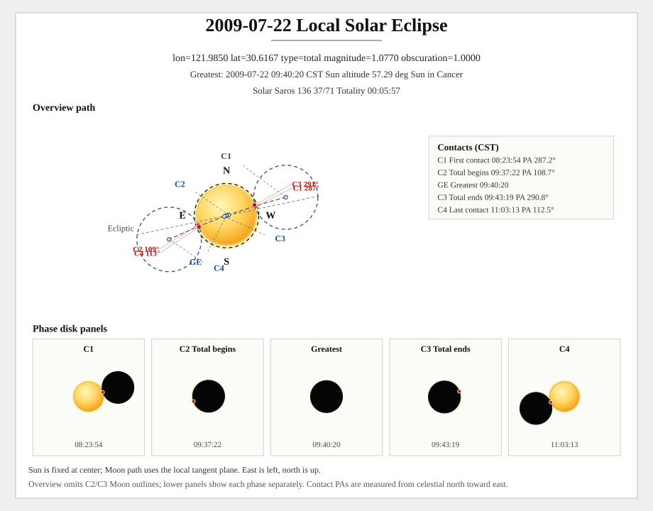

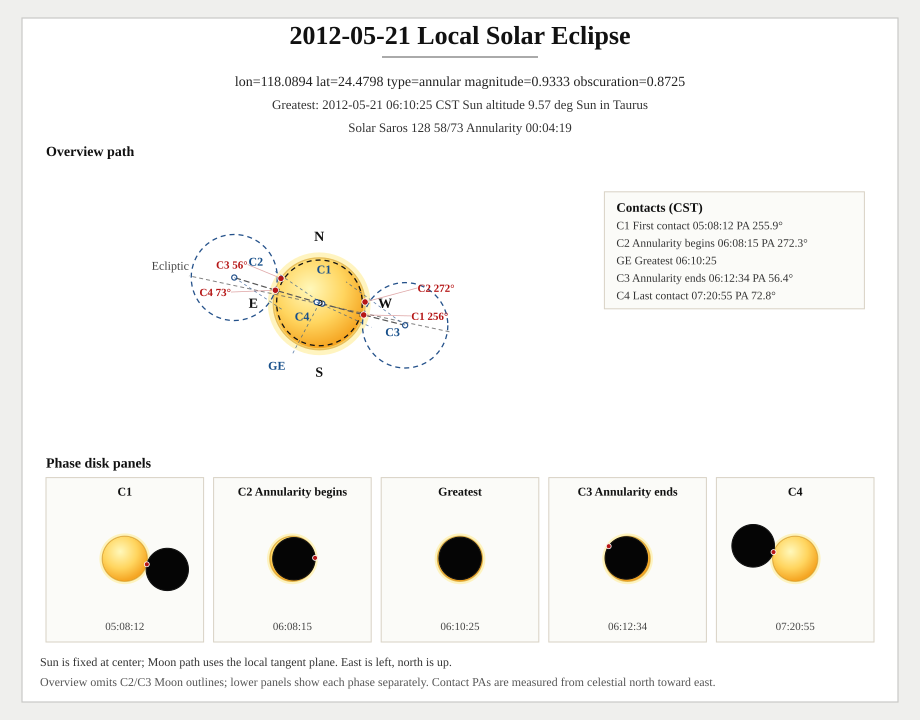

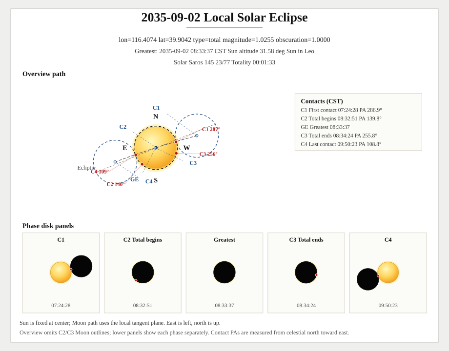

#### Lunar eclipse

Lunar-eclipse detection and search live in `eclipse`; returned times preserve the input `time.Time` location.

Common entry points:

- `LunarEclipseOnDate`: detect whether a lunar eclipse occurs on a local date
- `LastLunarEclipse` / `NextLunarEclipse` / `ClosestLunarEclipse`: search global lunar eclipses
- `LocalLunarEclipseOnDate`: detect whether a visible lunar eclipse is visible from a site on a local date
- `LastLocalLunarEclipse` / `NextLocalLunarEclipse` / `ClosestLocalLunarEclipse`: search visible local lunar eclipses
- `LastLocalTotalLunarEclipse` / `NextLocalTotalLunarEclipse` / `ClosestLocalTotalLunarEclipse`: search visible local total lunar eclipses, returning `(info, ok)`
- `GeometricLocalLunarEclipseOnDate`: detect geometric lunar eclipse overlap without filtering by whether the Moon is above the horizon
- `eclipse/svg.LunarEclipseSVG`: render a lunar-eclipse shadow-path SVG

`LunarEclipseInfo` includes:

- eclipse type `Type`
- Saros metadata `HasSaros` / `Saros`
- penumbral magnitude `PenumbralMagnitude`
- umbral magnitude `UmbralMagnitude`
- P1, U1, U2, greatest eclipse, U3, U4, P4 contact times

`Saros` has the same meaning as in the solar-eclipse section:

- `Saros.Series`: NASA lunar Saros series number when `Verified=true`, otherwise a provisional derived series number
- `Saros.Member`: 1-based member number within that series
- `Saros.Count`: total member count of that series
- `Saros.Verified`: whether the result matches an embedded authoritative catalog anchor; extension-table and extrapolated results are `false`

Lunar metadata also uses NASA anchors first, the extension table for astronomical years `-3000` through `+6000`, and live extrapolation outside that interval. Computed members include the union of events detected by Danjon and Chauvenet, so metadata is independent of the requested lunar model and observing site. Very shallow members may differ from the NASA catalog; `Verified` remains `false`.

Run `go generate ./eclipse` from the repository root to regenerate both extension tables. The generator scans years `-5000` through `+8000` to include complete lifetimes of series at the range limits, checking numbering in both directions from NASA anchors. Ordinary queries and tests do not generate tables.

For example, the cross-year total lunar eclipse on `2028-12-31 / 2029-01-01` is member `49/72` of Lunar Saros `125`.

Two shadow-radius conventions are retained:

- **Danjon** (default): multiplies only the lunar horizontal-parallax term by `1.01`, then combines it with the solar semidiameter and solar parallax. NASA GSFC's current lunar-eclipse catalogs and diagram pages use the same route, as do the library defaults `LunarEclipseOnDate`, `LastLunarEclipse`, `NextLunarEclipse`, and `ClosestLunarEclipse`.
- **Chauvenet**, compatibility convention: starts with `0.99834 x Earth equatorial radius` and then multiplies the full shadow radii by `51/50`. This is closer to older traditional tables and is useful for compatibility checks.

Differences:

- `Chauvenet` gives larger penumbral and umbral shadows. Penumbral magnitude is usually about `0.025` larger, and umbral magnitude about `0.005` larger.
- For edge cases, `Chauvenet` can push an eclipse toward a deeper type.
- Against NASA catalogs, modern ephemeris software, or current mainstream lunar-eclipse material, the matching convention is the default `Danjon`.
- For compatibility with existing historical baselines, the matching convention is the explicitly-called `Chauvenet`.

##### Code example

```go
package main

import (
	"fmt"
	"time"

	"github.com/starainrt/astro/eclipse"
)

func main() {
	date := time.Date(2029, 1, 1, 0, 0, 0, 0, time.UTC)

	// Default Danjon model, closer to NASA current material.
	info := eclipse.ClosestLunarEclipse(date)
	fmt.Println(info.Type)                                     // eclipse type
	fmt.Println(info.HasSaros, info.Saros)                     // Saros match flag; series, member number, total count
	fmt.Println(info.Maximum)                                  // greatest-eclipse time
	fmt.Println(info.PenumbralMagnitude, info.UmbralMagnitude) // penumbral and umbral magnitudes
	fmt.Println(info.PenumbralStart)                           // P1, penumbral eclipse begins
	fmt.Println(info.PartialStart)                             // U1, partial eclipse begins
	fmt.Println(info.TotalStart)                               // U2, totality begins
	fmt.Println(info.TotalEnd)                                 // U3, totality ends
	fmt.Println(info.PartialEnd)                               // U4, partial eclipse ends
	fmt.Println(info.PenumbralEnd)                             // P4, penumbral eclipse ends

	// Chauvenet model for compatibility with older conventions.
	legacy := eclipse.ClosestLunarEclipseChauvenet(date)
	fmt.Println(legacy.PenumbralMagnitude, legacy.UmbralMagnitude) // magnitudes under Chauvenet

	// Check a local civil date. Output time zone follows the input date.
	local := time.Date(2029, 1, 1, 12, 0, 0, 0, time.FixedZone("CST", 8*3600))
	today, ok := eclipse.LunarEclipseOnDate(local)
	fmt.Println(ok)            // whether this local date overlaps a lunar eclipse
	fmt.Println(today.Type)    // eclipse type
	fmt.Println(today.Maximum) // greatest-eclipse time in the input time zone
}
```

Output:

```text
total // eclipse type
true {125 49 72 true} // Lunar Saros 125, member 49/72, verified
2028-12-31 16:52:05.566135346 +0000 UTC // greatest eclipse
2.2739890433790566 1.2461142882915068 // penumbral and umbral magnitudes
2028-12-31 14:03:54.219463169 +0000 UTC // P1
2028-12-31 15:07:42.115980684 +0000 UTC // U1
2028-12-31 16:16:27.24464178 +0000 UTC // U2
2028-12-31 17:27:46.214954853 +0000 UTC // U3
2028-12-31 18:36:32.251235246 +0000 UTC // U4
2028-12-31 19:40:11.52023971 +0000 UTC // P4
2.2996033397562012 1.2511710895669002 // Chauvenet penumbral and umbral magnitudes
true // local date overlaps an eclipse
total // local eclipse type
2029-01-01 00:52:05.566135346 +0800 CST // greatest eclipse in UTC+8
```

##### Checks against NASA data

The following values are compared against NASA GSFC lunar-eclipse catalogs and single-eclipse diagram pages. Time errors are in seconds.

| Sample | Model | Penumbral magnitude error | Umbral magnitude error | Contact-time check |
| --- | --- | --- | --- | --- |
| 2026-03-03 total lunar eclipse | Danjon | -0.000072053 | -0.000065148 | second-level agreement, max error 6.380 s |
| 2026-03-03 total lunar eclipse | Chauvenet | +0.025594905 | +0.004939948 | compatibility model, not the NASA timing baseline |
| 2026-08-28 partial lunar eclipse | Danjon | -0.000118545 | -0.000028773 | second-level agreement, max error 6.179 s |
| 2026-08-28 partial lunar eclipse | Chauvenet | +0.025562714 | +0.004962282 | compatibility model, not the NASA timing baseline |
| 2024-03-25 penumbral lunar eclipse | Danjon | -0.000181657 | see note below | second-level agreement, max error 7.781 s |
| 2024-03-25 penumbral lunar eclipse | Chauvenet | +0.026039769 | see note below | compatibility model, not the NASA timing baseline |

For the `2026-03-03` total lunar eclipse, current default `Danjon` differences against NASA are:

- type: both `total`
- penumbral magnitude: `2.183727947` vs NASA `2.1838`, error `-0.000072053`
- umbral magnitude: `1.150634852` vs NASA `1.1507`, error `-0.000065148`
- P1 error: `+3.400 s`
- U1 error: `+5.801 s`
- U2 error: `+6.261 s`
- greatest eclipse error: `+5.897 s`
- U3 error: `+5.776 s`
- U4 error: `+6.328 s`
- P4 error: `+6.380 s`

For pure penumbral eclipses, NASA may publish negative `umbral magnitude`, meaning the Moon's disk center remains outside the umbral boundary by that amount. This library preserves that negative value, so pure penumbral cases are compared in the same convention.

##### Lunar-eclipse SVG

`LunarEclipseSVG`, `LunarEclipseDetailedSVG`, and `LunarEclipseMapSVG` share one default model: Danjon with a Chauvenet fallback for ultra-shallow penumbral cases, matching `LunarEclipseOnDate`; the `Danjon` / `Chauvenet` variants keep forcing their model.

The default lunar-eclipse SVG header includes Saros metadata. `LunarEclipseSVGOptions` can override:

- `Title`: main title
- `SummaryText` / `MaximumText` / `CoordinatesText` / `DurationText` / `MetaText`: five information lines under the title
- `ContactsTitle`: contact-time section title
- `DirectionText` / `FooterNote`: footer direction note and extra note

```go
package main

import (
	"fmt"
	"os"
	"time"

	eclipsesvg "github.com/starainrt/astro/eclipse/svg"
)

func main() {
	// Render the shadow-path diagram for the cross-year total lunar eclipse on 2029-01-01 UTC.
	svg, ok := eclipsesvg.LunarEclipseSVG(
		time.Date(2029, 1, 1, 0, 0, 0, 0, time.UTC),
		eclipsesvg.LunarEclipseSVGOptions{
			Width:    960,
			Height:   620,
			Step:     10 * time.Minute,
			Language: "en",
		},
	)
	fmt.Println(ok, len(svg)) // whether SVG generation succeeded; SVG byte length
	if ok {
		_ = os.WriteFile("doc/lunar-eclipse-2029-01-01-en.svg", []byte(svg), 0o644)
	}
}
```

Output:

```text
true 20274 // lunar-eclipse SVG generated, 20274 bytes
```

Rendered example:

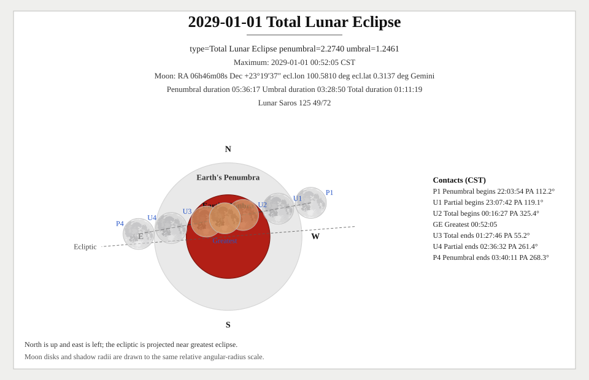

##### References

- NASA lunar eclipse decade catalog: <https://eclipse.gsfc.nasa.gov/LEdecade/LEdecade2021.html?pubDate=20250222>
- NASA 2026-03-03 total lunar eclipse diagram: <https://eclipse.gsfc.nasa.gov/LEplot/LEplot2001/LE2026Mar03T.pdf>
- NASA 2026-08-28 partial lunar eclipse diagram: <https://eclipse.gsfc.nasa.gov/LEplot/LEplot2001/LE2026Aug28P.pdf>
- NASA 2024-03-25 penumbral lunar eclipse diagram: <https://eclipse.gsfc.nasa.gov/LEplot/LEplot2001/LE2024Mar25N.pdf>
- NASA lunar eclipse algorithm and history notes: <https://eclipse.gsfc.nasa.gov/LEhistory/LEhistory.html>

### Lunar Occultations

Lunar-occultation APIs live in `moon` and search only the target supplied by the caller; they never enumerate the star catalog. Fixed-site APIs take `start`, `end`, longitude, latitude, and elevation directly.

Global-path results contain WGS84 samples suitable for `moon/svg` or `geojson`.

Targets use two distinct contact models:

- **Stars** are point sources. Results contain immersion, greatest occultation, and emersion.
- **Planets** are finite disks. C1/C4 are external contacts; a fully covered disk also has C2/C3 internal contacts. Partial and grazing events have no C2/C3.
- The planetary model uses the equatorial body radius and excludes rings, atmospheric extensions, and oblateness.
- `FindBestStarOccultations` and `FindBestPlanetOccultations` return the global sea-level geometric greatest point. They do not score horizon visibility, lunar altitude, duration, or magnitude.
- `VisibleAtGreatest` only reports visibility at the selected point.
- The query window selects events by their greatest instant. Once selected, complete contacts or a complete global path are returned rather than clipped at the query endpoints.
- Contact times solve topocentric geometry between the target and lunar limb without atmospheric refraction.
- `MoonAltitudeAtGreatest` is the true altitude of the lunar center. `VisibleAtGreatest` reports whether it is at or above the geometric horizon.

#### Stellar occultations

Callers supply a `StarCoordinate`. `RA` and `Dec` are degrees; `Epoch` and `Frame` are required. Proper motions use `mas/year`; `ProperMotionRACosDecMasPerYear` follows the usual catalog convention `dRA*cos(Dec)`.

A coordinate can be constructed directly:

```go
target := moon.StarCoordinate{
	ID:                             "HR 4799",
	RA:                             189.1975,
	Dec:                            -5.831944444444,
	Epoch:                          time.Date(2000, 1, 1, 12, 0, 0, 0, time.UTC),
	Frame:                          moon.CoordinateFrameJ2000,
	ProperMotionRACosDecMasPerYear: -28,
	ProperMotionDecMasPerYear:      -18,
}
```

Alternatively, explicitly load the embedded 9100-star catalog and convert a `StarData` value with `StarCoordinateFromStarData`.

The occultation search itself does not load the catalog; calls such as `star.InitStarDatabase`, `StarDataByName`, and `StarDataByHR` do.

```go
package main

import (
	"fmt"
	"time"

	"github.com/starainrt/astro/moon"
	"github.com/starainrt/astro/star"
)

func main() {
	cst := time.FixedZone("CST", 8*3600)
	start := time.Date(2025, 6, 5, 0, 0, 0, 0, cst)
	end := start.Add(24 * time.Hour)

	_ = star.InitStarDatabase()
	data, _ := star.StarDataByHR(4799)
	target, _ := moon.StarCoordinateFromStarData(data)
	target.ID = "HR 4799" // Optional display label.

	events, _ := moon.FindStarOccultations(
		start, end, target,
		121.56601, 6.80706, 0,
		moon.OccultationSearchOptions{},
	)
	for _, event := range events {
		fmt.Println(event.TargetID, event.Type)
		fmt.Println(
			event.Immersion.Format("2006-01-02 15:04:05.000 MST"),
			event.Greatest.Format("2006-01-02 15:04:05.000 MST"),
			event.Emersion.Format("2006-01-02 15:04:05.000 MST"),
		)
		fmt.Printf("altitude=%.3f visible=%v\n", event.MoonAltitudeAtGreatest, event.VisibleAtGreatest)
	}

	paths, _ := moon.FindStarOccultationPaths(
		start, end, target,
		moon.OccultationPathOptions{Step: 5 * time.Minute, TargetSpacingKM: 200},
	)
	for _, path := range paths {
		fmt.Println(
			path.Start.Time.Format("2006-01-02 15:04:05.000 MST"),
			path.Greatest.Time.Format("2006-01-02 15:04:05.000 MST"),
			path.End.Time.Format("2006-01-02 15:04:05.000 MST"),
		)
		fmt.Printf("greatest=%.6f %.6f width=%.1fkm center=%d\n",
			path.Greatest.Longitude, path.Greatest.Latitude,
			path.Greatest.WidthKM, len(path.CenterLine))
	}
}
```

Output:

```text
HR 4799 total
2025-06-05 19:14:01.062 CST 2025-06-05 20:02:06.296 CST 2025-06-05 20:50:10.697 CST
altitude=75.561 visible=true
2025-06-05 17:45:28.475 CST 2025-06-05 20:02:06.300 CST 2025-06-05 22:18:49.945 CST
greatest=121.566140 6.807079 width=3582.4km center=108
```

Zero-valued `OccultationSearchOptions` select the default search step and safety margin; `MaxEvents > 0` limits output.

`OccultationPathOptions.Step` controls base time sampling, while `TargetSpacingKM` adaptively refines the center line. Requests exceeding the deterministic budget return `ErrOccultationPathSamplingLimit`. `RiseSetStep` independently samples the six boundaries where local start, greatest, or end coincides with moonrise or moonset; zero uses five minutes, and `DisableRiseSet` omits them. `DisableFootprints` omits the much larger dense instantaneous visible-region features and merges sparse support samples into compact bands while retaining the center line, limits, and six rise/set phase curves, which is useful for ordinary GeoJSON maps. `IncludeFootprintTimeline` retains independently sampled instantaneous footprints alongside the compact band, using `FootprintTimelineStep` for time-axis selection of the currently visible region.

`OccultationPathOptions.Algorithm` selects the stellar/planetary global-path ephemeris branch. Its zero value or `moon.OccultationPathAlgorithmOptimized` uses checked Cartesian interpolation at 30-minute nodes while retaining the station equations, continuous envelopes, and rise/set curves. `moon.OccultationPathAlgorithmExact` retains the original branch: interpolated candidates, with full-term ephemerides for final solving. Failed table checks fall back to the original branch; evaluations outside the interpolation window use exact ephemerides. Checks are sampled safeguards, not a rigorous error bound at every instant. The branches share the geometric definition, but sample points and GeoJSON bytes need not be identical. Event-only searches, fixed-site contacts, independent instant-footprint APIs, and eclipses are unaffected.

Both branches retain full-term evaluation of global start/end/greatest markers and center-line widths. Render the complete returned path, including visibility contours; discarding those contours invokes the legacy sampled-footprint fallback, whose boundary is not interchangeable with the analytic visible set.

In a returned path, `BandContours` are the static contact envelopes, `VisibilityContours` are the time envelope where the Moon is above the horizon, and `Footprints` are instantaneous samples for time-axis detail. They serve different geometry layers and should not be used as substitutes for one another.

`OccultationPathOptions.GreatestTimeValues` / `GreatestTimeStep` request **greatest-occultation time isolines**. Unlike the solar case, `GreatestTimeValues []float64` carries TT Julian ephemeris days; at most 64 are kept — deduplicated, sorted, and cut to the earliest 64 — and a level outside the visibility window or without a usable branch produces no entry. When it is empty, `GreatestTimeStep` takes over, again only for a positive value, aligned to UTC ticks. Contours land in `StarOccultationPath.GreatestTimeContours` (the planetary path has the same field) as `OccultationGreatestTimeContour` values whose `JDE`, `Time`, and `Segments` mean the same as in the solar case: `Time` keeps the original aligned instant for step-derived levels, while an explicit level is converted from `JDE` and rounded to the millisecond; both carry the UTC zone, whereas branch point times use the path timezone (the solar public layer instead reports `Time` in the input timezone). The boundary rules match as well: curves exist only where the target disk truly overlaps the lunar disk and the Moon is above the geometric horizon (no refraction or semidiameter correction), each branch ends at the horizon or the occultation-visibility boundary, nothing is continued beyond ±88° latitude, one instant may carry several disconnected branches, and output is unchanged when they are not requested.

```go
options := moon.OccultationPathOptions{
	Algorithm: moon.OccultationPathAlgorithmExact, // Original branch; omit for optimized.
	DisableFootprints: true,
}
```

#### Planetary occultations

Planet targets use the constants from `OccultationMercury` through `OccultationNeptune`. This example solves C1-C4 for the `2025-02-01` occultation of Saturn at a site near the global geometric greatest point:

```go
package main

import (
	"fmt"
	"time"

	"github.com/starainrt/astro/moon"
)

func main() {
	cst := time.FixedZone("CST", 8*3600)
	start := time.Date(2025, 2, 1, 0, 0, 0, 0, cst)
	events, _ := moon.FindPlanetOccultations(
		start, start.Add(24*time.Hour), moon.OccultationSaturn,
		104.52219613, 55.25401991, 0,
		moon.OccultationSearchOptions{},
	)
	for _, event := range events {
		fmt.Println(event.TargetID, event.Type, event.HasInternalContacts)
		fmt.Println(event.ExternalImmersion.Format("2006-01-02 15:04:05.000 MST")) // C1
		fmt.Println(event.InternalImmersion.Format("2006-01-02 15:04:05.000 MST")) // C2
		fmt.Println(event.Greatest.Format("2006-01-02 15:04:05.000 MST"))
		fmt.Println(event.InternalEmersion.Format("2006-01-02 15:04:05.000 MST")) // C3
		fmt.Println(event.ExternalEmersion.Format("2006-01-02 15:04:05.000 MST")) // C4
	}
}
```

Output:

```text
Saturn total true
2025-02-01 11:29:09.710 CST
2025-02-01 11:29:40.069 CST
2025-02-01 12:00:48.747 CST
2025-02-01 12:32:46.415 CST
2025-02-01 12:33:18.312 CST
```

Global `FindPlanetOccultationPaths` results contain both the region where any part of the planetary disk overlaps the Moon and the region where the whole planet is hidden. `HasTotalBand` reports whether a total band exists, and `GreatestTotalWidthKM` is its width at greatest occultation; center lines, limits, and enabled instantaneous footprints all carry sample times.

#### Lunar-occultation SVG

`moon/svg` provides both search-and-render and render-an-existing-result entry points:

- `FindLocalStarOccultationSVGs` / `FindLocalPlanetOccultationSVGs`: fixed-site apparent tracks, the lunar path, and contact-stage panels.
- `FindStarOccultationSVGs` / `FindPlanetOccultationSVGs`: global bands, center lines, event points, and time labels.
- `LocalStarOccultationSVG` / `LocalPlanetOccultationSVG`: render an existing fixed-site event.
- `StarOccultationPathSVG` / `PlanetOccultationPathSVG`: render an existing global path.

```go
localSVGs, err := moonsvg.FindLocalStarOccultationSVGs(
	start, end, target,
	121.56601, 6.80706, 0,
	moon.OccultationSearchOptions{},
	moonsvg.LocalStarOccultationSVGOptions{Width: 920, Height: 700, Location: cst},
)
fmt.Println(err, len(localSVGs))
```

Local charts use the selected observer's topocentric geometry; the diagram below reuses the `2025-06-05` occultation of HR 4799 from the preceding example. The fixed site is `121.56601°E, 6.80706°N`, near the global geometric greatest point. Its immersion, greatest, and emersion times are the actual topocentric contacts at that site. The diagram also shows lunar orientation, the lunar path, Moon altitude, azimuth, and horizon visibility.

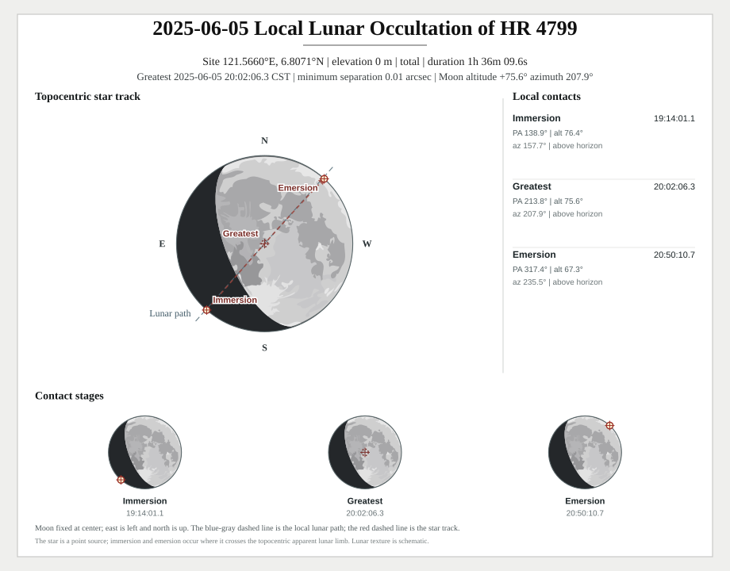

### Event Maps And GeoJSON

#### Global visibility-map SVG

`eclipse/svg` can directly render global solar- and lunar-eclipse maps. A solar map includes the partial-visibility sweep, total/annular central band, center line, global stages, and center-line time labels. It also shows the sunrise/sunset lines for eclipse start, greatest eclipse, and eclipse end; the subsolar point; shadow-axis entry/exit; `P1-P4/U1-U4` contacts; and the timed penumbral and umbral/antumbral outlines that are off by default and drawn on request. A lunar map shows P1/P4 visible hemispheres, moonrise/moonset transition regions, and the region that sees the entire event.

`LunarEclipseDetailedSVG` merges both lunar charts into one detailed page: a centred summary (greatest eclipse, penumbral/umbral magnitude, gamma, penumbral/umbral radius, Moon distance, Saros series), geocentric Sun and Moon blocks on either side, the shadow-path diagram, a three-column row of durations / arc-minute scale bar / contacts, and the world visibility map with its legend underneath. The shadow geometry comes from `basic.LunarEclipseShadowGeometryAt`, where **gamma is in Earth equatorial radii while the penumbral and umbral radii are in degrees** - multiply a radius by the Earth's parallax at the Moon to get Earth radii.

```go
package main

import (
	"os"
	"time"

	eclipsesvg "github.com/starainrt/astro/eclipse/svg"
)

func main() {
	cst := time.FixedZone("CST", 8*3600)

	solar, ok := eclipsesvg.SolarEclipseMapSVG(
		time.Date(2009, 7, 22, 12, 0, 0, 0, cst),
		eclipsesvg.SolarEclipseMapSVGOptions{
			Width: 1200, Height: 800, Location: cst,
			Language: "en",
			TimeLabelStep: 30 * time.Minute,
		},
	)
	if ok {
		_ = os.WriteFile("doc/solar-eclipse-yangshan-2009-global-en.svg", []byte(solar), 0o644)
	}

	lunar, ok := eclipsesvg.LunarEclipseMapSVG(
		time.Date(2029, 1, 1, 0, 0, 0, 0, cst),
		eclipsesvg.LunarEclipseMapSVGOptions{Width: 1200, Height: 800, Language: "en", Location: cst},
	)
	if ok {
		_ = os.WriteFile("doc/lunar-eclipse-2029-01-01-global-en.svg", []byte(lunar), 0o644)
	}

	detailed, ok := eclipsesvg.LunarEclipseDetailedSVG(
		time.Date(2029, 1, 1, 0, 0, 0, 0, cst),
		eclipsesvg.LunarEclipseDetailedSVGOptions{Language: "en", Location: cst},
	)
	if ok {
		_ = os.WriteFile("doc/lunar-eclipse-2029-01-01-detailed-en.svg", []byte(detailed), 0o644)
	}
}
```

The long orange dashes are the six phase lines where eclipse start, greatest eclipse, and eclipse end coincide with sunrise or sunset. **Instantaneous penumbral and umbral outlines are off by default**; a positive `PenumbralOutlineStep` / `CentralShadowStep` turns them on. Short purple dashes are the local greatest-magnitude contours given by `MagnitudeValues` (0.2/0.4/0.6/0.8 by default), and solid blue lines are greatest-eclipse time isochrones.

**Greatest-eclipse time isochrones** (solid blue lines) are off by default: every place on one line sees greatest eclipse at the same instant, and a positive `GreatestTimeStep` turns them on, with 30 minutes as the NASA world-map spacing. This `GreatestTimeStep` belongs to the SVG layer and aligns to ticks of the **display timezone** (`Location`), unlike the UTC alignment of the data layer; `eclipse/svg` exposes no explicit-level entry point, so call the data layer directly and pass the instants through `GreatestTimeValues` when another alignment is needed.

```go
solar, _ := eclipsesvg.SolarEclipseMapSVG(date, eclipsesvg.SolarEclipseMapSVGOptions{
	Width: 1200, Height: 800, Location: cst,
	GreatestTimeStep: 30 * time.Minute,
})
```

They are not produced by evaluating greatest eclipse on a latitude/longitude grid and contouring it. The instant is fixed first and the zero set of `d(centre-separation squared)/dt = 0` is continued along the curve instead, so the cost scales with curve length rather than with the visible area. Isochrones are drawn only where the solar and lunar disks actually overlap and the Sun is above the geometric horizon (no refraction or semidiameter correction), each branch ending at the horizon or the partial-visibility boundary; nothing is continued beyond ±88° latitude, and one instant may carry several disconnected branches.

A zero `TimeLabelStep` uses 30 minutes, while a negative value disables center-line time labels. A zero or negative `GreatestTimeStep` draws no greatest-eclipse isochrones (they must be requested explicitly, as in the core layer and `moon/svg`); positive values align to the display timezone, values below one minute use one minute, and at most 64 are generated per request. The recommended NASA world-map spacing is 30 minutes. `MagnitudeValues` uses 0.2/0.4/0.6/0.8 when nil, is disabled by an explicitly empty slice, and otherwise draws exactly the given levels.

`SolarEclipseMapSVGOptions.EventsTitle` replaces the title of the global-phases block that carries the greatest-eclipse coordinates and the earth-wide central begin/end, falling back to a localized default when empty; `MapTitle` and `Title` cover the map section title and the main title.

The documented minimum solar-map canvas is **800x560**: a width below 800 or a height below 560 falls back to 960x640, because on a narrower landscape canvas the map frame overlaps the right-hand data grid and the panel row spacing collapses below 1 px. A `PartialStep` below two minutes is treated as two minutes: the partial region is a union of instantaneous footprints whose cost grows with the sample count, and that union needs one self-consistent sweep, so a denser request does not change the product (a one-second step measured 36.8 s / 951 MB and becomes 1.1 s / 30 MB, byte-identical to the default request). The detailed lunar chart derives its page stack from `Height`: 640x420 and 800x600 cannot hold the diagram and map minima and return `false`, while 1000x1414 and 1414x1000 render normally.

The three suffix-free lunar entries (`LunarEclipseSVG`, `LunarEclipseDetailedSVG`, `LunarEclipseMapSVG`) share one default model: Danjon with a Chauvenet fallback for ultra-shallow penumbral cases, matching `LunarEclipseOnDate`; the `Danjon` / `Chauvenet` variants keep forcing their model.

Degradable layers tag their actual geometry source in `data-source`, using exactly the vocabulary documented in the `eclipse/svg` package comment: `partial-band-union`, `sampled-footprint-sweep`, `partial-band-contours`, `rise-set-phase-lines`, `magnitude-contours`, `greatest-time-isochrones`, `besselian-critical-envelope`, `paired-limit-chords`, `sampled-open-sweep`, `central-path-limits`, `penumbral-outlines`, `central-shadow-outlines`, `p1-p4-visibility-regions`, `p1-p4-horizon-boundaries`. `PenumbralOutlineStep` and `CentralShadowStep` are **off by default** (zero or negative draws no instantaneous penumbral/umbral outlines, which hide the globe and are absent from NASA world maps); a positive value gives the sampling interval, with values below one minute treated as one minute.

Solar-eclipse and occultation automatic projection can select a north- or south-polar map when appropriate. Lunar-eclipse maps default to equirectangular. Projection affects SVG presentation only, not the underlying WGS84 result.

Eclipse maps use `EclipseMapProjectionEquirectangular`, `EclipseMapProjectionNorthPolar`, or `EclipseMapProjectionSouthPolar` to force a projection. Lunar-occultation maps use the corresponding `MapProjection...` constants. `EclipseMapProjectionOrthographic` adds a **detailed orthographic globe**: the view point is the greatest-eclipse point, only the facing hemisphere is drawn, and the map boundary is the great circle of that hemisphere.

The globe needs neither extra data nor a projection library. Land is rebuilt at run time by decoding the embedded equirectangular base map back to longitude/latitude and projecting it orthographically; clipping to the limb intersects great circles in geographic coordinates and closes each cut ring along the limb arc; the graticule is sampled on the sphere and clipped the same way.

The orthographic projection also switches to the **NASA composition**: the globe is centred and enlarged, a scale bar sits directly below it, the phase information becomes three panels (penumbral contacts / local circumstances at greatest / umbral contacts), and the legend and footer follow underneath. Other projections keep the original composition. The cost is roughly 1.0 s per map (about 0.85 s for the equirectangular view), and a 1000x1414 globe SVG is about 530 KB.

The following global maps reuse the dates from the earlier local SVG examples. The 2009 Yangtze River total eclipse, 2012 Xiamen annular eclipse, and 2035 Beijing total eclipse use the equirectangular projection:

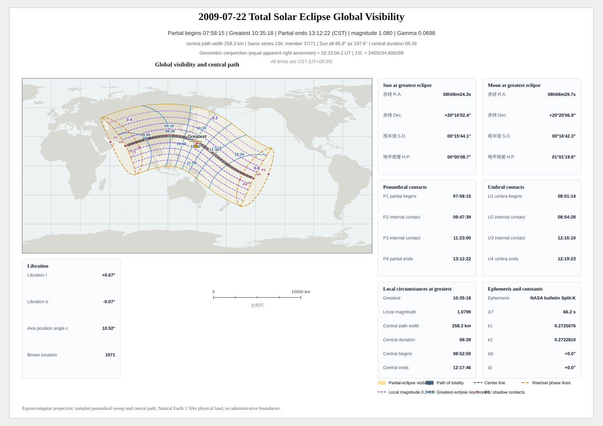

The same eclipse as an orthographic globe (`EclipseMapProjectionOrthographic`):

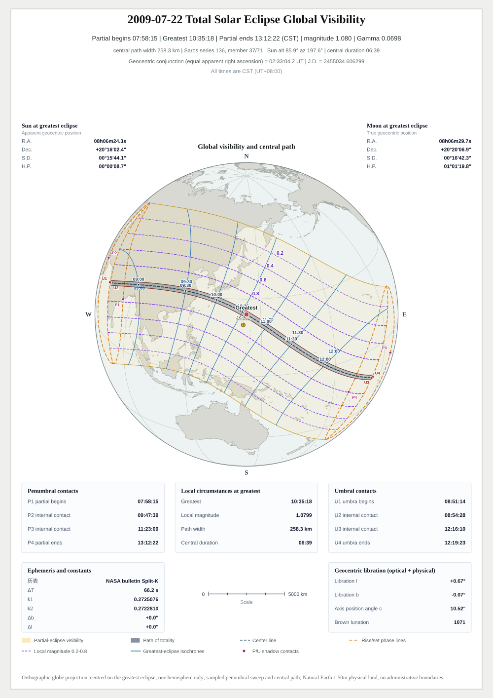

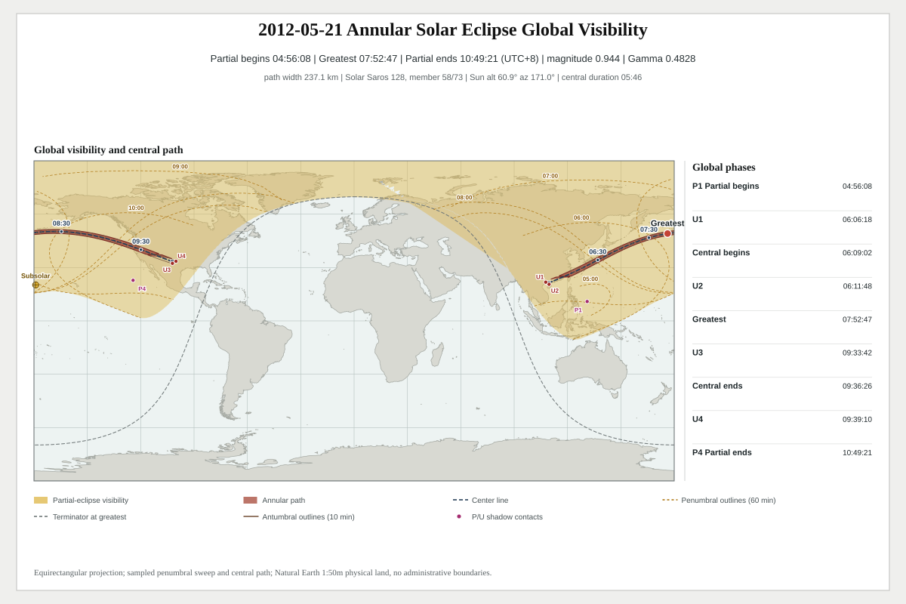

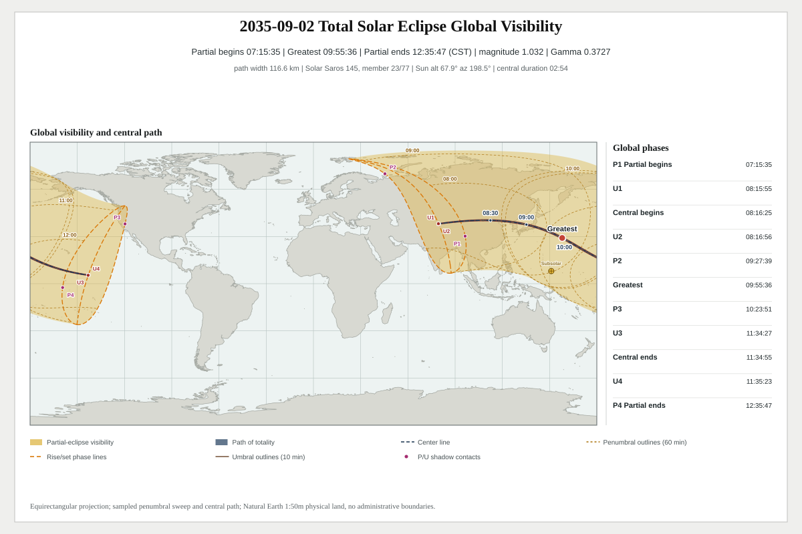

The partial-eclipse visibility region of the `2012-05-21` annular eclipse includes the North Pole. The same event is therefore shown again with a forced north-polar azimuthal-equidistant projection, making its antimeridian-crossing Arctic visibility easier to inspect. The circular outline is the projection boundary, not an administrative or political boundary:

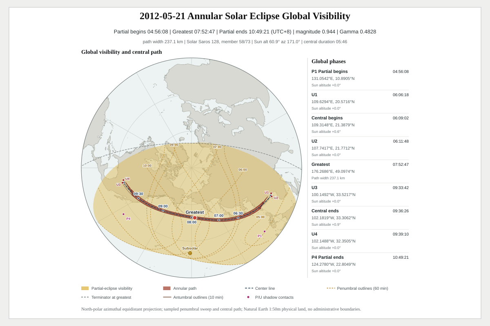

The lunar-eclipse example reuses the cross-year total eclipse on `2029-01-01`, separating entire-event visibility, moonrise during eclipse, moonset during eclipse, and unavailable regions:

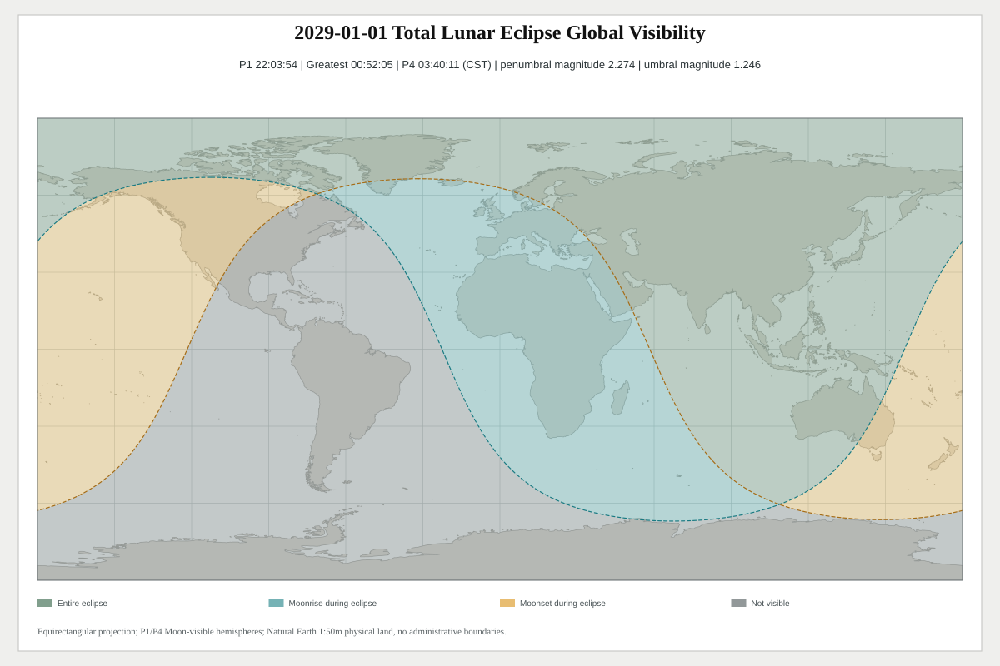

The lunar-eclipse map also has a detailed layout that merges the two charts above into one page: a centred summary (greatest eclipse, penumbral/umbral magnitude, gamma, penumbral/umbral radius, Moon distance, Saros series), geocentric Sun and Moon blocks on either side, the shadow-path diagram, a three-column row of durations / arc-minute scale bar / contacts, and the world visibility map with its legend underneath, on one `1000x1414` page:

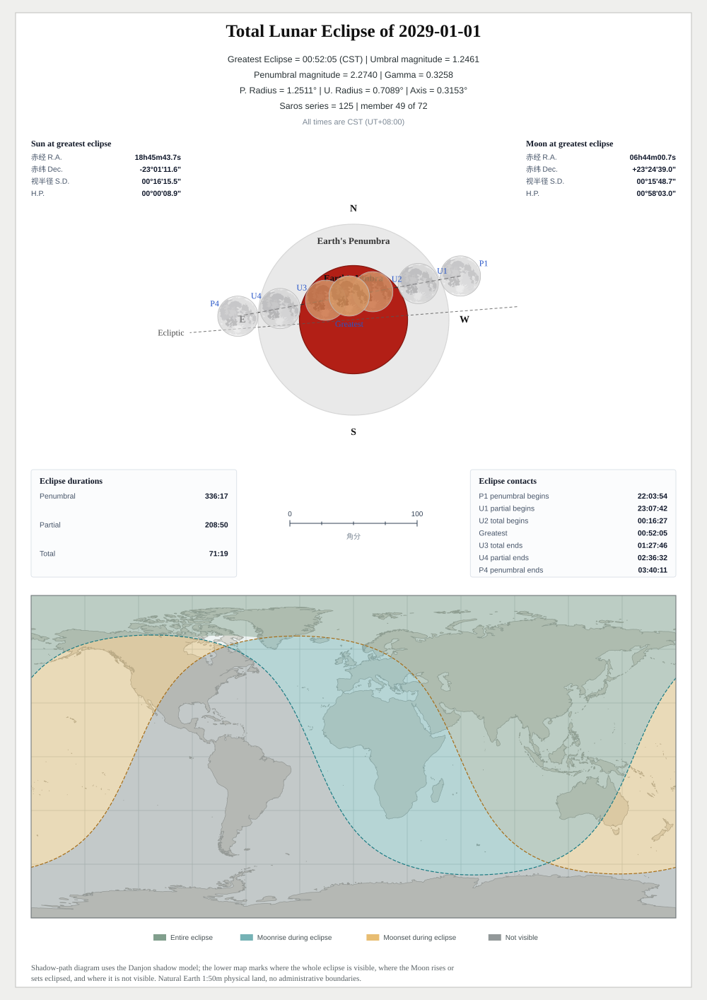

#### Lunar-occultation detailed SVG

`moon/svg` composes a whole occultation into one `1000x1414` page through `StarOccultationDetailedSVG` / `PlanetOccultationDetailedSVG`: a centred summary, geocentric/topocentric data blocks for the Sun, Moon, and target body, an **orthographic globe** of the global band (northern and southern limits, visible/geometric center lines, the greatest point, immersion/greatest/emersion stage points, and 30-minute time labels), and a footer note. The globe view point is the event centre and only the facing hemisphere is drawn; this layout is fixed to the orthographic sphere and accepts no other projection, and the standalone global band map is `StarOccultationPathSVG` / `FindStarOccultationSVGs` from the "Lunar-occultation SVG" section above. Page data falls into six blocks: geocentric Moon coordinates, target body, band path points, contact times, ephemeris and constants, and libration. A landscape canvas places the blocks to the right of the map in two columns by three rows; a portrait canvas places them below the globe in three columns by two rows. The diagram below is the `2025-06-05` occultation of HR 4799:

```go
package main

import (
	"os"
	"time"

	"github.com/starainrt/astro/moon"
	moonsvg "github.com/starainrt/astro/moon/svg"
)

func main() {
	cst := time.FixedZone("CST", 8*3600)
	star := moon.StarCoordinate{
		ID: "HR 4799", RA: 189.1975, Dec: -5.831944444444,
		Epoch: time.Date(2000, 1, 1, 12, 0, 0, 0, time.UTC), Frame: moon.CoordinateFrameJ2000,
		ProperMotionRACosDecMasPerYear: -28, ProperMotionDecMasPerYear: -18,
	}
	paths, err := moon.FindStarOccultationPaths(
		time.Date(2025, 6, 5, 0, 0, 0, 0, cst),
		time.Date(2025, 6, 6, 0, 0, 0, 0, cst),
		star,
		moon.OccultationPathOptions{Step: 5 * time.Minute, TargetSpacingKM: 200},
	)
	if err == nil && len(paths) > 0 {
		detailed, renderErr := moonsvg.StarOccultationDetailedSVG(
			paths[0], star,
			moonsvg.OccultationDetailedSVGOptions{Width: 1000, Height: 1414, Language: "en", Location: cst},
		)
		if renderErr == nil {
			_ = os.WriteFile("doc/lunar-occultation-hr4799-2025-06-05-detailed-en.svg", []byte(detailed), 0o644)
		}
	}
}
```

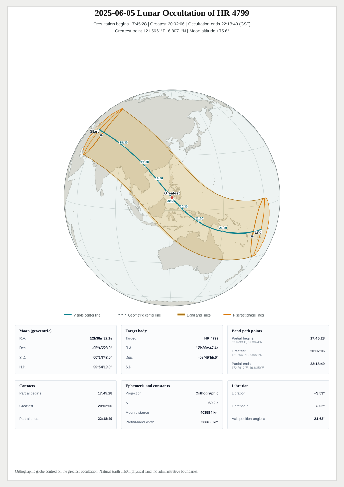

The globe on this page uses Natural Earth `1:50m` coastlines without administrative boundaries. Setting `GreatestTimeStep` on `moon.OccultationPathOptions` additionally requests **greatest-occultation time isochrones**, with the same meaning as the blue isochrones on solar-eclipse maps: the instant is fixed and the zero set of the separation derivative is continued along the curve. They are opt-in too, and output is unchanged when the option is not set. An occultation is visible worldwide for only a few hours (the HR 4799 sample on this page spans 4 h 33 m), so the spacing is usually tighter than for a solar eclipse, in the 15-30 minute range, and a larger spacing leaves fewer lines on the band; point-source stars define greatest by center separation while finite planetary disks use the outer-contact metric, matching `StarOccultationInfo.Greatest` and `PlanetOccultationInfo.Greatest` respectively. `moon/svg` has no isochrone switch of its own; it only draws the `GreatestTimeContours` already present in the path, so the request has to be made through `OccultationPathOptions` while the path is computed, and line placement follows the core rules (`GreatestTimeStep` aligns to UTC ticks). For a display-timezone grid, convert the instants to TT Julian ephemeris days and pass them as `GreatestTimeValues`. Global immersion and emersion are the instants when the lunar shadow first touches and finally leaves Earth; they are not the fixed site's contact times.

- Canvas and errors: the detailed layout needs at least `480x320` and derives its layout from the canvas, returning `ErrInvalidOccultationDetailedSVGOptions` when the map and data blocks cannot fit (`800x600`, `1000x1414`, and `1414x1000` render, while `640x420` and `900x400` are rejected); the standalone global band map needs at least `640x480` and returns `ErrInvalidStarOccultationSVGOptions` on a smaller canvas.

The "band width" label on the diagram is the ground separation of the northern and southern limits at greatest occultation, `GreatestLimitSeparationKM` (about `3666.6 km` here), which is a different convention from the across-center-line width `Greatest.WidthKM` (about `3582.4 km`); the two are not interchangeable. Greatest-time isochrones must be requested explicitly at the path layer through `OccultationPathOptions.GreatestTimeStep`; a compact band using `DisableFootprints` merges once on the first render and then caches for the same path. See the "Lunar-occultation SVG" section above for the detailed layout and the fixed-site charts.

#### GeoJSON

`geojson` accepts an already computed solar-eclipse, lunar-eclipse, or lunar-occultation result and returns `[]byte`. Those bytes are one complete UTF-8 RFC 7946 `FeatureCollection`, not an image or compressed payload: they can be written to `.geojson`, passed to `encoding/json`, or served directly to a map client.

```go
package main

import (
	"encoding/json"
	"fmt"
	"time"

	"github.com/starainrt/astro/eclipse"
	"github.com/starainrt/astro/geojson"
)

func main() {
	date := time.Date(2024, 4, 8, 0, 0, 0, 0, time.UTC)
	partial, ok := eclipse.SolarEclipsePartialFootprints(
		date,
		eclipse.SolarEclipsePartialFootprintOptions{
			Step: 10 * time.Minute, BoundaryPoints: 180,
		},
	)
	if !ok {
		return
	}
	central, hasCentral := eclipse.SolarEclipseCentralPath(
		date,
		eclipse.SolarEclipsePathOptions{Step: time.Minute, TargetSpacingKM: 20},
	)
	var centralPath *eclipse.SolarEclipsePath
	if hasCentral {
		centralPath = &central
	}

	data, err := geojson.MarshalSolarEclipseWithTimeMarkers(
		partial, centralPath,
		geojson.TimeMarkerOptions{
			Step: 30 * time.Minute,
			Location: time.FixedZone("CST", 8*3600),
		},
	)
	fmt.Println(err, json.Valid(data))
}
```

Each event type has plain and time-marker variants:

- `MarshalSolarEclipse` / `MarshalSolarEclipseWithTimeMarkers`
- `MarshalLunarEclipse` / `MarshalLunarEclipseWithTimeMarkers`
- `MarshalStarOccultation` / `MarshalStarOccultationWithTimeMarkers`
- `MarshalPlanetOccultation` / `MarshalPlanetOccultationWithTimeMarkers`

Coordinates are WGS84 longitude and latitude; lines and polygons are split at the antimeridian. Timed paths have `times` arrays aligned point-for-point with coordinate segments; `WithTimeMarkers` additionally adds Point Features with `role=time-marker`, whose localized `label` is for display while `time` stays UTC RFC 3339.

Single-instant primitives (timeline dragging, "exact the moment you stop") and station search horizons:

- `eclipse.NewSolarEclipseShadowSolver(eclipse.SolarEclipseShadowSolverOptions{...})` returns a reusable handle. `ShadowAt(time.Time)` (interpreted as UTC) or `ShadowAtJDE(jdeTT)` (TT) returns the **global umbral footprint** at that instant, and `StationStateAt` / `StationStateAtJDE` returns the **topocentric Sun/Moon geometry** for one station (magnitude, obscuration, center separation, apparent radii, solar altitude/azimuth, total/annular phase flags). Both compute only that: no visibility band, magnitude contours, rise/set boundaries, limits or center line, and an instant without an umbra yields an empty result instead of an error.
- `geojson.MarshalSolarEclipseShadowInstant(instant)` exports only that instant's shadow region plus its physical boundary when the horizon cuts it, with `time`, `source_boundary_closed`, `geometry_role`, `closure`, `delta_t_seconds`, `model` and `interp_signature` properties. The umbra uses `central-shadow-footprint` + `central-shadow-boundary`; setting `Kind` to `SolarEclipseShadowPenumbra` exports the penumbra (partial-eclipse region) as `partial-footprint` + `partial-footprint-boundary` with the same defaults as the packaged partial sampling (96 points plus 200 km refinement), so the same instant matches the sample to about 1e-12 degrees. No shadow yields an empty FeatureCollection.
- Packaged `partial-footprint` features also carry `source_boundary_closed`, `geometry_role`, `closure` and `interp_signature`, and their horizon-cut endpoints are extended to the horizon grazing points, where an endpoint would otherwise deviate by on the order of `36–41 km`. The partial-band fill hints keep the previous closure so the polar face selection does not move.
- Measured cost (native build, single-machine reference values; absolute timings vary with hardware): about **64 µs** per 96-point instant footprint and **20 µs** per station state; constructing the public handle only clamps options (≈0), the first query builds the internal state for the nearest new moon in 39 µs with a 130 µs anchor lookup, cached per event afterwards; batches run at about 75 µs per instant.
- ΔT: an explicit `DeltaTSeconds` applies to that handle only and only changes Earth rotation — the TT geometry stays fixed while the ground footprint shifts by `0.4651 * |ΔΔT| * cos(latitude)` km (see `basic.DeltaTGroundShiftKM`); `<=0` uses the process-wide model. Either way the result reports the ΔT actually used. The library ships no ΔT uncertainty model; use that helper to convert an external σ into a geometric uncertainty.
- Interpolation: both the packaged `central-shadow-footprint` features and the single-instant export carry `interp_signature` (for example `umbra-closed-seg1-pt97`, derived from the physical boundary's vertex count, segment count, closure flag and pole flag); neighbours may be interpolated vertex-wise only while it is identical; a flipped `closed` flag, a changed segment count (antimeridian), a changed vertex count, or empty↔non-empty (near U1/U4) all require the exact instant instead. Measured over two-minute steps, the centroid moves 78–232 km mid-event and up to about 520 km near the contacts.
- Batches: `ShadowBetween(start, end, step)` and `StationStatesBetween(...)` return a timeline-aligned slice whose entries are empty where no shadow exists.
- Single-instant occultation footprints (`moon.StarOccultationFootprintAt` / `moon.PlanetOccultationFootprintsAt` through `geojson.MarshalStarOccultationFootprint` / `MarshalPlanetOccultationFootprints`) also carry `delta_t_seconds`, `source_boundary_closed`, `geometry_role` and `interp_signature`; when the Moon's horizon cuts them the `closure` has `kind` `target-horizon`, `body` `moon` and a `sublunar` reference instead of the subsolar point. The occultation subsystem keeps the process-wide ΔT and only reports the value used.
- Station searches: `SearchLocalCentralSolarEclipse(date, lon, lat, height, eclipse.SolarEclipseLocalSearchOptions{Kind, MaxYears, Backward, Geometric, Model})` returns `(info, status)` where `status.Exhausted` separates "none within the horizon" from "found"; `MaxYears<=0` uses the legacy-equivalent default horizon (6000 candidate steps, about 992 years because candidates skip non-eclipse seasons). `SolarEclipseCandidates(start, end, options)` returns a geometry-free timetable (greatest time, type, centrality, magnitude, gamma, optional Saros).

The central-shadow roles in solar-eclipse GeoJSON are a stable contract: `role=central-shadow-footprint` is either absent or a `Polygon`/`MultiPolygon` and never a line. When the horizon cuts the shadow it still describes the full region covered on the ground that instant: the physical boundary is extended to both horizon grazing points and closed by the horizon arc between them, `source_boundary_closed` is `false`, and `closure` (`kind`, `time`, `subsolar`) declares that synthetic arc. The physical boundary alone is exported as `role=central-shadow-boundary`, so callers can stroke it and fill the region without drawing a fake horizon edge. A footprint that has shrunk to nothing at U1/U4 is omitted entirely instead of degrading into a line, and `source_boundary_closed=true` means the ring is closed by the shadow itself and carries no synthetic segment.

A zero `TimeMarkerOptions.Step` means 30 minutes, a positive step must be at least one minute, and one export is limited to 1440 markers. GeoJSON contains no basemap, national boundaries, styling, or projection; Web Mercator, polar views, tile selection, and political-boundary policy belong to the application.

### Planets

#### Inner planets

```go
package main

import (
	"fmt"
	"time"

	"github.com/starainrt/astro/mercury"
	"github.com/starainrt/astro/venus"
)

func main() {
	// Xi'an, China. Longitude east and latitude north are positive; elevation is 0 m.
	var lon, lat, height float64 = 108.93, 34.27, 0
	cst := time.FixedZone("CST", 8*3600)
	// Instant of observation.
	date := time.Date(2020, 1, 1, 8, 8, 8, 8, cst)

	// Previous inferior conjunction of Mercury.
	fmt.Println(mercury.LastInferiorConjunction(date))
	// Next superior conjunction of Venus.
	fmt.Println(venus.NextSuperiorConjunction(date))
	// Previous Mercury station from prograde to retrograde.
	fmt.Println(mercury.LastProgradeToRetrograde(date))
	// Next Venus station from retrograde to prograde.
	fmt.Println(venus.NextRetrogradeToPrograde(date))
	// Previous greatest eastern elongation of Mercury.
	fmt.Println(mercury.LastGreatestElongationEast(date))
	// Next greatest western elongation of Venus.
	fmt.Println(venus.NextGreatestElongationWest(date))
	// Venus rise and set times in Xi'an.
	fmt.Println(venus.RiseTime(date, lon, lat, height, true))
	fmt.Println(venus.SetTime(date, lon, lat, height, true))
	// Current apparent magnitude of Venus.
	fmt.Println(venus.ApparentMagnitude(date))
	// Venus phase angle, illuminated fraction, and bright-limb position angle.
	fmt.Println(venus.PhaseAngle(date))
	fmt.Println(venus.Phase(date))
	fmt.Println(venus.BrightLimbPositionAngle(date))
	// Earth-Venus distance.
	fmt.Println(venus.EarthDistance(date))
	// Sun-Venus distance.
	fmt.Println(venus.SunDistance(date))
}
```

Output:

```text
2019-11-11 23:21:41.971051096 +0800 CST // previous inferior conjunction of Mercury
2021-03-26 14:57:42.052354216 +0800 CST // next superior conjunction of Venus
2019-11-01 04:31:49.749019145 +0800 CST // previous Mercury station from prograde to retrograde
2020-06-25 02:07:41.599749326 +0800 CST // next Venus station from retrograde to prograde
2019-10-20 12:01:37.740152478 +0800 CST // previous greatest eastern elongation of Mercury
2020-08-13 08:14:46.304587125 +0800 CST // next greatest western elongation of Venus
2020-01-01 10:02:34.172435402 +0800 CST <nil> // Venus rise time in Xi'an; no error
2020-01-01 20:25:37.36411482 +0800 CST <nil> // Venus set time in Xi'an; no error
-4 // Venus apparent magnitude
49.98145049145023 // Venus phase angle, degrees
0.8215177914415865 // illuminated fraction of Venus
255.63802053541346 // bright-limb position angle of Venus, degrees
1.2778819631550336 // Earth-Venus distance, AU
0.7262651056423838 // Sun-Venus distance, AU
```

Inner and outer planets also expose `Diameter` / `Semidiameter` and `N` variants, returning geocentric apparent diameter/semidiameter in arcseconds.

Planet apparent diameter and orbital nodes can be queried directly:

```go
fmt.Println(mars.Diameter(date), mars.Semidiameter(date))                 // Martian apparent diameter and semidiameter, arcseconds
fmt.Println(venus.AscendingNode(date), venus.DescendingNode(date))         // Venus ascending-node and descending-node ecliptic longitudes, degrees
```

Ascending node / descending node here means the two intersections of the body's orbital plane with the ecliptic:

- `AscendingNode`: ecliptic longitude where the body crosses from south of the ecliptic to north of it
- `DescendingNode`: ecliptic longitude where the body crosses from north of the ecliptic to south of it
- return values are degrees; for the same instant, descending node is usually about `180°` from ascending node

For `date := 2020-01-01 08:08:08 CST`, the output is:

```text
4.287299886569956 2.143649943284978 // Mars apparent diameter and semidiameter, arcseconds
76.86008484515058 256.8600848451506 // Venus ascending-node and descending-node longitudes, degrees
```

Mercury and Venus also expose `NextTransit` / `LastTransit` / `ClosestTransit` for geocentric planetary transits. "Geocentric" means the planet disk crosses the solar disk as seen from Earth's center; it does not test whether the Sun is above the horizon at a particular observing site. For observing plans, combine this with local solar altitude and weather.

```go
package main

import (
	"fmt"
	"time"

	"github.com/starainrt/astro/mercury"
	"github.com/starainrt/astro/venus"
)

func main() {
	// Next geocentric Mercury transit after the beginning of 2019.
	mercuryTransit := mercury.NextTransit(time.Date(2019, 1, 1, 0, 0, 0, 0, time.UTC))
	fmt.Println(mercuryTransit.Valid)
	fmt.Println(mercuryTransit.Start)
	fmt.Println(mercuryTransit.InternalStart)
	fmt.Println(mercuryTransit.Greatest)
	fmt.Println(mercuryTransit.InternalEnd)
	fmt.Println(mercuryTransit.End)
	fmt.Println(mercuryTransit.Duration)
	fmt.Println(mercuryTransit.MinimumSeparationArcsec)
	fmt.Println(mercuryTransit.SunSemidiameterArcsec)
	fmt.Println(mercuryTransit.PlanetSemidiameterArcsec)

	// Next geocentric Venus transit after the beginning of 2012.
	venusTransit := venus.NextTransit(time.Date(2012, 1, 1, 0, 0, 0, 0, time.UTC))
	fmt.Println(venusTransit.Valid)
	fmt.Println(venusTransit.Start)
	fmt.Println(venusTransit.InternalStart)
	fmt.Println(venusTransit.Greatest)
	fmt.Println(venusTransit.InternalEnd)
	fmt.Println(venusTransit.End)
	fmt.Println(venusTransit.Duration)
}
```

Output:

```text
true // a valid geocentric Mercury transit was found
2019-11-11 12:35:31.567597389 +0000 UTC // first contact: Mercury externally enters the solar disk
2019-11-11 12:37:12.817581295 +0000 UTC // second contact: Mercury is fully inside the solar disk
2019-11-11 15:19:48.36056292 +0000 UTC // greatest transit: Mercury center is closest to the Sun center
2019-11-11 18:02:29.176982045 +0000 UTC // third contact: Mercury starts leaving the solar disk
2019-11-11 18:04:10.637948513 +0000 UTC // fourth contact: Mercury externally leaves the solar disk
5h28m39.070351124s // geocentric transit duration from first to fourth contact
75.92400059923187 // minimum Mercury-Sun center separation at greatest transit, arcseconds
968.8881519533047 // solar semidiameter at greatest transit, arcseconds
4.978442871670873 // Mercury semidiameter at greatest transit, arcseconds
true // a valid geocentric Venus transit was found
2012-06-05 22:09:47.466886639 +0000 UTC // first contact: Venus externally enters the solar disk
2012-06-05 22:27:35.865356326 +0000 UTC // second contact: Venus is fully inside the solar disk
2012-06-06 01:29:35.572371482 +0000 UTC // greatest transit: Venus center is closest to the Sun center
2012-06-06 04:31:35.068444311 +0000 UTC // third contact: Venus starts leaving the solar disk
2012-06-06 04:49:23.25597167 +0000 UTC // fourth contact: Venus externally leaves the solar disk
6h39m35.789085031s // geocentric transit duration from first to fourth contact
```

#### Outer planets

```go
package main

import (
	"fmt"
	"time"

	"github.com/starainrt/astro/jupiter"
	"github.com/starainrt/astro/mars"
	"github.com/starainrt/astro/neptune"
	"github.com/starainrt/astro/saturn"
	"github.com/starainrt/astro/uranus"
)

func main() {
	// Xi'an, China. Longitude east and latitude north are positive; elevation is 0 m.
	var lon, lat, height float64 = 108.93, 34.27, 0
	cst := time.FixedZone("CST", 8*3600)
	// Instant of observation.
	date := time.Date(2020, 1, 1, 8, 8, 8, 8, cst)

	// Next opposition of Mars.
	fmt.Println(mars.NextOpposition(date))
	// Next conjunction of Jupiter.
	fmt.Println(jupiter.NextConjunction(date))
	// Previous Saturn station from prograde to retrograde.
	fmt.Println(saturn.LastProgradeToRetrograde(date))
	// Saturn ring observing parameters.
	ring := saturn.Ring(date)
	fmt.Printf("saturn B=%.6f Bp=%.6f P=%.6f dU=%.6f major=%.6f minor=%.6f\n",
		ring.EarthLatitude,
		ring.SunLatitude,
		ring.PositionAngle,
		ring.DeltaU,
		ring.MajorAxis,
		ring.MinorAxis,
	)
	// Next Uranus station from retrograde to prograde.
	fmt.Println(uranus.NextRetrogradeToPrograde(date))
	// Previous eastern quadrature of Neptune.
	fmt.Println(neptune.LastEasternQuadrature(date))
	// Next western quadrature of Mars.
	fmt.Println(mars.NextWesternQuadrature(date))
	// Mars rise and set times in Xi'an.
	fmt.Println(mars.RiseTime(date, lon, lat, height, true))
	fmt.Println(mars.SetTime(date, lon, lat, height, true))
	// Current apparent magnitude of Mars.
	fmt.Println(mars.ApparentMagnitude(date))
	// Earth-Mars distance.
	fmt.Println(mars.EarthDistance(date))
	// Sun-Mars distance.
	fmt.Println(mars.SunDistance(date))
}
```

Output:

```text
2020-10-14 07:25:50.441412627 +0800 CST // next opposition of Mars
2021-01-29 09:39:33.697994649 +0800 CST // next conjunction of Jupiter
2019-04-30 10:28:00.187439918 +0800 CST // previous Saturn station from prograde to retrograde
saturn B=23.577025 Bp=23.266930 P=6.629811 dU=1.171016 major=34.133852 minor=13.652911 // Saturn ring B, B', P, dU, major axis, minor axis
2020-01-11 15:23:23.360308706 +0800 CST // next Uranus station from retrograde to prograde
2019-12-08 17:00:15.517960488 +0800 CST // previous eastern quadrature of Neptune
2020-06-07 03:11:00.026179254 +0800 CST // next western quadrature of Mars
2020-01-01 04:41:29.621566236 +0800 CST <nil> // Mars rise time in Xi'an; no error
2020-01-01 14:55:32.963508367 +0800 CST <nil> // Mars set time in Xi'an; no error
1.57 // Mars apparent magnitude
2.1844284956325937 // Earth-Mars distance, AU
1.5897860004265403 // Sun-Mars distance, AU
```

`saturn.Ring` returns `RingInfo`: `EarthLatitude` is ring opening angle B, `SunLatitude` is B', `PositionAngle` is the position angle of the northern semiminor axis, `DeltaU` is the Saturnicentric longitude difference between the Sun and Earth in the ring plane, and `MajorAxis` / `MinorAxis` are the apparent outer major/minor axes in arcseconds.

#### Planetary physical ephemerides

All seven major planets provide `Physical` / `PhysicalN` for disk orientation, sub-Earth/sub-Sun coordinates, and north-pole position angle. Jupiter additionally exposes System I/II/III central meridians, and Saturn exposes ring parameters.

```go
package main

import (
	"fmt"
	"time"

	"github.com/starainrt/astro/jupiter"
	"github.com/starainrt/astro/saturn"
)

func main() {
	date := time.Date(2025, 11, 1, 0, 0, 0, 0, time.UTC)

	// Jupiter: DS and DE are planetocentric declinations of the Sun and Earth relative to Jupiter's equator.
	// CMI/CMII/CMIII are Jupiter System I/II/III central meridians, degrees.
	j := jupiter.Physical(date)
	fmt.Printf("jupiter DS=%.6f DE=%.6f CMI=%.6f CMII=%.6f CMIII=%.6f\n",
		j.DS,
		j.DE,
		j.CentralMeridianSystemI,
		j.CentralMeridianSystemII,
		j.CentralMeridianSystemIII,
	)

	// Saturn ring: B/B' are ring-plane latitudes seen from Earth and Sun; P is the position angle of the ring minor axis.
	ring := saturn.Ring(date)
	fmt.Printf("saturn B=%.6f Bp=%.6f P=%.6f major=%.6f minor=%.6f\n",
		ring.EarthLatitude,
		ring.SunLatitude,
		ring.PositionAngle,
		ring.MajorAxis,
		ring.MinorAxis,
	)
}
```

Output:

```text
jupiter DS=54.342153 DE=1.436485 CMI=292.712909 CMII=276.309048 CMIII=147.241811 // Jupiter DS/DE and System I/II/III central meridians, degrees
saturn B=-0.608048 Bp=-2.675677 P=4.480276 major=42.709920 minor=0.453248 // Saturn ring B, B', minor-axis position angle, outer major/minor axes
```

If only Jupiter central meridians are needed:

```go
cm := jupiter.CentralMeridians(date)
fmt.Printf("CMI=%.6f CMII=%.6f CMIII=%.6f\n", cm.SystemI, cm.SystemII, cm.SystemIII) // Jupiter System I/II/III central meridians
```

Saturn and Uranus also retain explicit `System III` semantic aliases:

```go
sat3 := saturn.PhysicalSystemIII(date)
ura3 := uranus.PhysicalSystemIII(date)
fmt.Printf("saturn systemIII lon=%.6f lat=%.6f P=%.6f\n", sat3.SubEarthLongitude, sat3.SubEarthLatitude, sat3.NorthPolePositionAngle) // Saturn sub-Earth longitude/latitude and north-pole position angle
fmt.Printf("uranus systemIII lon=%.6f lat=%.6f P=%.6f\n", ura3.SubEarthLongitude, ura3.SubEarthLatitude, ura3.NorthPolePositionAngle) // Uranus sub-Earth longitude/latitude and north-pole position angle
```

#### Galilean satellites of Jupiter

The `jupiter` package provides apparent positions, instantaneous phenomena, and event searches for the four Galilean satellites.

Common entry points:

- `Satellites`: instantaneous apparent positions relative to Jupiter's disk
- `SatellitePhenomena`: instantaneous transit, occultation, eclipse, and shadow-transit flags
- `LastGalileanPhenomenonEvent` / `NextGalileanPhenomenonEvent` / `ClosestGalileanPhenomenonEvent`: search whole phenomenon intervals
- `LastGalileanPhenomenonContactEvent` / `NextGalileanPhenomenonContactEvent` / `ClosestGalileanPhenomenonContactEvent`: search IMCCE-style D/F contact events

Two conventions matter:

- `GalileanPhenomenonEvent` treats the satellite as a point and checks when its center enters or leaves Jupiter's disk. It is suitable for fast phenomenon search and internal state checks.
- `GalileanPhenomenonContactEvent` includes the finite disk of the satellite and splits disappearance and reappearance contact windows. It is the better match for IMCCE tables such as `TR.D/TR.F/OC.D/OC.F/EC.D/EC.F/SH.D/SH.F`.

The two conventions may differ by up to about 7 minutes in duration. This is a definition difference, not a timing-accuracy failure. Use `GalileanPhenomenonContactEvent` for observing predictions and direct comparison with public almanacs.

##### Code example

```go
package main

import (
	"fmt"
	"time"

	"github.com/starainrt/astro/jupiter"
)

func main() {
	date := time.Date(2026, 1, 15, 0, 0, 0, 0, time.UTC)

	// Instantaneous positions of the four satellites relative to Jupiter's center.
	sats := jupiter.Satellites(date)
	fmt.Printf("io x=%.6f y=%.6f front=%v\n", sats.Io.OffsetXJupiterR, sats.Io.OffsetYJupiterR, sats.Io.InFrontOfJupiter)
	fmt.Printf("europa ra=%.6f dec=%.6f\n", sats.Europa.ApparentRA, sats.Europa.ApparentDec)

	// Instantaneous phenomenon flags.
	ph := jupiter.SatellitePhenomena(date)
	fmt.Printf("io transit=%v occultation=%v eclipse=%v shadow=%v\n", ph.Io.Transit, ph.Io.Occultation, ph.Io.Eclipse, ph.Io.ShadowTransit)
	fmt.Printf("europa transit=%v occultation=%v eclipse=%v shadow=%v\n", ph.Europa.Transit, ph.Europa.Occultation, ph.Europa.Eclipse, ph.Europa.ShadowTransit)

	// Next full Io transit event.
	event := jupiter.NextGalileanPhenomenonEvent(date, jupiter.GalileanSatelliteIo, jupiter.GalileanPhenomenonTransit)
	fmt.Printf("event valid=%v sat=%d type=%s\n", event.Valid, event.Satellite, event.Type)
	fmt.Println(event.Start)
	fmt.Println(event.Greatest)
	fmt.Println(event.End)
	fmt.Println(event.Duration)

	// Next IMCCE-style contact window for a Europa occultation.
	contact := jupiter.NextGalileanPhenomenonContactEvent(date, jupiter.GalileanSatelliteEuropa, jupiter.GalileanPhenomenonOccultation)
	fmt.Printf("contact valid=%v sat=%d type=%s\n", contact.Valid, contact.Satellite, contact.Type)
	fmt.Println(contact.Disappearance.Start)
	fmt.Println(contact.Disappearance.ModelCrossing)
	fmt.Println(contact.Disappearance.End)
	fmt.Println(contact.Greatest)
	fmt.Println(contact.Reappearance.Start)
	fmt.Println(contact.Reappearance.ModelCrossing)
	fmt.Println(contact.Reappearance.End)
}
```

Output:

```text
io x=-0.675026 y=-0.032798 front=true // Io X/Y offset from Jupiter center, in Jupiter radii; in front of Jupiter
europa ra=110.769133 dec=22.335828 // Europa apparent RA and Dec, degrees
io transit=true occultation=false eclipse=false shadow=true // Io is transiting, and its shadow is also transiting
europa transit=false occultation=false eclipse=false shadow=false // Europa has no transit, occultation, eclipse, or shadow transit at this instant
event valid=true sat=1 type=transit // next valid event is an Io transit
2026-01-16 16:32:47.552742362 +0000 UTC // Io transit begins
2026-01-16 17:40:44.189371168 +0000 UTC // midpoint of the Io transit
2026-01-16 18:48:40.287077128 +0000 UTC // Io transit ends
2h15m52.734334766s // Io transit duration
contact valid=true sat=2 type=occultation // next valid contact event is a Europa occultation
2026-01-17 01:00:34.99533087 +0000 UTC // Europa occultation disappearance starts
2026-01-17 01:02:31.714070141 +0000 UTC // model center crossing during disappearance
2026-01-17 01:04:28.432809412 +0000 UTC // disappearance ends
2026-01-17 02:27:37.807798683 +0000 UTC // deepest occultation
2026-01-17 03:50:48.120300471 +0000 UTC // reappearance starts
2026-01-17 03:52:43.901527225 +0000 UTC // model center crossing during reappearance
2026-01-17 03:54:39.68275398 +0000 UTC // reappearance ends
```

##### External baselines

The Galilean-satellite implementation was checked against two external baselines:

- **JPL Horizons**: apparent positions of the four satellites relative to Jupiter's center, and shadow-center offsets from Jupiter's disk during shadow transits.
- **IMCCE 2026 tables**: transits, occultations, Jupiter eclipses, shadow transits, and D/F contact windows.

Current test results in summary:

- `Satellites` positions relative to Jupiter center: maximum sample difference against JPL Horizons about `X=0.054"`, `Y=0.048"`.
- `SatellitePhenomena` shadow-transit shadow-center offsets: maximum sample difference against JPL Horizons about `X=0.051"`, `Y=0.016"`; boolean phenomenon flags match in the samples.
- `GalileanPhenomenonContactEvent` against IMCCE 2026 tables (8 samples, all four D1/D2/F1/F2 contacts compared): maximum contact-time difference about `79 s`, maximum contact-duration difference about `17 s`, pinned by a regression test with `120 s` / `25 s` ceilings.
- `GalileanPhenomenonEvent` is not the IMCCE D/F contact convention. Direct comparison of its start/end times with IMCCE contact tables can differ by up to about `7 min` because the event definitions are different.

### Stars

The built-in star database holds 9100 stars (BSC / HR numbers `1–9110`, apparent magnitudes `-1.46` to `7.96`) and propagates proper motion automatically.

```go
package main

import (
	"fmt"
	"time"

	"github.com/starainrt/astro/star"
	"github.com/starainrt/astro/tools"
)

func main() {
	cst := time.FixedZone("CST", 8*3600)
	// Instant of observation.
	date := time.Date(2020, 1, 1, 8, 8, 8, 8, cst)

	// Initialize the star catalog.
	star.InitStarDatabase()
	sirius, _ := star.StarDataByHR(2491) // Sirius
	ra, dec := sirius.RaDecByDate(date)
	// Rise time of Sirius.
	riseDate, _ := star.RiseTime(date, ra, dec, 115, 40, 0, true)
	fmt.Println(riseDate)
	// Set time of Sirius.
	setDate, _ := star.SetTime(date, ra, dec, 115, 40, 0, true)
	fmt.Println(setDate)
	// English constellation containing Sirius.
	fmt.Println(star.ConstellationEN(ra, dec, date))

	// Vega.
	vega, _ := star.StarDataByHR(7001) // Vega
	ra, dec = vega.RaDecByDate(time.Date(13600, 1, 1, 0, 0, 0, 0, time.Local))
	// Right ascension of Vega in year 13600.
	fmt.Println(tools.Format(ra/15, 1))
	// Declination of Vega in year 13600.
	fmt.Println(tools.Format(dec, 0))

	// First entry in the brightest-star list.
	bright, _ := star.TopBrightStars()
	fmt.Println(bright[0].CommonName, bright[0].HR, bright[0].Mag)
}
```

Output:

```text
2019-12-31 19:22:56.144202053 +0800 CST // rise time of Sirius
2020-01-01 05:30:39.802506566 +0800 CST // set time of Sirius
Canis Major // English constellation containing Sirius
6h3m46.61s // right ascension of Vega in year 13600
84°18′27.15″ // declination of Vega in year 13600
Sirius 2491 -1.46 // first brightest-star entry: common English name, HR number, apparent magnitude
```

### Coordinate Tools

`coord` is the user-facing coordinate wrapper. Unless noted otherwise, angles are degrees, sidereal time is in hours, and `time.Time` is treated as an absolute instant and internally converted to UTC.

```go
package main

import (
	"fmt"
	"time"

	"github.com/starainrt/astro/coord"
)

func main() {
	date := time.Date(2026, 4, 27, 10, 30, 45, 0, time.FixedZone("CST", 8*3600))

	eq := coord.EclipticToEquatorial(date, 139.686111, 4.875278)
	fmt.Println(eq.RA, eq.Dec)

	hz := coord.EquatorialToHorizontal(date, eq.RA, eq.Dec, 115, 40)
	fmt.Println(hz.Azimuth, hz.Altitude, hz.Zenith)

	top := coord.TopocentricEquatorial(date, eq.RA, eq.Dec, 115, 40, 0.00257, 53)
	fmt.Println(top.RA, top.Dec)

	// Manual local sidereal time; the library does not compute sidereal time from date here.
	manual := coord.EquatorialToHorizontalByLocalSiderealTime(10.5, 83.6331, 22.0145, 31.2)
	fmt.Printf("manual az=%.6f alt=%.6f zen=%.6f ha=%.6f\n",
		manual.Azimuth,
		manual.Altitude,
		manual.Zenith,
		manual.HourAngle,
	)

	// ICRS/J2000 equatorial coordinates to Galactic coordinates.
	gal := coord.EquatorialToGalactic(266.4051, -28.936175)
	fmt.Printf("gal lon=%.6f lat=%.6f\n", gal.Lon, gal.Lat)

	// Atmospheric refraction: estimate apparent altitude from true altitude.
	fmt.Printf("apparent alt=%.6f\n", coord.ApparentAltitude(10, 1010, 0))
}
```

Output:

```text
143.72223158223719 19.53512536790277 // RA and Dec converted from ecliptic coordinates
43.46959597099446 -17.686623571613737 107.68662357161374 // azimuth, altitude, zenith distance
144.2551242046188 18.790254631841993 // topocentric RA and Dec
manual az=281.869347 alt=24.489608 zen=65.510392 ha=73.866900 // manual-LST horizontal result and hour angle
gal lon=0.000047 lat=-0.000079 // Galactic longitude and latitude
apparent alt=10.093428 // apparent altitude after refraction estimate
```

Research-style `coord` helpers do not automatically substitute the current obliquity or sidereal time. They are useful for experiments with custom axial tilts or manually specified hour angles. For ordinary observing calculations, use the `time.Time` based APIs such as `EclipticToEquatorial` and `EquatorialToHorizontal`.

Observing helpers:

- `ParallacticAngle` / `ParallacticAngleByHourAngle`: parallactic angle, or the direction angle of the zenith at the target
- `Airmass...FromApparentAltitude`: apply empirical airmass formula directly when apparent altitude is already known
- `Airmass...FromTrueAltitude`: estimate refraction from pressure/temperature, convert true altitude to apparent altitude, then compute airmass

```go
// Parallactic angle of the target, useful for camera rotation, spectrograph slit direction, and field orientation.
q := coord.ParallacticAngle(date, eq.RA, eq.Dec, 115, 40)

// With true altitude as input, estimate refraction first and then compute empirical airmass.
x := coord.AirmassKastenYoungFromTrueAltitude(10, 1010, 0)
fmt.Printf("q=%.6f airmass=%.6f\n", q, x)
```

The same observing helpers are also exposed in `sun`, `moon`, `star`, and the seven major-planet packages. If apparent altitude is already available and only the raw formula is needed, use `formula.Airmass...`.

### Formula Helpers

`formula` contains common formulas that do not depend on a specific date or ephemeris. They are useful for estimates, teaching, and lightweight research.

```go
package main

import (
	"fmt"

	"github.com/starainrt/astro/formula"
)

func main() {
	// Empirical limiting magnitude for a 70 mm refractor at a site with naked-eye limit 6.
	fmt.Printf("limiting=%.6f\n", formula.LimitingMagnitudeEmpirical(70, 6))

	// Synodic period of Earth and Venus. Inputs and output are days.
	fmt.Printf("synodic=%.6f\n", formula.SynodicPeriod(365.25636, 224.70069))

	// Apparent magnitude of a Sun-like absolute-magnitude object at 100 pc.
	fmt.Printf("apparent=%.6f\n", formula.ApparentMagnitudeFromAbsolute(4.83, 100))

	// Treat the Sun as a 5772 K blackbody; compute peak wavelength and total radiant exitance.
	fmt.Printf("peak=%.9em flux=%.6e\n",
		formula.WienPeakWavelength(5772),
		formula.StefanBoltzmannFlux(5772),
	)
}
```

Output:

```text
limiting=11.000000 // empirical telescope limiting magnitude
synodic=583.920635 // Earth-Venus synodic period, days
apparent=9.830000 // apparent magnitude at 100 pc
peak=5.020394932e-07m flux=6.293859e+07 // blackbody peak wavelength and radiant exitance
```

For raw airmass formulas without coordinate-layer refraction correction:

- `AirmassPlaneParallel`: true altitude input, equivalent to the geometric `sec(z)` approximation
- `AirmassPlaneParallelByZenithDistance`: zenith-distance input
- `AirmassKastenYoung` / `AirmassPickering`: apparent-altitude input, no automatic refraction correction

```go
fmt.Println(formula.AirmassPlaneParallel(30))                // plane-parallel airmass from true altitude
fmt.Println(formula.AirmassKastenYoung(5))                   // Kasten-Young airmass from apparent altitude
fmt.Println(formula.AirmassPickering(5))                     // Pickering airmass from apparent altitude
fmt.Println(formula.AirmassPlaneParallelByZenithDistance(60)) // plane-parallel airmass from zenith distance
```

### Generic Small-Body Orbits

`orbit` propagates heliocentric two-body positions from orbital elements. It supports asteroids, comets, dwarf planets, and custom hypothetical orbits. The seven major planets are still computed by their own packages using built-in VSOP87 analytical terms.

`orbit.Elements` supports two common forms:

- classical elliptical elements: `A/E/I/Omega/W/M0`
- perihelion form: `Q/E/I/Omega/W/TpJD`, useful for comets and high-eccentricity orbits

```go
package main

import (
	"fmt"
	"time"

	"github.com/starainrt/astro/orbit"
)

func main() {
	// Classical elliptical elements for 1 Ceres, referenced to J2000 mean ecliptic/equinox.
	ceres := orbit.Elements{
		EpochJD: 2461000.5,
		A:       2.765615651508659,
		E:       0.07957631994408416,
		I:       10.58788658206854,
		Omega:   80.24963090816965,
		W:       73.29975464616518,
		M0:      231.5397330043706,
	}
	ceresPos := orbit.ApparentGeocentricEquatorial(
		time.Date(2025, 11, 12, 0, 0, 0, 0, time.UTC),
		ceres,
	)
	fmt.Printf("ceres ra=%.6f dec=%.6f distance=%.6f\n", ceresPos.RA, ceresPos.Dec, ceresPos.Distance)

	// Halley's Comet example using perihelion distance Q and perihelion passage time TpJD.
	halley := orbit.Elements{
		Q:     0.5870992,
		E:     0.9671429,
		I:     162.26269,
		Omega: 58.42008,
		W:     111.33249,
		TpJD:  2446467.395,
	}
	halleyPos := orbit.ApparentGeocentricEquatorial(
		time.Date(1986, 2, 9, 0, 0, 0, 0, time.UTC),
		halley,
	)
	fmt.Printf("halley ra=%.6f dec=%.6f distance=%.6f\n", halleyPos.RA, halleyPos.Dec, halleyPos.Distance)
}
```

Output:

```text
ceres ra=7.739532 dec=-10.625981 distance=2.164391 // apparent geocentric RA, Dec, and distance of Ceres
halley ra=312.112360 dec=-11.826451 distance=1.533936 // apparent geocentric RA, Dec, and distance of Halley's Comet
```

Orbital elements have epochs. The farther the target date is from the epoch, the more static-element error can grow. If the source provides long-term linear rates such as `ADot/EDot/IDot/OmegaDot/WDot/MDot`, they can be filled into `Elements` to reduce medium- and long-term drift.

Common observing geometry and lightweight photometry helpers:

```go
r := orbit.SunDistance(when, ceres)                         // heliocentric distance
delta := orbit.EarthDistance(when, ceres)                   // geocentric distance
elong := orbit.Elongation(when, ceres)                      // solar elongation
phase := orbit.PhaseAngle(when, ceres)                      // phase angle
k := orbit.IlluminatedFraction(when, ceres)                 // illuminated fraction
mag := orbit.AsteroidMagnitudeHG(when, ceres, 3.34, 0.12)   // H-G asteroid magnitude
q := orbit.ParallacticAngle(when, ceres, 121.4737, 31.2304, 20) // parallactic angle from a site

fmt.Printf("r=%.6f delta=%.6f elong=%.6f phase=%.6f k=%.6f mag=%.3f q=%.6f\n",
	r, delta, elong, phase, k, mag, q)
```

Treat an orbit as an observable target for topocentric pointing:

```go
site := time.FixedZone("CST", 8*3600)
when := time.Date(2025, 11, 21, 20, 0, 0, 0, site)

alt := orbit.Altitude(when, ceres, 121.4737, 31.2304, 20) // topocentric altitude
az := orbit.Azimuth(when, ceres, 121.4737, 31.2304, 20)   // topocentric azimuth
rise, _ := orbit.RiseTime(time.Date(2025, 11, 21, 0, 0, 0, 0, site), ceres, 121.4737, 31.2304, 20, true) // rise time

fmt.Printf("alt=%.6f az=%.6f rise=%s\n", alt, az, rise.Format(time.RFC3339))
```

These observing helpers work on topocentric apparent coordinates and suit rise/set and pointing support for asteroids, comets, or custom two-body targets.

`orbit` also includes a lightweight visual-binary solver using the classical apparent-orbit formula from chapter 55 of *Astronomical Algorithms*:

```go
gammaVir := orbit.VisualBinaryElements{
	PeriodYears:        171.37,
	PeriastronYear:     1836.433,
	Eccentricity:       0.8808,
	SemiMajorAxis:      3.746,
	Inclination:        146.05,
	AscendingNode:      31.78,
	PeriastronArgument: 252.88,
}
vb := orbit.VisualBinary(time.Date(2026, 1, 1, 0, 0, 0, 0, time.UTC), gammaVir)
fmt.Printf("theta=%.6f rho=%.6f\n", vb.PositionAngle, vb.Separation) // position angle and separation
```

### Sundial And Apparent Solar Time

`sundial` groups apparent solar time, solar hour angle, and the geometry needed to draw sundials. It uses the same underlying `sun` APIs and does not introduce a separate solar algorithm.

```go
package main

import (
	"fmt"
	"time"

	"github.com/starainrt/astro/sundial"
)

func main() {
	date := time.Date(2026, 6, 21, 9, 30, 0, 0, time.FixedZone("CST", 8*3600))
	lon, lat := 121.4737, 31.2304

	trueSolar := sundial.TrueSolarTime(date, lon)
	hourAngle := sundial.HourAngle(date, lon)
	lineAngle := sundial.HorizontalHourLineAngle(lat, -45)
	lineAngleNow := sundial.HorizontalHourLineAngleAt(date, lon, lat)

	fmt.Println(trueSolar)
	fmt.Printf("hour angle=%.6f line@9am=%.6f line@now=%.6f\n", hourAngle, lineAngle, lineAngleNow)
}
```

Meaning:

- `TrueSolarTime`: local apparent solar time at the specified longitude
- `MeanSolarTime`: local mean solar time at the specified longitude
- `HourAngle`: signed solar hour angle, negative before noon and positive after noon
- `MeanSolarHourAngle` / `ZoneTimeHourAngle`: convert local mean solar time or zone-clock time to apparent solar hour angle
- `PlanarDial` / `Geometry` / `ShadowPointByHourAngleDeclination`: general geometric core for a planar sundial
- `PlaneIlluminatedHourAngleIntervals` / `IlluminatedHourAngleIntervals`: analytic hour-angle intervals for plane illumination and usable sunlight
- `DeclinationCurve` / `DeclinationCurveAt`: segmented sundial curve samples by declination or date
- `MeanSolarTimePoint` / `ZoneTimePoint` / `MeanSolarTimeLine` / `ZoneTimeLine`: attach mean-time or zone-time lines directly to the dial geometry
- `EquatorialNorthDial` / `EquatorialSouthDial` / `HorizontalDial` / `VerticalDial`: special cases for equatorial, horizontal, and vertical dials
- `HorizontalHourLineAngle`: hour-line angle on a horizontal sundial for a given latitude and hour angle
- `HorizontalHourLineAngleAt`: current horizontal hour-line angle from date, longitude, and latitude

Notes:

- `date` passed to `MeanSolarTimePoint` / `MeanSolarTimeLine` should be in the target site's local mean-solar-time zone. The most direct source is `MeanSolarTime(...)`.
- `ZoneTimePoint` / `ZoneTimeLine` ignore the original clock fields in `date`; they use only the calendar date and time zone, then replace the clock reading with `zoneTimeHours`.

## Implemented

- ✅ Sun position, altitude, zenith distance, azimuth, culmination, twilight, rise/set, solar terms, solar eclipses, solar physical ephemerides
- ✅ Moon position, altitude, zenith distance, azimuth, culmination, rise/set, phases, lunar eclipses, libration, apsides, maximum declination, and stellar/planetary lunar occultations
- ✅ Global projected SVG maps for solar eclipses, lunar eclipses, and lunar occultations; fixed-site occultation charts; GeoJSON with optional time markers
- ✅ `lite/sun` and `lite/moon` lightweight Sun/Moon chains for minute-level rise/set, lightweight position, and lunar-phase work
- ✅ Earth eccentricity, Sun-Earth distance, perihelion, aphelion
- ✅ Apparent/mean sidereal time, constellation lookup, common coordinate transforms, refraction, airmass, parallactic angle, Galactic coordinates
- ✅ Seven major-planet coordinates, Sun/body and Earth/body distances, special events, Mercury/Venus geocentric transits, physical ephemerides, apparent diameters, phases, parallactic angles, and nodes
- ✅ Chinese lunisolar calendar conversion from 721 BC to AD 3000
- ✅ 9100-star catalog
- ✅ Generic small-body orbit propagation, H-G apparent magnitude, visual-binary position angle and separation
- ✅ Blackbody radiation, synodic periods, magnitudes, telescope formulas, airmass formulas
- ✅ Apparent solar time, planar-sundial geometry, horizontal sundial hour-line angle

## TODO

- 🔄 Code normalization and performance optimization
- 🔄 More external baselines and fuller notes on physical-ephemeris conventions
- 🔄 More stellar and deep-sky helper functionality
