# Astro

**[English](README.en.md) | 中文**

[](https://pkg.go.dev/github.com/starainrt/astro)

自用多年的天文算法库，用于个人天文历法爱好。

>📚 本项目主要用于天文算法学习与验证，计算结果满足业余爱好级别需求。

基于《天文算法》（Astronomical Algorithms）一书实现，覆盖范围见下方[功能概览](#功能概览)。太阳和行星部分使用内置 VSOP87 解析项，月球部分使用内置 ELP/MPP02（DE405 拟合）解析级数，不依赖外部 JPL 星历文件。

没有特殊标注时，本程序所提供的坐标均为瞬时天球坐标；角度单位默认是度，视直径/视半径单位是角秒，距离单位按函数名使用 AU 或 km。


## 目录

- [安装](#安装)
- [功能概览](#功能概览)
- [包概览](#包概览)
- [适用范围与精度](#适用范围与精度)
- [快速开始](#快速开始)
   - [历法转换与节气](#历法转换与节气)
   - [太阳与月亮](#太阳与月亮)
   - [Lite 轻量太阳与月亮](#lite-轻量太阳与月亮)
   - [月掩](#月掩)
   - [天象地图与 GeoJSON](#天象地图与-geojson)
   - [行星](#行星)
   - [恒星](#恒星)
   - [坐标工具](#坐标工具)
   - [研究公式](#研究公式)
   - [通用小天体轨道](#通用小天体轨道)
   - [日晷与真太阳时](#日晷与真太阳时)
- [已实现](#已实现)
- [TODO](#todo)

## 安装

```bash
go get github.com/starainrt/astro
```

## 功能概览

- 📅 **历法转换**：公历与农历互转（公元前721年-公元3000年）、节气时刻
- 🌞 **太阳计算**：天球位置、日出日落、日地距离、真太阳时、视高度角、视差角、日面物理参数（`P/B0/L0`）、视直径等
- 🌙 **月亮计算**：天球位置、月出月落、地月距离、月相、朔望时间、视直径、亮边位置角、视差角、地心/站心天平动、近远地点、交点、最大赤纬等
- 🪶 **轻量链路**：`lite/sun` 与 `lite/moon` 提供面向手表、前端、小程序和其它资源受限环境的轻量近似太阳/月亮算法，覆盖天球位置、升落和月相
- 🌗 **日月食**：全局日食、站心日食、中心线/偏食足迹、月食、地方可见月食，以及局地示意图和全球见食图 SVG
- 🌘 **月掩**：按指定赤经赤纬搜索恒星月掩，按有限圆盘计算行星月掩，支持指定地点接触时刻、全球掩带、几何掩甚点和 SVG
- 🗺️ **地理输出**：日食、月食和月掩结果可编码为带时间数据与可选时间标记的 GeoJSON；全球 SVG 使用无行政边界海岸线，并支持等经纬和南北极投影
- 🪐 **行星计算**：七大行星天球位置、升落时间、合冲留、大距、水星/金星地心凌日等特殊天象时间、升交点/降交点、视直径/视半径、相位、视差角、节点、视星等与物理星历
- ⭐ **恒星计算**：指定天球坐标所属星座；同时内置 9100 颗恒星数据库，可计算升降时间、视差角和视高度角，获取指定日期的恒星坐标信息
- 🧭 **坐标工具**：黄道/赤道/地平坐标转换、站心坐标、恒星时、岁差、章动、角距离、大气折射、大气质量、视差角、银道坐标
- 🔭 **研究公式**：黑体辐射、会合周期、星等距离换算、望远镜极限星等、恒星半径/温度/光度换算、大气质量模型
- ☄️ **通用轨道**：给定小行星、彗星或假想天体轨道根数，计算日心/地心位置和站心视位置，并提供距日/距地距离、日距角、相位角、照明比例、H-G 视星等和轻量视双星位置角/角距计算
- 🕰️ **日晷**：真/平太阳时换算、太阳时角、平太阳时/区时时角、平面日晷几何、赤道/水平/垂直日晷特例

## 包概览

| 包 | 主要能力 |
| --- | --- |
| `calendar` | 公历/农历互转、节气、历史朝代年号、古代历法信息 |
| `coord` | 黄道/赤道/地平互转、恒星时、岁差、章动、站心坐标、大气折射、大气质量、视差角、银道坐标、手动黄赤交角和手动时角的研究接口 |
| `sun` | 太阳位置、日出日落、晨昏朦影、均时差、真太阳时、视高度角、视差角、视直径、日面 `P/B0/L0` |
| `moon` | 月亮位置、月出月落、月相、朔望弦、视高度角、视差角、视直径、亮边位置角、地心/站心天平动、近远地点、交点、最大赤纬，以及恒星/行星月掩和全球掩带 |
| `lite/sun` / `lite/moon` | 轻量太阳/月亮近似链路，面向分钟级升落、轻量天球位置和月相计算 |
| `eclipse` / `eclipse/svg` | 全局/局地日月食、日食中心线与偏食足迹、局地可见性筛选、局地示意图与全球见食图 SVG |
| `moon/svg` | 指定地点恒星/行星月掩视圆图，以及带掩带、中心线和时间标记的全球投影 SVG |
| `geojson` | 将日食、月食和月掩的既有地理结果编码为 RFC 7946 GeoJSON |
| `mercury` / `venus` | 水星、金星位置、升落、合日、留、大距、地心凌日、相位、视差角、视星等、视直径、节点和物理星历 |
| `mars` / `jupiter` / `saturn` / `uranus` / `neptune` | 外行星位置、升落、合冲、留、方照、相位、视差角、视星等、视直径、节点和物理星历 |
| `earth` | 地球轨道偏心率、近日点、远日点 |
| `star` | 星座判定、恒星数据库、恒星自行/岁差/章动修正、恒星升落、视差角、视高度角 |
| `formula` | 与具体日期无关的常用研究公式和天文奥赛公式，含大气质量模型 |
| `orbit` | 通用日心二体圆锥曲线轨道传播，支持椭圆、近抛物、抛物和双曲轨道；另含相位/测光辅助和轻量视双星计算 |
| `sundial` | 真/平太阳时换算、太阳时角、平太阳时/区时时角、平面日晷几何、时间线/赤纬曲线采样、赤道/水平/垂直日晷特例 |

一些接口额外提供 `...N` 截断版本：

- `n < 0`：使用本仓库当前内置的全部解析项
- `n >= 0`：截断解析项，适合性能对比、粗算或算法研究

这里的“全部解析项”指package中已经内置的表项，不等同于外部发行版 VSOP/ELP 长表的全部原始数据。

## 适用范围与精度

### 太阳与行星

太阳和行星使用内置 VSOP87 解析项，当前表项覆盖 **J2000 前后约 4000 年**。下表列出相对完整 VSOP87 的截断误差量级：

| 目标 | 黄经/黄纬 | 距离 |
| --- | --- | --- |
| 太阳/地球 | 约 `0.1"` | 约 `0.1 × 10^-6 AU` |
| 水星、金星 | 约 `0.2"` | 约 `0.2 × 10^-6 AU` |
| 火星 | 约 `0.5"` | 约 `1 × 10^-6 AU` |
| 木星 | 约 `0.5"` | 约 `3 × 10^-6 AU` |
| 土星 | 约 `0.5"` | 约 `5 × 10^-6 AU` |
| 天王星 | 约 `1"` | 约 `20 × 10^-6 AU` |
| 海王星 | 约 `1"` | 约 `40 × 10^-6 AU` |

这类精度适合常规天文历法、观测辅助、科普展示和个人研究；航天导航、精确掩星预报和严格动力学积分不在该范围内，这类用途通常需要 JPL DE 等专业星历。

### 月球

月球使用内置的 ELP/MPP02 DE405 解析级数（截断版，保留主要周期项），库体积轻，不需要外部星历文件。它适合农历定朔、月相、升落、月食、业余月掩预报和常规位置计算；极高精度月球测距、长期物理天平动和专业掩星超出该范围，这类用途以 JPL 星历或专门月球星历为准。

### Lite 轻量链路

`lite/sun` 和 `lite/moon` 是独立于 `sun` / `moon` 的近似实现。不依赖 VSOP87 或 ELP/MPP02，适合 CPU / 内存受限环境。

- `lite/sun`：简化太阳真黄经 / 视黄经公式 + 轻量赤道坐标转换
- `lite/moon`：Schlyter 风格月球近似（约 15 个摄动项）+ 轻量站心修正
- 升落搜索：固定步长扫描 + 二分，不走主链的高精度章动迭代
- 计算链路零堆分配（0 allocs/op）；相对主链，位置与月相等纯求值接口约快 `8.3–27.3x`，升落接口约 `1.0–3.7x`

能力边界：

| 包 | 位置模型 | 升落搜索 | 主要用途 |
| --- | --- | --- | --- |
| `lite/sun` | 简化太阳真/视黄经 + 轻量赤道坐标转换 | `30` 分钟步长扫描 + 二分 | 日出日落、太阳高度角、表盘/前端周期刷新 |
| `lite/moon` | Schlyter / vFPS 月球近似 + 轻量站心修正 | `15` 分钟步长扫描 + 二分 | 月出月落、月相、月龄、轻量月球观测辅助 |

与 `sun` / `moon` package的误差（2026 全年，8 个站点；升落每 7 或 15 天取样，月相月龄每 6 小时）：

| 能力 | 平均绝对误差 | P95 | 最大绝对误差 | 备注                                |
| --- | --- | --- | --- |-----------------------------------|
| `lite/sun` 日出 | `0.02 min` | `0.04 min` | `0.31 min` | 样本中无事件存在性分歧                       |
| `lite/sun` 日落 | `0.02 min` | `0.06 min` | `0.35 min` | `2` 个高纬样本在跨午夜日期归属上有语义差异           |
| `lite/moon` 月出 | `0.28 min` | `0.57 min` | `1.44 min` | 样本中无事件存在性分歧                       |
| `lite/moon` 月落 | `0.36 min` | `0.86 min` | `1.24 min` | `1` 个高纬样本在“当天是否有月落”上与主链判断不同       |
| `lite/moon` `Phase()` | `0.00089` | `0.00185` | `0.00243` | 与 `moon.Phase` 对比的结果              |
| `lite/moon` `PhaseAge()` | `0.003 d` | `0.010 d` | `0.014 d` | 约平均 4.3 分钟、P95 14.4 分钟、最大 20.2 分钟 |
| `lite/moon` 地心黄经 | `2.41'` | `6.82'` | `9.91'` | 相对主链月球位置                          |
| `lite/moon` 地心黄纬 | `0.87'` | `1.83'` | `2.92'` | 相对主链月球位置                          |

`Go testing.Benchmark` 参考值（单机实测，仅供参考；绝对值因机器而异）：

口径为 2026-01-01 20:00 CST、上海（`121.4737°E, 31.2304°N`）、`height=0`、`aero=true`，表中取 3 次中位数；每项先预热一次，懒加载缓存与首次分配不计入稳态单次开销。

| 接口 | 主链 | `lite` | 加速倍数 | 主链分配 | `lite` 分配 |
| --- | --- | --- | --- | --- | --- |
| `Sun ApparentRaDec` | `5.888 µs/op` | `215.6 ns/op` | `27.3x` | `0 B/op, 0 allocs/op` | `0 B/op, 0 allocs/op` |
| `Sun Altitude` | `5.955 µs/op` | `625.9 ns/op` | `9.5x` | `0 B/op, 0 allocs/op` | `0 B/op, 0 allocs/op` |
| `Sun RiseTime` | `95.847 µs/op` | `25.648 µs/op` | `3.7x` | `0 B/op, 0 allocs/op` | `0 B/op, 0 allocs/op` |
| `Moon ApparentRaDec` | `16.520 µs/op` | `1.006 µs/op` | `16.4x` | `0 B/op, 0 allocs/op` | `0 B/op, 0 allocs/op` |
| `Moon Phase` | `15.139 µs/op` | `917.7 ns/op` | `16.5x` | `0 B/op, 0 allocs/op` | `0 B/op, 0 allocs/op` |
| `Moon Altitude` | `9.533 µs/op` | `1.150 µs/op` | `8.3x` | `0 B/op, 0 allocs/op` | `0 B/op, 0 allocs/op` |
| `Moon RiseTime` | `120.545 µs/op` | `118.037 µs/op` | `1.0x` | `0 B/op, 0 allocs/op` | `0 B/op, 0 allocs/op` |

主链与 `lite` 的差距随场景变化：位置、月相等纯求值接口约 `8.3–27.3x`；升落接口两边都要做时间搜索，差距缩小到 `1.0–3.7x`（`Moon RiseTime` 已接近持平）。加速倍数来自同一台机器上的对照，受机器影响小于绝对值。

日月食、物理天平动或高纬边界判定使用主链 `sun` / `moon`。

### 精度校验参考

下面这些函数曾与 JPL Horizons、NASA GSFC 等资料对照，可作为使用时判断结果量级的参考：

- 太阳/行星/月亮视直径：各天体与外部基线的最大差异从 `0.000002"` 到 `0.194598"` 不等，月亮因视差和距离变化更敏感
- 太阳物理星历 `P/B0/L0`：最大差异约 `0.003349° / 0.003986° / 0.047394°`
- 行星升/中天/落：已用 JPL Horizons 电视事件（TVH, Time-Varying Hourly）做对比校验；该基线按 1 分钟步长生成，当前结果与 Horizons 事件时间在分钟级上对齐
- 月出/月落：`aero=true` 按动态标准折射和实时月球视半径计算上缘过地平线。7 个地点、14 个海平面事件相对 JPL Horizons DE441 的平均/最大差异约 `0.30s / 0.75s`
- 月出/月落的其他口径：相对固定 `-0.8333°` 的 MET Norway（Skyfield 1.53 + DE440s）约 `38.77s / 76.22s`；相对未公开地平线口径的 IMCCE Miriade 平均约 `2m13.46s`，`61°N` 低仰角样本最大约 `6m41.82s`
- 地球近日点/远日点：时刻最大差异约 `1m28.84s`，距离最大差异约 `0.000000039837 AU`
- 月球主链位置：当前算法为 ELP/MPP02 DE405 解析级数截断版；在 `-2000` 年四个 JPL/Horizons `JDTT` 样本上，相对 JPL/Horizons 的最大差异约为黄经 `219.6"`、黄纬 `25.8"`、距离 `34.3 km`
- 月球近地点/远地点：时刻最大差异约 `15m53.45s`，距离最大差异约 `39.758 km`
- 月球最大赤纬：时刻最大差异约 `2.43s`，赤纬最大差异约 `0.00006431°`

## 快速开始

### 历法转换与节气

本 package 支持公历与中国传统农历日期之间的相互转换，并提供节气信息。支持年份范围为公元前721年至公元3000年（公元前104年为历法表切换点）。
农历本质上是阴阳合历（Lunisolar Calendar），但为兼顾大众习惯与代码简洁性，相关函数命名采用 `Lunar` 而非更学术的 `Lunisolar`。

#### 历法说明

- **默认路由**：按年份自动选择，先秦段使用春秋/古六历重建，`-220..-104` 使用秦汉颛顼历，`-103..1912` 使用历表，`1913` 年后使用现代算法。
- **显式古历**：如果需要指定某一古历系统，请使用 `SolarToLunarWithCalendar` / `LunarToSolarWithCalendar` 这类 API。
- **数据来源**：古历部分主要参考《寿星天文历》；使用 [ytliu0教授的网站数据](https://ytliu0.github.io/ChineseCalendar/index_simp.html)做验证校验；现代段依据GB/T 33661-2017编排，通过 VSOP87、ELP定气定朔 。
- **节气**：`JieQi` 返回现代天文计算的节气时刻；`CalendricalJieQi` 返回历法相符节气日期。

---

#### 使用须知

##### 1. 同一公历日期可能对应多个农历日期
在多个政权并存的历史时期（如三国时期），不同政权可能使用不同历法，造成同一公历日期对应多个农历日期。本程序尽可能提供所有可能的转换结果。

##### 2. 同一农历日期可能对应多个公历日期
不仅因多个政权历法不同，同一政权在历法改革中也可能出现此类情况。例如，武则天改历后，圣历三年出现了两个腊月。

##### 3. 公历历法处理规则
本程序基于儒略日进行计算，公历部分处理规则如下：
- 1582年10月15日之后：使用格里高利历
- 1582年10月4日之前：使用儒略历
- 公元8年之前：使用逆推儒略历
- 1582年10月4日的下一天为1582年10月15日
- 1582年10月5日到10月14日这10个公历日期不存在，相关接口会直接拒绝
- 年份表示：0年表示公元前1年，-1年表示公元前2年，以此类推

##### 4. 时区说明

本 package 主要面向中国历法，因此定气和定朔的计算默认采用北京时间（UTC+8）。对于使用其他时区的地区，若直接套用中国农历的编排规则，可能会产生日期偏差。

为方便探索与研究，本 package 提供了底层方法 `Solar` 和 `Lunar`，它们支持在**自定义时区**下，按照**现行中国农历算法（GB/T 33661-2017）** 进行公历与农历的相互转换。
如果只需北京时间下的标准转换，请直接使用封装好的 `SolarToLunar` 和 `LunarToSolar` 方法。

**示例**：农历规则要求冬至必须落在农历十一月。以1984年冬至为例，计算可得：
```go
ws := calendar.JieQi(1984, 270)
fmt.Println(ws)
fmt.Println(moon.ClosestShuoYue(ws))
```

| 节令 | 东八区 (UTC+8) | 东七区 (UTC+7) |
|------|----------------|----------------|
| 冬至 | 1984-12-22     | 1984-12-21     |
| 朔日 | 1984-12-22     | 1984-12-22     |

可见，对于东八区（中国），1984年12月22日既是冬至又是朔日，因此该日为农历十一月初一；而在东七区，冬至提前至12月21日，导致12月22日已成为腊月初一。

类似地，春节的日期也会相差一天。1985年正月初一对应的公历日期，在东八区为2月20日，在东七区则为1月21日：
```go
fmt.Println(calendar.Solar(1985, 1, 1, false, 8.0))
fmt.Println(calendar.Solar(1985, 1, 1, false, 7.0))
```

##### 5. Go 语言特别注意

⚠️ Go 标准库 `time.Time` 在历法处理上与本程序存在差异：

- Go 语言在1582年10月15日之前使用逆推格里高利历，而非儒略历。若不使用 `Add` 方法，一般可正常使用。
- 因此，**在1582年10月15日之前，`time.Time.Weekday()` 返回结果与本程序计算结果不一致**。
  例如：1582年10月4日，本程序为星期四，Go 语言判断为星期一。

#### 建议解决方案：
如需获得与本程序一致的星期数，可使用如下方法：

```go
// date 应为当日0时的 time.Time
weekday := int(calendar.Date2JDE(date)+1.5) % 7
// 0表示星期日，1表示星期一，……，6表示星期六
```
在 1582 年之前使用 `time.Time` 的 `Add` 或 `AddDate` 会经过逆推格里高利历，跨过儒略历独有的闰日时与儒略历相差一天。
例如：700年儒略历为闰年，而 Go 使用的逆推格里高利历中700年不是闰年。

##### 6. 儒略历独有的闰日（如 700-02-29）

1582 年以前"能被 100 整除但不能被 400 整除"的年份（如 100、700、1500 年）在儒略历中有 2 月 29 日，
而 Go 的`time.Time`使用逆推格里高利历，没有这一天（`time.Date(700, 2, 29, ...)` 会被规范化成 700-03-01）。本库承认 700-02-29 这一天存在，对应的约束如下：

- `Time.JulianOnly()`：该农历日是否只存在于儒略历（对应 JSON 字段 `julianOnly`）；
- `Time.JDE()`：该日精确的儒略日；儒略历闰日比 `Solar()` 早一天，其余情况两者一致（对应 JSON 字段 `jde`）。
- `Time.Solar()` / `LunarTime.SolarDate`：库内标准输出，对于700-02-29Go标准库表示不出来的日期，固定返回为**后一天**（700-02-29 的后一天是 700-03-01），与 `basic.JDE2DateByZone` 的约定一致；

```go
julian, _ := calendar.SolarToLunarByYMD(700, 2, 29)
fmt.Println(julian.Solar().Format("2006-01-02"), julian.JulianOnly(), julian.JDE(), julian.Lunar().MonthDay())
// 0700-03-01 true 1.9767915e+06 二月初五
```

> 涉及这类日期时，不丢闰日的入口有两类：整型年月日入口 `SolarToLunarByYMD` / `LunarToSolarByYMD`，以及直接调用
> `basic.JDECalc(700, 2, 29)` 得到精确儒略日 `1976791.5`；先构造 `time.Time` 的那一步就会丢掉闰日。

##### 7. 同一农历日的多个公历候选

改历双纪年（王莽 9–23 年、魏明帝 237–240 年、武则天 689–700 年、唐肃宗 761–762 年）与太初改历交接
（公元前 104 年）会让同一个农历日对应两个合法公历日。`Solar()` 仍是库内默认选择，`SolarCandidates()`
返回全部候选、首个恒等于 `Solar()`：

```go
res, _ := calendar.LunarToSolarByYMD(700, 11, 1, false)
fmt.Println(res.Solar().Format("2006-01-02"))
fmt.Println(len(res.SolarCandidates()))
// 0700-12-15
// 2
```

非改历年份的农历日只有一个候选，`SolarCandidates()` 返回仅含 `Solar()` 的slice；儒略历独有的闰日也只返回
标准输出，因为它唯一合法的那一天无法表示成 `time.Time`，精确日期见 `JDE()`。

#### 历法转换

##### 公历转农历

- **输入**：公历日期 (`time.Time`)
- **输出**：`calendar.Time` 对象，可能包含多个对应的农历日期
- **功能**：可从返回对象中获取：
   - 农历日期的详细描述
   - 年、月、日的天干地支
   - 所属朝代、皇帝、年号等信息
   - 完整的结构化农历信息

##### 农历转公历

支持两种调用方式：

###### 方式一：传入农历字符串
支持以下格式（示例）：
1. `年号+年+月+日`：如 **`"元丰六年十月十二"`**（闰月前加"闰"，日期格式为"初一"、"二十"等）
2. `年号+年+月+干支日`：如 **`"元嘉二十七年七月庚午"`**
3. `年份+月+日`：如 **`"二零二五年正月初一"`**（闰月前加"闰"，适用于现代日期）
4. `年份+月+干支日`：如 **`"二零二五年正月戊戌日"`**
5. `阿拉伯数字+月+日`：可以将中文数字替换为阿拉伯数字，如 **`"2025年1月1日"`**，代表`二零二五年正月初一`
6. 历史场景：历史上月份名称可能与现代不同（如武则天时期“正月”与“一月”代表不同月份），这类场景下月份名称按汉字数字解释

> ⚠️ 农历年份与公历年份并非完全重合。例如：公历2025年1月28日（除夕）对应农历2024年腊月二十九，对应的字符串是 `"二零二四年腊月廿九"`。

###### 方式二：传入数字参数
- **参数**：年份 (`int`)、月份 (`int`)、日期 (`int`)、是否闰月 (`bool`)
- **语义**：按农历年、月、日与闰月标志定位日期，适用于现代农历日期转换

##### 代码示例

```go
package main

import (
   "encoding/json"
   "fmt"
   "github.com/starainrt/astro/calendar"
   "time"
)

func main() {
   cst := time.FixedZone("CST", 8*3600)

   // 示例1：公历转农历；这里故意选三国时期，会返回多个政权并行历法结果。
   date := time.Date(240, 1, 1, 8, 8, 8, 8, cst)
   lunar, _ := calendar.SolarToLunar(date)
   fmt.Println(lunar.LunarDescWithEmperor())

   info := lunar.LunarInfo()
   data, _ := json.MarshalIndent(info, "", "  ")
   fmt.Println(string(data))

   // 示例2：农历转公历（字符串格式）；这里用苏轼《记承天寺夜游》的日期。
   solar, _ := calendar.LunarToSolar("元丰六年十月十二日")
   for _, v := range solar {
      fmt.Println(v.Time())
      fmt.Println(v.LunarDescWithEmperor())
   }

   // 示例3：农历转公历（数字参数格式）；2026 年正月初一，也就是春节。
   modernDate, _ := calendar.LunarToSolarByYMD(2026, 1, 1, false)
   fmt.Println(modernDate.Time())
}
```

输出结果：

```text
// 同一公历时刻在三国并立时期会映射到多个政权各自的农历结果
[魏明帝 景初三年腊月二十 蜀后主 延熙二年冬月十九 吴大帝 赤乌二年冬月二十]
// 结构化农历信息输出；每个对象对应一个政权口径下的结果
[
  {
    "solarDate": "0240-01-01T08:08:08.000000008+08:00",
    "lunarYear": 239,
    "lunarYearChn": "二三九",
    "lunarMonth": 12,
    "lunarDay": 20,
    "isLeap": false,
    "lunarMonthDayDesc": "腊月二十",
    "ganzhiYear": "己未",
    "ganzhiMonth": "丙子",
    "ganzhiDay": "辛未",
    "calendarSystem": "",
    "calendarName": "",
    "jde": 1808717.8389814815,
    "dynasty": "魏",
    "emperor": "魏明帝",
    "nianhao": "景初",
    "yearOfNianhao": 3,
    "eraDesc": "景初三年",
    "lunarWithNianhaoDesc": "景初三年腊月二十",
    "chineseZodiac": "羊"
  },
  {
    "solarDate": "0240-01-01T08:08:08.000000008+08:00",
    "lunarYear": 239,
    "lunarYearChn": "二三九",
    "lunarMonth": 11,
    "lunarDay": 19,
    "isLeap": false,
    "lunarMonthDayDesc": "冬月十九",
    "ganzhiYear": "己未",
    "ganzhiMonth": "丙子",
    "ganzhiDay": "辛未",
    "calendarSystem": "",
    "calendarName": "",
    "jde": 1808717.8389814815,
    "dynasty": "蜀",
    "emperor": "蜀后主",
    "nianhao": "延熙",
    "yearOfNianhao": 2,
    "eraDesc": "延熙二年",
    "lunarWithNianhaoDesc": "延熙二年冬月十九",
    "chineseZodiac": "羊"
  },
  {
    "solarDate": "0240-01-01T08:08:08.000000008+08:00",
    "lunarYear": 239,
    "lunarYearChn": "二三九",
    "lunarMonth": 11,
    "lunarDay": 20,
    "isLeap": false,
    "lunarMonthDayDesc": "冬月二十",
    "ganzhiYear": "己未",
    "ganzhiMonth": "丙子",
    "ganzhiDay": "辛未",
    "calendarSystem": "",
    "calendarName": "",
    "jde": 1808717.8389814815,
    "dynasty": "吴",
    "emperor": "吴大帝",
    "nianhao": "赤乌",
    "yearOfNianhao": 2,
    "eraDesc": "赤乌二年",
    "lunarWithNianhaoDesc": "赤乌二年冬月二十",
    "chineseZodiac": "羊"
  }
]
// “元丰六年十月十二日”对应的公历日期
1083-11-24 00:00:00 +0800 CST
// 同一天在并行政权下还会命中辽道宗大康九年十月十二
[宋神宗 元丰六年十月十二 辽道宗 大康九年十月十二]
// 现代农历日期转换结果；2026 年正月初一对应 2026-02-17
2026-02-17 00:00:00 +0800 CST
```

#### 节气

`JieQi(year, term)` 返回现代天文算法计算出的节气精确时刻；`CalendricalJieQi(year, term)` 返回默认历法下节气落在的日期，时间固定为北京时间当天 0 点。需要指定古历系统时，使用 `CalendricalJieQiWithCalendar(year, term, system)`。

```go
package main

import (
	"fmt"

	"github.com/starainrt/astro/calendar"
)

func main() {
	// 计算 2020 年立春时刻；节气常量本质上对应太阳视黄经。
	fmt.Println(calendar.JieQi(2020, calendar.JQ_立春))
	// 计算 2020 年冬至时刻。
	fmt.Println(calendar.JieQi(2020, calendar.JQ_冬至))
	// 计算 2020 年春分时刻。
	fmt.Println(calendar.JieQi(2020, calendar.JQ_春分))
	// 也可直接传入黄经数值；春分对应太阳视黄经 0°。
	fmt.Println(calendar.JieQi(2020, 0))
}
```

输出结果

```
2020-02-04 17:03:20.471614301 +0800 CST
2020-12-21 18:02:20.648710727 +0800 CST
2020-03-20 11:49:37.149532735 +0800 CST
2020-03-20 11:49:37.149532735 +0800 CST

```

历法相符节气示例：

```go
date, err := calendar.CalendricalJieQi(1582, calendar.JQ_冬至)
fmt.Println(date, err)

date, err = calendar.CalendricalJieQiWithCalendar(-202, calendar.JQ_冬至, calendar.AncientCalendarQinHan)
fmt.Printf("%d-%02d-%02d %v\n", date.Year(), int(date.Month()), date.Day(), err)
```

输出结果

```
1582-12-22 00:00:00 +0800 CST <nil>
-202-12-25 <nil>
```


### 太阳与月亮

#### 观测角语义

- `Altitude`：高度角，地平线为 `0°`，天顶为 `+90°`
- `Zenith`：天顶距，天顶为 `0°`，地平线为 `90°`
- `Zenith` 与 `Altitude` 互补，两者相加为 `90°`

#### 日出日落/月出月落

> ⚠️ 月球升降时间按当天日期计算，升降时间点之间不一定具有连续性。
>
> 例如月亮可能在凌晨1点落下、中午12点再次升起，此时升起时间会晚于降落时间；这一场景晚上的月落时间对应次日日期。
>
> 完整的升降周期由升起时间与降落时间的先后关系决定：判断升起时间是否在降落时间之后，即可确定后续的正确时间点。

```go
package main

import (
	"fmt"
	"github.com/starainrt/astro/moon"
	"github.com/starainrt/astro/sun"
	"time"
)

func main() {
	// 以陕西省西安市为例，设置西安市经纬度,设置地平高度为0米
	var lon, lat, height float64 = 108.93, 34.27, 0
	cst := time.FixedZone("CST", 8*3600)
	// 指定 2020-01-01 08:08:08 CST，所有"今日"语义都以这个本地自然日为基准。
	date := time.Date(2020, 1, 1, 8, 8, 8, 8, cst)
	// 西安市2020年1月1日民用晨朦影开始时间
	// 民用朦影，太阳位于地平线下6度，航海朦影=地平线下12度，天文朦影=地平线下18度
	fmt.Println(sun.MorningTwilight(date, lon, lat, -6))
	// 西安市2020年1月1日日出时间，按动态标准折射和实时太阳视半径计算上缘过地平线
	fmt.Println(sun.RiseTime(date, lon, lat, height, true))
	// 西安市2020年1月1日太阳上中天时间
	fmt.Println(sun.CulminationTime(date, lon))
	// 西安市2020年1月1日日落时间，按动态标准折射和实时太阳视半径计算上缘过地平线
	fmt.Println(sun.SetTime(date, lon, lat, height, true))
	// 西安市2020年1月1日民用昏朦影结束时间
	fmt.Println(sun.EveningTwilight(date, lon, lat, -6))

	// 西安市2020年1月1日月出时间，按动态标准折射和实时月球视半径计算上缘过地平线
	fmt.Println(moon.RiseTime(date, lon, lat, height, true))
	// 西安市2020年1月1日月亮上中天时间
	fmt.Println(moon.CulminationTime(date, lon, lat))
	// 西安市2020年1月1日月落时间，按动态标准折射和实时月球视半径计算上缘过地平线
	fmt.Println(moon.SetTime(date, lon, lat, height, true))
}
```


输出结果

```
2020-01-01 07:22:27.960488498 +0800 CST <nil>
2020-01-01 07:49:52.413689196 +0800 CST <nil>
2020-01-01 12:47:35.933117866 +0800 CST
2020-01-01 17:45:09.188657999 +0800 CST <nil>
2020-01-01 18:12:33.624035418 +0800 CST <nil>
2020-01-01 11:52:49.860912859 +0800 CST <nil>
2020-01-01 17:36:48.811488747 +0800 CST
2020-01-01 23:26:49.313553571 +0800 CST <nil>


```

#### 日月位置


```go
package main

import (
	"fmt"
	"github.com/starainrt/astro/moon"
	"github.com/starainrt/astro/star"
	"github.com/starainrt/astro/sun"
	"github.com/starainrt/astro/tools"
	"time"
)

func main() {
	// 以陕西省西安市为例，设置西安市经纬度,设置地平高度为0米
	var lon, lat float64 = 108.93, 34.27
	cst := time.FixedZone("CST", 8*3600)
	// 指定观测时刻。
	date := time.Date(2020, 1, 1, 8, 8, 8, 8, cst)
	// 太阳此刻的视黄经，单位度。
	fmt.Println(sun.ApparentLo(date))
	// 此刻黄赤交角，第二个参数 true 表示使用真黄赤交角。
	fmt.Println(sun.EclipticObliquity(date, true))
	//太阳此刻视赤经、视赤纬
	ra, dec := sun.ApparentRaDec(date)
	fmt.Println("赤经：", tools.Format(ra/15, 1), "赤纬：", tools.Format(dec, 0))
	//太阳当前所在星座
	fmt.Println(star.Constellation(ra, dec, date))
	//此刻西安市的太阳方位角、高度角、天顶距
	fmt.Println("方位角：", sun.Azimuth(date, lon, lat), "高度角：", sun.Altitude(date, lon, lat), "天顶距：", sun.Zenith(date, lon, lat))
	//此刻日地距离，单位为天文单位（AU）
	fmt.Println(sun.EarthDistance(date))

	//月亮此刻站心视赤经、视赤纬
	ra, dec = moon.ApparentRaDec(date, lon, lat)
	fmt.Println("赤经：", tools.Format(ra/15, 1), "赤纬：", tools.Format(dec, 0))
	//月亮当前所在星座
	fmt.Println(star.Constellation(ra, dec, date))
	//此刻西安市的月亮方位角、高度角、天顶距
	fmt.Println("方位角：", moon.Azimuth(date, lon, lat), "高度角：", moon.Altitude(date, lon, lat), "天顶距：", moon.Zenith(date, lon, lat))
	//此刻地月距离，单位为千米
	fmt.Println(moon.EarthDistance(date))
}
```

输出结果：

```
280.01526210031136
23.4362178391013
赤经： 18h43m34.82s 赤纬： -23°3′30.27″
人马座
方位角： 120.19477090015224 高度角： 2.4014437419430097 天顶距： 87.59855625805699
0.983292937163176
赤经： 23h18m56.24s 赤纬： -10°20′54.42″
宝瓶座
方位角： 67.63889332004852 高度角： -45.34916937173283 天顶距： 135.34916937173284
404238.6096080479
```

太阳还提供 `sun.Physical` / `sun.PhysicalN`，返回：

- `P`：太阳北极位置角，单位度
- `B0`：日面中心太阳纬度，单位度
- `L0`：日面中心卡林顿经度，单位度

日月与七大行星还提供统一的 `Diameter` / `Semidiameter`（以及 `N` 版），单位均为角秒：

```go
fmt.Println(sun.Diameter(date), sun.Semidiameter(date))
fmt.Println(sun.Physical(date))
fmt.Println(moon.Diameter(date), moon.Semidiameter(date))
fmt.Println(mars.Diameter(date), mars.Semidiameter(date))
```

地球和月球还提供轨道距离极值、月球最大赤纬和月球物理观测参数：

```go
package main

import (
	"fmt"
	"time"

	"github.com/starainrt/astro/earth"
	"github.com/starainrt/astro/moon"
)

func main() {
	// 2026 年地球近日点、远日点，时间为 UTC，距离单位 AU。
	peri := earth.Perihelion(2026)
	aphe := earth.Aphelion(2026)
	fmt.Printf("earth perihelion=%s distance=%.9fAU\n", peri.Time.Format(time.RFC3339), peri.Distance)
	fmt.Printf("earth aphelion=%s distance=%.9fAU\n", aphe.Time.Format(time.RFC3339), aphe.Distance)

	// 2026 年 1 月的月球近地点、远地点，距离单位 km。
	perigees := moon.PerigeesInMonth(2026, time.January)
	apogees := moon.ApogeesInMonth(2026, time.January)
	fmt.Printf("moon perigee=%s distance=%.1fkm count=%d\n", perigees[0].Time.Format(time.RFC3339), perigees[0].Distance, len(perigees))
	fmt.Printf("moon apogee=%s distance=%.1fkm count=%d\n", apogees[0].Time.Format(time.RFC3339), apogees[0].Distance, len(apogees))

	// 2026 年 1 月的月球最大北/南赤纬。
	north := moon.MaximumNorthDeclinationsInMonth(2026, time.January)
	south := moon.MaximumSouthDeclinationsInMonth(2026, time.January)
	fmt.Printf("north=%s dec=%.6f\n", north[0].Time.Format(time.RFC3339), north[0].Declination)
	fmt.Printf("south=%s dec=%.6f\n", south[0].Time.Format(time.RFC3339), south[0].Declination)

	// 月球天平动和自转轴位置角。
	physical := moon.Physical(time.Date(2026, 1, 1, 0, 0, 0, 0, time.UTC))
	fmt.Printf("libration lon=%.6f lat=%.6f pa=%.6f\n", physical.LibrationLongitude, physical.LibrationLatitude, physical.PositionAngle)

	// 月亮明亮边缘位置角；0° 从月面北点起，向东增加。
	fmt.Printf("bright limb=%.6f\n", moon.BrightLimbPositionAngle(time.Date(2026, 1, 1, 0, 0, 0, 0, time.UTC)))

	// 上海站心看到的月球天平动、自转轴位置角和亮边位置角。
	topo := moon.TopocentricPhysical(time.Date(2026, 1, 1, 0, 0, 0, 0, time.UTC), 121.4737, 31.2304, 4)
	fmt.Printf("topo libration lon=%.6f lat=%.6f pa=%.6f\n", topo.LibrationLongitude, topo.LibrationLatitude, topo.PositionAngle)
	fmt.Printf("topo bright limb=%.6f\n", moon.TopocentricBrightLimbPositionAngle(time.Date(2026, 1, 1, 0, 0, 0, 0, time.UTC), 121.4737, 31.2304, 4))
}
```

输出结果：

```text
earth perihelion=2026-01-03T17:15:35Z distance=0.983302050AU
earth aphelion=2026-07-06T17:31:24Z distance=1.016643936AU
moon perigee=2026-01-01T21:44:24Z distance=360348.1km count=2
moon apogee=2026-01-13T20:47:13Z distance=405437.9km count=1
north=2026-01-02T08:10:49Z dec=28.266373
south=2026-01-16T05:15:14Z dec=-28.304184
libration lon=-1.278902 lat=-6.531444 pa=-9.967050
bright limb=267.364849
topo libration lon=-1.736754 lat=-5.780730 pa=-10.072846
topo bright limb=266.038258
```

如果只关心某一时刻地球轨道偏心率，也可以直接调用：

```go
fmt.Printf("earth e=%.9f\n", earth.EarthEccentricity(time.Date(2026, 1, 1, 0, 0, 0, 0, time.UTC)))
```

月球也提供升交点和降交点黄经，适合做食季、轨道几何和月球轨道研究：

```go
nodeDate := time.Date(2026, 1, 1, 0, 0, 0, 0, time.UTC)
fmt.Println(moon.AscendingNode(nodeDate), moon.DescendingNode(nodeDate))
```

这里的“升交点 / 降交点”与行星章节中的定义相同：

- `AscendingNode`：月球轨道从黄道南侧穿到黄道北侧时的黄经
- `DescendingNode`：月球轨道从黄道北侧穿到黄道南侧时的黄经
- 单位都是度；同一时刻两者通常相差约 `180°`

以上面 `nodeDate := 2026-01-01 00:00:00 UTC` 的示例来说，输出结果是：

```text
340.95708624505863 160.9570862450587
```

#### 月相

```go
package main

import (
	"fmt"
	"github.com/starainrt/astro/moon"
	"time"
)

func main() {
	cst := time.FixedZone("CST", 8*3600)
	// 指定观测时刻。
	date := time.Date(2020, 1, 1, 8, 8, 8, 8, cst)
	//月亮此刻被照亮的比例（月相）
	fmt.Println(moon.Phase(date))
	//月相具体描述
	fmt.Println(moon.PhaseDesc(date))
	//下次朔月时间；也可用 moon.NextNewMoon(date)
	fmt.Println(moon.NextShuoYue(date))
	//下次上弦月时间；也可用 moon.NextFirstQuarter(date)
	fmt.Println(moon.NextShangXianYue(date))
	//下次望月时间；也可用 moon.NextFullMoon(date)
	fmt.Println(moon.NextWangYue(date))
	//下次下弦月时间；也可用 moon.NextLastQuarter(date)
	fmt.Println(moon.NextXiaXianYue(date))
}
```

输出结果：

```
0.30004130960877884 // 月面约有 30% 被太阳照亮
上峨眉月 // 当前月相描述
2020-01-25 05:41:58.271192908 +0800 CST // 下一次朔月
2020-01-03 12:45:23.229190707 +0800 CST // 下一次上弦
2020-01-11 03:21:17.159625291 +0800 CST // 下一次望月，也就是满月
2020-01-17 20:58:23.396406769 +0800 CST // 下一次下弦
```

月相四个相位同时提供拼音名和英文 alias，例如：

- `ShuoYue` / `NewMoon`
- `WangYue` / `FullMoon`
- `ShangXianYue` / `FirstQuarter`
- `XiaXianYue` / `LastQuarter`

对应的 `Next*`、`Last*`、`Closest*` 也都成组提供。

#### Lite 轻量太阳与月亮

`lite/sun` 和 `lite/moon` 的用法与主链相同。误差量级见[适用范围与精度](#lite-轻量链路)。

```go
package main

import (
	"fmt"
	litemoon "github.com/starainrt/astro/lite/moon"
	litesun "github.com/starainrt/astro/lite/sun"
	"time"
)

func main() {
	cst := time.FixedZone("CST", 8*3600)
	date := time.Date(2026, 1, 1, 20, 0, 0, 0, cst)

	fmt.Println(litesun.Altitude(date, 121.4737, 31.2304))
	fmt.Println(litesun.RiseTime(date, 121.4737, 31.2304, 0, true))

	fmt.Println(litemoon.Phase(date))
	fmt.Println(litemoon.PhaseAge(date))
	fmt.Println(litemoon.RiseTime(date, 121.4737, 31.2304, 0, true))
}
```

导出函数：

- `lite/sun`：`TrueLo`、`ApparentLo`、`Distance`、`TrueRaDec`、`ApparentRaDec`、`HourAngle`、`Azimuth`、`Altitude`、`Zenith`、`RiseTime`、`SetTime`
- `lite/moon`：`TrueLo`、`TrueBo`、`TrueRaDec`、`ApparentRaDec`、`HourAngle`、`Azimuth`、`Altitude`、`Zenith`、`SunMoonLoDiff`、`Phase`、`PhaseAge`、`RiseTime`、`SetTime`

#### 日食

日食计算统一放在 `eclipse` 包；SVG 生成功能放在 `eclipse/svg` 包。默认采用 `NASA bulletin Split-K` 的月亮半径口径；如果需要 IAU 单一 `k` 值，也可以调用同名的 `...IAUSingleK` 接口。

常用接口：

- `SolarEclipseOnDate`：判断某个当地日期附近是否有全局日食
- `LastSolarEclipse` / `NextSolarEclipse` / `ClosestSolarEclipse`：搜索全局日食
- `LocalSolarEclipseOnDate`：判断某地当天是否能看到站心日食
- `LastLocalSolarEclipse` / `NextLocalSolarEclipse` / `ClosestLocalSolarEclipse`：搜索某地可见的站心日食
- `LastLocalTotalSolarEclipse` / `NextLocalTotalSolarEclipse` / `ClosestLocalTotalSolarEclipse`：搜索某地可见的日全食，返回 `(info, ok)`
- `LastLocalAnnularSolarEclipse` / `NextLocalAnnularSolarEclipse` / `ClosestLocalAnnularSolarEclipse`：搜索某地可见的日环食，返回 `(info, ok)`
- `SolarEclipseCentralPath`：计算中心线、南北界和食甚点
- `SolarEclipsePartialFootprints`：计算偏食半影在地球表面的足迹；可选采样本影/反本影瞬时轮廓
- `eclipse/svg.LocalSolarEclipseSVG`：生成某地的日面视圆 SVG

`SolarEclipsePartialFootprintsInfo` 还给出影锥与地球的全球接触：`P1/P4` 是半影外切，`P2/P3` 是半影内切；`U1/U4` 是本影或反本影外切，`U2/U3` 是内切。某次日食不存在的接触保持 `time.Time` 零值。`CentralBeginOnEarth` / `CentralEndOnEarth` 仍表示影轴进入和离开地球，不等同于 `U1/U4`。

需要结构化的瞬时中心影轮廓时，可在 `SolarEclipsePartialFootprintOptions` 中设置 `CentralShadowStep`；结果写入 `CentralShadowFootprints`。零值关闭该额外计算；SVG 入口同样只在正值时采样（小于一分钟按一分钟），零值或负值都不画。

需要在数据层直接取等时线时，可在同一个 `SolarEclipsePartialFootprintOptions` 中设置 `GreatestTimeValues` 或 `GreatestTimeStep`。`GreatestTimeValues []time.Time` 是**食甚时刻取值**，按绝对时刻使用（其 `Location` 不参与换算），最多保留 64 条：重复的时刻取值与偏食可见窗口之外的时刻取值会被跳过，其余按时间先后排序，超出时保留最早的 64 条；没有可用支路的时刻取值不会出现在结果里。它为空时改用 `GreatestTimeStep` 按间隔生成，间隔只在为正值时生效，且对齐到 UTC 整刻度；要按展示时区对齐，请自行生成时刻后传给 `GreatestTimeValues`。

结果写入 `SolarEclipsePartialFootprintsInfo.GreatestTimeContours`：`JDE` 是对应的力学时儒略日，`Time` 是该时刻取值在输入时区下的时刻（显式传入的时刻取值原样回显，按步长生成时由 `JDE` 换算并抹到毫秒，避免往返把整分截断成前一分钟），`Segments` 是该时刻的等时线支路。等时线只出现在日月盘面确有重叠且太阳在几何地平以上（不含蒙气差与半径修正）的地方，两端止于地平线或偏食可见域边界；纬度 ±88° 以上不再延拓，同一时刻可能有多条互不相连的支路。不请求时既有输出完全不变。

日食结果 `SolarEclipseInfo`、`LocalSolarEclipseInfo`，以及 `SolarEclipsePath` / `SolarEclipsePartialFootprintsInfo` 里的 `Eclipse` 字段还会附带沙罗序列信息：

- `HasSaros`：是否成功匹配到沙罗序列
- `Saros.Series`：`Verified=true` 时为 NASA 沙罗系列号，否则为推算的暂定系列号
- `Saros.Member`：这次日食在该系列中的第几个成员，从 `1` 开始
- `Saros.Count`：该沙罗系列的总成员数
- `Saros.Verified`：是否已与内置权威目录锚点核验；扩展表或范围外推算结果为 `false`

说明：

- 沙罗周期约为 `6585.321` 天，也就是 `223` 个朔望月、约 `18 年 11 天 8 小时`；系列成员按此周期排列。
- 沙罗系列是一组按沙罗周期连续排列的日食事件；`Series` 标识该组，`Member` / `Count` 表示当前事件在该组中的序号和总数。
- 沙罗序列属于整场日食事件，不随观测地点改变，所以全局日食、站心日食、中心路径和偏食足迹中的对应值应当一致。
- 内置 NASA 锚点优先使用正式编号；天文年份 `-3000` 至 `+6000` 年内（含首尾年，`0` 年为公元前 1 年）未被锚点覆盖的事件使用预计算扩展表，范围外才实时演算外推。预计算与实时推算结果的 `Verified` 都是 `false`，不应视为实际已发布编号。
- 扩展编号沿用 NASA 的 [Saros/Inex 编号关系](https://eclipse.gsfc.nasa.gov/SEsaros/SEperiodicity.html)，成员按 Split-K 模型计算，计数覆盖完整系列，不在预计算年份边界截断。`3288-11-15` 的推算结果为系列 `202`、第 `1/71` 个成员。
- 例如 `2024-04-08` 北美日全食属于 `日食沙罗序列139` 的第 `30/71` 个成员。

##### 与 NASA 资料的时间对照

日食时间分两类看：

- **全局日食**：关注整次日食的食甚 UT、食分、Gamma、食甚点经纬度和食带宽度。当前用 NASA GSFC 的日食搜索/贝塞尔根数资料对照了 `2023-04-20` 全环食、`2024-04-08` 日全食、`2024-10-02` 日环食、`2025-03-29` 日偏食。
- **站心日食**：关注某个观测点看到的初亏、食甚、复圆和中心食持续时间。当前用 NASA GSFC 的 local circumstances / Google map 日食资料对照了芝加哥偏食、2024 日全食食甚点、2024 日环食食甚点。

当前回归样例的对照口径如下：

| 对照类型 | 样例 | 时间项 | 对照结果 |
| --- | --- | --- | --- |
| 全局日食 | 4 次现代日食 | 食甚 UT | 秒级对齐，当前样例在 `8 s` 阈值内 |
| 站心日食 | 3 个本地观测点 | 食甚、初亏、复圆 | NASA local circumstances 公开值多为整分钟，当前结果与公开分钟值对齐 |
| 站心日食 | 2 个中心食点 | 全食/环食持续时间 | 秒级对齐，当前样例在 `5 s` 阈值内 |

说明：

- 全局日食资料通常给到秒，适合直接做秒级对照。
- 很多站心日食页面的初亏、复圆和本地食甚只公开到整分钟，因此这类资料只按分钟级核对，公开资料舍入造成的残差不按秒级误差解读。
- 下面的 2009 洋山和 2012 厦门示例只展示接口调用与 SVG 输出，未承诺地方接触时刻的发布级精度；需要逐项核对时可与 NASA/IMCCE local circumstances 比对。

##### 2009 年长江大日食：长江口洋山附近

2009-07-22 “长江大日食”。下面示例选用上海东南方长江口洋山附近的观测点，接近中心线，全食持续约 5 分 57 秒。

```go
package main

import (
	"fmt"
	"time"

	"github.com/starainrt/astro/eclipse"
)

func main() {
	cst := time.FixedZone("CST", 8*3600)
	date := time.Date(2009, 7, 22, 12, 0, 0, 0, cst)

	// 上海洋山附近，东经为正，北纬为正，海拔取 0 米。
	info, ok := eclipse.LocalSolarEclipseOnDate(date, 121.9850, 30.6167, 0)
	fmt.Println(ok, info.Type)                                    // 是否命中本地日食；食型
	fmt.Println(info.HasSaros, info.Saros)                        // 是否匹配沙罗序列；系列号、系列内序号、总成员数
	fmt.Println(info.PartialStart)                                // 初亏
	fmt.Println(info.CentralStart)                                // 全食开始
	fmt.Println(info.GreatestEclipse)                             // 食甚
	fmt.Println(info.CentralEnd)                                  // 全食结束
	fmt.Println(info.PartialEnd)                                  // 复圆
	fmt.Println(info.CentralEnd.Sub(info.CentralStart))           // 全食阶段持续时间
	fmt.Printf("magnitude=%.6f obscuration=%.6f altitude=%.3f\n", info.Magnitude, info.Obscuration, info.SunAltitude) // 食分、遮掩比例、食甚太阳高度

	// 同一天的中心路径，包含食甚点、中心线和南北界。
	path, _ := eclipse.SolarEclipseCentralPath(
		date,
		eclipse.SolarEclipsePathOptions{Step: time.Minute, TargetSpacingKM: 100},
	)
	fmt.Printf("greatest lon=%.4f lat=%.4f width=%.1fkm center=%d\n",
		path.Greatest.Longitude,
		path.Greatest.Latitude,
		path.Greatest.WidthKM,
		len(path.CenterLine),
	)
}
```

输出结果：

```text
true total // 洋山站点当天命中日食，食型为日全食
true {136 37 71 true} // Solar Saros 136，第 37/71 个成员，已核验
2009-07-22 08:23:54.852366149 +0800 CST // 初亏
2009-07-22 09:37:22.978486418 +0800 CST // 全食开始
2009-07-22 09:40:20.771366357 +0800 CST // 食甚
2009-07-22 09:43:19.610750377 +0800 CST // 全食结束
2009-07-22 11:03:13.974526226 +0800 CST // 复圆
5m56.632263959s // 全食持续时间
magnitude=1.076997 obscuration=1.000000 altitude=57.292 // 食分、遮掩比例、食甚太阳高度
greatest lon=144.1177 lat=24.2193 width=258.3km center=289 // 全局食甚点经纬度、食带宽度、中心线采样点数
```

##### 2012 年日环食：厦门示例

2012-05-21 日环食在中国东南沿海可见。下面用厦门做一个本地日环食示例，食甚时太阳高度约 9.6 度，环食阶段持续约 4 分 19 秒。

```go
package main

import (
	"fmt"
	"time"

	"github.com/starainrt/astro/eclipse"
)

func main() {
	cst := time.FixedZone("CST", 8*3600)
	date := time.Date(2012, 5, 21, 12, 0, 0, 0, cst)

	info, ok := eclipse.LocalSolarEclipseOnDate(date, 118.0894, 24.4798, 0)
	fmt.Println(ok, info.Type)                                    // 是否命中本地日食；食型
	fmt.Println(info.HasSaros, info.Saros)                        // 是否匹配沙罗序列；系列号、系列内序号、总成员数
	fmt.Println(info.PartialStart)                                // 初亏
	fmt.Println(info.CentralStart)                                // 环食开始
	fmt.Println(info.GreatestEclipse)                             // 食甚
	fmt.Println(info.CentralEnd)                                  // 环食结束
	fmt.Println(info.PartialEnd)                                  // 复圆
	fmt.Println(info.CentralEnd.Sub(info.CentralStart))           // 环食阶段持续时间
	fmt.Printf("magnitude=%.6f obscuration=%.6f altitude=%.3f\n", info.Magnitude, info.Obscuration, info.SunAltitude) // 食分、遮掩比例、食甚太阳高度
}
```

输出结果：

```text
true annular // 厦门站点当天命中日食，食型为日环食
true {128 58 73 true} // Solar Saros 128，第 58/73 个成员，已核验
2012-05-21 05:08:12.683024704 +0800 CST // 初亏
2012-05-21 06:08:15.570422708 +0800 CST // 环食开始
2012-05-21 06:10:25.156724452 +0800 CST // 食甚
2012-05-21 06:12:34.764188826 +0800 CST // 环食结束
2012-05-21 07:20:55.029536783 +0800 CST // 复圆
4m19.193766118s // 环食持续时间
magnitude=0.933290 obscuration=0.872480 altitude=9.567 // 食分、遮掩比例、食甚太阳高度
```

##### 生成日食 SVG

现代城市观测示例可以使用 `2035-09-02` 北京日全食。按北京市区近似坐标（东经 `116.4074`，北纬 `39.9042`）计算，这次事件属于 `Solar Saros 145` 的第 `23/77` 个成员，全食阶段持续约 `1m33s`。

默认日食 SVG 头部会自动带上沙罗序列和全食/环食历时；更多文案可通过 `LocalSolarEclipseSVGOptions` 覆写：

- `Title`：主标题
- `SummaryText` / `GreatestText` / `MetaText`：标题下三行摘要
- `OverviewTitle` / `PhasePanelsTitle` / `ContactsTitle`：总览、阶段视圆、接触时刻三个分区标题
- `DirectionText` / `FooterNote`：底部方向说明和补充说明

```go
package main

import (
	"fmt"
	"os"
	"time"

	"github.com/starainrt/astro/eclipse"
	eclipsesvg "github.com/starainrt/astro/eclipse/svg"
)

func main() {
	cst := time.FixedZone("CST", 8*3600)

	// 2009 长江口洋山附近日全食图。
	totalSVG, ok := eclipsesvg.LocalSolarEclipseSVG(
		time.Date(2009, 7, 22, 12, 0, 0, 0, cst),
		121.9850, 30.6167, 0,
		eclipsesvg.LocalSolarEclipseSVGOptions{
			Width:    920,
			Height:   720,
			Step:     5 * time.Minute,
			Location: cst,
		},
	)
	fmt.Println(ok, len(totalSVG)) // 是否生成成功；SVG 字节长度
	if ok {
		_ = os.WriteFile("doc/solar-eclipse-yangshan-2009.svg", []byte(totalSVG), 0o644)
	}

	// 2012 厦门日环食图。
	annularSVG, ok := eclipsesvg.LocalSolarEclipseSVG(
		time.Date(2012, 5, 21, 12, 0, 0, 0, cst),
		118.0894, 24.4798, 0,
		eclipsesvg.LocalSolarEclipseSVGOptions{
			Width:    920,
			Height:   720,
			Step:     5 * time.Minute,
			Location: cst,
		},
	)
	fmt.Println(ok, len(annularSVG)) // 是否生成成功；SVG 字节长度
	if ok {
		_ = os.WriteFile("doc/solar-eclipse-xiamen-2012.svg", []byte(annularSVG), 0o644)
	}

	// 2035 北京日全食图，同时打印沙罗序列号和全食持续时间。
	beijingDate := time.Date(2035, 9, 2, 12, 0, 0, 0, cst)
	beijingInfo, ok := eclipse.LocalSolarEclipseOnDate(beijingDate, 116.4074, 39.9042, 0)
	fmt.Println(ok, beijingInfo.Type)                                    // 是否命中本地日食；食型
	fmt.Println(beijingInfo.HasSaros, beijingInfo.Saros)                  // 是否匹配沙罗序列；系列号、系列内序号、总成员数
	fmt.Println(beijingInfo.CentralEnd.Sub(beijingInfo.CentralStart))     // 全食持续时间

	beijingSVG, ok := eclipsesvg.LocalSolarEclipseSVG(
		beijingDate,
		116.4074, 39.9042, 0,
		eclipsesvg.LocalSolarEclipseSVGOptions{
			Width:    920,
			Height:   720,
			Step:     5 * time.Minute,
			Location: cst,
		},
	)
	fmt.Println(ok, len(beijingSVG)) // 是否生成成功；SVG 字节长度
	if ok {
		_ = os.WriteFile("doc/solar-eclipse-beijing-2035.svg", []byte(beijingSVG), 0o644)
	}
}
```

输出结果：

```text
true 13460 // 洋山日全食 SVG 生成成功，长度 13460 字节
true 13377 // 厦门日环食 SVG 生成成功，长度 13377 字节
true total // 北京站点当天命中日食，食型为日全食
true {145 23 77 true} // Solar Saros 145，第 23/77 个成员，已核验
1m33.329527974s // 北京市区近似坐标下的全食持续时间
true 13424 // 北京日全食 SVG 生成成功，长度 13424 字节
```

生成效果：

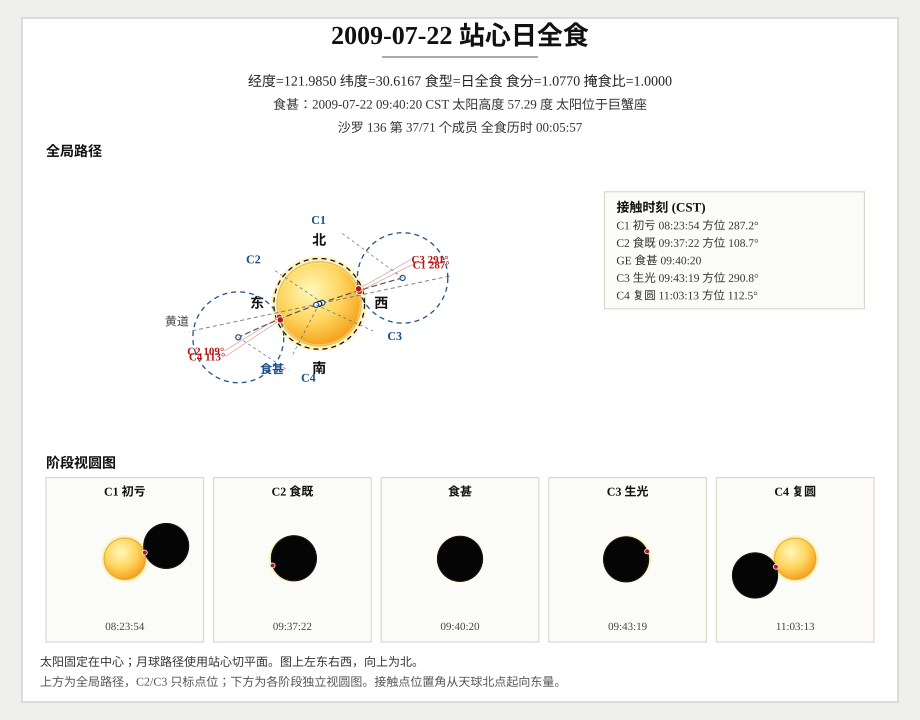

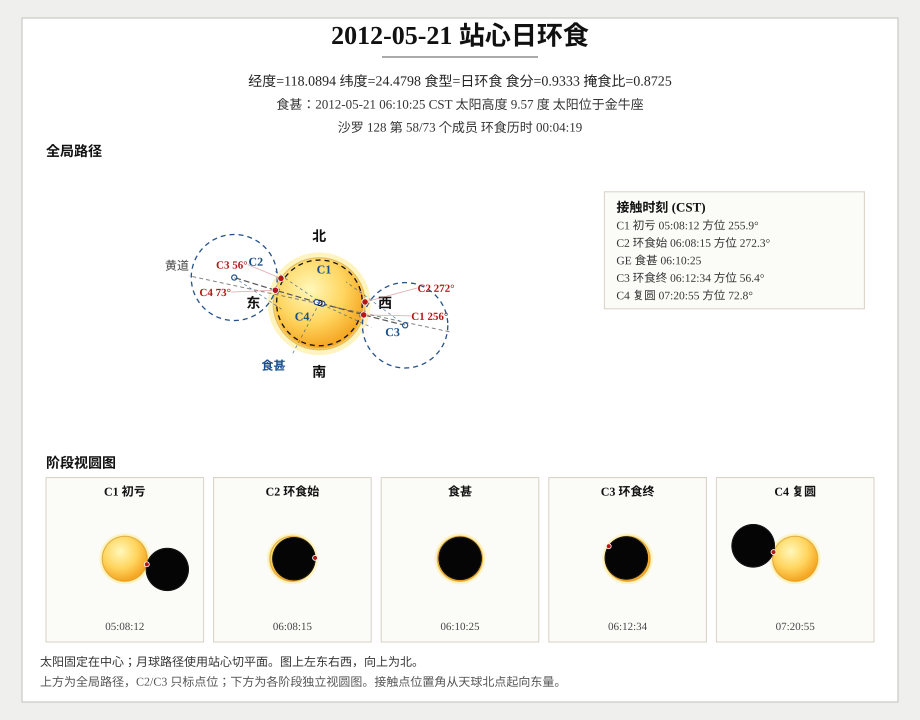

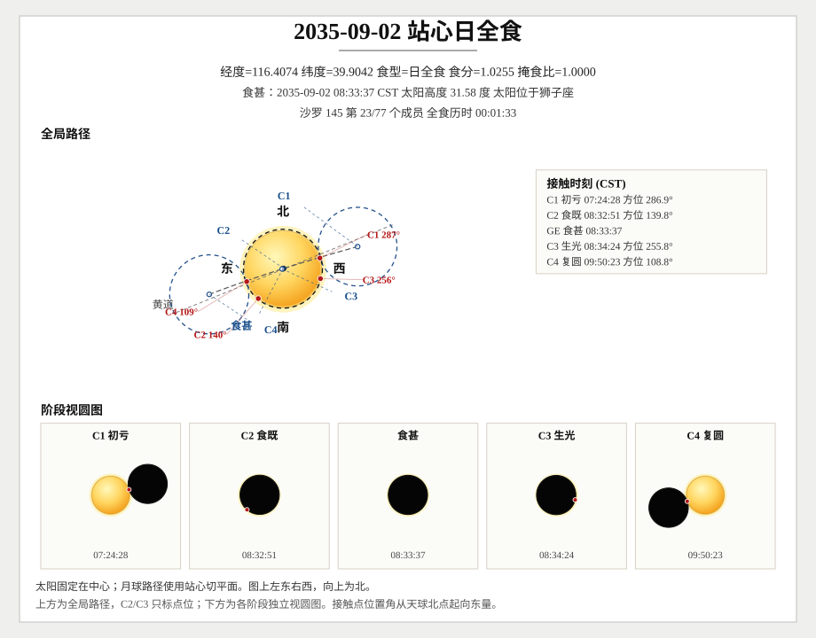

#### 月食

本库的月食判断与搜索能力统一放在 `eclipse` 包，返回结果会保持传入 `time.Time` 的时区。
常用接口：

- `LunarEclipseOnDate`：判断某个当地日期是否有月食
- `LastLunarEclipse` / `NextLunarEclipse` / `ClosestLunarEclipse`：搜索全局月食
- `LocalLunarEclipseOnDate`：判断某地当天是否能看到可见月食
- `LastLocalLunarEclipse` / `NextLocalLunarEclipse` / `ClosestLocalLunarEclipse`：搜索某地可见月食
- `LastLocalTotalLunarEclipse` / `NextLocalTotalLunarEclipse` / `ClosestLocalTotalLunarEclipse`：搜索某地可见月全食，返回 `(info, ok)`
- `GeometricLocalLunarEclipseOnDate`：判断某地当天是否发生几何月食，不做“月亮在地平线上方”的可见性过滤
- `eclipse/svg.LunarEclipseSVG`：生成月食穿影图 SVG

返回结果 `LunarEclipseInfo` 包含：

- 月食类型 `Type`
- 沙罗序列信息 `HasSaros` / `Saros`
- 半影食分 `PenumbralMagnitude`
- 本影食分 `UmbralMagnitude`
- 半影始、初亏、食既、食甚、生光、复圆、半影终等时刻

其中 `Saros` 的含义与日食部分相同：

- `Saros.Series`：`Verified=true` 时为 NASA 月食沙罗系列号，否则为推算的暂定系列号
- `Saros.Member`：这次月食在该系列中的第几个成员，从 `1` 开始
- `Saros.Count`：该沙罗系列的总成员数
- `Saros.Verified`：是否已与内置权威目录锚点核验；扩展表或范围外推算结果为 `false`

月食同样优先使用 NASA 锚点，天文年份 `-3000` 至 `+6000` 年内查扩展表，范围外才实时演算。推算成员按 Danjon 与 Chauvenet 检出的事件并集计数，因此不随调用的月食模型或观测地点改变；极浅成员可能与 NASA 目录不同，`Verified` 保持 `false`。
例如 `2028-12-31 / 2029-01-01` 这次跨年月全食属于 `月食沙罗序列125` 的第 `49/72` 个成员。

当前同时保留两套地影放大口径：

- **Danjon（默认）**：只对月球水平视差项乘 `1.01`，再与太阳视半径、太阳视差组合求影半径。NASA GSFC 当前月食目录与图页采用的也是这一路线，本库默认的 `LunarEclipseOnDate`、`LastLunarEclipse`、`NextLunarEclipse`、`ClosestLunarEclipse` 都使用它。
- **Chauvenet（兼容口径）**：先取 `0.99834 × 地球赤道半径`，再把整组影半径统一乘 `51/50`。这与传统旧历表口径更接近，适合做兼容性回归和旧结果对照。

两者的直接差异通常表现为：

- `Chauvenet` 给出的半影和本影都更大，半影食分通常比 `Danjon` 多约 `0.025`，本影食分通常多约 `0.005`
- 对边界月食而言，`Chauvenet` 更容易把结果推向“更深”的食型
- 与 NASA 目录、现代星历软件或当前主流月食资料对照时，对应的是默认的 `Danjon`
- 兼容既有历史基线时，对应的是显式调用的 `Chauvenet`

##### 代码示例

```go
package main

import (
	"fmt"
	"github.com/starainrt/astro/eclipse"
	"time"
)

func main() {
	date := time.Date(2029, 1, 1, 0, 0, 0, 0, time.UTC)

	// 默认使用 Danjon，更接近 NASA
	info := eclipse.ClosestLunarEclipse(date)
	fmt.Println(info.Type)
	fmt.Println(info.HasSaros, info.Saros)
	fmt.Println(info.Maximum)
	fmt.Println(info.PenumbralMagnitude, info.UmbralMagnitude)
	fmt.Println(info.PenumbralStart)
	fmt.Println(info.PartialStart)
	fmt.Println(info.TotalStart)
	fmt.Println(info.TotalEnd)
	fmt.Println(info.PartialEnd)
	fmt.Println(info.PenumbralEnd)

	// 如需兼容旧口径，可显式使用 Chauvenet
	legacy := eclipse.ClosestLunarEclipseChauvenet(date)
	fmt.Println(legacy.PenumbralMagnitude, legacy.UmbralMagnitude)

	// 判断某个本地自然日是否发生月食，返回时区与输入保持一致
	local := time.Date(2029, 1, 1, 12, 0, 0, 0, time.FixedZone("CST", 8*3600))
	today, ok := eclipse.LunarEclipseOnDate(local)
	fmt.Println(ok)
	fmt.Println(today.Type)
	fmt.Println(today.Maximum)
}
```

输出结果：

```text
total
true {125 49 72 true}
2028-12-31 16:52:05.566135346 +0000 UTC
2.2739890433790566 1.2461142882915068
2028-12-31 14:03:54.219463169 +0000 UTC
2028-12-31 15:07:42.115980684 +0000 UTC
2028-12-31 16:16:27.24464178 +0000 UTC
2028-12-31 17:27:46.214954853 +0000 UTC
2028-12-31 18:36:32.251235246 +0000 UTC
2028-12-31 19:40:11.52023971 +0000 UTC
2.2996033397562012 1.2511710895669002
true
total
2029-01-01 00:52:05.566135346 +0800 CST
```

##### 与 NASA 数据对照

以下对照值均来自 NASA GSFC 的月食目录和单次月食图页。结果基于当前库实现直接计算，时间误差单位为秒。

| 样例 | 模型 | 半影食分误差 | 本影食分误差 | 接触时刻对照 |
|------|------|--------------|--------------|----------------|
| 2026-03-03 月全食 | Danjon | -0.000072053 | -0.000065148 | 秒级对齐，最大误差 6.380 s |
| 2026-03-03 月全食 | Chauvenet | +0.025594905 | +0.004939948 | 兼容旧口径，不作为 NASA 时间对齐基准 |
| 2026-08-28 月偏食 | Danjon | -0.000118545 | -0.000028773 | 秒级对齐，最大误差 6.179 s |
| 2026-08-28 月偏食 | Chauvenet | +0.025562714 | +0.004962282 | 兼容旧口径，不作为 NASA 时间对齐基准 |
| 2024-03-25 半影月食 | Danjon | -0.000181657 | 见下说明 | 秒级对齐，最大误差 7.781 s |
| 2024-03-25 半影月食 | Chauvenet | +0.026039769 | 见下说明 | 兼容旧口径，不作为 NASA 时间对齐基准 |

以 `2026-03-03` 月全食为例，当前默认 `Danjon` 与 NASA 的逐项差异为：

- 食型：一致，都是 `total`
- 半影食分：`2.183727947` vs NASA `2.1838`，误差 `-0.000072053`
- 本影食分：`1.150634852` vs NASA `1.1507`，误差 `-0.000065148`
- 半影始：误差 `+3.400 s`
- 初亏：误差 `+5.801 s`
- 食既：误差 `+6.261 s`
- 食甚：误差 `+5.897 s`
- 生光：误差 `+5.776 s`
- 复圆：误差 `+6.328 s`
- 半影终：误差 `+6.380 s`

同一例中，`Chauvenet` 的结果为：

- 食型：一致，都是 `total`
- 半影食分：`2.209394905` vs NASA `2.1838`，误差 `+0.025594905`
- 本影食分：`1.155639948` vs NASA `1.1507`，误差 `+0.004939948`

`Chauvenet` 是保留给旧历表/旧口径兼容的影半径模型，半影和本影都会比默认 `Danjon` 更大；与 NASA 当前目录对照时，接触时刻会出现分钟量级偏移。这是模型口径差异，不代表默认月食接口的时间精度。

> 说明：纯半影月食时，NASA 会给出负的 `umbral magnitude`，表示月面中心距本影边界还有余量；本库也保留这个负值，因此纯半影月食与 NASA 的本影食分已经属于同口径比较。

##### 月食 SVG

`LunarEclipseSVG`、`LunarEclipseDetailedSVG` 与 `LunarEclipseMapSVG` 的默认模型与后缀入口口径见下文[全球见食图 SVG](#全球见食图-svg)。

默认月食 SVG 头部会自动带上沙罗序列；如果需要自定义更多文字，可以通过 `LunarEclipseSVGOptions` 覆写：

- `Title`：主标题
- `SummaryText` / `MaximumText` / `CoordinatesText` / `DurationText` / `MetaText`：标题下五行信息
- `ContactsTitle`：接触时刻区标题
- `DirectionText` / `FooterNote`：底部方向说明和补充说明

```go
package main

import (
	"fmt"
	"os"
	"time"

	eclipsesvg "github.com/starainrt/astro/eclipse/svg"
)

func main() {
	// 生成 2029-01-01 这次跨年月全食的穿影图。
	svg, ok := eclipsesvg.LunarEclipseSVG(
		time.Date(2029, 1, 1, 0, 0, 0, 0, time.UTC),
		eclipsesvg.LunarEclipseSVGOptions{
			Width:  960,
			Height: 620,
			Step:   10 * time.Minute,
		},
	)
	fmt.Println(ok, len(svg))
	if ok {
		_ = os.WriteFile("doc/lunar-eclipse-2029-01-01.svg", []byte(svg), 0o644)
	}
}
```

输出结果：

```text
true 19671
```

生成效果：

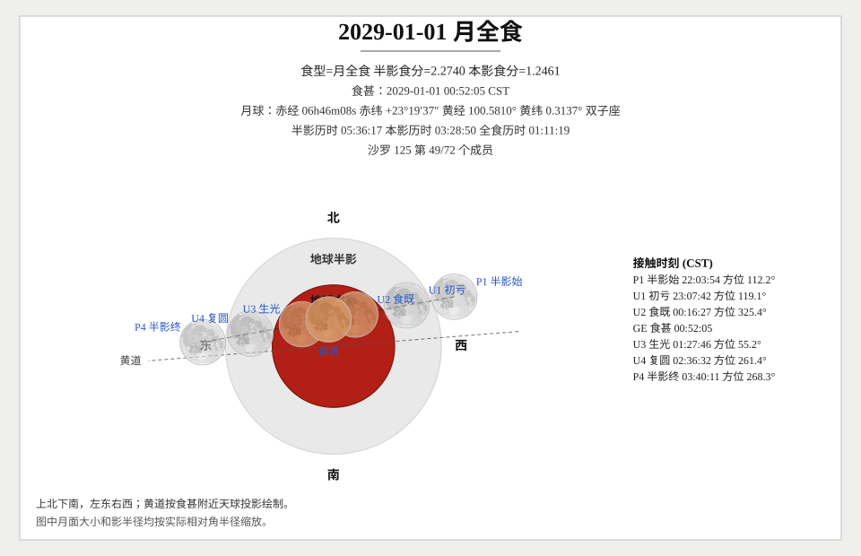

##### 参考资料

- NASA 月食 decade 目录：<https://eclipse.gsfc.nasa.gov/LEdecade/LEdecade2021.html?pubDate=20250222>
- NASA 2026-03-03 月全食图页：<https://eclipse.gsfc.nasa.gov/LEplot/LEplot2001/LE2026Mar03T.pdf>
- NASA 2026-08-28 月偏食图页：<https://eclipse.gsfc.nasa.gov/LEplot/LEplot2001/LE2026Aug28P.pdf>
- NASA 2024-03-25 半影月食图页：<https://eclipse.gsfc.nasa.gov/LEplot/LEplot2001/LE2024Mar25N.pdf>
- NASA 月食算法与历史说明：<https://eclipse.gsfc.nasa.gov/LEhistory/LEhistory.html>


### 月掩

月掩接口位于 `moon`，按用户给定的目标搜索，不会遍历恒星表。固定地点接口直接接收 `start`、`end`、经度、纬度和海拔；全球路径接口返回 WGS84 经纬度采样，可继续交给 `moon/svg` 或 `geojson`。

目标和接触语义分为两类：

- **恒星**按点光源处理，返回掩始 `Immersion`、掩甚 `Greatest` 和掩终 `Emersion`。
- **行星**按有限圆盘处理，外切为 C1/C4，完全被月面覆盖时另有内切 C2/C3；偏掩和擦掩没有 C2/C3。行星半径取赤道本体半径，不含行星环、大气延伸和扁率。
- `FindBestStarOccultations` / `FindBestPlanetOccultations` 返回全球海平面几何掩甚点，不按地平线、月高、可见时长或食分评分；`VisibleAtGreatest` 仅报告该点的可见性。
- 搜索时间窗按掩甚时刻选择事件。命中后会返回完整接触时刻或完整全球路径，不会把结果裁剪到查询端点。
- 接触时刻按目标与月面边缘的站心几何求解，不加入大气折射。`MoonAltitudeAtGreatest` 是月心真高度，`VisibleAtGreatest` 表示它是否不低于几何地平线。

#### 恒星月掩

恒星由调用者传入 `StarCoordinate`。`RA` / `Dec` 单位为度，`Epoch` 和 `Frame` 必填；自行单位为 `mas/year`，其中 `ProperMotionRACosDecMasPerYear` 使用星表常见的 `dRA*cos(Dec)` 口径。

可以直接构造坐标：

```go
target := moon.StarCoordinate{
	ID:                             "HR 4799",
	RA:                             189.1975,
	Dec:                            -5.831944444444,
	Epoch:                          time.Date(2000, 1, 1, 12, 0, 0, 0, time.UTC),
	Frame:                          moon.CoordinateFrameJ2000,
	ProperMotionRACosDecMasPerYear: -28,
	ProperMotionDecMasPerYear:      -18,
}
```

也可以显式加载内置 9100 星表，再用 `StarCoordinateFromStarData` 转换。月掩搜索本身不会加载星表；只有调用 `star.InitStarDatabase`、`StarDataByName`、`StarDataByHR` 等星表接口时才会加载。

```go
package main

import (
	"fmt"
	"time"

	"github.com/starainrt/astro/moon"
	"github.com/starainrt/astro/star"
)

func main() {
	cst := time.FixedZone("CST", 8*3600)
	start := time.Date(2025, 6, 5, 0, 0, 0, 0, cst)
	end := start.Add(24 * time.Hour)

	_ = star.InitStarDatabase()
	data, _ := star.StarDataByName("进贤增九")
	target, _ := moon.StarCoordinateFromStarData(data)

	events, _ := moon.FindStarOccultations(
		start, end, target,
		121.56601, 6.80706, 0,
		moon.OccultationSearchOptions{},
	)
	for _, event := range events {
		fmt.Println(event.TargetID, event.Type)
		fmt.Println(
			event.Immersion.Format("2006-01-02 15:04:05.000 MST"),
			event.Greatest.Format("2006-01-02 15:04:05.000 MST"),
			event.Emersion.Format("2006-01-02 15:04:05.000 MST"),
		)
		fmt.Printf("altitude=%.3f visible=%v\n", event.MoonAltitudeAtGreatest, event.VisibleAtGreatest)
	}

	paths, _ := moon.FindStarOccultationPaths(
		start, end, target,
		moon.OccultationPathOptions{Step: 5 * time.Minute, TargetSpacingKM: 200},
	)
	for _, path := range paths {
		fmt.Println(
			path.Start.Time.Format("2006-01-02 15:04:05.000 MST"),
			path.Greatest.Time.Format("2006-01-02 15:04:05.000 MST"),
			path.End.Time.Format("2006-01-02 15:04:05.000 MST"),
		)
		fmt.Printf("greatest=%.6f %.6f width=%.1fkm center=%d\n",
			path.Greatest.Longitude, path.Greatest.Latitude,
			path.Greatest.WidthKM, len(path.CenterLine))
	}
}
```

输出结果：

```text
进贤增九 total
2025-06-05 19:14:01.062 CST 2025-06-05 20:02:06.296 CST 2025-06-05 20:50:10.697 CST
altitude=75.561 visible=true
2025-06-05 17:45:28.475 CST 2025-06-05 20:02:06.300 CST 2025-06-05 22:18:49.945 CST
greatest=121.566140 6.807079 width=3582.4km center=108
```

`OccultationSearchOptions` 的零值使用默认搜索步长和安全余量；`MaxEvents > 0` 限制返回数量。`OccultationPathOptions.Step` 控制基础时间采样，`TargetSpacingKM` 按地面距离自适应加密中心线；过密请求超出确定性预算时返回 `ErrOccultationPathSamplingLimit`。`RiseSetStep` 独立控制初掩、掩甚、终掩分别发生在月升/月落时的六类阶段线，零值使用 5 分钟；`DisableRiseSet` 可跳过这些阶段线。`DisableFootprints` 跳过体积较大的密集瞬时可见区要素，改用稀疏支撑样本合并成紧凑掩带；中心线、边界和六类升落阶段线仍保留，适合普通 GeoJSON 地图（首次渲染需合并一次，重复渲染走缓存）。`GreatestLimitSeparationKM` 是掩甚处南北限的地面间距，掩星图与详细版的"掩带宽"用它标注，与 `Greatest.WidthKM` 口径不同、不可互换。`IncludeFootprintTimeline` 可在紧凑掩带之外保留按 `FootprintTimelineStep` 采样的瞬时足迹，供时间轴选择当前时刻的可见区域。

`OccultationPathOptions.Algorithm` 控制恒星和行星全球路径的星历分支：零值或 `moon.OccultationPathAlgorithmOptimized` 默认使用经抽检的 30 分钟节点矢量插值，保留现有站心方程、连续包络和升落曲线；`moon.OccultationPathAlgorithmExact` 保留原有分支，候选可使用插值，最终求解仍使用全项星历。优化分支在抽检不合格时回退到原分支，超出插值时间窗时使用精确星历。抽检不是全时段严格误差证明；两个分支的几何目标相同，但不保证采样点或 GeoJSON 字节完全相同。此选项不影响仅查询事件、指定站点接触或独立单时刻月影接口，也不影响日月食。

两个分支的全球起止、掩甚标记和中心线宽度均保留全项星历计算。绘图时应传入完整返回路径，包括可见性轮廓；丢弃该轮廓会调用历史瞬时足迹回退逻辑，其边界不能替代完整解析可见集。

路径中的 `BandContours` 是静态掩带的接触包络，`VisibilityContours` 是月亮处于地平线以上时的可见时间包络；两者与 `Footprints` 的瞬时采样分别承担静态边界、可见性边界和时间轴细节，不应互相替代。

`OccultationPathOptions.GreatestTimeValues` / `GreatestTimeStep` 请求**掩甚时刻等时线**。与日食不同，`GreatestTimeValues []float64` 给的是力学时儒略日，最多保留 64 条（先去掉重复的时刻取值，按时间先后排序，超出时保留最早的 64 条），掩可见窗口之外或没有可用支路的时刻取值不会出现在结果里；它为空时改用 `GreatestTimeStep`，同样只在为正值时生效，且对齐到 UTC 整刻度。结果写入 `StarOccultationPath.GreatestTimeContours`（行星路径是同名字段），元素类型 `OccultationGreatestTimeContour` 的 `JDE`、`Time`、`Segments` 与日食同义：`Time` 在按步长生成时是原始对齐时刻，显式给出的时刻取值则由 `JDE` 换算并抹到毫秒，两者都落在 UTC 时区，而支路点的时刻仍按路径时区；日食公共层的 `Time` 则直接落在输入时区。边界口径同样一致：只出现在目标盘面与月面确有重叠且月亮在几何地平以上（不含蒙气差与半径修正）的地方，两端止于地平线或掩可见域边界，纬度 ±88° 以上不再延拓，同一时刻可能有多条互不相连的支路；不请求时既有输出不变。

```go
options := moon.OccultationPathOptions{
	Algorithm: moon.OccultationPathAlgorithmExact, // 显式选择原分支；省略时使用优化分支
	DisableFootprints: true,
}
```

#### 行星月掩

行星目标使用 `OccultationMercury` 到 `OccultationNeptune` 常量。下面以 `2025-02-01` 月掩土星为例，在靠近全球几何掩甚点的位置求 C1-C4：

```go
package main

import (
	"fmt"
	"time"

	"github.com/starainrt/astro/moon"
)

func main() {
	cst := time.FixedZone("CST", 8*3600)
	start := time.Date(2025, 2, 1, 0, 0, 0, 0, cst)
	events, _ := moon.FindPlanetOccultations(
		start, start.Add(24*time.Hour), moon.OccultationSaturn,
		104.52219613, 55.25401991, 0,
		moon.OccultationSearchOptions{},
	)
	for _, event := range events {
		fmt.Println(event.TargetID, event.Type, event.HasInternalContacts)
		fmt.Println(event.ExternalImmersion.Format("2006-01-02 15:04:05.000 MST")) // C1
		fmt.Println(event.InternalImmersion.Format("2006-01-02 15:04:05.000 MST")) // C2
		fmt.Println(event.Greatest.Format("2006-01-02 15:04:05.000 MST"))
		fmt.Println(event.InternalEmersion.Format("2006-01-02 15:04:05.000 MST")) // C3
		fmt.Println(event.ExternalEmersion.Format("2006-01-02 15:04:05.000 MST")) // C4
	}
}
```

输出结果：

```text
Saturn total true
2025-02-01 11:29:09.710 CST
2025-02-01 11:29:40.069 CST
2025-02-01 12:00:48.747 CST
2025-02-01 12:32:46.415 CST
2025-02-01 12:33:18.312 CST
```

`FindPlanetOccultationPaths` 的全球结果同时包含任意圆盘重叠的部分掩区域和整颗行星被遮住的全掩区域。`HasTotalBand` 表示是否存在全掩带，`GreatestTotalWidthKM` 是掩甚处全掩带宽；中心线、边界和启用时的瞬时足迹都带采样时刻。

#### 月掩 SVG

`moon/svg` 同时提供“搜索并渲染”和“渲染已计算结果”两组入口：

- `FindLocalStarOccultationSVGs` / `FindLocalPlanetOccultationSVGs`：指定地点的实际月面轨迹、白道和接触阶段图。
- `FindStarOccultationSVGs` / `FindPlanetOccultationSVGs`：全球掩带、中心线、阶段点和时间标记图。
- `LocalStarOccultationSVG` / `LocalPlanetOccultationSVG`：渲染已有的固定地点事件。
- `StarOccultationPathSVG` / `PlanetOccultationPathSVG`：渲染已有的全球路径。

```go
localSVGs, err := moonsvg.FindLocalStarOccultationSVGs(
	start, end, target,
	121.56601, 6.80706, 0,
	moon.OccultationSearchOptions{},
	moonsvg.LocalStarOccultationSVGOptions{Width: 920, Height: 700, Location: cst},
)
fmt.Println(err, len(localSVGs))
```

本地图按指定观测者的站心几何绘制，下图沿用前文 `2025-06-05` 月掩进贤增九（HR 4799）的样例。局地图的观测点为 `121.56601°E, 6.80706°N`，靠近全球几何掩甚点；图中的掩始、掩甚和掩终是该地点实际看到的站心接触时刻，并同时给出月面方向、白道、月高、方位和地平可见性。

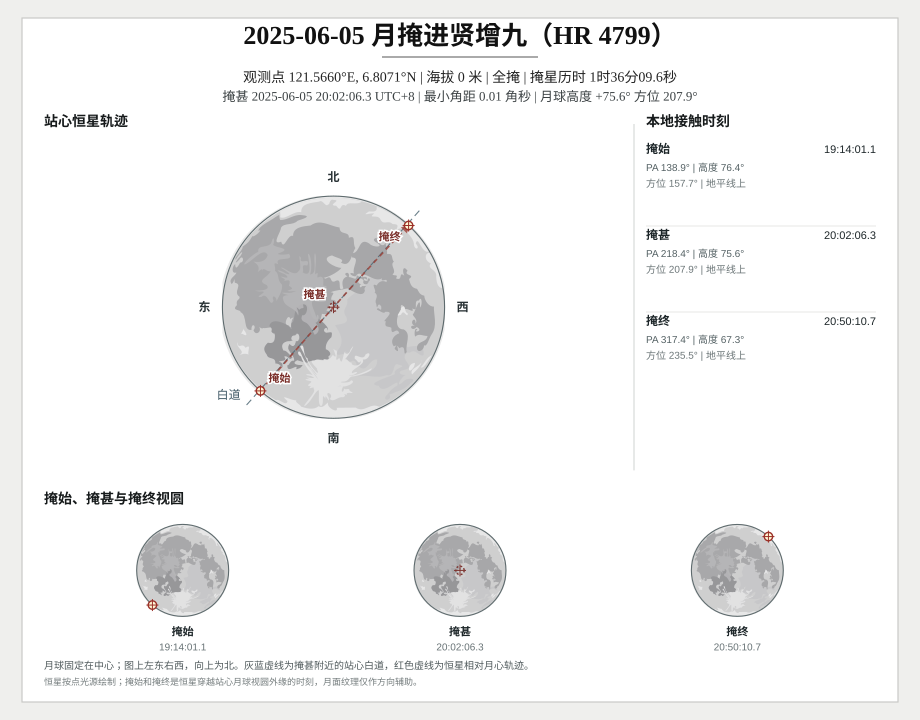

### 天象图与 GeoJSON

#### 全球见食图 SVG

`eclipse/svg` 可直接生成日食和月食全球图。日食图绘制完整偏食可见区、全食/环食中心带、中心线、全球阶段信息和中心线时间标记；同时显示初亏/食甚/复圆的日升日落线、太阳直射点、影轴进出地球点、`P1-P4/U1-U4` 接触点，以及默认关闭、按需打开的定时半影轮廓和本影/反本影轮廓。月食图绘制 P1/P4 可见半球、月出/月落过渡区和整场可见区。

`LunarEclipseDetailedSVG` 把上述两类月食图合成详细版式的一页：居中摘要（食甚、半影/本影食分、伽马、半影/本影半径、月距、沙罗序列）、左右两侧的日月地心坐标块、穿影示意图、历时 / 弧分比例尺 / 接触时刻三栏，以及下方的世界可见性底图与图例。地影几何由 `basic.LunarEclipseShadowGeometryAt` 给出，其中 **Gamma 用地球赤道半径、半影/本影半径用度**，换成地球半径要乘以月球处的地球视差。

```go
package main

import (
	"os"
	"time"

	eclipsesvg "github.com/starainrt/astro/eclipse/svg"
)

func main() {
	cst := time.FixedZone("CST", 8*3600)

	solar, ok := eclipsesvg.SolarEclipseMapSVG(
		time.Date(2009, 7, 22, 12, 0, 0, 0, cst),
		eclipsesvg.SolarEclipseMapSVGOptions{
			Width: 1200, Height: 800, Location: cst,
			TimeLabelStep: 30 * time.Minute,
		},
	)
	if ok {
		_ = os.WriteFile("doc/solar-eclipse-yangshan-2009-global.svg", []byte(solar), 0o644)
	}

	lunar, ok := eclipsesvg.LunarEclipseMapSVG(
		time.Date(2029, 1, 1, 0, 0, 0, 0, cst),
		eclipsesvg.LunarEclipseMapSVGOptions{Width: 1200, Height: 800, Location: cst},
	)
	if ok {
		_ = os.WriteFile("doc/lunar-eclipse-2029-01-01-global.svg", []byte(lunar), 0o644)
	}

	detailed, ok := eclipsesvg.LunarEclipseDetailedSVG(
		time.Date(2029, 1, 1, 0, 0, 0, 0, cst),
		eclipsesvg.LunarEclipseDetailedSVGOptions{Location: cst},
	)
	if ok {
		_ = os.WriteFile("doc/lunar-eclipse-2029-01-01-detailed.svg", []byte(detailed), 0o644)
	}
}
```

图上的橙色长虚线是初亏/食甚/复圆分别发生在日出和日落时的六类阶段线；**瞬时半影与本影轮廓默认不画**，需要时用正的 `PenumbralOutlineStep` / `CentralShadowStep` 打开。紫色短虚线是 `MagnitudeValues` 指定的地方最大食分等值线（默认 0.2/0.4/0.6/0.8），蓝色实线是食甚时刻等时线。

**食甚时刻等时线**（蓝色实线）默认不画：同一条线上的地点在同一时刻看到食甚，需要时用正的 `GreatestTimeStep` 打开，NASA 全球图的间隔是 30 分钟。这里的 `GreatestTimeStep` 属于 SVG 层，按**展示时区**（`Location`）对齐整刻度，与数据层的 UTC 对齐不同；`eclipse/svg` 不提供显式时刻取值入口，需要别的对齐刻度时请直接调用数据层并把时刻传给 `GreatestTimeValues`。

```go
solar, _ := eclipsesvg.SolarEclipseMapSVG(date, eclipsesvg.SolarEclipseMapSVGOptions{
	Width: 1200, Height: 800, Location: cst,
	GreatestTimeStep: 30 * time.Minute,
})
```

它不是在经纬度网格上逐点求食甚再描等值线，而是固定时刻后求解 `∂(日月中心角距²)/∂t = 0` 的零集，再沿曲线延拓，因此成本正比于曲线长度而不是可见域面积。等时线只画在日月盘面确有重叠且太阳在几何地平以上（不含蒙气差与半径修正）的地方，每条支路止于地平线或偏食可见域边界；纬度 ±88° 以上不再延拓，同一时刻可能有多条互不相连的支路。

`TimeLabelStep` 的零值为 30 分钟，负值关闭中心线时刻标记。`GreatestTimeStep` 的零值与负值都不画食甚时刻等时线（与核心层、`moon/svg` 一样必须显式请求），正值按展示时区对齐、小于一分钟时按一分钟处理，单次最多生成 64 条；30 分钟是 NASA 全球图的推荐间隔。`MagnitudeValues` 为 nil 时使用 0.2/0.4/0.6/0.8，显式空切片关闭，非空切片按给定电平绘制。

`SolarEclipseMapSVGOptions.EventsTitle` 覆盖“全球阶段”数据块的标题（该块给出食甚经纬度与地球范围的中心食始/终），为空时使用本地化默认标题；`MapTitle` 与 `Title` 分别覆盖地图分区标题与主标题。

日食图的画布下限是 **800×560**：宽度小于 800 或高度小于 560 时按文档回落到 960×640，更窄的横版画布上地图框会与右栏数据网格水平重叠、面板行距压到 1 px 以下。`PartialStep` 小于两分钟时按两分钟处理：偏食区填充是瞬时足迹的并集，成本随采样数成倍增长，而并集必须由一整条自洽的扫描序列生成，更密的请求不改变产物（1 秒步长实测 36.8 s / 951 MB，夹取后为 1.1 s / 30 MB，与默认请求逐字节相同）。月食详细版式按 `Height` 推导版面：640×420 与 800×600 容不下示意图与底图的下限而返回 `false`，1000×1414 与 1414×1000 正常出图。

`eclipse/svg` 的三个无后缀月食入口（`LunarEclipseSVG`、`LunarEclipseDetailedSVG`、`LunarEclipseMapSVG`）使用同一个默认模型：以 Danjon 为主，极浅半影按核心默认口径回退 Chauvenet，与 `LunarEclipseOnDate` 一致；带 `Danjon` / `Chauvenet` 后缀的入口强制指定模型。

可降级的图层用 `data-source` 标注实际几何来源，取值词表见 `eclipse/svg` 包注释：`partial-band-union`、`sampled-footprint-sweep`、`partial-band-contours`、`rise-set-phase-lines`、`magnitude-contours`、`greatest-time-isochrones`、`besselian-critical-envelope`、`paired-limit-chords`、`sampled-open-sweep`、`central-path-limits`、`penumbral-outlines`、`central-shadow-outlines`、`p1-p4-visibility-regions`、`p1-p4-horizon-boundaries`。`PenumbralOutlineStep` 与 `CentralShadowStep` **默认关闭**（零值或负值都不画瞬时半影/本影轮廓，它们会把地球盖住，NASA 全球图也没有这两族），正值给出采样间隔，小于一分钟时按一分钟。

日食和月掩的自动投影会在适合时选择北极或南极图；月食默认使用等经纬投影。投影仅影响 SVG 表达，不改变底层 WGS84 地理结果。

日月食通过 `EclipseMapProjectionEquirectangular`、`EclipseMapProjectionNorthPolar`、`EclipseMapProjectionSouthPolar` 强制投影；月掩使用对应的 `MapProjection...` 常量。`EclipseMapProjectionOrthographic` 给出 NASA 版式的**正射球面图**：视点取食甚点，只画朝向视点的半个地球，投影边界就是可见半球的大圆。

球面图不需要新增数据，也不需要第三方投影库：陆地由内置的等经纬底图在运行时反解回经纬度再正射投影，视界裁剪在地理坐标上按大圆求交、并沿视界弧补齐被切断的环；经纬网按球面采样后同样裁剪。

正射投影同时切换成 **NASA 摆法**的版式：球面居中放大，比例尺排在球面正下方，阶段信息改为三栏面板（半影接触 / 食甚点地方情况 / 本影接触），图例与页脚依次向下；其他投影保持原有版式。代价是 `1000×1414` 画布下整幅图约 1.0 s（等经纬图约 0.85 s），一个同尺寸的球面图 SVG 约 530 KB；耗时为单机实测参考值，绝对值因机器而异。

下面的全球图沿用前文局地 SVG 的事件日期。2009 长江大日食、2012 厦门日环食和 2035 北京日全食使用等经纬投影：

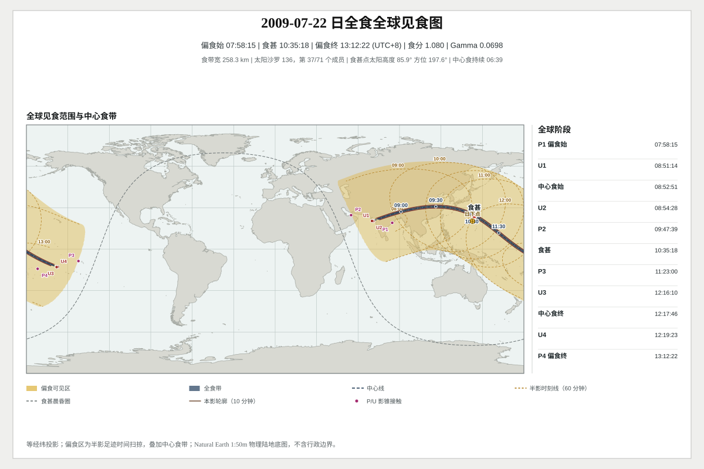

同一场日食的正射球面版式（`EclipseMapProjectionOrthographic`）：

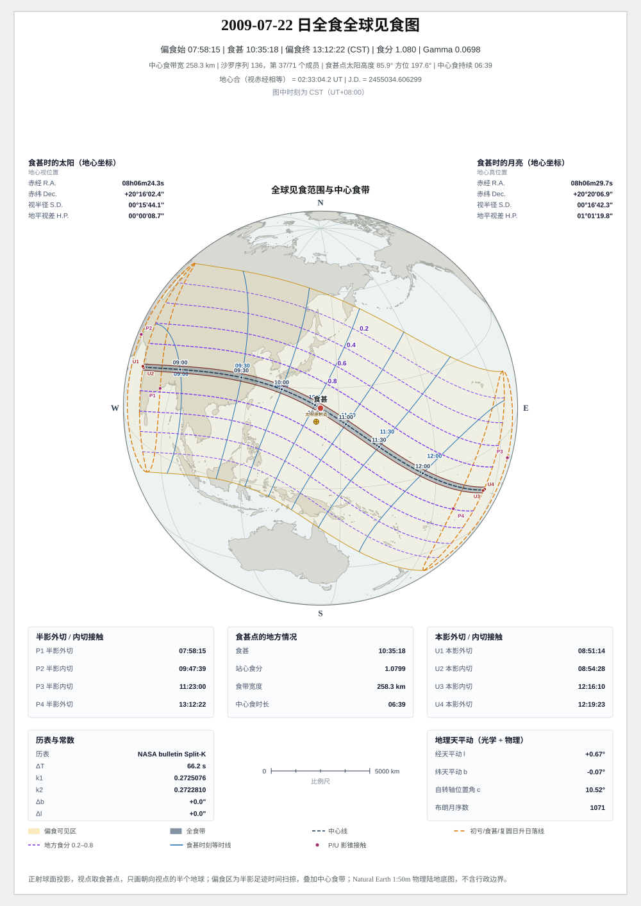

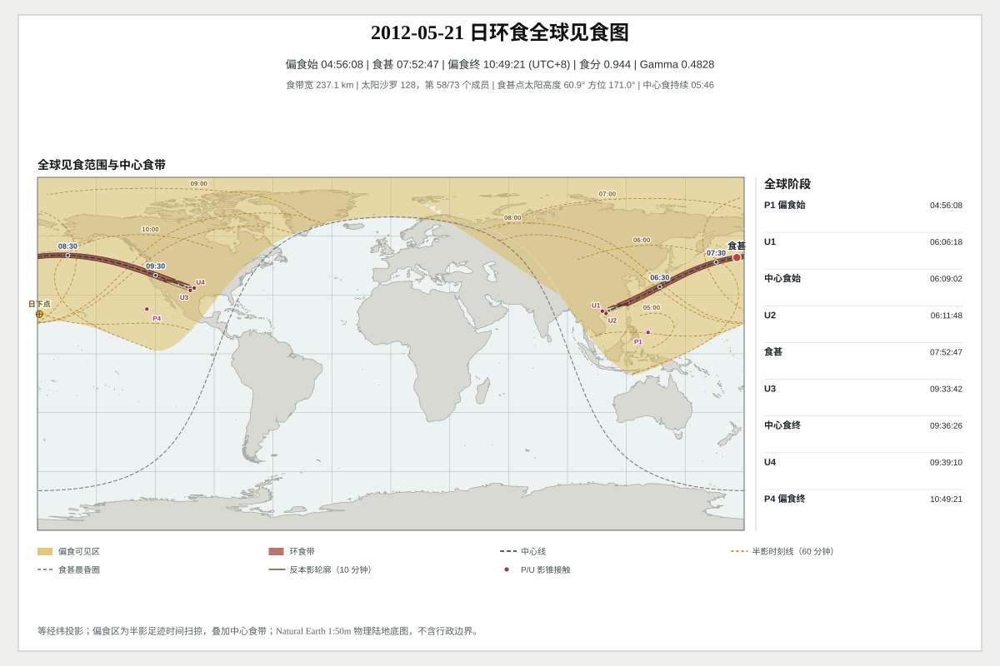

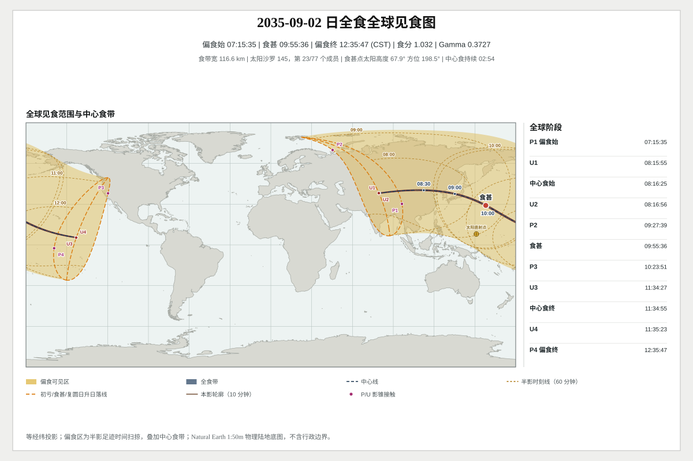

`2012-05-21` 日环食的偏食可见区覆盖北极点。下面把同一事件强制切换为北极方位等距投影，以便查看跨反经线的北极区见食范围；圆形边界是投影范围，不是行政或政治边界：

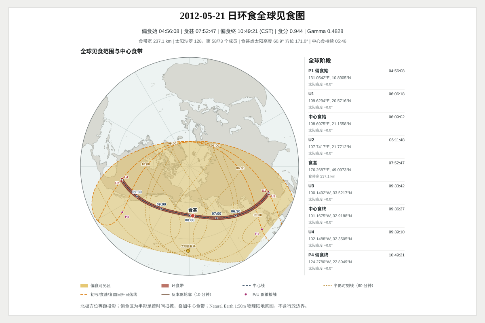

月食沿用前文 `2029-01-01` 跨年月全食，显示全程可见、带食月出、带食月落和不可见区域：

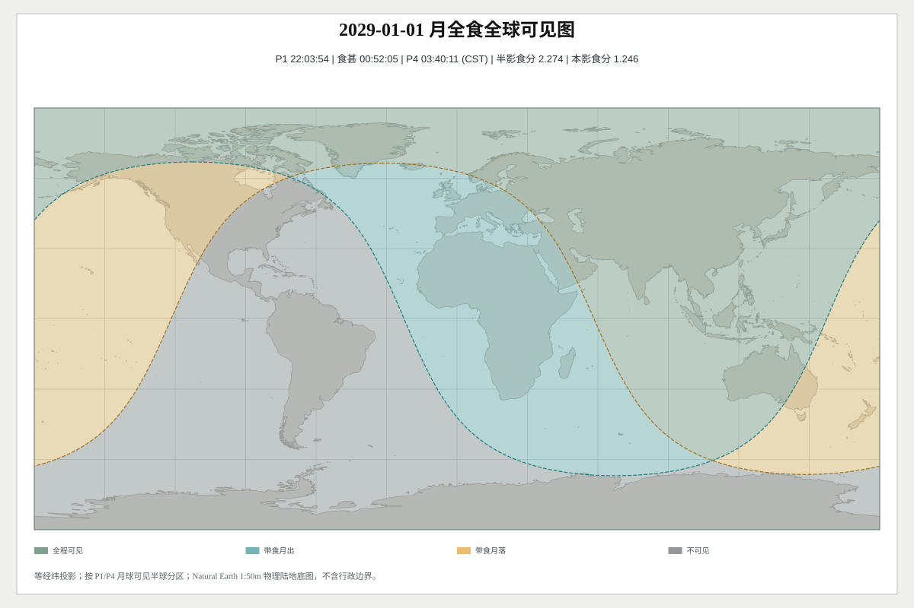

月食还有把上面两类图合二为一的详细版式：居中摘要（食甚、半影/本影食分、伽马、半影/本影半径、月距、沙罗序列）、左右两侧的日月地心坐标块、穿影示意图、历时 / 弧分比例尺 / 接触时刻三栏，以及下方的世界可见性底图与图例，一页 `1000x1414`：

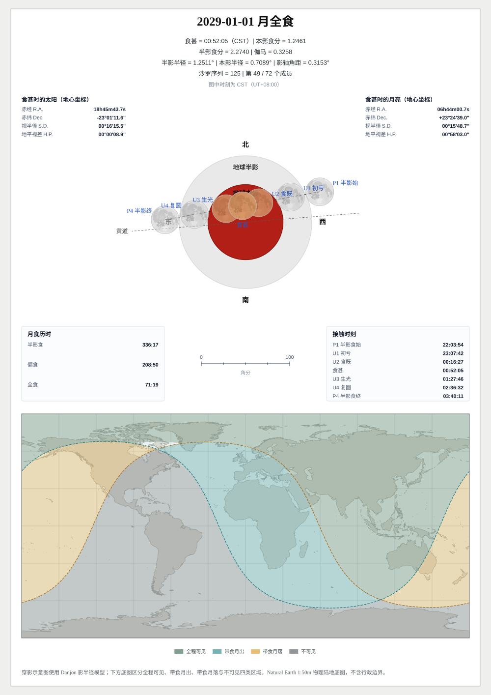

#### 月掩详细版式 SVG

`moon/svg` 的详细版式把整场月掩合成一页 `1000x1414`：居中摘要、日月与目标天体的地心/站心数据块、一张**正射球面**的全球掩带图（南北限、可见/几何中心线、掩甚点、初掩/掩甚/终掩阶段点与 30 分钟时间标记），以及页脚说明。球面视点取事件中心，只画朝向视点的半球，这一版式固定用正射球面，不接受其它投影；只需要单独的全球掩带地图时用前文“月掩 SVG”的 `StarOccultationPathSVG` / `FindStarOccultationSVGs`。页内数据分为月亮地心坐标、目标天体、掩带路径点、接触时刻、历表与常数、天平动六块；横版画布把数据块排在地图右侧两栏三行，竖版把数据块排在球面下方三栏两行。下图是 `2025-06-05` 月掩 HR 4799：

```go
package main

import (
	"os"
	"time"

	"github.com/starainrt/astro/moon"
	moonsvg "github.com/starainrt/astro/moon/svg"
)

func main() {
	cst := time.FixedZone("CST", 8*3600)
	star := moon.StarCoordinate{
		ID: "HR 4799", RA: 189.1975, Dec: -5.831944444444,
		Epoch: time.Date(2000, 1, 1, 12, 0, 0, 0, time.UTC), Frame: moon.CoordinateFrameJ2000,
		ProperMotionRACosDecMasPerYear: -28, ProperMotionDecMasPerYear: -18,
	}
	paths, err := moon.FindStarOccultationPaths(
		time.Date(2025, 6, 5, 0, 0, 0, 0, cst),
		time.Date(2025, 6, 6, 0, 0, 0, 0, cst),
		star,
		moon.OccultationPathOptions{Step: 5 * time.Minute, TargetSpacingKM: 200},
	)
	if err == nil && len(paths) > 0 {
		detailed, renderErr := moonsvg.StarOccultationDetailedSVG(
			paths[0], star,
			moonsvg.OccultationDetailedSVGOptions{Width: 1000, Height: 1414, Location: cst},
		)
		if renderErr == nil {
			_ = os.WriteFile("doc/lunar-occultation-hr4799-2025-06-05-detailed.svg", []byte(detailed), 0o644)
		}
	}
}
```

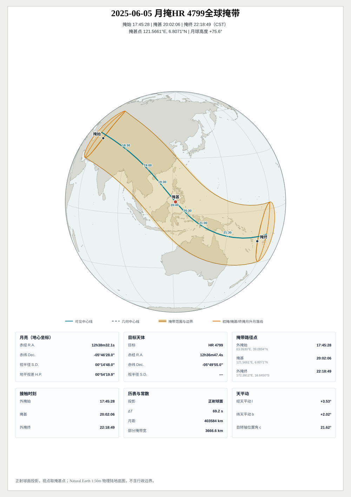

页内的球面掩带图使用 Natural Earth `1:50m` 海岸线，不含行政边界。在 `moon.OccultationPathOptions` 上设置 `GreatestTimeStep` 会额外请求**掩甚时刻等时线**，含义与日食图上的蓝色等时线相同：固定时刻后求角距导数的零集并沿曲线延拓。它同样是可选项，不设置时输出不变。掩星全球可见窗口通常只有数小时（本页 HR 4799 样例为 4 小时 33 分），常用间隔比日食更密，为 15–30 分钟量级，间隔越大掩带上的等时线越少；点源恒星按日月中心角距定食甚，有限盘面行星按外接触度量，分别与库内 `StarOccultationInfo.Greatest`、`PlanetOccultationInfo.Greatest` 同口径。`moon/svg` 自己不提供等时线开关，只绘制路径结果里已有的 `GreatestTimeContours`，因此请求必须在计算路径时通过 `OccultationPathOptions` 提出，线的位置也由核心口径决定（`GreatestTimeStep` 对齐 UTC 整刻度）；按展示时区对齐的入口，是把时刻换算成力学时儒略日后传给 `GreatestTimeValues`。全球掩始和掩终表示月影首次接触和最后离开地球，与指定地点的接触时刻无关。

- 画布与错误：详细版最小 `480x320`，并按画布推导版式，地图与数据块放不下时返回 `ErrInvalidOccultationDetailedSVGOptions`（`800x600`、`1000x1414`、`1414x1000` 均可出图，`640x420`、`900x400` 会被拒绝）；单独的全球掩带地图最小 `640x480`，更小的画布返回 `ErrInvalidStarOccultationSVGOptions`。

图上标注的“掩带宽”是掩甚处南北限的地面间距 `GreatestLimitSeparationKM`（本例约 `3666.6 km`），与中心线横向宽度 `Greatest.WidthKM`（约 `3582.4 km`）口径不同、不可互换。掩甚时刻等时线要在路径层显式请求 `OccultationPathOptions.GreatestTimeStep`；使用 `DisableFootprints` 的紧凑掩带首次渲染会合并一次，之后同一路径走缓存。详细版式与固定地点图见前文“月掩 SVG”。

#### GeoJSON

`geojson` 接收已经计算好的日食、月食或月掩结果，返回 `[]byte`。这段字节是完整的 UTF-8 RFC 7946 `FeatureCollection` JSON，不是图片，也不是压缩数据，可以直接写入 `.geojson`、交给 `encoding/json`，或发送给前端地图组件。

```go
package main

import (
	"encoding/json"
	"fmt"
	"time"

	"github.com/starainrt/astro/eclipse"
	"github.com/starainrt/astro/geojson"
)

func main() {
	date := time.Date(2024, 4, 8, 0, 0, 0, 0, time.UTC)
	partial, ok := eclipse.SolarEclipsePartialFootprints(
		date,
		eclipse.SolarEclipsePartialFootprintOptions{
			Step: 10 * time.Minute, BoundaryPoints: 180,
		},
	)
	if !ok {
		return
	}
	central, hasCentral := eclipse.SolarEclipseCentralPath(
		date,
		eclipse.SolarEclipsePathOptions{Step: time.Minute, TargetSpacingKM: 20},
	)
	var centralPath *eclipse.SolarEclipsePath
	if hasCentral {
		centralPath = &central
	}

	data, err := geojson.MarshalSolarEclipseWithTimeMarkers(
		partial, centralPath,
		geojson.TimeMarkerOptions{
			Step: 30 * time.Minute,
			Location: time.FixedZone("CST", 8*3600),
		},
	)
	fmt.Println(err, json.Valid(data))
}
```

对应的无时间标记和带时间标记入口包括：

- `MarshalSolarEclipse` / `MarshalSolarEclipseWithTimeMarkers`
- `MarshalLunarEclipse` / `MarshalLunarEclipseWithTimeMarkers`
- `MarshalStarOccultation` / `MarshalStarOccultationWithTimeMarkers`
- `MarshalPlanetOccultation` / `MarshalPlanetOccultationWithTimeMarkers`

坐标统一为 WGS84 经度、纬度，跨反经线的线和面会拆分。带时路径的 `times` 属性与各段坐标逐点对齐；`WithTimeMarkers` 另加 `role=time-marker` 的 Point Feature，本地化 `label` 用于显示，`time` 始终是 UTC RFC 3339。

单时刻原语（拖动时间轴、"停下即精确"）与站心搜索跨度：

- `eclipse.NewSolarEclipseShadowSolver(eclipse.SolarEclipseShadowSolverOptions{...})` 返回可复用句柄；`ShadowAt(time.Time)`（按 UTC 解释）或 `ShadowAtJDE(jdeTT)`（TT 语义）取该时刻的**全球本影足迹**，`StationStateAt` / `StationStateAtJDE` 取该时刻、该站点的**站心日月几何**（食分、遮蔽率、站心角距、日月视半径、太阳高度/方位、是否处于全食/环食）。两者都只算这一件事，不产生可见带、食分线、升落边界、南北界或中心线；本影不在地球上时返回空/零值而不是错误。
- `geojson.MarshalSolarEclipseShadowInstant(instant)` 只输出该时刻的阴影区域，以及被地平线切断时的物理边界；属性含 `time`、`source_boundary_closed`、`geometry_role`、`closure`、`delta_t_seconds`、`model`、`interp_signature`。本影用 `central-shadow-footprint` + `central-shadow-boundary`；把 `Kind` 设为 `SolarEclipseShadowPenumbra` 则输出半影（偏食区），角色为 `partial-footprint` + `partial-footprint-boundary`，默认参数与整包偏食采样一致（96 点 + 200 km 加密），因此同一时刻的结果与采样逐点一致（约 1e-12 度差）。没有阴影时返回空 FeatureCollection。
- 采样的 `partial-footprint` 也带 `source_boundary_closed`、`geometry_role`、`closure` 与 `interp_signature`；被地平线切断的序列端点补到地平圈擦地点，未补齐时该处的端点偏差为 `36–41 km` 量级。掩带的填充提示仍沿用旧封口，避免端点外扩改变极区面归属。
- 实测成本（原生构建，单机参考值，绝对值因机器而异）：单时刻足迹（96 点）约 **64 µs**，站心瞬时约 **20 µs**；公开句柄构造只是夹取选项（≈0），首次查询时按最近朔月构造内部状态约 39 µs、锚点查询约 130 µs，随后按事件缓存；批处理约 75 µs/时刻。
- ΔT：`DeltaTSeconds` 显式指定时只作用于该句柄，且只改变地球自转相位——同一 TT 的几何不变，地面足迹沿经度平移 `0.4651·|ΔΔT|·cos(纬度)` 千米（见 `basic.DeltaTGroundShiftKM`）；`<=0` 时使用进程级模型。两种情况下结果都回传实际使用的 ΔT。库不附带 ΔT 不确定度模型，请用该函数把外部的 ΔT 标准差换算成几何不确定度。
- 插值：整包的 `central-shadow-footprint` 与该时刻的单时刻导出都带 `interp_signature`（形如 `umbra-closed-seg1-pt97`，由物理边界的顶点数/分段数/闭合标志与绕极标志给出），**相同**的相邻时刻才适合按顶点插值；`closed` 翻转、段数变化（换日线拆分）、顶点数变化、空↔非空（U1/U4 附近）时必须改取精确几何。实测 2 分钟步长下中段质心移动 78–232 km，端点附近可达约 520 km。
- 批量：`ShadowBetween(start, end, step)` / `StationStatesBetween(...)` 按时间轴对齐返回整段，没有阴影的时刻是空条目。
- 掩星的单时刻足迹（`moon.StarOccultationFootprintAt` / `moon.PlanetOccultationFootprintsAt` → `geojson.MarshalStarOccultationFootprint` / `MarshalPlanetOccultationFootprints`）同样带 `delta_t_seconds`、`source_boundary_closed`、`geometry_role`、`interp_signature`；被月球地平切断时 `closure` 的 `kind` 是 `target-horizon`、`body` 是 `moon`，参照 `sublunar` 月下点而不是日下点。掩星子系统沿用进程级 ΔT，只回传实际用值，不提供显式覆盖。
- 站心搜索：`SearchLocalCentralSolarEclipse(date, lon, lat, height, eclipse.SolarEclipseLocalSearchOptions{Kind, MaxYears, Backward, Geometric, Model})` 返回 `(info, status)`，`status.Exhausted` 把"跨度内确实没有"与"找到了"分开；`MaxYears<=0` 使用与旧入口等价的默认跨度（6000 次候选步进 ≈ 992 年，因为候选会跳过非食季）。`SolarEclipseCandidates(start, end, options)` 只回时刻表（食甚时刻、食型、中心食类型、食分、伽马、可选沙罗序列），不含任何几何。

日食 GeoJSON 的中心影相关 role 是稳定契约：`role=central-shadow-footprint` 要么缺省、要么是 `Polygon`/`MultiPolygon`，永不出现线类型；被地平线切断时它仍输出该时刻地面本影（或反本影）覆盖的完整区域——物理边界延伸到两个地平擦地点，再由两擦地点之间的地平弧闭合，此时 `source_boundary_closed=false`，并由 `closure`（`kind`、`time`、`subsolar`）声明那段人工弧。只含物理边界曲线的折线另由 `role=central-shadow-boundary` 输出，调用方描它、填上面那个面即可，不会描出假的地平线边界。足迹收缩到零（U1/U4）时整条缺省，也不会退化成线。`source_boundary_closed=true` 表示边界由本影自身闭合，环上没有任何人工段。

`TimeMarkerOptions.Step` 的零值为 30 分钟，正值至少 1 分钟，每次导出最多 1440 个标记。GeoJSON 不携带底图、国家边界、样式或投影；Web Mercator、极区图、瓦片选择和政治边界由应用自行决定。

### 行星

#### 内行星

```go
package main

import (
	"fmt"
	"github.com/starainrt/astro/mercury"
	"github.com/starainrt/astro/venus"
	"time"
)

func main() {
	// 以陕西省西安市为例，设置西安市经纬度,设置地平高度为0米
	var lon, lat, height float64 = 108.93, 34.27, 0
	cst := time.FixedZone("CST", 8*3600)
	// 指定观测时刻。
	date := time.Date(2020, 1, 1, 8, 8, 8, 8, cst)
	//水星上次下合时间
	fmt.Println(mercury.LastInferiorConjunction(date))
	//金星下次上合时间
	fmt.Println(venus.NextSuperiorConjunction(date))
	//水星上次留（顺转逆）时间（水逆）
	fmt.Println(mercury.LastProgradeToRetrograde(date))
	//金星下次留（逆转顺）时间
	fmt.Println(venus.NextRetrogradeToPrograde(date))
	//水星上次东大距时间
	fmt.Println(mercury.LastGreatestElongationEast(date))
	//金星下次西大距时间
	fmt.Println(venus.NextGreatestElongationWest(date))
	//西安市今日金星升起，降落时间
	fmt.Println(venus.RiseTime(date, lon, lat, height, true))
	fmt.Println(venus.SetTime(date, lon, lat, height, true))
	//金星当前视星等
	fmt.Println(venus.ApparentMagnitude(date))
	//金星相位角、被照亮比例、亮面中心位置角
	fmt.Println(venus.PhaseAngle(date))
	fmt.Println(venus.Phase(date))
	fmt.Println(venus.BrightLimbPositionAngle(date))
	//金地距离
	fmt.Println(venus.EarthDistance(date))
	//金日距离
	fmt.Println(venus.SunDistance(date))
}
```

输出结果：

```
2019-11-11 23:21:41.971051096 +0800 CST // 水星上次下合
2021-03-26 14:57:42.052354216 +0800 CST // 金星下次上合
2019-11-01 04:31:49.749019145 +0800 CST // 水星上次由顺行转逆行的留
2020-06-25 02:07:41.599749326 +0800 CST // 金星下次由逆行转顺行的留
2019-10-20 12:01:37.740152478 +0800 CST // 水星上次东大距
2020-08-13 08:14:46.304587125 +0800 CST // 金星下次西大距
2020-01-01 10:02:34.172435402 +0800 CST <nil> // 西安当天金星升起时刻；无错误
2020-01-01 20:25:37.36411482 +0800 CST <nil> // 西安当天金星落下时刻；无错误
-4 // 金星视星等
49.98145049145023 // 金星相位角，单位度
0.8215177914415865 // 金星被照亮比例
255.63802053541346 // 金星亮面中心位置角，单位度
1.2778819631550336 // 金地距离，单位 AU
0.7262651056423838 // 金日距离，单位 AU
```

内外行星同样提供 `Diameter` / `Semidiameter`（以及 `N` 版），返回地心视直径/视半径，单位为角秒。

行星视直径或轨道节点也可以单独查询：

```go
fmt.Println(mars.Diameter(date), mars.Semidiameter(date))
fmt.Println(venus.AscendingNode(date), venus.DescendingNode(date))
```

这里的“升交点 / 降交点”指天体轨道面与黄道面的两个交点：

- `AscendingNode`：天体从黄道南侧穿到黄道北侧时对应的黄经
- `DescendingNode`：天体从黄道北侧穿到黄道南侧时对应的黄经
- 返回值单位都是度；对同一时刻而言，降交点通常与升交点相差约 `180°`

以上面 `date := 2020-01-01 08:08:08 CST` 的示例来说，输出结果是：

```text
4.287299886569956 2.143649943284978 // 火星视直径、视半径，单位角秒
76.86008484515058 256.8600848451506 // 金星升交点、降交点黄经，单位度
```

水星和金星还提供 `NextTransit` / `LastTransit` / `ClosestTransit` 地心凌日查询。这里的“地心”指从地球中心看到的行星圆面经过太阳圆面，不判断某个地点当时太阳是否在地平线上；如果要做观测计划，还需要结合本地太阳高度角和天气条件。

```go
package main

import (
	"fmt"
	"time"

	"github.com/starainrt/astro/mercury"
	"github.com/starainrt/astro/venus"
)

func main() {
	// 查询 2019 年之后下一次地心水星凌日。
	mercuryTransit := mercury.NextTransit(time.Date(2019, 1, 1, 0, 0, 0, 0, time.UTC))
	fmt.Println(mercuryTransit.Valid)
	fmt.Println(mercuryTransit.Start)
	fmt.Println(mercuryTransit.InternalStart)
	fmt.Println(mercuryTransit.Greatest)
	fmt.Println(mercuryTransit.InternalEnd)
	fmt.Println(mercuryTransit.End)
	fmt.Println(mercuryTransit.Duration)
	fmt.Println(mercuryTransit.MinimumSeparationArcsec)
	fmt.Println(mercuryTransit.SunSemidiameterArcsec)
	fmt.Println(mercuryTransit.PlanetSemidiameterArcsec)

	// 查询 2012 年之后下一次地心金星凌日。
	venusTransit := venus.NextTransit(time.Date(2012, 1, 1, 0, 0, 0, 0, time.UTC))
	fmt.Println(venusTransit.Valid)
	fmt.Println(venusTransit.Start)
	fmt.Println(venusTransit.InternalStart)
	fmt.Println(venusTransit.Greatest)
	fmt.Println(venusTransit.InternalEnd)
	fmt.Println(venusTransit.End)
	fmt.Println(venusTransit.Duration)
}
```

输出结果：

```text
true // 找到一次有效的地心水星凌日
2019-11-11 12:35:31.567597389 +0000 UTC // 一触：水星外切进入太阳圆面
2019-11-11 12:37:12.817581295 +0000 UTC // 二触：水星完全进入太阳圆面
2019-11-11 15:19:48.36056292 +0000 UTC // 凌甚：水星中心最接近太阳中心
2019-11-11 18:02:29.176982045 +0000 UTC // 三触：水星开始离开太阳圆面
2019-11-11 18:04:10.637948513 +0000 UTC // 四触：水星外切离开太阳圆面
5h28m39.070351124s // 一触到四触的地心凌日持续时间
75.92400059923187 // 凌甚时水星中心与太阳中心的最小角距离，单位角秒
968.8881519533047 // 凌甚时太阳视半径，单位角秒
4.978442871670873 // 凌甚时水星视半径，单位角秒
true // 找到一次有效的地心金星凌日
2012-06-05 22:09:47.466886639 +0000 UTC // 一触：金星外切进入太阳圆面
2012-06-05 22:27:35.865356326 +0000 UTC // 二触：金星完全进入太阳圆面
2012-06-06 01:29:35.572371482 +0000 UTC // 凌甚：金星中心最接近太阳中心
2012-06-06 04:31:35.068444311 +0000 UTC // 三触：金星开始离开太阳圆面
2012-06-06 04:49:23.25597167 +0000 UTC // 四触：金星外切离开太阳圆面
6h39m35.789085031s // 一触到四触的地心凌日持续时间
```

#### 外行星

```go
package main

import (
	"fmt"
	"github.com/starainrt/astro/jupiter"
	"github.com/starainrt/astro/mars"
	"github.com/starainrt/astro/neptune"
	"github.com/starainrt/astro/saturn"
	"github.com/starainrt/astro/uranus"
	"time"
)

func main() {
	// 以陕西省西安市为例，设置西安市经纬度,设置地平高度为0米
	var lon, lat, height float64 = 108.93, 34.27, 0
	cst := time.FixedZone("CST", 8*3600)
	// 指定观测时刻。
	date := time.Date(2020, 1, 1, 8, 8, 8, 8, cst)
	//火星下次冲日时间
	fmt.Println(mars.NextOpposition(date))
	//木星下次合日时间
	fmt.Println(jupiter.NextConjunction(date))
	//土星上次留（顺转逆）时间（土逆）
	fmt.Println(saturn.LastProgradeToRetrograde(date))
	//土星环观测参数
	ring := saturn.Ring(date)
	fmt.Printf("saturn B=%.6f Bp=%.6f P=%.6f dU=%.6f major=%.6f minor=%.6f\n",
		ring.EarthLatitude,
		ring.SunLatitude,
		ring.PositionAngle,
		ring.DeltaU,
		ring.MajorAxis,
		ring.MinorAxis,
	)
	//天王星下次留（逆转顺）时间
	fmt.Println(uranus.NextRetrogradeToPrograde(date))
	//海王星上次东方照时间
	fmt.Println(neptune.LastEasternQuadrature(date))
	//火星下次西方照时间
	fmt.Println(mars.NextWesternQuadrature(date))
	//西安市今日火星升起，降落时间
	fmt.Println(mars.RiseTime(date, lon, lat, height, true))
	fmt.Println(mars.SetTime(date, lon, lat, height, true))
	//火星当前视星等
	fmt.Println(mars.ApparentMagnitude(date))
	//地火距离
	fmt.Println(mars.EarthDistance(date))
	//日火距离
	fmt.Println(mars.SunDistance(date))
}

```

输出结果：

```
2020-10-14 07:25:50.441412627 +0800 CST // 火星下次冲日
2021-01-29 09:39:33.697994649 +0800 CST // 木星下次合日
2019-04-30 10:28:00.187439918 +0800 CST // 土星上次由顺行转逆行的留
saturn B=23.577025 Bp=23.266930 P=6.629811 dU=1.171016 major=34.133852 minor=13.652911 // 土星环 B、B'、P、dU、长轴、短轴
2020-01-11 15:23:23.360308706 +0800 CST // 天王星下次由逆行转顺行的留
2019-12-08 17:00:15.517960488 +0800 CST // 海王星上次东方照
2020-06-07 03:11:00.026179254 +0800 CST // 火星下次西方照
2020-01-01 04:41:29.621566236 +0800 CST <nil> // 西安当天火星升起时刻；无错误
2020-01-01 14:55:32.963508367 +0800 CST <nil> // 西安当天火星落下时刻；无错误
1.57 // 火星视星等
2.1844284956325937 // 地火距离，单位 AU
1.5897860004265403 // 日火距离，单位 AU

```

`saturn.Ring` 返回 `RingInfo`：`EarthLatitude` 是土星环张角 B，`SunLatitude` 是 B'，`PositionAngle` 是北半短轴位置角，`DeltaU` 是太阳与地球在环面内的土星心黄经差，`MajorAxis` / `MinorAxis` 是土星环外缘长短轴，单位为角秒。

#### 行星物理星历

七大行星都提供 `Physical` / `PhysicalN`，用于查看盘面朝向、子地/子日经纬度和北极位置角等物理观测参数。木星额外提供 System I/II/III 中央经线，土星额外提供土星环参数。

```go
package main

import (
	"fmt"
	"time"

	"github.com/starainrt/astro/jupiter"
	"github.com/starainrt/astro/saturn"
)

func main() {
	date := time.Date(2025, 11, 1, 0, 0, 0, 0, time.UTC)

	// 木星：DS/DE 分别是太阳、地球相对木星赤道的行星中心赤纬。
	// CMI/CMII/CMIII 是木星 System I/II/III 中央经线，单位度。
	j := jupiter.Physical(date)
	fmt.Printf("jupiter DS=%.6f DE=%.6f CMI=%.6f CMII=%.6f CMIII=%.6f\n",
		j.DS,
		j.DE,
		j.CentralMeridianSystemI,
		j.CentralMeridianSystemII,
		j.CentralMeridianSystemIII,
	)

	// 土星环：B/B' 是地球、太阳看到的环面纬度，P 是环面短轴位置角。
	ring := saturn.Ring(date)
	fmt.Printf("saturn B=%.6f Bp=%.6f P=%.6f major=%.6f minor=%.6f\n",
		ring.EarthLatitude,
		ring.SunLatitude,
		ring.PositionAngle,
		ring.MajorAxis,
		ring.MinorAxis,
	)
}
```

输出结果：

```text
jupiter DS=54.342153 DE=1.436485 CMI=292.712909 CMII=276.309048 CMIII=147.241811 // 木星子日/子地赤纬，System I/II/III 中央经线，单位度
saturn B=-0.608048 Bp=-2.675677 P=4.480276 major=42.709920 minor=0.453248 // 土星环 B、B'、短轴位置角、外缘长短轴，角度单位度，长短轴单位角秒
```

只需要中央经线时，可以单独调用 `CentralMeridians`：

```go
cm := jupiter.CentralMeridians(date)
fmt.Printf("CMI=%.6f CMII=%.6f CMIII=%.6f\n", cm.SystemI, cm.SystemII, cm.SystemIII) // 木星 System I/II/III 中央经线
```

土星和天王星则额外保留了显式的 `System III` 语义别名，便于按行星自转系统来写调用代码：

```go
sat3 := saturn.PhysicalSystemIII(date)
ura3 := uranus.PhysicalSystemIII(date)
fmt.Printf("saturn systemIII lon=%.6f lat=%.6f P=%.6f\n", sat3.SubEarthLongitude, sat3.SubEarthLatitude, sat3.NorthPolePositionAngle) // 土星子地经纬度与北极位置角
fmt.Printf("uranus systemIII lon=%.6f lat=%.6f P=%.6f\n", ura3.SubEarthLongitude, ura3.SubEarthLatitude, ura3.NorthPolePositionAngle) // 天王星子地经纬度与北极位置角
```

#### 木星伽利略卫星

`jupiter` 包提供四颗伽利略卫星的视位置、瞬时现象和事件搜索。

常用接口：

- `Satellites`：四颗卫星相对木星盘面的瞬时视位置
- `SatellitePhenomena`：瞬时凌日、掩蔽、食、影凌状态
- `LastGalileanPhenomenonEvent` / `NextGalileanPhenomenonEvent` / `ClosestGalileanPhenomenonEvent`：搜索整场现象区间
- `LastGalileanPhenomenonContactEvent` / `NextGalileanPhenomenonContactEvent` / `ClosestGalileanPhenomenonContactEvent`：搜索 IMCCE 风格的 D/F 接触事件

两个口径的区别如下，以木卫一凌日为例：

- `GalileanPhenomenonEvent` 把卫星看作一个点，判断“卫星圆心是否进入/离开木星圆面”。它返回整段凌日的起止区间，适合快速搜索现象和程序内部状态判断。
- `GalileanPhenomenonContactEvent` 把卫星自身的有限圆盘考虑进去，区分初亏到复圆的完整接触过程。它返回消失阶段（D）和再现阶段（R）各自的接触起止与模型中心穿越时刻，适合和 IMCCE 年表中的 `TR.D/TR.F/OC.D/OC.F/EC.D/EC.F/SH.D/SH.F` 逐项对照。

两个口径的差异在持续时间上最多约 7 分钟，差异来自模型定义不同。用于观测预报或与公开年表逐项核对时，取 `GalileanPhenomenonContactEvent`。

##### 代码示例

```go
package main

import (
	"fmt"
	"time"

	"github.com/starainrt/astro/jupiter"
)

func main() {
	date := time.Date(2026, 1, 15, 0, 0, 0, 0, time.UTC)

	// 四颗卫星相对木星中心的瞬时位置。
	sats := jupiter.Satellites(date)
	fmt.Printf("io x=%.6f y=%.6f front=%v\n", sats.Io.OffsetXJupiterR, sats.Io.OffsetYJupiterR, sats.Io.InFrontOfJupiter)
	fmt.Printf("europa ra=%.6f dec=%.6f\n", sats.Europa.ApparentRA, sats.Europa.ApparentDec)

	// 瞬时现象标志。
	ph := jupiter.SatellitePhenomena(date)
	fmt.Printf("io transit=%v occultation=%v eclipse=%v shadow=%v\n", ph.Io.Transit, ph.Io.Occultation, ph.Io.Eclipse, ph.Io.ShadowTransit)
	fmt.Printf("europa transit=%v occultation=%v eclipse=%v shadow=%v\n", ph.Europa.Transit, ph.Europa.Occultation, ph.Europa.Eclipse, ph.Europa.ShadowTransit)

	// 下一次木卫一凌日整场事件。
	event := jupiter.NextGalileanPhenomenonEvent(date, jupiter.GalileanSatelliteIo, jupiter.GalileanPhenomenonTransit)
	fmt.Printf("event valid=%v sat=%d type=%s\n", event.Valid, event.Satellite, event.Type)
	fmt.Println(event.Start)
	fmt.Println(event.Greatest)
	fmt.Println(event.End)
	fmt.Println(event.Duration)

	// 下一次木卫二掩蔽的 IMCCE 风格接触窗口。
	contact := jupiter.NextGalileanPhenomenonContactEvent(date, jupiter.GalileanSatelliteEuropa, jupiter.GalileanPhenomenonOccultation)
	fmt.Printf("contact valid=%v sat=%d type=%s\n", contact.Valid, contact.Satellite, contact.Type)
	fmt.Println(contact.Disappearance.Start)
	fmt.Println(contact.Disappearance.ModelCrossing)
	fmt.Println(contact.Disappearance.End)
	fmt.Println(contact.Greatest)
	fmt.Println(contact.Reappearance.Start)
	fmt.Println(contact.Reappearance.ModelCrossing)
	fmt.Println(contact.Reappearance.End)
}
```

输出结果：

```text
io x=-0.675026 y=-0.032798 front=true // 木卫一相对木星中心的 X/Y 偏移，单位木星半径；位于木星盘面前方
europa ra=110.769133 dec=22.335828 // 木卫二视赤经、视赤纬，单位度
io transit=true occultation=false eclipse=false shadow=true // 木卫一正在凌日，且影子正在凌日
europa transit=false occultation=false eclipse=false shadow=false // 木卫二此刻无凌日、掩蔽、木星食或影凌
event valid=true sat=1 type=transit // 下一次有效事件为木卫一凌日
2026-01-16 16:32:47.552742362 +0000 UTC // 木卫一凌日开始
2026-01-16 17:40:44.189371168 +0000 UTC // 木卫一凌日中点
2026-01-16 18:48:40.287077128 +0000 UTC // 木卫一凌日结束
2h15m52.734334766s // 木卫一凌日持续时间
contact valid=true sat=2 type=occultation // 下一次有效接触事件为木卫二掩蔽
2026-01-17 01:00:34.99533087 +0000 UTC // 木卫二掩蔽消失阶段开始
2026-01-17 01:02:31.714070141 +0000 UTC // 木卫二掩蔽消失阶段模型中心穿越
2026-01-17 01:04:28.432809412 +0000 UTC // 木卫二掩蔽消失阶段结束
2026-01-17 02:27:37.807798683 +0000 UTC // 木卫二掩蔽最深时刻
2026-01-17 03:50:48.120300471 +0000 UTC // 木卫二掩蔽再现阶段开始
2026-01-17 03:52:43.901527225 +0000 UTC // 木卫二掩蔽再现阶段模型中心穿越
2026-01-17 03:54:39.68275398 +0000 UTC // 木卫二掩蔽再现阶段结束
```

##### 与外部资料对照

木卫能力主要对照了两类外部基线：

- **JPL Horizons**：用于四颗卫星相对木星中心的视位置，以及影凌时影心相对木星盘面的偏移。
- **IMCCE 2026 年表**：用于凌日、掩蔽、木星食、影凌等事件和 D/F 接触窗口。

当前测试结果可概括为：

- `Satellites` 相对木星中心的位置，对 JPL Horizons 的样例最大偏差约为 `X=0.054"`、`Y=0.048"`。
- `SatellitePhenomena` 的影凌影心偏移，对 JPL Horizons 的样例最大偏差约为 `X=0.051"`、`Y=0.016"`，现象布尔标志在样例中一致。
- `GalileanPhenomenonContactEvent` 对 IMCCE 2026 年表（8 个样例、D1/D2/F1/F2 四个接触逐值对拍）：接触时刻最大偏差约 `79 s`，接触持续时间最大偏差约 `17 s`，回归测试按 `120 s` / `25 s` 上限钉住。
- `GalileanPhenomenonEvent` 不是 IMCCE 的 D/F 接触口径；与 IMCCE 起止时刻直接对照时，当前样例的最大差异约 `7` 分钟，来源是事件定义不同。

### 恒星

1. 本程序自带 9100 颗恒星的数据库（BSC / HR 编号 `1–9110`，视星等 `-1.46`～`7.96`），能够自动计算自行

```go
package main

import (
	"fmt"
	"github.com/starainrt/astro/star"
	"github.com/starainrt/astro/tools"
	"time"
)

func main() {
	cst := time.FixedZone("CST", 8*3600)
	// 指定观测时刻。
	date := time.Date(2020, 1, 1, 8, 8, 8, 8, cst)

	//初始化恒星数据库
	star.InitStarDatabase()
	sirius, _ := star.StarDataByName("天狼")
	ra, dec := sirius.RaDecByDate(date)
	//天狼星升起时间
	riseDate, _ := star.RiseTime(date, ra, dec, 115, 40, 0, true)
	fmt.Println(riseDate)
	//天狼星降落时间
	setDate, _ := star.SetTime(date, ra, dec, 115, 40, 0, true)
	fmt.Println(setDate)
	fmt.Println(star.Constellation(ra, dec, date))

	//织女星
	vega, _ := star.StarDataByName("织女一")
	ra, dec = vega.RaDecByDate(time.Date(13600, 01, 01, 00, 00, 00, 00, time.Local))
	//织女星在公元13600年的赤经
	fmt.Println(tools.Format(ra/15, 1))
	//织女星在公元13600年的赤纬
	fmt.Println(tools.Format(dec, 0))

	bright, _ := star.TopBrightStars()
	fmt.Println(bright[0].ChineseName, bright[0].CommonName, bright[0].Mag)
}
```

```
2019-12-31 19:22:56.144202053 +0800 CST // 天狼星升起时刻
2020-01-01 05:30:39.802506566 +0800 CST // 天狼星落下时刻
大犬座 // 天狼星所在星座
6h3m46.61s // 织女一在公元 13600 年的赤经
84°18′27.15″ // 织女一在公元 13600 年的赤纬
天狼 Sirius -1.46 // 最亮恒星表第一项：中文名、英文常用名、视星等
```

### 坐标工具

`coord` package 提供面向用户的坐标薄封装。没有特殊说明时，角度单位为度；恒星时单位为小时；`time.Time` 按绝对时刻使用，内部转换为 UTC 后计算。

```go
package main

import (
	"fmt"
	"time"

	"github.com/starainrt/astro/coord"
)

func main() {
	date := time.Date(2026, 4, 27, 10, 30, 45, 0, time.FixedZone("CST", 8*3600))

	eq := coord.EclipticToEquatorial(date, 139.686111, 4.875278)
	fmt.Println(eq.RA, eq.Dec)

	hz := coord.EquatorialToHorizontal(date, eq.RA, eq.Dec, 115, 40)
	fmt.Println(hz.Azimuth, hz.Altitude, hz.Zenith)

	top := coord.TopocentricEquatorial(date, eq.RA, eq.Dec, 115, 40, 0.00257, 53)
	fmt.Println(top.RA, top.Dec)

	// 手动给地方恒星时，不让库自动计算恒星时。
	manual := coord.EquatorialToHorizontalByLocalSiderealTime(10.5, 83.6331, 22.0145, 31.2)
	fmt.Printf("manual az=%.6f alt=%.6f zen=%.6f ha=%.6f\n",
		manual.Azimuth,
		manual.Altitude,
		manual.Zenith,
		manual.HourAngle,
	)

	// ICRS/J2000 赤道坐标转银道坐标。
	gal := coord.EquatorialToGalactic(266.4051, -28.936175)
	fmt.Printf("gal lon=%.6f lat=%.6f\n", gal.Lon, gal.Lat)

	// 大气折射：由真高度角估算视高度角。
	fmt.Printf("apparent alt=%.6f\n", coord.ApparentAltitude(10, 1010, 0))
}
```

输出结果：

```text
143.72223158223719 19.53512536790277
43.46959597099446 -17.686623571613737 107.68662357161374
144.2551242046188 18.790254631841993
manual az=281.869347 alt=24.489608 zen=65.510392 ha=73.866900
gal lon=0.000047 lat=-0.000079
apparent alt=10.093428
```

`coord` 里的研究型接口不会自动代入当前日期的黄赤交角或恒星时，适合做“不同自转轴倾角”“手工指定时角”这类推演。常规计算可用 `EclipticToEquatorial`、`EquatorialToHorizontal` 等带 `time.Time` 的接口。

观测辅助方面，`coord` 还提供了两类高频小工具：

- `ParallacticAngle` / `ParallacticAngleByHourAngle`：视差角（天顶方向角）
- `Airmass...FromApparentAltitude`：已经有视高度角时，直接套经验式
- `Airmass...FromTrueAltitude`：先按给定气压/气温估算折射，把真高度角换成视高度角后再算

```go
// 目标的视差角，常用于旋转相机、光谱缝方向和视场姿态判断。
q := coord.ParallacticAngle(date, eq.RA, eq.Dec, 115, 40)

// 已知真高度角时，可先估算折射，再按经验模型求大气质量。
x := coord.AirmassKastenYoungFromTrueAltitude(10, 1010, 0)
fmt.Printf("q=%.6f airmass=%.6f\n", q, x)
```

同样的观测辅助接口在 `sun`、`moon`、`star` 以及七大行星包中都有提供。已有视高度角且只需要纯公式时，`formula.Airmass...` 更直接。

### 研究公式

`formula` 包放的是和具体日期、星历表无关的常用公式，适合科普估算、小说设定和教学演示。

```go
package main

import (
	"fmt"

	"github.com/starainrt/astro/formula"
)

func main() {
	// 70mm 小折射镜，观测地裸眼极限取 6 等。
	fmt.Printf("limiting=%.6f\n", formula.LimitingMagnitudeEmpirical(70, 6))

	// 地球和金星的会合周期，输入周期单位都是天，输出也是天。
	fmt.Printf("synodic=%.6f\n", formula.SynodicPeriod(365.25636, 224.70069))

	// 太阳这样的绝对星等天体放到 100pc 处的视星等。
	fmt.Printf("apparent=%.6f\n", formula.ApparentMagnitudeFromAbsolute(4.83, 100))

	// 把太阳近似为 5772K 黑体，计算峰值波长和单位面积总辐射出射度。
	fmt.Printf("peak=%.9em flux=%.6e\n",
		formula.WienPeakWavelength(5772),
		formula.StefanBoltzmannFlux(5772),
	)
}
```

输出结果：

```text
limiting=11.000000
synodic=583.920635
apparent=9.830000
peak=5.020394932e-07m flux=6.293859e+07
```

如果不需要坐标层的折射修正，`formula` 也直接提供三种大气质量模型，输入语义更直接：

- `AirmassPlaneParallel`：输入真高度角，等价于 `sec(z)` 几何近似
- `AirmassPlaneParallelByZenithDistance`：直接输入天顶距
- `AirmassKastenYoung` / `AirmassPickering`：输入视高度角，不会自动做折射修正

```go
fmt.Println(formula.AirmassPlaneParallel(30))
fmt.Println(formula.AirmassKastenYoung(5))
fmt.Println(formula.AirmassPickering(5))
fmt.Println(formula.AirmassPlaneParallelByZenithDistance(60))
```

### 通用小天体轨道

`orbit` 包用于按日心二体轨道根数传播天体位置，支持小行星、彗星、矮行星和自定义假想轨道。七大行星仍由各行星包使用内置 VSOP87 解析项计算。

`orbit.Elements` 支持两种常见写法：

- 经典椭圆根数：`A/E/I/Omega/W/M0`
- 近日点形式：`Q/E/I/Omega/W/TpJD`，适合彗星和高偏心率轨道

```go
package main

import (
	"fmt"
	"time"

	"github.com/starainrt/astro/orbit"
)

func main() {
	// 1 Ceres 的一组经典椭圆根数，参考系为 J2000 平黄道/平春分点。
	ceres := orbit.Elements{
		EpochJD: 2461000.5,
		A:       2.765615651508659,
		E:       0.07957631994408416,
		I:       10.58788658206854,
		Omega:   80.24963090816965,
		W:       73.29975464616518,
		M0:      231.5397330043706,
	}
	ceresPos := orbit.ApparentGeocentricEquatorial(
		time.Date(2025, 11, 12, 0, 0, 0, 0, time.UTC),
		ceres,
	)
	fmt.Printf("ceres ra=%.6f dec=%.6f distance=%.6f\n", ceresPos.RA, ceresPos.Dec, ceresPos.Distance)

	// 哈雷彗星示例：用近日点距离 Q 和近日点通过时刻 TpJD 描述。
	halley := orbit.Elements{
		Q:     0.5870992,
		E:     0.9671429,
		I:     162.26269,
		Omega: 58.42008,
		W:     111.33249,
		TpJD:  2446467.395,
	}
	halleyPos := orbit.ApparentGeocentricEquatorial(
		time.Date(1986, 2, 9, 0, 0, 0, 0, time.UTC),
		halley,
	)
	fmt.Printf("halley ra=%.6f dec=%.6f distance=%.6f\n", halleyPos.RA, halleyPos.Dec, halleyPos.Distance)
}
```

输出结果：

```text
ceres ra=7.739532 dec=-10.625981 distance=2.164391
halley ra=312.112360 dec=-11.826451 distance=1.533936
```

轨道根数本身有历元，离历元越远，静态根数误差越明显。若数据源提供 `ADot/EDot/IDot/OmegaDot/WDot/MDot` 这类长期线性变化率，也可以填入 `Elements`，用于减轻中长期漂移。

`orbit` 也提供了常见观测几何量和轻量测光接口：

```go
r := orbit.SunDistance(when, ceres)
delta := orbit.EarthDistance(when, ceres)
elong := orbit.Elongation(when, ceres)
phase := orbit.PhaseAngle(when, ceres)
k := orbit.IlluminatedFraction(when, ceres)
mag := orbit.AsteroidMagnitudeHG(when, ceres, 3.34, 0.12)
q := orbit.ParallacticAngle(when, ceres, 121.4737, 31.2304, 20)

fmt.Printf("r=%.6f delta=%.6f elong=%.6f phase=%.6f k=%.6f mag=%.3f q=%.6f\n",
	r, delta, elong, phase, k, mag, q)
```

已有轨道根数时，也可以把它当作一个“可观测目标”来求站心观测量：

```go
site := time.FixedZone("CST", 8*3600)
when := time.Date(2025, 11, 21, 20, 0, 0, 0, site)

alt := orbit.Altitude(when, ceres, 121.4737, 31.2304, 20)
az := orbit.Azimuth(when, ceres, 121.4737, 31.2304, 20)
rise, _ := orbit.RiseTime(time.Date(2025, 11, 21, 0, 0, 0, 0, site), ceres, 121.4737, 31.2304, 20, true)

fmt.Printf("alt=%.6f az=%.6f rise=%s\n", alt, az, rise.Format(time.RFC3339))
```

这些观测接口基于站心视坐标计算，适合直接拿去做小行星、彗星或自定义二体目标的升落和指向辅助。

`orbit` 里还带了一个视双星求解器，直接按《天文算法》第 55 章的经典表观轨道公式输出位置角和角距：

```go
gammaVir := orbit.VisualBinaryElements{
	PeriodYears:        171.37,
	PeriastronYear:     1836.433,
	Eccentricity:       0.8808,
	SemiMajorAxis:      3.746,
	Inclination:        146.05,
	AscendingNode:      31.78,
	PeriastronArgument: 252.88,
}
vb := orbit.VisualBinary(time.Date(2026, 1, 1, 0, 0, 0, 0, time.UTC), gammaVir)
fmt.Printf("theta=%.6f rho=%.6f\n", vb.PositionAngle, vb.Separation)
```

### 日晷与真太阳时

`sundial` 把 `sun` 包的真太阳时、太阳时角与日晷绘制所需的几何量集中在一起，不引入另一套算法：

```go
package main

import (
	"fmt"
	"time"

	"github.com/starainrt/astro/sundial"
)

func main() {
	date := time.Date(2026, 6, 21, 9, 30, 0, 0, time.FixedZone("CST", 8*3600))
	lon, lat := 121.4737, 31.2304

	trueSolar := sundial.TrueSolarTime(date, lon)
	hourAngle := sundial.HourAngle(date, lon)
	lineAngle := sundial.HorizontalHourLineAngle(lat, -45)
	lineAngleNow := sundial.HorizontalHourLineAngleAt(date, lon, lat)

	fmt.Println(trueSolar)
	fmt.Printf("hour angle=%.6f line@9am=%.6f line@now=%.6f\n", hourAngle, lineAngle, lineAngleNow)
}
```

其中：

- `TrueSolarTime`：返回该绝对时刻在指定经度上的地方真太阳时
- `MeanSolarTime`：返回该绝对时刻在指定经度上的地方平太阳时
- `HourAngle`：返回带符号的太阳时角，上午为负，下午为正
- `MeanSolarHourAngle` / `ZoneTimeHourAngle`：把地方平太阳时或区时钟面读数换成视太阳时角
- `PlanarDial` / `Geometry` / `ShadowPointByHourAngleDeclination`：任意平面日晷的通用几何核心
- `PlaneIlluminatedHourAngleIntervals` / `IlluminatedHourAngleIntervals`：按太阳赤纬解析盘面受光区间与最终可用时角区间
- `DeclinationCurve` / `DeclinationCurveAt`：按赤纬或日期生成分段的日晷曲线采样点列
- `MeanSolarTimePoint` / `ZoneTimePoint` / `MeanSolarTimeLine` / `ZoneTimeLine`：把平太阳时线或区时线直接接到日晷几何
- `EquatorialNorthDial` / `EquatorialSouthDial` / `HorizontalDial` / `VerticalDial`：赤道、水平、垂直日晷特例
- `HorizontalHourLineAngle`：给定纬度和时角，计算水平日晷相对午线的时线角
- `HorizontalHourLineAngleAt`：直接用时刻和经纬度求当前时线角

- `MeanSolarTimePoint` / `MeanSolarTimeLine` 的 `date` 位于目标地点的地方平太阳时区，通常是 `MeanSolarTime(...)` 的返回值。
- `ZoneTimePoint` / `ZoneTimeLine` 会忽略传入 `date` 的原有时分秒，只使用它的年月日与时区，再把钟面时间替换成参数 `zoneTimeHours`。

## 已实现

- ✅ 太阳位置、高度角、天顶距、方位角、中天、晨昏朦影、日出日落、节气、日食、日面物理参数
- ✅ 月亮位置、高度角、天顶距、方位角、中天、升落、月相、月食、天平动、近远地点、最大赤纬，以及恒星/行星月掩
- ✅ 日食、月食和月掩的全球 SVG 投影图、指定地点月掩图、GeoJSON 与可选时间标记
- ✅ `lite/sun`、`lite/moon` 轻量太阳/月亮链路：面向分钟级升落、轻量位置和月相计算
- ✅ 地球偏心率、日地距离、近日点、远日点
- ✅ 真平恒星时、星座计算、常用坐标转换、大气折射、大气质量、视差角、银道坐标
- ✅ 七大行星坐标、距日距地距离、特殊天象、水星/金星地心凌日、物理星历、视直径、相位、视差角与节点
- ✅ 公农历转换（公元前721年至公元3000年）
- ✅ 9100 颗恒星数据库
- ✅ 通用小天体轨道传播、H-G 视星等、视双星位置角/角距
- ✅ 黑体辐射、会合周期、星等、望远镜、大气质量等研究公式
- ✅ 真太阳时、平面日晷几何、水平日晷时线角

## TODO

- 🔄 代码规范化与性能优化
- 🔄 继续补充外部基线和更完整的物理星历口径说明
- 🔄 增强恒星计算功能和更多深空天体辅助能力
