# 日月食与凌日

[English](en/eclipse.md) | [返回 README](../../README.md)

> 本手册的完整示例以仓库根目录为工作目录执行，生成的图片写入 `doc/img/`。

本手册讲日食、月食的查询与出图，以及水星、金星凌日的两张 SVG 图。凌日的接触时刻与站心可见性由 `planets` 包的凌日接口给出，见[行星：水星与金星凌日](planets.md#水星与金星凌日)。

## 目录

- [简单示例：2009长江大日食，上海某地见食情况](#简单示例2009长江大日食上海某地见食情况)
- [API 参考](#api-参考)
- [常用场景](#常用场景)
  - [本地有没有日食或月食](#本地有没有日食或月食)
  - [全球见食图与月食图](#全球见食图与月食图)
  - [中心线与偏食足迹](#中心线与偏食足迹)
  - [贝塞尔根数与沙罗](#贝塞尔根数与沙罗)
- [日食](#日食)
  - [与 NASA 资料的时间对照](#与-nasa-资料的时间对照)
  - [2009 年长江大日食：上海洋山附近](#2009-年长江大日食上海洋山附近)
  - [2012 年日环食：厦门示例](#2012-年日环食厦门示例)
  - [生成日食 SVG](#生成日食-svg)
- [月食](#月食)
  - [代码示例](#代码示例)
  - [与 NASA 数据对照](#与-nasa-数据对照)
  - [月食 SVG](#月食-svg)
  - [参考资料](#参考资料)
- [月缘地形修正](#月缘地形修正)
- [全球见食图与月食出图](#全球见食图与月食出图)
  - [全球见食图](#全球见食图)
  - [月食出图](#月食出图)
  - [时标口径与 UT1](#时标口径与-ut1)
- [凌日出图](#凌日出图)
  - [水星：2032-11-13（北京）](#水星2032-11-13北京)
  - [金星：2012-06-06（北京）](#金星2012-06-06北京)

## 简单示例：2009长江大日食，上海某地见食情况

```go
package main

import (
	"fmt"
	"time"

	"github.com/starainrt/astro/eclipse"
)

func main() {
	cst := time.FixedZone("CST", 8*3600)
	date := time.Date(2009, 7, 22, 0, 0, 0, 0, cst)
	info, ok := eclipse.LocalSolarEclipseOnDate(date, 121.9850, 30.6167, 0)
	if !ok {
		fmt.Println("no local solar eclipse")
		return
	}
	fmt.Println(info.Type)
	fmt.Printf("%+v\n", info)
}
```

`ok=false` 表示该日期或地点没有命中所查询的日食，此时不应读取结果字段。全局事件、地方接触时刻和全球路径分别由下面的接口计算。

## API 参考

SVG 片段使用导入别名 `eclipsesvg "github.com/starainrt/astro/eclipse/svg"`；月掩图使用 `moonsvg "github.com/starainrt/astro/moon/svg"`。日期和时区沿用首例。

| 名称 | 用途 | 备注 |
| --- | --- | --- |
| `LocalSolarEclipseOnDate` / `LocalSolarEclipseOnDateNASABulletinSplitK` | 站心日食查询 | 返回 `(info, bool)`；默认 NASA Split-K 口径 |
| `LunarEclipseOnDate` / `LunarEclipseOnDateDanjon` / `LunarEclipseOnDateChauvenet` | 月食查询 | 同上；后缀强制影半径模型 |
| `SearchLocalCentralSolarEclipse` / `SolarEclipseCandidates` | 跨年搜索中心食 / 候选时刻表 | 前者返回 `(info, SolarEclipseLocalSearchStatus)` |
| `SolarEclipseCentralPath` / `SolarEclipsePartialFootprints` | 中心线和偏食足迹几何 | 选项见 `SolarEclipsePathOptions` / `SolarEclipsePartialFootprintOptions` |
| `SolarEclipseBesselianElements` / `SolarEclipseBesselianMuForPublishedTable` | 贝塞尔根数与已发布表换算 | 用来对表 |
| `eclipsesvg.SolarEclipseMapSVG` / `LunarEclipseMapSVG` | 全球见食图 / 月食可见区图 | 返回 `(string, bool)` |
| `eclipsesvg.LocalSolarEclipseSVG` / `LunarEclipseSVG` / `LunarEclipseDetailedSVG` | 站心视圆图 / 穿影图 / 详细版式 | 同上 |
| `eclipsesvg.SolarEclipseMapSVGOptions` / `LunarEclipseDetailedSVGOptions` | 出图选项（投影、图层、画布） | 图层开关见「全球见食图与月食出图」 |
| `astro.TimeScaleUT1` | UT1 口径出图 | 此时 `Location` 必须为 UTC |
| `SolarEclipseInfoInUT1` 等 `...InUT1` 系列 | 把结果里的民用时刻换成同一物理时刻的 UT1 读数 | 零值时刻原样保留 |

## 常用场景

### 本地有没有日食或月食

```go
solar, ok := eclipse.LocalSolarEclipseOnDate(date, 121.9850, 30.6167, 0)
fmt.Println(ok, solar.Type)
lunar, ok2 := eclipse.LunarEclipseOnDate(time.Date(2029, 1, 1, 0, 0, 0, 0, cst))
fmt.Println(ok2, lunar.Type)
```

```text
true total
true total
```

- `LocalSolarEclipseOnDate` 一次给出食型、各阶段时刻、食分、遮掩比例与食甚太阳高度；只关心"有没有"时看第二个返回值。
- 要跨年份找"下一次中心食"，用 `SearchLocalCentralSolarEclipse`（第二个返回值 `SolarEclipseLocalSearchStatus` 的 `Exhausted` 区分"跨度内确实没有"）；只要候选时刻表用 `SolarEclipseCandidates`。
- 月食侧对应 `LunarEclipseOnDate` 与带 `Danjon` / `Chauvenet` 后缀的强制模型入口。

### 全球见食图与月食图

```go
solar, ok := eclipsesvg.SolarEclipseMapSVG(date, eclipsesvg.SolarEclipseMapSVGOptions{Width: 1200, Height: 800, Location: cst})
local, ok2 := eclipsesvg.LocalSolarEclipseSVG(date, 121.9850, 30.6167, 0, eclipsesvg.LocalSolarEclipseSVGOptions{Width: 920, Height: 720, Step: 5 * time.Minute, Location: cst})
lunar, ok3 := eclipsesvg.LunarEclipseSVG(time.Date(2029, 1, 1, 0, 0, 0, 0, cst), eclipsesvg.LunarEclipseSVGOptions{Width: 960, Height: 620, Step: 10 * time.Minute, Location: cst})
detailed, ok4 := eclipsesvg.LunarEclipseDetailedSVG(time.Date(2029, 1, 1, 0, 0, 0, 0, cst), eclipsesvg.LunarEclipseDetailedSVGOptions{Location: cst})
fmt.Println(ok, len(solar), ok2, len(local), ok3, len(lunar), ok4, len(detailed))
```

```text
true 265827 true 13625 true 19831 true 319721
```

投影切换、图层开关（半影/本影轮廓、食分等值线、等时线）与画布下限都在[全球见食图与月食出图](#全球见食图与月食出图)里；正射球面与极区版式的取舍见[地图投影](map-geojson.md#地图投影)。

### 中心线与偏食足迹

```go
partial, ok := eclipse.SolarEclipsePartialFootprints(date,
	eclipse.SolarEclipsePartialFootprintOptions{Step: 10 * time.Minute, BoundaryPoints: 180})
central, hasCentral := eclipse.SolarEclipseCentralPath(date,
	eclipse.SolarEclipsePathOptions{Step: time.Minute, TargetSpacingKM: 20})
fmt.Println(ok, hasCentral, len(partial.CentralBandFootprints), len(central.CenterLine))
```

```text
true true 42 1117
```

- 只要几何、不要图（例如自己写数据管线或传给 `geojson`）时用这两个入口；`TargetSpacingKM` 控制中心线加密上限。
- 偏食足迹是瞬时足迹的并集，`Step` 小于两分钟会夹到两分钟；结果里的 `data-source` 会标注实际几何来源。

### 贝塞尔根数与沙罗

```go
elements, ok := eclipse.SolarEclipseBesselianElements(2460409.262835,
	eclipse.SolarEclipseBesselianElementsOptions{DeltaTSeconds: 70.6, ReferenceJDE: 2460409.25})
t := 0.5
fmt.Printf("X=%.6f Y=%.6f D=%.6f L1=%.6f L2=%.6f\n",
	elements.X.At(t), elements.Y.At(t), elements.D.At(t), elements.L1.At(t), elements.L2.At(t))
fmt.Println(info.HasSaros, info.Saros)
```

```text
X=-0.062351 Y=0.355150 D=7.593613 L1=0.535842 L2=-0.010245
true {136 37 71 true}
```

- 显式给 `DeltaTSeconds` 与 `ReferenceJDE` 时可直接与已发布的贝塞尔根数表逐项对表；已发布表用的是 T0 本身的恒星时，需要先用 `SolarEclipseBesselianMuForPublishedTable` 换算。
- 与 NASA 目录/图页的 UT 时刻比较前要先扣掉它们出版时采用的 ΔT 口径，方法见[与 NASA 资料的时间对照](#与-nasa-资料的时间对照)；TD 层（不含 ΔT）才是能单独检验星历与几何的一层。

## 日食

> 图内与图注的时标声明见[时标声明](map-geojson.md#时标声明)。

日食计算统一放在 `eclipse` 包；SVG 生成功能放在 `eclipse/svg` 包。月亮半径默认采用 `NASA bulletin Split-K` 口径（半影与偏食 `k = 0.2724880`，本影与反本影 `k = 0.2722810`）；需要 IAU 单一 `k = 0.2725076` 时，调用同名的 `...IAUSingleK` 接口。

太阳半径有两个口径：**标准档**（1 AU 处 `959.639″`，与已发布星历表、目录一致，默认）与**边缘档**（1 AU 处 `959.95″`，由全食边缘的光变曲线实测得到的食半径），两者相差 `0.31″`。以 2024-04-08 全食为例，改用边缘档会让全食带每侧收窄约 0.6 千米、中心食时长缩短约 1.5 秒；2023-10-14 环食则带变宽约 1.3 千米、时长延长约 2.1 秒；偏食食分变化约 `1e-4`。

两个口径都可以选：

- 求值：`eclipse.SolarEclipseOptions{SunRadiusModel: ...}` 配合 `SolarEclipseOnDateWithOptions`、`LocalSolarEclipseOnDateWithOptions`
- 搜索与面板：`LastSolarEclipseWithOptions`、`NextSolarEclipseWithOptions`、`ClosestSolarEclipseWithOptions`、`SolarEclipseGeocentricPanelWithOptions`
- `basic` 侧：`SolarEclipseWithOptions`、`LocalSolarEclipseWithOptions`，以及各 `...Options` 结构里的 `SunRadiusModel` 字段

结果里的 `SunRadiusModel` 记录实际使用的口径，`basic.SolarEclipseSunSemidiameter` 与面板里的“视半径 S.D.”都按同一口径计算。

常用接口：

- `SolarEclipseOnDate`：判断某个当地日期附近是否有全局日食
- `LastSolarEclipse` / `NextSolarEclipse` / `ClosestSolarEclipse`：搜索全局日食
- `LocalSolarEclipseOnDate`：判断某地当天是否能看到站心日食
- `LastLocalSolarEclipse` / `NextLocalSolarEclipse` / `ClosestLocalSolarEclipse`：搜索某地可见的站心日食
- `LastLocalTotalSolarEclipse` / `NextLocalTotalSolarEclipse` / `ClosestLocalTotalSolarEclipse`：搜索某地可见的日全食，返回 `(info, ok)`
- `LastLocalAnnularSolarEclipse` / `NextLocalAnnularSolarEclipse` / `ClosestLocalAnnularSolarEclipse`：搜索某地可见的日环食，返回 `(info, ok)`
- `SolarEclipseCentralPath`：计算中心线、南北界和食甚点
- `SolarEclipsePartialFootprints`：计算偏食半影在地球表面的足迹；可选采样本影/反本影瞬时轮廓
- `SolarEclipseBesselianElements`：计算一次日食的多项式贝塞尔根数（`X`/`Y`/`D`/`L1`/`L2`/`Mu` 的三次系数与 `TanF1`/`TanF2`），窗口内无日食时返回 `(零值, false)`
- `eclipse/svg.LocalSolarEclipseSVG`：生成某地的日面视圆 SVG

`SolarEclipseBesselianElements` 给出一张与已发布根数表同形的多项式表：`T0JDE` 是参考时刻，`t = (jde - T0JDE) * 24` 是自它起算的 TT 小时数，`X`/`Y`/`D`/`L1`/`L2`/`Mu` 都是 `t` 的三次多项式（`D` 与 `Mu` 用度，其余用地球赤道半径），`TanF1`/`TanF2` 在本次日食内为常数。

`L1`/`L2` 用 Explanatory Supplement 的含 `1/cos f` 形式，本影 `L2` 为负表示月心尚未越过本影锥顶点。默认 `T0` 取食甚所在 TT 小时的下整、窗口半径 3 小时、窗口内 5 个等距时刻做三次最小二乘，与已发布表的拟合口径一致。`Model`、`SunRadiusModel`、`PenumbralK`、`UmbralK`、`DeltaTSeconds` 五个字段记录决定这些数值的口径，随结果一起返回。

**`Mu` 的时间自变量与已发布表不同，必须换算后才能对表。** 已发布表用 `T0` 本身的恒星时，本库用 `UT = TT - ΔT`，两者相差 `ΔT × 15.041067/3600` 度；`Mu` 在窗口内保持连续、不折回 `[0,360)`，`SolarEclipseBesselianMuForPublishedTable` 只平移常数项。本库取真实格林时角，是为了让 `Mu` 与本库自己的食甚经度、中心线和接触时刻自洽；直接拿已发布表的 `Mu` 配上正确的恒星时，会得到约 0.3° 的经度偏差（2024-04-08 的食甚纬度上约 30 km）。

```go
// 贝塞尔根数表，T0 与 ΔT 显式指定时可直接与已发布表对表。
elements, ok := eclipse.SolarEclipseBesselianElements(
	2460409.262835, // 2024-04-08 日全食附近的 TT 儒略日
	eclipse.SolarEclipseBesselianElementsOptions{DeltaTSeconds: 70.6, ReferenceJDE: 2460409.25},
)
if ok {
	t := 0.5                                                          // 自 T0 起 0.5 TT 小时
	fmt.Println(elements.X.At(t), elements.Y.At(t), elements.D.At(t)) // 基本面坐标与影轴赤纬
	fmt.Println(elements.L1.At(t), elements.L2.At(t))                 // 半影、本影半径
	// 已发布表用 T0 本身的恒星时，换算后才能对表。
	fmt.Println(eclipse.SolarEclipseBesselianMuForPublishedTable(elements.Mu, elements.DeltaTSeconds).At(t))
}
```

`SolarEclipsePartialFootprintsInfo` 还给出影锥与地球的全球接触：`P1/P4` 是半影外切，`P2/P3` 是半影内切；`U1/U4` 是本影或反本影外切，`U2/U3` 是内切。某次日食不存在的接触保持 `time.Time` 零值。`CentralBeginOnEarth` / `CentralEndOnEarth` 仍表示影轴进入和离开地球，不等同于 `U1/U4`。

需要结构化的瞬时中心影轮廓时，可在 `SolarEclipsePartialFootprintOptions` 中设置 `CentralShadowStep`；结果写入 `CentralShadowFootprints`。零值关闭该额外计算；SVG 入口同样只在正值时采样（小于一分钟按一分钟），零值或负值都不会构造。

需要在数据层直接取等时线时，可在同一个 `SolarEclipsePartialFootprintOptions` 中设置 `GreatestTimeValues` 或 `GreatestTimeStep`。`GreatestTimeValues []time.Time` 是**食甚时刻取值**，按绝对时刻使用（其 `Location` 不参与换算），最多保留 64 条：重复的时刻取值与偏食可见窗口之外的时刻取值会被跳过，其余按时间先后排序，超出时保留最早的 64 条；没有可用支路的时刻取值不会出现在结果里。它为空时改用 `GreatestTimeStep` 按间隔生成，间隔只在为正值时生效，且对齐到 UTC 整刻度；要按展示时区对齐，请自行生成时刻后传给 `GreatestTimeValues`。

结果写入 `SolarEclipsePartialFootprintsInfo.GreatestTimeContours`：`JDE` 是对应的力学时儒略日，`Time` 是该时刻取值在输入时区下的时刻（显式传入的时刻取值原样回显，按步长生成时由 `JDE` 换算并抹到毫秒，避免往返把整分截断成前一分钟），`Segments` 是该时刻的等时线支路。等时线只出现在日月盘面确有重叠且太阳在几何地平以上（不含蒙气差与半径修正）的地方，两端止于地平线或偏食可见域边界；纬度 ±88° 以上不再延拓，同一时刻可能有多条互不相连的支路。不请求时既有输出完全不变。

日食结果 `SolarEclipseInfo`、`LocalSolarEclipseInfo`，以及 `SolarEclipsePath` / `SolarEclipsePartialFootprintsInfo` 里的 `Eclipse` 字段还会附带沙罗序列信息：

- `HasSaros`：是否成功匹配到沙罗序列
- `Saros.Series`：`Verified=true` 时为 NASA 沙罗系列号，否则为推算的暂定系列号
- `Saros.Member`：这次日食在该系列中的第几个成员，从 `1` 开始
- `Saros.Count`：该沙罗系列的总成员数
- `Saros.Verified`：是否已与内置权威目录锚点核验；扩展表或范围外推算结果为 `false`

说明：

- 沙罗周期约为 `6585.321` 天，也就是 `223` 个朔望月、约 `18 年 11 天 8 小时`；系列成员按此周期排列。
- 沙罗系列是一组按沙罗周期连续排列的日食事件；`Series` 标识该组，`Member` / `Count` 表示当前事件在该组中的序号和总数。
- 沙罗序列属于整场日食事件，不随观测地点改变，所以全局日食、站心日食、中心路径和偏食足迹中的对应值应当一致。
- 内置 NASA 锚点优先使用正式编号；天文年份 `-3000` 至 `+6000` 年内（含首尾年，`0` 年为公元前 1 年）未被锚点覆盖的事件使用预计算扩展表，范围外才实时演算外推。预计算与实时推算结果的 `Verified` 都是 `false`，不应视为实际已发布编号。
- 扩展编号沿用 NASA 的 [Saros/Inex 编号关系](https://eclipse.gsfc.nasa.gov/SEsaros/SEperiodicity.html)，成员按 Split-K 模型计算，计数覆盖完整系列，不在预计算年份边界截断。`3288-11-15` 的推算结果为系列 `202`、第 `1/71` 个成员。
- 例如 `2024-04-08` 北美日全食属于 `日食沙罗序列139` 的第 `30/71` 个成员。

### 与 NASA 资料的时间对照

日食时间分两类：

- **全局日食**：关注整次日食的食甚 UT、食分、Gamma、食甚点经纬度和食带宽度。当前用 NASA GSFC 的日食搜索/贝塞尔根数资料对照了 `2023-04-20` 全环食、`2024-04-08` 日全食、`2024-10-02` 日环食、`2025-03-29` 日偏食。
- **站心日食**：关注某个观测点看到的初亏、食甚、复圆和中心食持续时间。当前用 NASA GSFC 的 local circumstances / Google map 日食资料对照了芝加哥偏食、2024 日全食食甚点、2024 日环食食甚点。

| 时标类型 | 比较项 | 作用 | 已知量级 |
| --- | --- | --- | --- |
| **TT / TD 层**（力学时，去掉 ΔT） | 几何与星历：贝塞尔根数、影轴位置、接触时刻的 TD 值 | 星历与影子几何本身 | 4 个回归样例中位差约 `0.2 s`；1901–2100 与 NASA 配对 195 次的中位差 `0.40 s`、p99 `2.37 s`、max `2.51 s` |
| **UT 层**（民用时刻，含 ΔT 口径） | 上面再叠一段地球自转换算 | 还额外含出版方选的 ΔT | 系统差 `4.8–5.9 s`，是口径差不是几何误差 |

**UT 层的差异来自 ΔT 口径，不是几何**：NASA 目录/图页的 UT 时刻用其出版时采用的 ΔT 从 TD 换算（2024 年 `74 s`、2026 年 `75 s`），而本库实测 ΔT 约 `69.1–69.2 s`，两者相差 `4.8–5.9 s`，会整体进入任何 UT 层比较。

换算成地面量级用 `basic.DeltaTGroundShiftKM(ΔΔT, 纬度)`（即 `≈0.4651·|ΔΔT|·cos(纬度)` km，ΔT 只改自转相位、不动 TT 几何）：实测 `DeltaTGroundShiftKM(5, 36) = 1.881 km`、`DeltaTGroundShiftKM(5.9, 24) = 2.507 km`。

**分类对比**：

| 对照类型 | 样例 | 时间项 | 时标层级 | 对照结果 |
| --- | --- | --- | --- | --- |
| 全局日食 | 4 次现代日食 | 食甚 UT（包含ΔT 口径） | UT 层，`8 s` 阈值**已含**口径差；扣掉后见下一行 | 秒级对齐，在 `8 s` 阈值内（其中 `4.8–5.9 s` 是 ΔT 口径） |
| 全局日食 | 同上扣掉口径后 | 食甚 TD（本库 TT 对 NASA TD） | TT 层 | 中位差约 `0.2 s` |
| 站心日食 | 3 个本地观测点 | 食甚、初亏、复圆 | UT 层，但公开值多为整分钟 | 与公开分钟值一致（分辨率限制，不按秒级解读） |
| 站心日食 | 2 个中心食点 | 全食/环食持续时间 | **TT 层**：两端时刻相减，ΔT 自动抵消 | 秒级对齐，在 `5 s` 阈值内 |

- **日食持续时间反映几何与星历精度**：它是两个接触时刻之差，ΔT 口径自动抵消，所以 `5 s` 阈值反映的是几何与星历（对食带边缘最敏感），与 ΔT 无关。
- **UT 世界时时刻的 `8 s` 差异主要是口径差异**：不能当成几何精度，它的构成是 `4.8–5.9 s`（ΔT 口径）+ 不到 `1 s`（TD 层几何残差）+ NASA 整秒打印的舍入，所以是个宽松上界而不是精度指标。
- **更大范围的一致性对比结果**：1901–2100 与 NASA 五千年目录配对 195 次（NASA 页面缺 1986–2000、2088–2100 两段），类型普查 `A145/T139/H13/P155` 与 NASA 逐一相等、类型不一致 `0`；食甚 TD 差中位 `0.40 s`、p99 `2.37 s`、max `2.51 s`；gamma 差中位 `3.2e-5`、食分差中位 `4.2e-5`、带宽差中位 `0.5 km`（max `8.3 km`）、中心食时长差中位 `0.25 s`（max `0.59 s`）。

- **两套内置模型的差异**：以上对照在 Legacy 为默认的时期完成。用 4 个回归样例实测，半解析与 Legacy 的食甚 TT 差只有 `0.008–0.198 s`，小于 TD 层残差，更远小于 UT 层的 `4.8–5.9 s` ΔT 口径差；`astro_legacy` 构建同样通过同一组 NASA 基线。因此这里不按模型分列。
- **复现NASA的 UT 值**：用 `astro.SetDeltaT` 注入NASA采用的 ΔT（例如 2024 年 `74 s`）后取 UT，就能把ΔT差值从比较里去掉；注入只影响换算，不改变 TT 几何。
- 此外，全局日食资料通常给到秒，适合直接做秒级对照；很多站心日食页面的初亏、复圆和本地食甚只公开到整分钟，因此这类资料只按分钟级核对，公开资料舍入造成的残差不按秒级误差解读。
- 下面的 2009 上海洋山港和 2012 厦门示例只展示接口调用与 SVG 输出，未承诺地方接触时刻的发布级精度；需要逐项核对时可与 NASA/IMCCE local circumstances 比对。

### 2009 年长江大日食：上海洋山附近

2009-07-22 “长江大日食”。下面示例选用上海东南方长江口洋山附近的观测点，接近中心线，全食持续约 5 分 57 秒。

```go
package main

import (
	"fmt"
	"time"

	"github.com/starainrt/astro/eclipse"
)

func main() {
	cst := time.FixedZone("CST", 8*3600)
	date := time.Date(2009, 7, 22, 12, 0, 0, 0, cst)

	// 上海洋山附近，东经为正，北纬为正，椭球高取 0 米。
	info, ok := eclipse.LocalSolarEclipseOnDate(date, 121.9850, 30.6167, 0)
	fmt.Println(ok, info.Type)                                                                                        // 是否命中本地日食；食型
	fmt.Println(info.HasSaros, info.Saros)                                                                            // 是否匹配沙罗序列；系列号、系列内序号、总成员数
	fmt.Println(info.PartialStart)                                                                                    // 初亏
	fmt.Println(info.CentralStart)                                                                                    // 全食开始
	fmt.Println(info.GreatestEclipse)                                                                                 // 食甚
	fmt.Println(info.CentralEnd)                                                                                      // 全食结束
	fmt.Println(info.PartialEnd)                                                                                      // 复圆
	fmt.Println(info.CentralEnd.Sub(info.CentralStart))                                                               // 全食阶段持续时间
	fmt.Printf("magnitude=%.6f obscuration=%.6f altitude=%.3f\n", info.Magnitude, info.Obscuration, info.SunAltitude) // 食分、遮掩比例、食甚太阳高度

	// 同一天的中心路径，包含食甚点、中心线和南北界。
	path, _ := eclipse.SolarEclipseCentralPath(
		date,
		eclipse.SolarEclipsePathOptions{Step: time.Minute, TargetSpacingKM: 100},
	)
	fmt.Printf("greatest lon=%.4f lat=%.4f width=%.1fkm center=%d\n",
		path.Greatest.Longitude,
		path.Greatest.Latitude,
		path.Greatest.WidthKM,
		len(path.CenterLine),
	)
}
```

输出结果：

```text
true total // 洋山站点当天命中日食，食型为日全食
true {136 37 71 true} // Solar Saros 136，第 37/71 个成员，已核验
2009-07-22 08:23:55.491912066 +0800 CST // 初亏
2009-07-22 09:37:23.525415658 +0800 CST // 全食开始
2009-07-22 09:40:21.314272284 +0800 CST // 食甚
2009-07-22 09:43:20.161139667 +0800 CST // 全食结束
2009-07-22 11:03:14.368167221 +0800 CST // 复圆
5m56.635724009s // 全食持续时间
magnitude=1.076997 obscuration=1.000000 altitude=57.295 // 食分、遮掩比例、食甚太阳高度
greatest lon=144.1154 lat=24.2190 width=258.3km center=289 // 全局食甚点经纬度、食带宽度、中心线采样点数
```

### 2012 年日环食：厦门示例

2012-05-21 日环食在我国东南沿海可见。下面用厦门做一个本地日环食示例，食甚时太阳高度约 9.6 度，环食阶段持续约 4 分 19 秒。

```go
package main

import (
	"fmt"
	"time"

	"github.com/starainrt/astro/eclipse"
)

func main() {
	cst := time.FixedZone("CST", 8*3600)
	date := time.Date(2012, 5, 21, 12, 0, 0, 0, cst)

	info, ok := eclipse.LocalSolarEclipseOnDate(date, 118.0894, 24.4798, 0)
	fmt.Println(ok, info.Type)                                                                                        // 是否命中本地日食；食型
	fmt.Println(info.HasSaros, info.Saros)                                                                            // 是否匹配沙罗序列；系列号、系列内序号、总成员数
	fmt.Println(info.PartialStart)                                                                                    // 初亏
	fmt.Println(info.CentralStart)                                                                                    // 环食开始
	fmt.Println(info.GreatestEclipse)                                                                                 // 食甚
	fmt.Println(info.CentralEnd)                                                                                      // 环食结束
	fmt.Println(info.PartialEnd)                                                                                      // 复圆
	fmt.Println(info.CentralEnd.Sub(info.CentralStart))                                                               // 环食阶段持续时间
	fmt.Printf("magnitude=%.6f obscuration=%.6f altitude=%.3f\n", info.Magnitude, info.Obscuration, info.SunAltitude) // 食分、遮掩比例、食甚太阳高度
}
```

输出结果：

```text
true annular // 厦门站点当天命中日食，食型为日环食
true {128 58 73 true} // Solar Saros 128，第 58/73 个成员，已核验
2012-05-21 05:08:12.807224392 +0800 CST // 初亏
2012-05-21 06:08:15.319126546 +0800 CST // 环食开始
2012-05-21 06:10:25.112628936 +0800 CST // 食甚
2012-05-21 06:12:34.91297096 +0800 CST // 环食结束
2012-05-21 07:20:54.736518859 +0800 CST // 复圆
4m19.593844414s // 环食持续时间
magnitude=0.933289 obscuration=0.872354 altitude=9.565 // 食分、遮掩比例、食甚太阳高度
```

### 生成日食 SVG

现代城市观测示例可以使用 `2035-09-02` 北京日全食。按北京市区近似坐标（东经 `116.4074`，北纬 `39.9042`）计算，这次事件属于 `Solar Saros 145` 的第 `23/77` 个成员，全食阶段持续约 `1m33s`。

默认日食 SVG 头部会自动带上沙罗序列和全食/环食历时；更多文案可通过 `LocalSolarEclipseSVGOptions` 覆写：

- `Title`：主标题
- `SummaryText` / `GreatestText` / `MetaText`：标题下三行摘要
- `OverviewTitle` / `PhasePanelsTitle` / `ContactsTitle`：总览、阶段视圆、接触时刻三个分区标题
- `DirectionText` / `FooterNote`：底部方向说明和补充说明

```go
package main

import (
	"fmt"
	"os"
	"time"

	"github.com/starainrt/astro/eclipse"
	eclipsesvg "github.com/starainrt/astro/eclipse/svg"
)

func main() {
	cst := time.FixedZone("CST", 8*3600)

	// 2009 长江口洋山附近日全食图。
	totalSVG, ok := eclipsesvg.LocalSolarEclipseSVG(
		time.Date(2009, 7, 22, 12, 0, 0, 0, cst),
		121.9850, 30.6167, 0,
		eclipsesvg.LocalSolarEclipseSVGOptions{
			Width:    920,
			Height:   720,
			Step:     5 * time.Minute,
			Location: cst,
		},
	)
	fmt.Println(ok, len(totalSVG)) // 是否生成成功；SVG 字节长度
	if ok {
		_ = os.WriteFile("doc/img/solar-eclipse-yangshan-2009.svg", []byte(totalSVG), 0o644)
	}

	// 2012 厦门日环食图。
	annularSVG, ok := eclipsesvg.LocalSolarEclipseSVG(
		time.Date(2012, 5, 21, 12, 0, 0, 0, cst),
		118.0894, 24.4798, 0,
		eclipsesvg.LocalSolarEclipseSVGOptions{
			Width:    920,
			Height:   720,
			Step:     5 * time.Minute,
			Location: cst,
		},
	)
	fmt.Println(ok, len(annularSVG)) // 是否生成成功；SVG 字节长度
	if ok {
		_ = os.WriteFile("doc/img/solar-eclipse-xiamen-2012.svg", []byte(annularSVG), 0o644)
	}

	// 2035 北京日全食图，同时打印沙罗序列号和全食持续时间。
	beijingDate := time.Date(2035, 9, 2, 12, 0, 0, 0, cst)
	beijingInfo, ok := eclipse.LocalSolarEclipseOnDate(beijingDate, 116.4074, 39.9042, 0)
	fmt.Println(ok, beijingInfo.Type)                                 // 是否命中本地日食；食型
	fmt.Println(beijingInfo.HasSaros, beijingInfo.Saros)              // 是否匹配沙罗序列；系列号、系列内序号、总成员数
	fmt.Println(beijingInfo.CentralEnd.Sub(beijingInfo.CentralStart)) // 全食持续时间

	beijingSVG, ok := eclipsesvg.LocalSolarEclipseSVG(
		beijingDate,
		116.4074, 39.9042, 0,
		eclipsesvg.LocalSolarEclipseSVGOptions{
			Width:    920,
			Height:   720,
			Step:     5 * time.Minute,
			Location: cst,
		},
	)
	fmt.Println(ok, len(beijingSVG)) // 是否生成成功；SVG 字节长度
	if ok {
		_ = os.WriteFile("doc/img/solar-eclipse-beijing-2035.svg", []byte(beijingSVG), 0o644)
	}
}
```

输出结果：

```text
true 13640 // 洋山日全食 SVG 生成成功，长度 13640 字节
true 13557 // 厦门日环食 SVG 生成成功，长度 13557 字节
true total // 北京站点当天命中日食，食型为日全食
true {145 23 77 true} // Solar Saros 145，第 23/77 个成员，已核验
1m33.053206801s // 北京市区近似坐标下的全食持续时间
true 13604 // 北京日全食 SVG 生成成功，长度 13604 字节
```

生成效果：


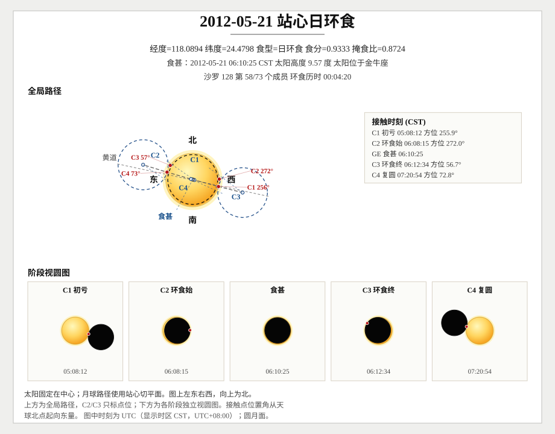

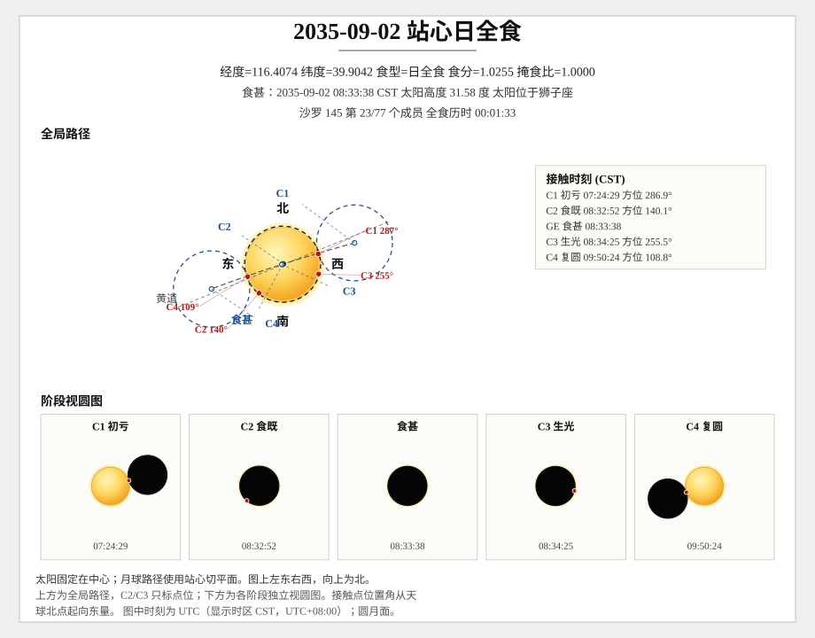

## 月食

本库的月食判断与搜索能力统一放在 `eclipse` 包，返回结果会保持传入 `time.Time` 的时区。
常用接口：

- `LunarEclipseOnDate`：判断某个当地日期是否有月食
- `LastLunarEclipse` / `NextLunarEclipse` / `ClosestLunarEclipse`：搜索全局月食
- `LocalLunarEclipseOnDate`：判断某地当天是否能看到可见月食
- `LastLocalLunarEclipse` / `NextLocalLunarEclipse` / `ClosestLocalLunarEclipse`：搜索某地可见月食
- `LastLocalTotalLunarEclipse` / `NextLocalTotalLunarEclipse` / `ClosestLocalTotalLunarEclipse`：搜索某地可见月全食，返回 `(info, ok)`
- `GeometricLocalLunarEclipseOnDate`：判断某地当天是否发生几何月食，不做“月亮在地平线上方”的可见性过滤
- `eclipse/svg.LunarEclipseSVG`：生成月食穿影图 SVG

`LocalLunarEclipseInfo.Visibility` 按当地中天情况分为八类：`full`、`moonrise`、`moonset`、`rise-and-set`、`interrupted`、`penumbra-moonrise`、`penumbra-moonset` 与 `invisible`。两种 `penumbra-*` 状态要求本影阶段始终在地平线下，判定检查整个本影区间的月球高度极值，以覆盖接触时刻之间的极区掠射窗口；纯半影月食没有本影接触，不会返回这两类。`interrupted` 表示半影首尾可见而中途落到地平线下，即使本影阶段始终不可见，也仍属于此类。分类使用观测点当地中天，不使用全球食甚时刻。

`MarshalLunarEclipse` 导出 `visible-at-p1`、`visible-at-p4` 两个瞬时可见半球，以及 `visible-during-eclipse`（P1 到 P4 任意时刻可见）和 `visible-throughout-eclipse`（P1 到 P4 全程可见）两个时间包络。包络分别使用 `aggregation=union` 和 `aggregation=intersection`；没有全程可见区域时，后者为空 `MultiPolygon`。包络按经度列采样，列数由 `boundary_points` 推导并限制在 360..720，实际值写入 `longitude_points`。

同一接口还导出 `penumbra-moonset` 与 `penumbra-moonrise` 两条仅见半影带，分别对应 P1 可见/P4 不可见与 P4 可见/P1 不可见、且本影阶段始终不可见的区域；每条带包含 `phase=penumbral-only` 和自己的接触时刻。纯半影月食没有本影接触，不导出这两条带。

`MarshalLunarEclipseWithOptions` 通过 `LunarEclipseOptions` 控制输出内容和采样精度。`SkipRoles` 可跳过时间包络与仅见半影带；跳过两个时间包络时不会执行包络采样。`EnvelopeSweepSamples` 默认 48，显式值限制在 `[2, 192]`；`EnvelopeLongitudePoints` 默认 `max(360, boundaryPoints)`，显式值限制在 `[12, 720]`。

`MoonHorizon` 和 `MoonStateAt` 接收 UTC 儒略日；`HMoonHeight(jd, lon, lat, tz)` 接收该时区的民用墙上时间儒略日，并使用小时单位的时区偏移换算。仅当 `tz=0` 时，`jd` 才是 UTC；时标换算由库内部完成。

返回结果 `LunarEclipseInfo` 包含：

- 月食类型 `Type`
- 沙罗序列信息 `HasSaros` / `Saros`
- 半影食分 `PenumbralMagnitude`
- 本影食分 `UmbralMagnitude`
- 半影始、初亏、食既、食甚、生光、复圆、半影终等时刻

其中 `Saros` 的含义与日食部分相同：

- `Saros.Series`：`Verified=true` 时为 NASA 月食沙罗系列号，否则为推算的暂定系列号
- `Saros.Member`：这次月食在该系列中的第几个成员，从 `1` 开始
- `Saros.Count`：该沙罗系列的总成员数
- `Saros.Verified`：是否已与内置权威目录锚点核验；扩展表或范围外推算结果为 `false`

月食同样优先使用 NASA 锚点，天文年份 `-3000` 至 `+6000` 年内查扩展表，范围外才实时演算。推算成员按 Danjon 与 Chauvenet 检出的事件并集计数，因此不随调用的月食模型或观测地点改变；极浅成员可能与 NASA 目录不同，`Verified` 保持 `false`。
例如 `2028-12-31 / 2029-01-01` 这次跨年月全食属于 `月食沙罗序列125` 的第 `49/72` 个成员。

当前同时保留两套地影放大口径：

- **Danjon（默认）**：只对月球水平视差项乘 `1.01`，再与太阳视半径、太阳视差组合求影半径。NASA GSFC 当前月食目录与图页采用的也是这一路线，本库默认的 `LunarEclipseOnDate`、`LastLunarEclipse`、`NextLunarEclipse`、`ClosestLunarEclipse` 都使用它。
- **Chauvenet（兼容口径）**：先取 `0.99834 × 地球赤道半径`，再把整组影半径统一乘 `51/50`。这与传统旧历表口径更接近，适合做兼容性回归和旧结果对照。

两者的直接差异通常表现为：

- `Chauvenet` 给出的半影和本影都更大，半影食分通常比 `Danjon` 多约 `0.025`，本影食分通常多约 `0.005`
- 对边界月食而言，`Chauvenet` 更容易把结果推向“更深”的食型
- 与 NASA 目录、现代星历软件或当前主流月食资料对照时，对应的是默认的 `Danjon`
- 兼容既有历史基线时，对应的是显式调用的 `Chauvenet`

### 代码示例

```go
package main

import (
	"github.com/starainrt/astro/eclipse"
	"fmt"
	"time"
)

func main() {
	date := time.Date(2029, 1, 1, 0, 0, 0, 0, time.UTC)

	// 默认使用 Danjon，更接近 NASA
	info := eclipse.ClosestLunarEclipse(date)
	fmt.Println(info.Type)
	fmt.Println(info.HasSaros, info.Saros)
	fmt.Println(info.Maximum)
	fmt.Println(info.PenumbralMagnitude, info.UmbralMagnitude)
	fmt.Println(info.PenumbralStart)
	fmt.Println(info.PartialStart)
	fmt.Println(info.TotalStart)
	fmt.Println(info.TotalEnd)
	fmt.Println(info.PartialEnd)
	fmt.Println(info.PenumbralEnd)

	// 如需兼容旧口径，可显式使用 Chauvenet
	legacy := eclipse.ClosestLunarEclipseChauvenet(date)
	fmt.Println(legacy.PenumbralMagnitude, legacy.UmbralMagnitude)

	// 判断某个本地自然日是否发生月食，返回时区与输入保持一致
	local := time.Date(2029, 1, 1, 12, 0, 0, 0, time.FixedZone("CST", 8*3600))
	today, ok := eclipse.LunarEclipseOnDate(local)
	fmt.Println(ok)
	fmt.Println(today.Type)
	fmt.Println(today.Maximum)
}
```

输出结果：

```text
total // 食型
true {125 49 72 true} // 沙罗 125 号第 49/72 次，已核对
2028-12-31 16:52:05.797516107 +0000 UTC // 食甚
2.2740102011228953 1.246124858428628 // 半影与影锥食分
2028-12-31 14:03:54.428796172 +0000 UTC // P1
2028-12-31 15:07:42.35383898 +0000 UTC // U1
2028-12-31 16:16:27.44777888 +0000 UTC // U2
2028-12-31 17:27:46.474579274 +0000 UTC // U3
2028-12-31 18:36:32.476299405 +0000 UTC // U4
2028-12-31 19:40:11.773990094 +0000 UTC // P4
2.29962460346294 1.2511815539147877 // Chauvenet 口径的半影与影锥食分
true // 当地日期落在月食当天
total // 站心食型
2029-01-01 00:52:05.797516107 +0800 CST // UTC+8 下的食甚
```

### 与 NASA 数据对照

对照值取自 NASA GSFC 的月食目录（食甚印为 **TD**、食分为目录值）。**UT 层的比较必须先扣掉时标口径**：目录与单次图页的 UT 时刻是用其出版时采用的 ΔT 从 TD 换算的（2026 年取 `75 s`、2024 年取 `74 s`），而实测 ΔT 只有约 `69.1–69.2 s`，两者相差 `4.8–5.9 s`。所以 UT 层的逐接触比较会整体带上这个时标差，它不是月球几何误差；TD 层（不含 ΔT）才是能单独检验星历与几何的一层。

下表在 Legacy 为默认的时期测量。用半解析重测 `2026-03-03` 得食甚 TD `+0.083 s`，表内 Legacy 为 `+0.114 s`，两套模型相差 `0.031 s`；差异远小于表内 `0.1–1.0 s` 的口径残差，因此不按模型分列。

| 样例 | 模型 | 半影食分误差 | 本影食分误差 | 食甚 TD 差（不含 ΔT） | 食甚 UT 差（含 ΔT 口径） |
|------|------|--------------|--------------|----------------------|--------------------------|
| 2026-03-03 月全食 | Danjon | -0.000067208 | -0.000069993 | +0.114 s | +5.99 s |
| 2026-03-03 月全食 | Chauvenet | +0.025599846 | +0.004935007 | +0.114 s | +5.99 s |
| 2026-08-28 月偏食 | Danjon | -0.000113694 | -0.000033624 | +0.090 s | +5.93 s |
| 2026-08-28 月偏食 | Chauvenet | +0.025567662 | +0.004957333 | +0.090 s | +5.93 s |
| 2024-03-25 半影月食 | Danjon | -0.000176555 | 见下说明 | +1.012 s | +5.81 s |
| 2024-03-25 半影月食 | Chauvenet | +0.026044973 | 见下说明 | +1.012 s | +5.81 s |

以 `2026-03-03` 月全食为例，当前默认 `Danjon` 与 NASA 的逐项差异为：

- 食型：一致，都是 `total`
- 食甚：本库 TD `11:34:52.113` vs NASA `11:34:52`，差 `+0.114 s`；换算到 UT 后本库比 NASA 图页晚 `5.99 s`，其中 `5.88 s` 来自 NASA 采用 `ΔT = 75 s`、本库实测 `ΔT = 69.12 s`
- 阶段历时：半影 `338.67 min` vs NASA `338.6`、本影 `207.17 min` vs `207.2`、全食 `58.31 min` vs `58.3`，都落在目录 0.1 分钟的印刷精度内
- 半影食分：`2.183732792` vs NASA `2.1838`，误差 `-0.000067208`
- 本影食分：`1.150630007` vs NASA `1.1507`，误差 `-0.000069993`

同一例中，`Chauvenet` 的结果为：

- 食型：一致，都是 `total`
- 半影食分：`2.209399846` vs NASA `2.1838`，误差 `+0.025599846`
- 本影食分：`1.155635007` vs NASA `1.1507`，误差 `+0.004935007`

`Chauvenet` 是保留给旧历表/旧口径兼容的影半径模型，半影和本影都会比默认 `Danjon` 更大；与 NASA 当前目录对照时，食分与接触时刻都会出现分钟/百分之一量级的偏移。这是模型口径差异，不代表默认月食接口的时间精度。

> 说明：NASA 目录的 TD 只印到整秒，因此 ±0.5 s 以内都属于印刷精度；上表 `2024-03-25` 的 `+1.012 s` 已经略超这一精度，是半影食甚这种极浅几何下两条链的差异。

> 说明：纯半影月食时，NASA 会给出负的 `umbral magnitude`，表示月面中心距本影边界还有余量；本库也保留这个负值，因此纯半影月食与 NASA 的本影食分已经属于同口径比较。

### 月食 SVG

`LunarEclipseSVG`、`LunarEclipseDetailedSVG` 与 `LunarEclipseMapSVG` 的默认模型与后缀入口口径见下文[月食出图](#月食出图)。

默认月食 SVG 头部会自动带上沙罗序列；如果需要自定义更多文字，可以通过 `LunarEclipseSVGOptions` 覆写：

- `Title`：主标题
- `SummaryText` / `MaximumText` / `CoordinatesText` / `DurationText` / `MetaText`：标题下五行信息
- `ContactsTitle`：接触时刻区标题
- `DirectionText` / `FooterNote`：底部方向说明和补充说明

```go
package main

import (
	"fmt"
	"os"
	"time"

	eclipsesvg "github.com/starainrt/astro/eclipse/svg"
)

func main() {
	cst := time.FixedZone("CST", 8*3600)
	// 生成 2029-01-01 这次跨年月全食的穿影图。
	svg, ok := eclipsesvg.LunarEclipseSVG(
		time.Date(2029, 1, 1, 0, 0, 0, 0, cst),
		eclipsesvg.LunarEclipseSVGOptions{
			Width:    960,
			Height:   620,
			Step:     10 * time.Minute,
			Location: cst,
		},
	)
	fmt.Println(ok, len(svg))
	if ok {
		_ = os.WriteFile("doc/img/lunar-eclipse-2029-01-01.svg", []byte(svg), 0o644)
	}
}
```

输出结果：

```text
true 19846
```

生成效果：

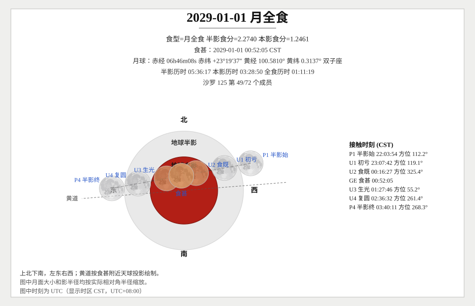

### 参考资料

- NASA 月食 decade 目录：<https://eclipse.gsfc.nasa.gov/LEdecade/LEdecade2021.html?pubDate=20250222>
- NASA 2026-03-03 月全食图页：<https://eclipse.gsfc.nasa.gov/LEplot/LEplot2001/LE2026Mar03T.pdf>
- NASA 2026-08-28 月偏食图页：<https://eclipse.gsfc.nasa.gov/LEplot/LEplot2001/LE2026Aug28P.pdf>
- NASA 2024-03-25 半影月食图页：<https://eclipse.gsfc.nasa.gov/LEplot/LEplot2001/LE2024Mar25N.pdf>
- NASA 月食算法与历史说明：<https://eclipse.gsfc.nasa.gov/LEhistory/LEhistory.html>

## 月缘地形修正

默认月面是圆盘；站心日食、全球日食、月食和固定地点的月掩都可以改用 `moon/limb` 的月缘剖面。剖面给出月心指向目标方向上的实际月缘半径，用来精修接触时刻。

| 计算项 | 是否按月缘修正 |
| --- | --- |
| 站心日食的初亏、复圆、中心食始末与中心食时长 | 是 |
| 站心日食食甚时刻的食分与遮蔽率 | 是，食甚时刻本身不变 |
| 全球日食的偏食始末（P1/P4）与食甚点中心食时长 | 是 |
| 日食中心路径的全食/环食带南北界、逐点带宽、食甚带宽、中心带足迹、中心线最长时长 | 是，`SolarEclipsePathOptions.LunarLimb` 或模块设置 |
| 偏食可见域外边界（零食分包络与初亏、复圆的日出日落曲线） | 是，`SolarEclipsePartialFootprintOptions.LunarLimb` 或模块设置 |
| 月食的六个接触时刻 | 是，只能通过模块或上下文设置 |
| 月掩的掩始、掩终及行星内外切 | 是，见[月掩手册](occultation.md#月缘地形修正) |
| 站心与全球食甚时刻、全球食分、食型、中心线本身、食分线、食甚等时线与食甚日出日落曲线 | 否，仍按圆月面 |

修正规则：

- 环食内切与月全食内切取月缘背向接触中心的一侧。
- 全球日食的 P1/P4 在圆月面切点两侧沿地球边缘扫描，取最早（最晚）的接触。
- 中心路径南北界在中心方向两侧 ±45° 位置角内取最不利点：全食取月缘最低处仍盖住日面的界线，环食取月缘最高处仍在日面内的界线；地平线上的端点保留圆月面。
- 偏食可见域外边界取月缘最高处刚好碰到日面近侧的界线；地平线上的端点与初亏、复圆日出日落曲线在同一时刻沿晨昏线移动，两者仍在同一点相接。太阳高度在 0.05°～0.5° 之间的点保留圆月面。结果的 `PartialBoundaryLimbApplied` 表示至少平移了一点；同一结果里的 `Eclipse`（偏食始末、食甚点中心食时长、`LunarLimbApplied`）与 `P1`/`P4` 也按月缘修正，与 `SolarEclipseOnDate` 一致。以 2024-04-08 等四场日食（含高纬偏食）实测：零等食分外包络的垂向平移中位数 1～4 km、最大约 7 km；初亏、复圆的升落曲线沿晨昏线滑动，个别点可移动 10 km 以上；默认步长下足迹计算耗时增加约 10%～20%。

```go
import "github.com/starainrt/astro/moon/limb"

// 方式一：单次查询
info, ok := eclipse.LocalSolarEclipseOnDateWithOptions(date, lon, lat, 0,
	eclipse.SolarEclipseOptions{LunarLimb: limb.Default()})

// 方式二：整个上下文的站心日食都用月缘
base, err := astro.NewContext(astro.ModelSemianalytic)
if err != nil {
	panic(err)
}
ctx := base.WithLunarLimb(limb.Default())
info, ok = ctx.Eclipse().LocalSolarEclipseOnDate(date, lon, lat, 0)
```

出图同样可用：`eclipse/svg` 五个入口的选项都有 `LunarLimb` 字段。站心日食图修正接触时刻与食甚时的食分、遮蔽率；两种月食示意图修正接触时刻，日月盘仍画圆面、食甚时刻不变；月食世界图的各阶段地平圈随修正后的接触时刻移动；日食全球图修正中心带南北界、食甚带宽、偏食可见域外边界、全球 P1/P4 与食甚点站心面板（含中心食时长），食分线、等时线与地心面板仍按圆月面。

各层修正彼此独立，剖面只在部分位置有值时可能只修正其中几层；日食全球图页脚只列出实际修正的层，如“按月缘剖面修正可见域边界（食分线与等时线仍按圆月面）。”；中心路径结果的 `CentralLimitsLimbApplied` 记录南北界与带宽是否修正。

每张图都在时标声明后写明所用口径（站心图为“圆月面。”或“月缘剖面。”），自定义 `FooterNote` 不会覆盖它。

结果上的 `LunarLimbApplied` 记录月缘是否真正生效，图注按它而不是按选项是否为空来写。剖面在需要的位置无值时（`LimbRadiusKM` 返回 `false`），该处半径退回圆月面且不参与修正；整个结果没有任何量被月缘修正时字段为 `false`，数值与圆月面结果完全相同。

选项里的 `LunarLimb` 优先于模块设置；`eclipse.(*Eclipse).WithLunarLimb` 返回新模块，不改原模块。也可以实现 `eclipse.LunarLimb` 接口接入别的剖面；底层 `basic.LunarEclipseWithLunarLimb` 提供同一能力。

内置剖面在独立子包 `moon/limb`，由 ISAS/JAXA 的 SELENE（Kaguya）LALT 全球地形数据（DARTS 发布，16 像素/度栅格）加工而成，数据约 1.5 MB，只有导入该包才会链接；剖面按观测者月面经纬（±9° / ±8°，步长 1°）与位置角（步长 0.1°）制表，三线性插值对 DEM 直接求剖面的均方根误差约 90 m。

修正量是秒级：2024-04-08 达拉斯全食时长 `227.6 s` → `229.8 s`，托雷翁 `250.6 s` → `255.0 s`；2023-10-14 阿尔伯克基环食 `289.4 s` → `290.3 s`；2025-09-07 月全食各接触移动 `-4.4 s` 至 `+0.2 s`。全食带南北界平均移动约 `2.1 km` / `1.0 km`（最大约 `3.2 km`），食甚带宽 `198.6 km` → `196.8 km`，中心线最长时长 `268.0 s` → `271.7 s`，食甚点中心食时长 `268.0 s` → `271.2 s`。

需要逐项核对时，可与《中国天文年历》（紫金山天文台）的发布值比较：整秒精度下误差约 `-0.8 s` / `+0.2 s`；Chauvenet 口径、0.1 分钟精度下平均误差为圆月 `1.5 s`、月缘 `2.2 s`，都在发布舍入以内。

## 全球见食图与月食出图

`eclipse/svg` 的五个入口都返回 `(string, bool)`：第二个返回值是 `false` 表示这张图按当前参数画不出来（当天没有该事件、画布低于下限、或 UT1 口径配了非 UTC 时区），不是渲染错误。

| 入口 | 画面 | 画布建议 |
| --- | --- | --- |
| `LocalSolarEclipseSVG` | 站心日面视圆图（见前文“生成日食 SVG”） | 920×720 起 |
| `SolarEclipseMapSVG` | 全球见食图，可切四种投影 | 1200×800；正射球面 1000×1414 |
| `LunarEclipseSVG` | 月食穿影图 | 960×620 起 |
| `LunarEclipseMapSVG` | 月食世界可见区图 | 1200×800 |
| `LunarEclipseDetailedSVG` | 月食详细版式（示意与底图合成一页） | 1000×1414 或 1414×1000 |

日食全球图包含偏食可见区、中心带与路径、阶段信息、日升日落线、太阳直射点、影轴进出地球点和接触点；定时半影及本影/反本影轮廓可按需打开。月食图绘制 `P1/P4` 可见半球和月出/月落过渡区，以 `P1`、食甚、`P4` 三刻地平圈近似整场可见区；它不包含 GeoJSON 的时间包络，因此两条地平线之间可能留有窄缝。

### 全球见食图

#### 等经纬投影

最小可用调用只给事件日期与展示时区，其余走默认（`TimeLabelStep` 默认 30 分钟）：

```go
solar, ok := eclipsesvg.SolarEclipseMapSVG(
	time.Date(2009, 7, 22, 12, 0, 0, 0, cst),
	eclipsesvg.SolarEclipseMapSVGOptions{
		Width: 1414, Height: 1000, Location: cst,
		TimeLabelStep: 30 * time.Minute, GreatestTimeStep: 30 * time.Minute,
	},
)
fmt.Println(ok, len(solar))
```

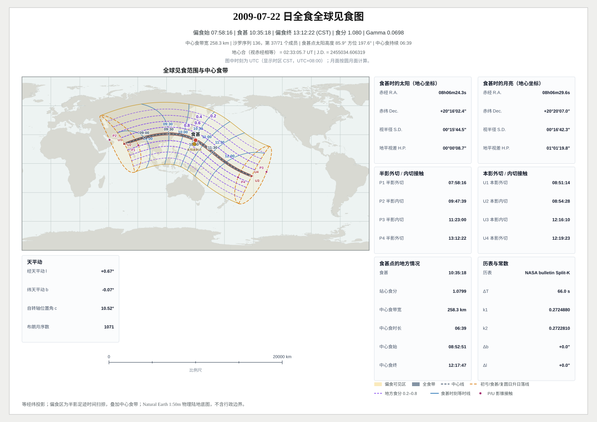

另外两场等经纬示例是 `2012-05-21` 厦门日环食与 `2035-09-02` 北京日全食，两张图与长江口图同口径：不画瞬时半影/本影轮廓、画 30 分钟食甚等时线，并用空切片关闭食分等值线：

```go
options := eclipsesvg.SolarEclipseMapSVGOptions{
	Width: 1200, Height: 800, Location: cst,
	TimeLabelStep: 30 * time.Minute, GreatestTimeStep: 30 * time.Minute,
	MagnitudeValues: []float64{},
}
annular, ok := eclipsesvg.SolarEclipseMapSVG(time.Date(2012, 5, 21, 12, 0, 0, 0, cst), options)
total, ok := eclipsesvg.SolarEclipseMapSVG(time.Date(2035, 9, 2, 12, 0, 0, 0, cst), options)
fmt.Println(ok, len(annular), len(total))
```

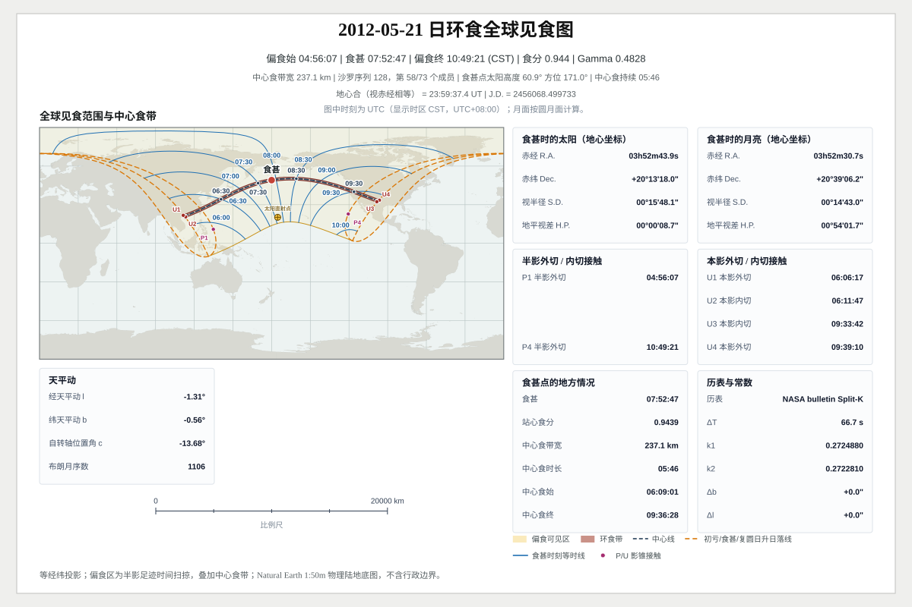

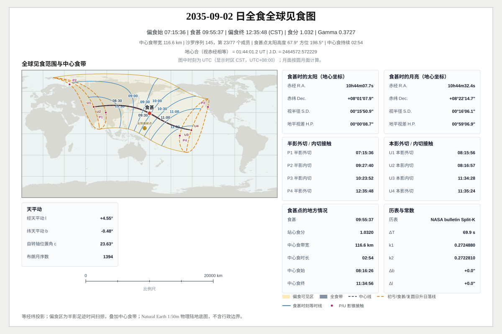

#### 正射球面图

`EclipseMapProjectionOrthographic` 给出 NASA 版式的**正射球面图**：视点取食甚点，只画朝向视点的半个地球，建议使用 `1000×1414` 画布。投影不改变底层地理结果。

```go
globe, ok := eclipsesvg.SolarEclipseMapSVG(
	time.Date(2009, 7, 22, 12, 0, 0, 0, cst),
	eclipsesvg.SolarEclipseMapSVGOptions{
		Width: 1000, Height: 1414, Location: cst,
		Projection:    eclipsesvg.EclipseMapProjectionOrthographic,
		TimeLabelStep: 30 * time.Minute, GreatestTimeStep: 30 * time.Minute,
	},
)
```

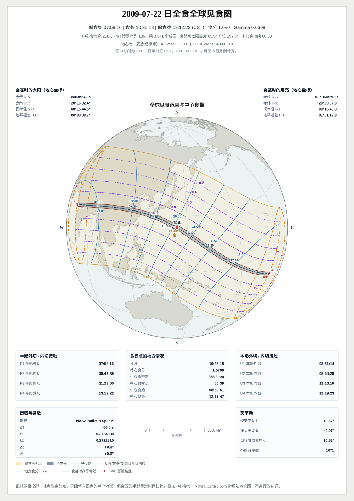

正射球面图在竖版（如 `1000×1414`）下最舒展；横版（`1200×800`）同样能出图，只是球面会明显缩小。

#### 南北极方位等距投影

`EclipseMapProjectionNorthPolar` 与 `EclipseMapProjectionSouthPolar` 把极点放在画布中心，适合食带整体落在高纬的事件。`EclipseMapProjectionAuto`（零值）会在适合时自动选极图，需要固定版式时才显式指定；投影只影响 SVG 表达，不改变底层 WGS84 地理结果。

`2012-05-21` 日环食的偏食可见区覆盖北极点，强制北极投影便于查看跨反经线的见食范围：

```go
arctic, ok := eclipsesvg.SolarEclipseMapSVG(
	time.Date(2012, 5, 21, 12, 0, 0, 0, cst),
	eclipsesvg.SolarEclipseMapSVGOptions{
		Width: 1200, Height: 800, Location: cst,
		Projection:    eclipsesvg.EclipseMapProjectionNorthPolar,
		TimeLabelStep: 30 * time.Minute, GreatestTimeStep: 30 * time.Minute,
	},
)
```

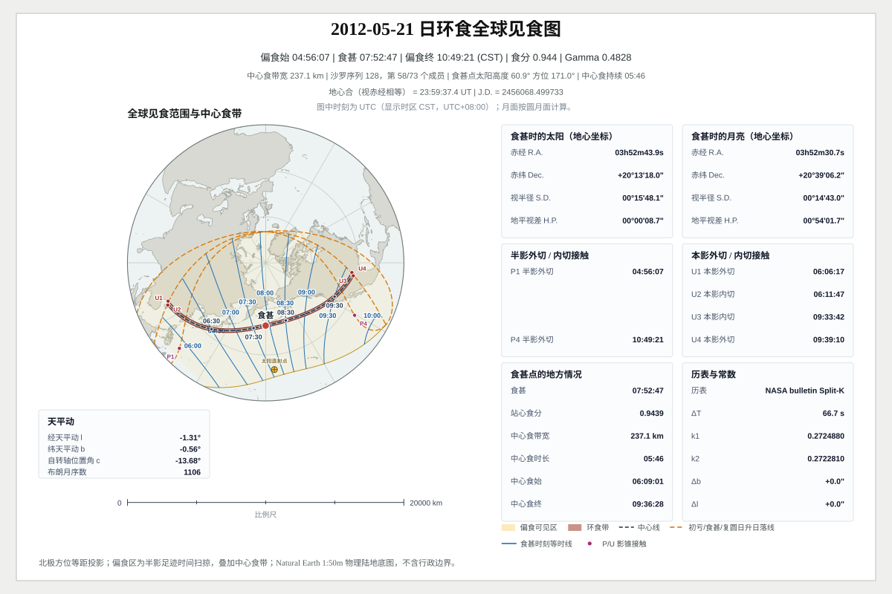

`2021-12-04` 日全食的食带整条落在南极区，南极投影是最自然的版式；下面这张与横版全球图同一口径，只画 30 分钟食甚等时线：

```go
south, ok := eclipsesvg.SolarEclipseMapSVG(
	time.Date(2021, 12, 4, 12, 0, 0, 0, cst),
	eclipsesvg.SolarEclipseMapSVGOptions{
		Width: 1200, Height: 800, Location: cst,
		Projection:    eclipsesvg.EclipseMapProjectionSouthPolar,
		TimeLabelStep: 30 * time.Minute, GreatestTimeStep: 30 * time.Minute,
		MagnitudeValues: []float64{},
	},
)
```

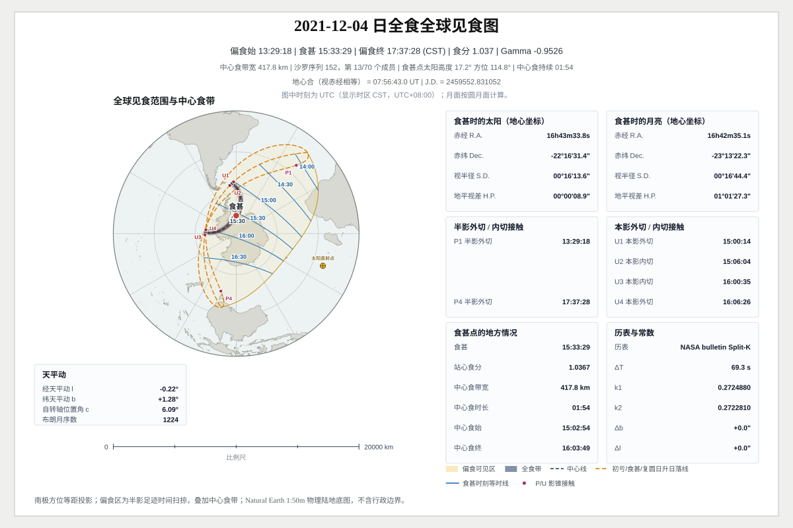

#### 同一事件批量出四种投影

四个投影共用一份选项，只是 `Projection` 不同，适合一次生成后挑版式：

```go
date := time.Date(2009, 7, 22, 12, 0, 0, 0, cst)
for _, spec := range []struct {
	name string
	p    eclipsesvg.EclipseMapProjection
}{
	{"equirectangular", eclipsesvg.EclipseMapProjectionEquirectangular},
	{"north-polar", eclipsesvg.EclipseMapProjectionNorthPolar},
	{"south-polar", eclipsesvg.EclipseMapProjectionSouthPolar},
	{"orthographic", eclipsesvg.EclipseMapProjectionOrthographic},
} {
	options := eclipsesvg.SolarEclipseMapSVGOptions{
		Width: 1200, Height: 800, Location: cst, Projection: spec.p,
	}
	svg, ok := eclipsesvg.SolarEclipseMapSVG(date, options)
	if !ok {
		continue
	}
	_ = os.WriteFile("solar-eclipse-"+spec.name+".svg", []byte(svg), 0o644)
}
```

#### 图层与采样开关

| 选项 | 默认 | 语义 |
| --- | --- | --- |
| `TimeLabelStep` | 30 分钟 | 中心线时刻标记间隔；负值关闭 |
| `GreatestTimeStep` | 关闭 | 食甚时刻等时线；必须显式给正值，按展示时区对齐，小于一分钟按一分钟，单次最多 64 条 |
| `MagnitudeValues` | `0.2/0.4/0.6/0.8`（nil 时） | 食分等值线电平；显式空切片关闭，非空切片按给定电平绘制 |
| `PenumbralOutlineStep` | 关闭 | 瞬时半影轮廓采样间隔；零值或负值不画，正值小于一分钟按一分钟 |
| `CentralShadowStep` | 关闭 | 瞬时本影/反本影轮廓采样间隔；同上 |
| `PartialStep` | 2 分钟 | 偏食足迹时间步长；非正值与小于两分钟的正值都夹到两分钟 |
| `BoundaryPoints` | 180 | 每个瞬时偏食足迹的角向采样数；非正值用 180，正值限制在 12..1440 |
| `CentralStep` | 2 分钟 | 中心路径时间步长；非正值用两分钟，正值小于一秒按一秒，长事件会自动放大以保持基础路径不超过 30000 个采样点 |
| `TargetSpacingKM` | 150 km | 中心线地面间距上限；非正值用 150 km，NaN 与 +Inf 禁用加密 |

半影/本影轮廓默认关闭。食分等值线在 `MagnitudeValues == nil` 时使用表中的默认电平；显式传入空切片可关闭。厦门、北京、北极区与南极点四张图不画瞬时轮廓，只画 30 分钟食甚等时线，并显式关闭食分等值线：

```go
options := eclipsesvg.SolarEclipseMapSVGOptions{
	Width: 1200, Height: 800, Location: cst,
	TimeLabelStep: 30 * time.Minute, GreatestTimeStep: 30 * time.Minute,
	MagnitudeValues: []float64{},
}
```

等时线不是逐点求食甚再描等值线，而是固定时刻后解 `∂(日月中心角距²)/∂t = 0` 的零集再沿曲线延拓，成本正比于曲线长度；每条支路止于地平线或偏食可见域边界，纬度 ±88° 以上不再延拓，同一时刻可能有多条互不相连的支路。

可降级的图层用 `data-source` 标注实际几何来源，取值词表见 [地图投影](map-geojson.md#地图投影)。

#### 画布下限与回落

- 日食图下限 **800×560**：宽度小于 800 或高度小于 560 时回落到 960×640；更窄的横版画布会让地图框与右栏数据网格水平重叠、面板行距压到 1 px 以下。
- 偏食区填充由瞬时足迹的并集生成，因此 `PartialStep` 小于两分钟时会夹到两分钟；更密的请求不会提高结果精度。
- 月食详细版式按 `Height` 推导版面：`640×420` 与 `800×600` 容不下示意图与底图的下限而返回 `false`，`1000×1414` 与 `1414×1000` 正常出图。

### 月食出图

#### 三个入口与影半径模型

`LunarEclipseSVG`（穿影图）、`LunarEclipseMapSVG`（世界可见区）与 `LunarEclipseDetailedSVG`（详细版式）默认共用同一套模型：以 Danjon 为主，极浅半影按核心默认口径回退 Chauvenet，与 `LunarEclipseOnDate` 一致；带 `Danjon` / `Chauvenet` 后缀的入口强制指定模型，`...Chauvenet` 适合与采用经典影半径的旧表对表。

```go
diagram, ok := eclipsesvg.LunarEclipseSVG(
	time.Date(2029, 1, 1, 0, 0, 0, 0, cst),
	eclipsesvg.LunarEclipseSVGOptions{
		Width: 960, Height: 620, Step: 10 * time.Minute, Location: cst,
	},
)
fmt.Println(ok, len(diagram))
```


#### 世界可见区图

底图区分全程可见、带食月出、带食月落与不可见四类区域：全程可见要求 `P1`、食甚、`P4` 三刻月球都在地平上（两端可见推不出中途可见，高纬下中天会让月亮在食甚前后落到地平下，这段归带食月落）；带食月落覆盖 `P1` 可见而 `P4` 不可见的地点，以及只在食甚前后露出地平、两端都在地平下的极区透镜；带食月出覆盖 `P4` 可见而 `P1` 不可见的地点；三刻都不见才算不可见。`Projection` 可切极区与正射版式；下面这张图是默认输出，半影阶段已纳入分区（口径见下）：

```go
visible, ok := eclipsesvg.LunarEclipseMapSVG(
	time.Date(2029, 1, 1, 0, 0, 0, 0, cst),
	eclipsesvg.LunarEclipseMapSVGOptions{Width: 1200, Height: 800, Location: cst},
)
```

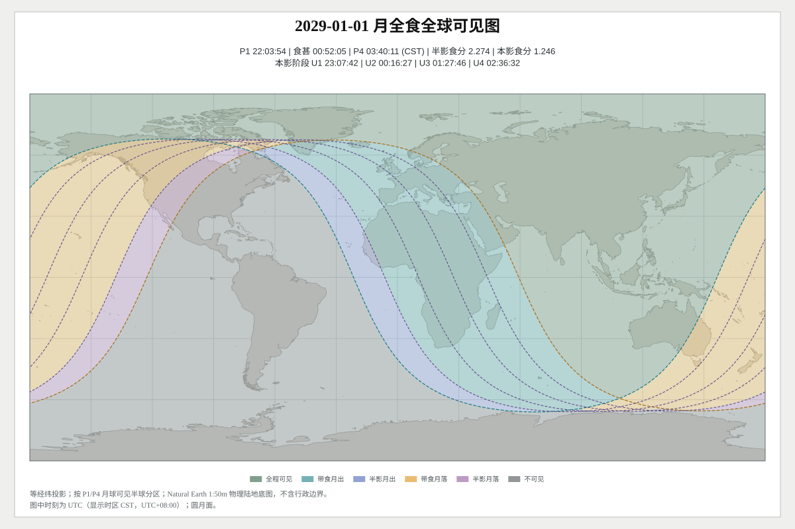

半影阶段默认纳入分区，画法同 NASA 月食世界图：补画 `U1`、`U2`、`U3`、`U4` 四条地平边界线，把只看得见半影的月出、月落带单独着色，图例里分列「半影月出」与「半影月落」（月出偏蓝、月落偏紫红），并在图上方的时刻行里补一行本影接触时刻。两条带排除**整个本影阶段的可见区**：本影区间内只要有任何时刻月亮在地平上，该地点就归带食月出/带食月落。掩膜按 15 分钟档位取样整球可见半球（圆盘分辨率约 0.035°），残余的掠射窗口深度约 0.05°（约 0.15 像素）；深度更浅、只持续几分钟的窗口由站点 API 与 GeoJSON 精确判定。纯半影月食没有本影接触，开关两侧输出一致。`DisablePenumbralPhase: true` 退回只按三刻地平状态分的四类可见区，不画 `U1–U4` 与这两条半影带：

```go
penumbral, ok := eclipsesvg.LunarEclipseMapSVG(
	time.Date(2026, 3, 3, 0, 0, 0, 0, cst),
	eclipsesvg.LunarEclipseMapSVGOptions{
		Width: 1200, Height: 800, Location: cst, DisablePenumbralPhase: true,
	},
)
```

`LunarEclipseDetailedSVGOptions` 有同名字段，控制详细版式下方那张底图，默认同样画半影阶段。

#### 详细版式

详细版式把两类月食图合成一页：居中摘要（食甚、半影/本影食分、伽马、半影/本影半径、月距、沙罗序列）、左右两侧的日月地心坐标块、穿影示意图、历时/弧分比例尺/接触时刻三栏，以及下方的世界可见性底图与图例。地影几何由 `basic.LunarEclipseShadowGeometryAt` 给出，其中 **Gamma 用地球赤道半径、半影/本影半径用度**，换算成地球半径要乘以月球处的地球视差。

```go
detailed, ok := eclipsesvg.LunarEclipseDetailedSVG(
	time.Date(2029, 1, 1, 0, 0, 0, 0, cst),
	eclipsesvg.LunarEclipseDetailedSVGOptions{Location: cst},
)
```

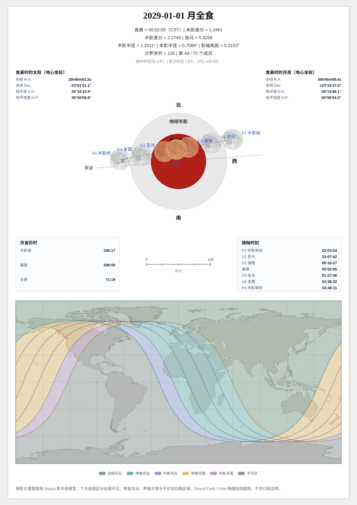

第二个事件 `2026-03-03` 月全食用同一批入口，穿影图与详细版式各一张：

```go
diagram2026, ok := eclipsesvg.LunarEclipseSVG(
	time.Date(2026, 3, 3, 0, 0, 0, 0, cst),
	eclipsesvg.LunarEclipseSVGOptions{Width: 960, Height: 620, Step: 10 * time.Minute, Location: cst},
)
detailed2026, ok := eclipsesvg.LunarEclipseDetailedSVG(
	time.Date(2026, 3, 3, 12, 0, 0, 0, cst),
	eclipsesvg.LunarEclipseDetailedSVGOptions{Location: cst},
)
```

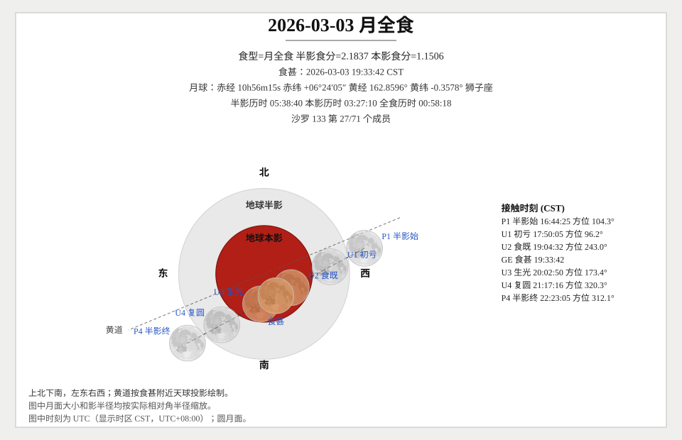

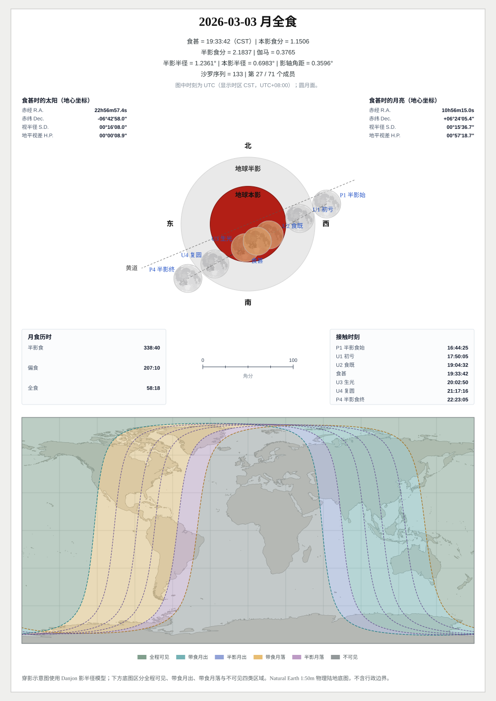

版面由 `Height` 推导：横版把数据块排在地图右侧两栏三行，竖版把数据块排在下方三栏两行。

### 时标口径与 UT1

四族图默认按 UTC 口径出图，并在图上或图注写明时标；`TimeScale: astro.TimeScaleUT1` 改成 UT1 读数并补上 `DUT1 = UT1−UTC` 差值，此时 `Location` 必须是 UTC，否则返回 `false`。几何一律按民用时刻算完再换口径，换算不会平移等时线。

要在程序里直接取 UT1 读数，用 `eclipse` 的 `...InUT1` 系列（`SolarEclipseInfoInUT1`、`LocalSolarEclipseInfoInUT1`、`LunarEclipseInfoInUT1`、`SolarEclipsePathInUT1`、`SolarEclipsePartialFootprintsInUT1`、`SolarEclipseGeocentricPanelInUT1`、`TimeLabelsInUT1`），它们只改时刻字段，零值原样保留。

完整约定见[时标声明](map-geojson.md#时标声明)。

```go
ut1, ok := eclipsesvg.SolarEclipseMapSVG(
	time.Date(2009, 7, 22, 12, 0, 0, 0, cst),
	eclipsesvg.SolarEclipseMapSVGOptions{
		Width: 1200, Height: 800, Location: time.UTC,
		TimeScale: astro.TimeScaleUT1, TimeLabelStep: 30 * time.Minute,
	},
)
```

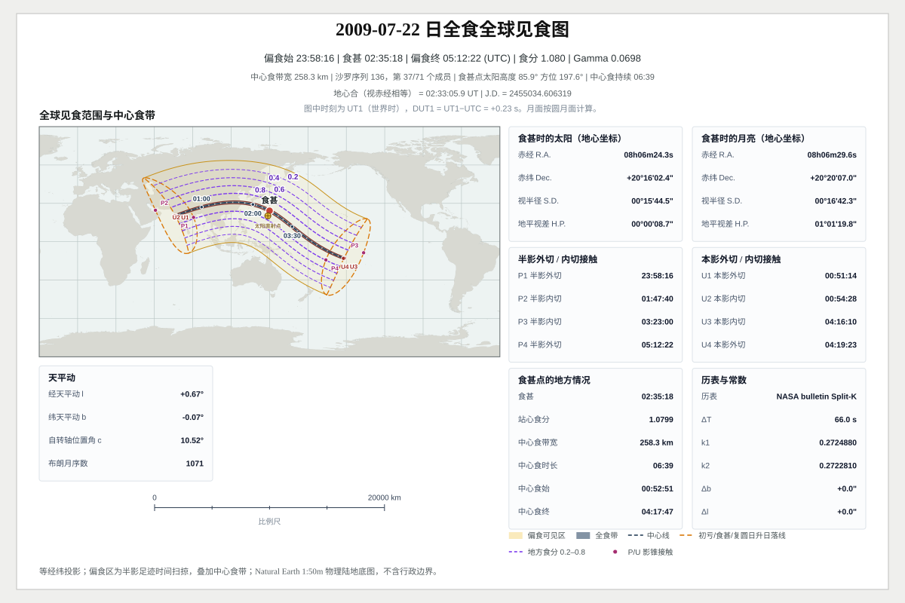

## 凌日出图

凌日的接触时刻、站心可见性和 `LocalTransit` 见[行星：水星与金星凌日](planets.md#水星与金星凌日)；本节只讲 `eclipse/svg` 的两张图。两个凌日入口同样返回 `(string, bool)`，`date` 取距它最近的一次凌日（同日查询能找到当天凌日）。

| 入口 | 画面 | 画布建议 |
| --- | --- | --- |
| `TransitMapSVG` | 地心几何的全球可见图：全程可见、日出时已在凌日、日落时仍在凌日、不可见四区 | 960×640 起 |
| `TransitLocalSVG` | 站心日面图：上北左东，行星中心轨迹、各接触与凌甚的行星圆面、接触时刻表 | 960×680 起 |

可见区按一触、凌甚、四触三刻太阳中心是否在视地平上划分，计入标准大气折射（地平圈半径 90°34′）。等时线默认不画，用 `Isochrones` 按位开启：`TransitIsochroneC1` … `TransitIsochroneC4`，或组合 `TransitIsochroneExternal`（一触、四触）、`TransitIsochroneAll`；掠凌没有内切接触时 C2/C3 自动略去。等时线是站心接触时刻，只画太阳在视地平上的部分；`IsochroneStep` 非正时水星取 20 秒、金星取 1 分钟。凌日可见范围接近半个地球，地图始终画全球，`Projection` 可选四种投影。

```go
venus := time.Date(2012, 6, 6, 0, 0, 0, 0, time.UTC)
world, ok := eclipsesvg.TransitMapSVG(eclipsesvg.TransitVenus, venus, eclipsesvg.TransitMapSVGOptions{
	Isochrones:    eclipsesvg.TransitIsochroneExternal,
	IsochroneStep: 10 * time.Minute,
})
local, ok := eclipsesvg.TransitLocalSVG(eclipsesvg.TransitVenus, venus, 116.4, 39.9, 50,
	eclipsesvg.TransitLocalSVGOptions{Location: time.FixedZone("UTC+8", 8*3600)})
```

站心图中太阳中心在视地平下的轨迹段画成灰色虚线，时刻表补出凌日期间的日出、日落。该地几何上看不到凌日（行星圆面不进入站心日面）时 `TransitLocalSVG` 返回 `false`。站心接触的算法与口径见[行星：水星与金星凌日](planets.md#水星与金星凌日)。

### 水星：2032-11-13（北京）

2032-11-13 是北京下一次可见的水星凌日。北京可见一触、二触与凌甚，凌甚时太阳高度只有 `+0.2°`；三触、四触发生在日落后（太阳高度约 `-24°`），站心图上画成灰色虚线。

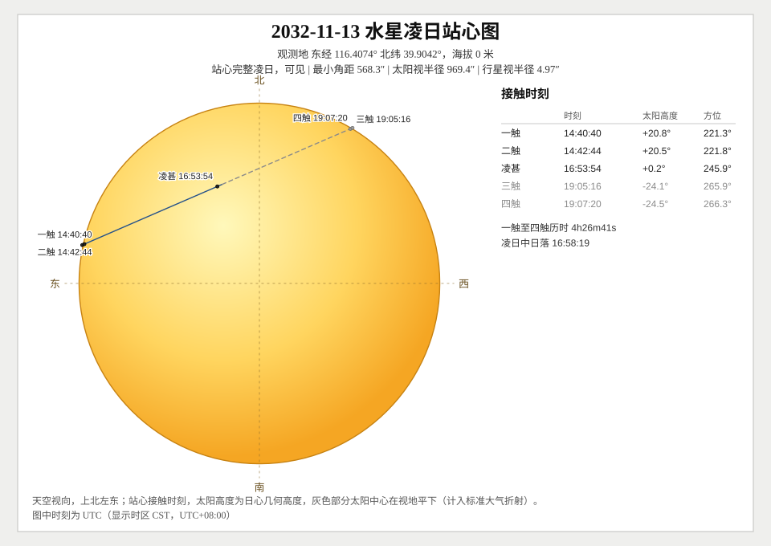

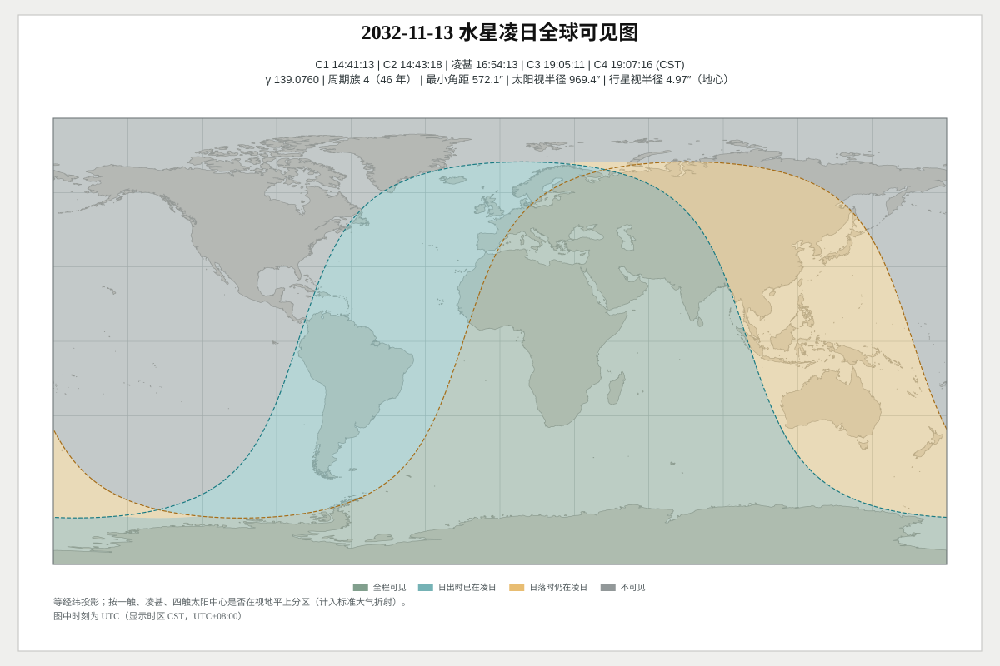

### 金星：2012-06-06（北京）

2012-06-06 金星凌日在北京全程可见，一触到四触历时 `6h39m4s`，各接触的太阳高度为 `+14°` 至 `+71°`。

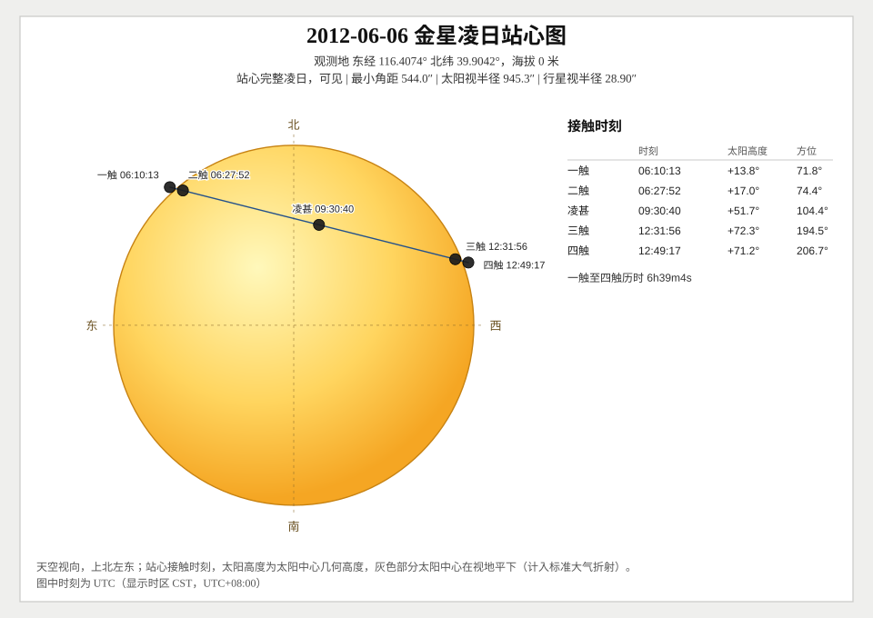

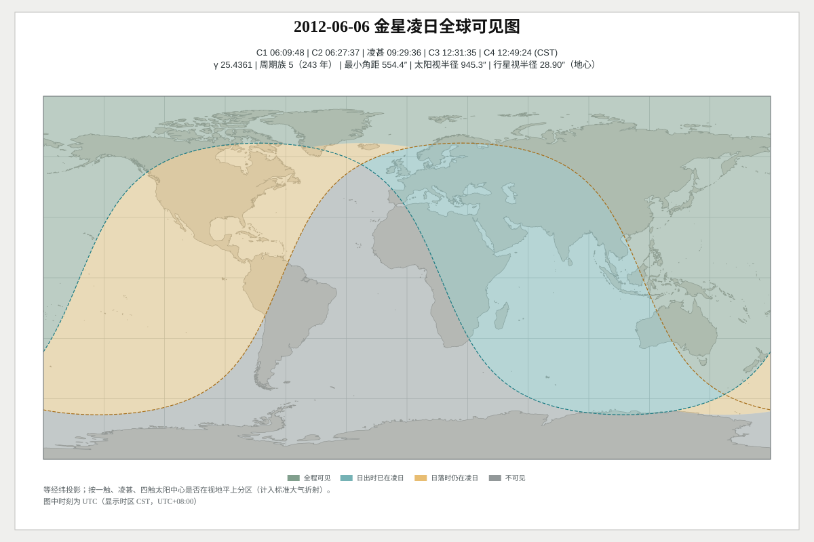
