# Eclipses and Transits

[中文](../eclipse.md) | [Back to README](../../../README.en.md)

> Full examples in this manual run from the repository root and write their figures to `doc/img/`.

This manual covers solar- and lunar-eclipse queries and charts, plus the two Mercury and Venus transit SVG charts. Transit contact times and topocentric visibility come from the `planets` transit entry points, see [Planets: Mercury and Venus transits](planets.md#mercury-and-venus-transits).

## Contents

- [Simple example: the 2009 Great Yangtze Eclipse at a site in Shanghai](#simple-example-the-2009-great-yangtze-eclipse-at-a-site-in-shanghai)
- [API Reference](#api-reference)
- [Usage examples](#usage-examples)
  - [Is there a solar or lunar eclipse at my site?](#is-there-a-solar-or-lunar-eclipse-at-my-site)
  - [Global visibility maps and lunar charts](#global-visibility-maps-and-lunar-charts)
  - [Central path and partial footprints](#central-path-and-partial-footprints)
  - [Besselian elements and Saros](#besselian-elements-and-saros)
- [Solar eclipse](#solar-eclipse)
  - [Timing checks against NASA material](#timing-checks-against-nasa-material)
  - [2009 Yangtze River total eclipse near Yangshan](#2009-yangtze-river-total-eclipse-near-yangshan)
  - [2012 Xiamen annular eclipse](#2012-xiamen-annular-eclipse)
  - [Solar-eclipse SVG](#solar-eclipse-svg)
- [Lunar eclipse](#lunar-eclipse)
  - [Code example](#code-example)
  - [Checks against NASA data](#checks-against-nasa-data)
  - [Lunar-eclipse SVG](#lunar-eclipse-svg)
  - [References](#references)
- [Lunar limb correction](#lunar-limb-correction)
- [Solar and Lunar Eclipse Charts](#solar-and-lunar-eclipse-charts)
  - [Global visibility maps](#global-visibility-maps)
  - [Lunar eclipse charts](#lunar-eclipse-charts)
  - [Time scale and UT1](#time-scale-and-ut1)
- [Transit charts](#transit-charts)
  - [Mercury: 2032-11-13 (Beijing)](#mercury-2032-11-13-beijing)
  - [Venus: 2012-06-06 (Beijing)](#venus-2012-06-06-beijing)

## Simple example: the 2009 Great Yangtze Eclipse at a site in Shanghai

```go
package main

import (
	"fmt"
	"time"

	"github.com/starainrt/astro/eclipse"
)

func main() {
	cst := time.FixedZone("CST", 8*3600)
	date := time.Date(2009, 7, 22, 0, 0, 0, 0, cst)
	info, ok := eclipse.LocalSolarEclipseOnDate(date, 121.9850, 30.6167, 0)
	if !ok {
		fmt.Println("no local solar eclipse")
		return
	}
	fmt.Println(info.Type)
	fmt.Printf("%+v\n", info)
}
```

When `ok=false`, no matching eclipse was found for that date or site; do not use the result fields. Separate APIs below calculate global events, local contacts and geographic paths.

## API Reference

SVG snippets use the import aliases `eclipsesvg "github.com/starainrt/astro/eclipse/svg"` and, for occultations, `moonsvg "github.com/starainrt/astro/moon/svg"`. Dates and time zones reuse the first example.

| Name | Purpose | Notes |
| --- | --- | --- |
| `LocalSolarEclipseOnDate` / `LocalSolarEclipseOnDateNASABulletinSplitK` | Fixed-site solar eclipse query | Returns `(info, bool)`; NASA Split-K by default |
| `LunarEclipseOnDate` / `LunarEclipseOnDateDanjon` / `LunarEclipseOnDateChauvenet` | Lunar eclipse query | Same; the suffix forces a shadow-radius model |
| `SearchLocalCentralSolarEclipse` / `SolarEclipseCandidates` | Cross-year central-eclipse search / candidate list | The former returns `(info, SolarEclipseLocalSearchStatus)` |
| `SolarEclipseCentralPath` / `SolarEclipsePartialFootprints` | Central path and partial-footprint geometry | Options are `SolarEclipsePathOptions` / `SolarEclipsePartialFootprintOptions` |
| `SolarEclipseBesselianElements` / `SolarEclipseBesselianMuForPublishedTable` | Besselian elements and the published-table conversion | For table comparison |
| `eclipsesvg.SolarEclipseMapSVG` / `LunarEclipseMapSVG` | Global visibility maps | Return `(string, bool)` |
| `eclipsesvg.LocalSolarEclipseSVG` / `LunarEclipseSVG` / `LunarEclipseDetailedSVG` | Fixed-site disk chart / shadow-path diagram / detailed layout | Same |
| `eclipsesvg.SolarEclipseMapSVGOptions` / `LunarEclipseDetailedSVGOptions` | Chart options (projection, layers, canvas) | Layer switches are documented in the charts section |
| `astro.TimeScaleUT1` | UT1 chart output | `Location` must be UTC in this mode |
| `...InUT1` converters (`SolarEclipseInfoInUT1`, `TimeLabelsInUT1`, ...) | rewrite the civil instants of a result as UT1 readings of the same physical instant | zero instants are kept as-is |

## Usage examples

### Is there a solar or lunar eclipse at my site?

```go
solar, ok := eclipse.LocalSolarEclipseOnDate(date, 121.9850, 30.6167, 0)
fmt.Println(ok, solar.Type)
lunar, ok2 := eclipse.LunarEclipseOnDate(time.Date(2029, 1, 1, 0, 0, 0, 0, cst))
fmt.Println(ok2, lunar.Type)
```

```text
true total
true total
```

- `LocalSolarEclipseOnDate` returns the type, all contact instants, magnitude, obscuration and the solar altitude at greatest eclipse in one call; when you only care whether something happens, read the second return value.
- To find "the next central eclipse" across years use `SearchLocalCentralSolarEclipse` (the `Exhausted` field of the returned `SolarEclipseLocalSearchStatus` separates "nothing in the span" from "found"); for a bare candidate list use `SolarEclipseCandidates`.
- On the lunar side the counterparts are `LunarEclipseOnDate` plus the `Danjon` / `Chauvenet` suffixed entry points that force a shadow-radius model.

### Global visibility maps and lunar charts

```go
solar, ok := eclipsesvg.SolarEclipseMapSVG(date, eclipsesvg.SolarEclipseMapSVGOptions{Width: 1200, Height: 800, Location: cst})
local, ok2 := eclipsesvg.LocalSolarEclipseSVG(date, 121.9850, 30.6167, 0, eclipsesvg.LocalSolarEclipseSVGOptions{Width: 920, Height: 720, Step: 5 * time.Minute, Location: cst})
lunar, ok3 := eclipsesvg.LunarEclipseSVG(time.Date(2029, 1, 1, 0, 0, 0, 0, cst), eclipsesvg.LunarEclipseSVGOptions{Width: 960, Height: 620, Step: 10 * time.Minute, Location: cst})
detailed, ok4 := eclipsesvg.LunarEclipseDetailedSVG(time.Date(2029, 1, 1, 0, 0, 0, 0, cst), eclipsesvg.LunarEclipseDetailedSVGOptions{Location: cst})
fmt.Println(ok, len(solar), ok2, len(local), ok3, len(lunar), ok4, len(detailed))
```

```text
true 265827 true 13625 true 19831 true 319721
```

Projection switching, layer switches (penumbral/umbral outlines, magnitude contours, isochrones) and canvas floors are all documented under [Global visibility maps and lunar eclipse charts](#solar-and-lunar-eclipse-charts); the trade-offs of the orthographic globe and polar layouts are under [Map Projections](map-geojson.md#map-projections).

### Central path and partial footprints

```go
partial, ok := eclipse.SolarEclipsePartialFootprints(date,
	eclipse.SolarEclipsePartialFootprintOptions{Step: 10 * time.Minute, BoundaryPoints: 180})
central, hasCentral := eclipse.SolarEclipseCentralPath(date,
	eclipse.SolarEclipsePathOptions{Step: time.Minute, TargetSpacingKM: 20})
fmt.Println(ok, hasCentral, len(partial.CentralBandFootprints), len(central.CenterLine))
```

```text
true true 42 1117
```

- Use these two when you need geometry rather than a picture (your own data pipeline, or feeding `geojson`); `TargetSpacingKM` caps the center-line refinement spacing.
- Partial footprints are a union of instantaneous footprints, and a `Step` below two minutes is clamped to two minutes; the resulting `data-source` records the actual geometry source.

### Besselian elements and Saros

```go
elements, ok := eclipse.SolarEclipseBesselianElements(2460409.262835,
	eclipse.SolarEclipseBesselianElementsOptions{DeltaTSeconds: 70.6, ReferenceJDE: 2460409.25})
t := 0.5
fmt.Printf("X=%.6f Y=%.6f D=%.6f L1=%.6f L2=%.6f\n",
	elements.X.At(t), elements.Y.At(t), elements.D.At(t), elements.L1.At(t), elements.L2.At(t))
fmt.Println(info.HasSaros, info.Saros)
```

```text
X=-0.062351 Y=0.355150 D=7.593613 L1=0.535842 L2=-0.010245
true {136 37 71 true}
```

- With explicit `DeltaTSeconds` and `ReferenceJDE` you can compare term by term against a published Besselian table; published tables use the sidereal time of T0 itself, so convert with `SolarEclipseBesselianMuForPublishedTable` first.
- Before comparing UT instants against NASA catalogues or figure pages, subtract the ΔT convention they were published with, as described under [Time comparison against NASA data](#checks-against-nasa-data); the TD layer (without ΔT) is the one that tests ephemeris and geometry on its own.

## Solar eclipse

> Figure and footer time-scale declarations are documented in [Time Scale Declaration](map-geojson.md#time-scale-declaration).

Solar-eclipse calculation lives in `eclipse`; SVG generation lives in `eclipse/svg`. The default lunar-radius convention follows NASA bulletin split-`k` (penumbral/partial `k = 0.2724880`, umbral and antumbral `k = 0.2722810`); IAU single-`k` (`0.2725076`) variants are available through same-named `...IAUSingleK` functions.

There are two solar-radius conventions: the **standard** one (`959.639″` at 1 AU, matching published ephemerides and catalogues, the default) and the **measured** one (`959.95″` at 1 AU, the eclipse solar radius inferred from limb light curves), 0.31″ apart.

For the 2024-04-08 total eclipse the measured convention narrows the path by about 0.6 km per side and shortens totality by about 1.5 s; for the 2023-10-14 annular eclipse it widens the path by about 1.3 km and lengthens the annular phase by about 2.1 s; partial magnitudes change by about `1e-4`.

Either convention can be selected:

- Evaluation: `eclipse.SolarEclipseOptions{SunRadiusModel: ...}` with `SolarEclipseOnDateWithOptions` and `LocalSolarEclipseOnDateWithOptions`
- Search and panels: `LastSolarEclipseWithOptions`, `NextSolarEclipseWithOptions`, `ClosestSolarEclipseWithOptions`, `SolarEclipseGeocentricPanelWithOptions`
- The `basic` layer: `SolarEclipseWithOptions`, `LocalSolarEclipseWithOptions`, and the `SunRadiusModel` field of the various `...Options` structs

The returned `SunRadiusModel` records the convention used, and `basic.SolarEclipseSunSemidiameter` together with the "S.D." rows of the panels use that same convention.

Common entry points:

- `SolarEclipseOnDate`: detect whether a global solar eclipse occurs near a local date
- `LastSolarEclipse` / `NextSolarEclipse` / `ClosestSolarEclipse`: search global solar eclipses
- `LocalSolarEclipseOnDate`: detect whether a site can see a local solar eclipse on that date
- `LastLocalSolarEclipse` / `NextLocalSolarEclipse` / `ClosestLocalSolarEclipse`: search locally visible solar eclipses
- `LastLocalTotalSolarEclipse` / `NextLocalTotalSolarEclipse` / `ClosestLocalTotalSolarEclipse`: search locally visible total solar eclipses, returning `(info, ok)`
- `LastLocalAnnularSolarEclipse` / `NextLocalAnnularSolarEclipse` / `ClosestLocalAnnularSolarEclipse`: search locally visible annular solar eclipses, returning `(info, ok)`
- `SolarEclipseCentralPath`: compute central line, northern/southern limits, and greatest-eclipse point
- `SolarEclipsePartialFootprints`: compute the partial-eclipse penumbral footprint on Earth, with optional sampled umbral/antumbral outlines
- `SolarEclipseBesselianElements`: return the polynomial Besselian elements of one solar eclipse (`X`/`Y`/`D`/`L1`/`L2`/`Mu` cubic coefficients plus `TanF1`/`TanF2`), or `(zero, false)` when the window holds no eclipse
- `eclipse/svg.LocalSolarEclipseSVG`: render a local solar-disk SVG

`SolarEclipseBesselianElements` returns the same shape of table that published element tables carry: `T0JDE` is the reference instant, `t = (jde - T0JDE) * 24` is the number of TT hours from it, and `X`/`Y`/`D`/`L1`/`L2`/`Mu` are cubics in `t` (`D` and `Mu` in degrees, the rest in equatorial Earth radii), with `TanF1`/`TanF2` constant over the eclipse.

`L1`/`L2` use the Explanatory Supplement form with its `1/cos f` factor, and a negative umbral `L2` means the Moon's center has not yet passed the umbra's apex.

By default `T0` is the whole TT hour below greatest eclipse, the window half-width is 3 hours, and five evenly spaced samples inside it are fitted by least squares, matching the fitting convention of published tables.

The `Model`, `SunRadiusModel`, `PenumbralK`, `UmbralK` and `DeltaTSeconds` fields record the conventions that fix those numbers and are returned with them.

**`Mu` uses a different time argument from published tables and must be shifted before comparison.** Published tables evaluate sidereal time at `T0` itself, while this library uses `UT = TT - ΔT`; the two differ by `DeltaT * 15.041067/3600` degrees. `Mu` stays continuous across the window and is not folded into `[0,360)`, and `SolarEclipseBesselianMuForPublishedTable` shifts only the constant term.

The library reports the true Greenwich hour angle so that `Mu` stays consistent with its own greatest-eclipse longitude, center line and contact times; pairing a published table's `Mu` with a correct sidereal time yields a longitude error of about 0.3 degrees (roughly 30 km at the greatest-eclipse latitude of 2024-04-08).

```go
// A Besselian element table; an explicit T0 and DeltaT make it directly comparable.
elements, ok := eclipse.SolarEclipseBesselianElements(
	2460409.262835, // a TT Julian day near the total solar eclipse of 2024-04-08
	eclipse.SolarEclipseBesselianElementsOptions{DeltaTSeconds: 70.6, ReferenceJDE: 2460409.25},
)
if ok {
	t := 0.5                                                          // 0.5 TT hours from T0
	fmt.Println(elements.X.At(t), elements.Y.At(t), elements.D.At(t)) // fundamental-plane coordinates and axis declination
	fmt.Println(elements.L1.At(t), elements.L2.At(t))                 // penumbral and umbral radii
	// Published tables evaluate sidereal time at T0 itself; shift before comparing.
	fmt.Println(eclipse.SolarEclipseBesselianMuForPublishedTable(elements.Mu, elements.DeltaTSeconds).At(t))
}
```

`SolarEclipsePartialFootprintsInfo` also reports global shadow contacts. `P1/P4` are the external penumbral contacts and `P2/P3` are the internal penumbral contacts; `U1/U4` are the external umbral or antumbral contacts and `U2/U3` are the internal contacts. Contacts that do not occur remain zero `time.Time` values.

`CentralBeginOnEarth` / `CentralEndOnEarth` retain their existing meaning of the shadow axis entering and leaving Earth; they are not aliases for `U1/U4`.

Set `CentralShadowStep` in `SolarEclipsePartialFootprintOptions` when structured instantaneous central-shadow outlines are needed; samples are returned in `CentralShadowFootprints`. Zero disables this extra calculation in the data API; the SVG entry points follow the same rule and sample only for positive values (rounded up to one minute).

The same options struct takes `GreatestTimeValues` or `GreatestTimeStep` when the isochrones are wanted straight from the data layer.

`GreatestTimeValues []time.Time` holds the **greatest-eclipse time levels** as absolute instants (their `Location` does not affect the computation); at most 64 are kept, duplicates and levels outside the partial-eclipse window are skipped, the rest are sorted, and anything beyond the earliest 64 is dropped; a level with no usable branch produces no entry.

When it is empty, `GreatestTimeStep` generates the levels instead; only a positive step applies, and the grid aligns to UTC ticks. A display-timezone grid has to be generated by the caller and passed through `GreatestTimeValues`.

Contours come back in `SolarEclipsePartialFootprintsInfo.GreatestTimeContours`.

`JDE` is the matching TT Julian ephemeris day, `Time` is that level in the input timezone (an explicit level is echoed back unchanged, a step-derived one is converted from `JDE` and rounded to the millisecond so the round trip cannot truncate a whole minute into the previous one), and `Segments` are the isochrone branches at that instant.

Isochrones exist only where the solar and lunar disks actually overlap and the Sun is above the geometric horizon (no refraction or semidiameter correction), each branch ends at the horizon or the partial-visibility boundary, nothing is continued beyond ±88° latitude, and one instant may carry several disconnected branches.

When they are not requested, existing output is unchanged.

`SolarEclipseInfo`, `LocalSolarEclipseInfo`, and the embedded `Eclipse` field in `SolarEclipsePath` / `SolarEclipsePartialFootprintsInfo` include Saros metadata:

- `HasSaros`: whether a Saros series was matched
- `Saros.Series`: NASA Saros series number when `Verified=true`, otherwise a provisional derived series number
- `Saros.Member`: 1-based member number within that series
- `Saros.Count`: total member count of that series
- `Saros.Verified`: whether the result matches an embedded authoritative catalog anchor; extension-table and extrapolated results are `false`

Saros note:

- One Saros is about `6585.321` days, that is `223` synodic months or about `18 years 11 days 8 hours`; series members are ordered by this period.
- A Saros series is a sequence of eclipses separated by one Saros period. `Series` identifies the sequence, while `Member` / `Count` describe the event's position in it.
- Saros metadata belongs to the eclipse event, not to the observing site. Global, local, path, and footprint results for the same eclipse should report the same Saros.
- Embedded NASA anchors take precedence. Unmatched events in astronomical years `-3000` through `+6000` use a precomputed extension table, including both end years; year `0` is 1 BCE. Only events outside that interval use live extrapolation.

  Precomputed and live results have `Verified=false` and are not official NASA assignments.
- Extended numbers follow NASA's [Saros/Inex numbering relations](https://eclipse.gsfc.nasa.gov/SEsaros/SEperiodicity.html).

  Members are computed with the Split-K model across the complete series, without clipping at the precomputed year limits. The computed result for `3288-11-15` is series `202`, member `1/71`.
- For example, the `2024-04-08` North American total solar eclipse is member `30/71` of Solar Saros `139`.

### Timing checks against NASA material

Solar-eclipse timing is checked in two forms:

- **Global eclipses**: greatest-eclipse UT, magnitude, gamma, greatest-eclipse coordinates, and path width. The current comparison against NASA GSFC eclipse search / Besselian element material covers the `2023-04-20` hybrid, `2024-04-08` total, `2024-10-02` annular and `2025-03-29` partial eclipses.
- **Local eclipses**: local first contact, greatest eclipse, last contact, and totality/annularity duration.

  The current comparison against NASA GSFC local circumstances / Google map material covers a Chicago partial eclipse, the 2024 total-eclipse greatest point, and the 2024 annular-eclipse greatest point.

**Separate the two layers first**, otherwise the numbers cannot be read:

| Layer | What is compared | What it actually tests | Known magnitude |
| --- | --- | --- | --- |
| **TT / TD layer** (dynamical time, ΔT removed) | Geometry and ephemeris: Besselian elements, shadow-axis position, contact instants in TD | The ephemeris and shadow geometry on their own | about `0.2 s` median on the four regression samples; over 1901-2100 against NASA (195 paired eclipses) median `0.40 s`, p99 `2.37 s`, max `2.51 s` |
| **UT layer** (civil instants, including the ΔT convention) | The above plus one Earth-rotation conversion | That, plus whichever ΔT the publisher chose | systematic `4.8-5.9 s`, a convention offset rather than a geometry error |

**The UT-layer difference comes from the ΔT convention, not from geometry**: NASA catalogue and diagram-page UT times are converted from TD with the ΔT adopted at publication (`74 s` for 2024, `75 s` for 2026), while the measured ΔT is about `69.1-69.2 s`.

That `4.8-5.9 s` gap enters every UT-level comparison. Convert it to a ground quantity with `basic.DeltaTGroundShiftKM(deltaDeltaT, latitude)` (that is `0.4651*|deltaDeltaT|*cos(latitude)` km; ΔT only rotates the Earth, it does not move the TT geometry): measured `DeltaTGroundShiftKM(5, 36) = 1.881 km` and `DeltaTGroundShiftKM(5.9, 24) = 2.507 km`.

**Read each threshold by layer**:

| Check type | Sample | Time fields | Layer | Result |
| --- | --- | --- | --- | --- |
| Global solar eclipse | 4 modern eclipses | greatest-eclipse UT (including the publisher's ΔT convention) | UT layer; the `8 s` threshold **contains** the convention offset, see the next row for the cleaned value | second-level agreement within `8 s`, of which `4.8-5.9 s` is the ΔT convention |
| Global solar eclipse | same samples with the convention removed | greatest-eclipse TD (our TT against NASA TD) | TT layer | median difference about `0.2 s` |
| Local solar eclipse | 3 observing sites | greatest eclipse, first contact, last contact | UT layer, but public values are mostly whole minutes | matches the published minute values (a resolution limit, not a second-level claim) |
| Local central eclipse | 2 central-eclipse points | totality/annularity duration | **TT layer**: a difference of two instants, so ΔT cancels | second-level agreement, within `5 s` |

- **Duration is the cleanest TT-layer metric**: it is the difference of two contact instants, so the ΔT convention cancels automatically; the `5 s` threshold therefore reflects geometry and ephemeris (most sensitive at the band edges) and nothing about ΔT.
- **The `8 s` threshold on absolute instants is mainly a convention metric**: it supports "the UT layer agrees" but not a geometry claim - compare the TD row for that.

  It is made up of `4.8-5.9 s` (ΔT convention) plus under `1 s` (TD-layer geometry residual) plus whole-second printing in the NASA catalogue, so it is a loose upper bound rather than an accuracy figure.
- **Wider agreement**: over 1901-2100 against NASA's five-millennium catalogue (195 paired eclipses; the NASA pages are missing 1986-2000 and 2088-2100), the type census `A145/T139/H13/P155` matches NASA entry by entry with zero type mismatches; greatest-eclipse TD differences have median `0.40 s`, p99 `2.37 s` and max `2.51 s`;

  gamma differences median `3.2e-5`, magnitude differences median `4.2e-5`, path-width differences median `0.5 km` (max `8.3 km`) and central-duration differences median `0.25 s` (max `0.59 s`).

  These are the figures that describe geometry and ephemeris accuracy.
- **Difference between the two built-in models**: the comparisons above were made while Legacy was the default. On the four regression samples the greatest-eclipse TT difference between the semianalytic model and Legacy is only `0.008-0.198 s`, below the TD-layer residual and far below the `4.8-5.9 s` ΔT convention offset of the UT layer; an `astro_legacy` build passes the same NASA baselines. The tables are therefore not split by model.
- **To reproduce a publisher's UT values**: inject their adopted ΔT with `astro.SetDeltaT` (for example `74 s` for 2024) and read UT, which removes the convention offset from the comparison; the injection only affects the conversion and never the TT geometry.
- Global eclipse references often publish seconds, so second-level checks are meaningful there.

  Many local-circumstance pages publish contact times only to whole minutes, so minute-level agreement is the correct interpretation for those fields.

  The 2009 Yangshan and 2012 Xiamen examples below only demonstrate API calls and SVG output and claim no publication-grade accuracy for local contact times; check them item by item against NASA/IMCCE local circumstances when that matters.

### 2009 Yangtze River total eclipse near Yangshan

`2009-07-22` is the Great Yangtze Eclipse. The example below uses a site near Yangshan at the Yangtze River estuary southeast of Shanghai, close to the center line; totality lasts about 5 minutes 57 seconds.

```go
package main

import (
	"fmt"
	"time"

	"github.com/starainrt/astro/eclipse"
)

func main() {
	cst := time.FixedZone("CST", 8*3600)
	date := time.Date(2009, 7, 22, 12, 0, 0, 0, cst)

	// Near Yangshan, Shanghai. East longitude and north latitude are positive; elevation is 0 m.
	info, ok := eclipse.LocalSolarEclipseOnDate(date, 121.9850, 30.6167, 0)
	fmt.Println(ok, info.Type)                                                                                        // whether a local eclipse is found; eclipse type
	fmt.Println(info.HasSaros, info.Saros)                                                                            // Saros match flag; series, member number, total count
	fmt.Println(info.PartialStart)                                                                                    // first contact
	fmt.Println(info.CentralStart)                                                                                    // totality begins
	fmt.Println(info.GreatestEclipse)                                                                                 // greatest eclipse
	fmt.Println(info.CentralEnd)                                                                                      // totality ends
	fmt.Println(info.PartialEnd)                                                                                      // last contact
	fmt.Println(info.CentralEnd.Sub(info.CentralStart))                                                               // totality duration
	fmt.Printf("magnitude=%.6f obscuration=%.6f altitude=%.3f\n", info.Magnitude, info.Obscuration, info.SunAltitude) // magnitude, obscuration, solar altitude at greatest eclipse

	// Central path for the same date, including greatest point, center line, and northern/southern limits.
	path, _ := eclipse.SolarEclipseCentralPath(
		date,
		eclipse.SolarEclipsePathOptions{Step: time.Minute, TargetSpacingKM: 100},
	)
	fmt.Printf("greatest lon=%.4f lat=%.4f width=%.1fkm center=%d\n",
		path.Greatest.Longitude,
		path.Greatest.Latitude,
		path.Greatest.WidthKM,
		len(path.CenterLine),
	)
}
```

Output:

```text
true total // Yangshan site has a local total solar eclipse
true {136 37 71 true} // Solar Saros 136, member 37/71, verified
2009-07-22 08:23:55.491912066 +0800 CST // first contact
2009-07-22 09:37:23.525415658 +0800 CST // totality begins
2009-07-22 09:40:21.314272284 +0800 CST // greatest eclipse
2009-07-22 09:43:20.161139667 +0800 CST // totality ends
2009-07-22 11:03:14.368167221 +0800 CST // last contact
5m56.635724009s // totality duration
magnitude=1.076997 obscuration=1.000000 altitude=57.295 // magnitude, obscuration, solar altitude at greatest eclipse
greatest lon=144.1154 lat=24.2190 width=258.3km center=289 // global greatest point, path width, center-line sample count
```

### 2012 Xiamen annular eclipse

The `2012-05-21` annular eclipse was visible from the southeast coast of China. The Xiamen example has the Sun about 9.6 degrees above the horizon at greatest eclipse, and annularity lasts about 4 minutes 19 seconds.

```go
package main

import (
	"fmt"
	"time"

	"github.com/starainrt/astro/eclipse"
)

func main() {
	cst := time.FixedZone("CST", 8*3600)
	date := time.Date(2012, 5, 21, 12, 0, 0, 0, cst)

	info, ok := eclipse.LocalSolarEclipseOnDate(date, 118.0894, 24.4798, 0)
	fmt.Println(ok, info.Type)                                                                                        // whether a local eclipse is found; eclipse type
	fmt.Println(info.HasSaros, info.Saros)                                                                            // Saros match flag; series, member number, total count
	fmt.Println(info.PartialStart)                                                                                    // first contact
	fmt.Println(info.CentralStart)                                                                                    // annularity begins
	fmt.Println(info.GreatestEclipse)                                                                                 // greatest eclipse
	fmt.Println(info.CentralEnd)                                                                                      // annularity ends
	fmt.Println(info.PartialEnd)                                                                                      // last contact
	fmt.Println(info.CentralEnd.Sub(info.CentralStart))                                                               // annularity duration
	fmt.Printf("magnitude=%.6f obscuration=%.6f altitude=%.3f\n", info.Magnitude, info.Obscuration, info.SunAltitude) // magnitude, obscuration, solar altitude at greatest eclipse
}
```

Output:

```text
true annular // Xiamen site has a local annular solar eclipse
true {128 58 73 true} // Solar Saros 128, member 58/73, verified
2012-05-21 05:08:12.807224392 +0800 CST // first contact
2012-05-21 06:08:15.319126546 +0800 CST // annularity begins
2012-05-21 06:10:25.112628936 +0800 CST // greatest eclipse
2012-05-21 06:12:34.91297096 +0800 CST // annularity ends
2012-05-21 07:20:54.736518859 +0800 CST // last contact
4m19.593844414s // annularity duration
magnitude=0.933289 obscuration=0.872354 altitude=9.565 // magnitude, obscuration, solar altitude at greatest eclipse
```

### Solar-eclipse SVG

The modern city example uses the `2035-09-02` total solar eclipse in Beijing. With approximate downtown coordinates (`116.4074E`, `39.9042N`), this event belongs to Solar Saros `145` as member `23/77`, and local totality lasts about `1m33s`.

The default solar-eclipse SVG header includes Saros metadata and totality/annularity duration. `LocalSolarEclipseSVGOptions` can override:

- `Title`: main title
- `SummaryText` / `GreatestText` / `MetaText`: three subtitle lines under the title
- `OverviewTitle` / `PhasePanelsTitle` / `ContactsTitle`: section titles
- `DirectionText` / `FooterNote`: footer direction note and extra note

```go
package main

import (
	"fmt"
	"os"
	"time"

	"github.com/starainrt/astro/eclipse"
	eclipsesvg "github.com/starainrt/astro/eclipse/svg"
)

func main() {
	cst := time.FixedZone("CST", 8*3600)

	// 2009 Yangshan total solar eclipse diagram.
	totalSVG, ok := eclipsesvg.LocalSolarEclipseSVG(
		time.Date(2009, 7, 22, 12, 0, 0, 0, cst),
		121.9850, 30.6167, 0,
		eclipsesvg.LocalSolarEclipseSVGOptions{
			Width:    920,
			Height:   720,
			Step:     5 * time.Minute,
			Location: cst,
			Language: "en",
		},
	)
	fmt.Println(ok, len(totalSVG)) // whether SVG generation succeeded; SVG byte length
	if ok {
		_ = os.WriteFile("doc/img/solar-eclipse-yangshan-2009-en.svg", []byte(totalSVG), 0o644)
	}

	// 2012 Xiamen annular solar eclipse diagram.
	annularSVG, ok := eclipsesvg.LocalSolarEclipseSVG(
		time.Date(2012, 5, 21, 12, 0, 0, 0, cst),
		118.0894, 24.4798, 0,
		eclipsesvg.LocalSolarEclipseSVGOptions{
			Width:    920,
			Height:   720,
			Step:     5 * time.Minute,
			Location: cst,
			Language: "en",
		},
	)
	fmt.Println(ok, len(annularSVG)) // whether SVG generation succeeded; SVG byte length
	if ok {
		_ = os.WriteFile("doc/img/solar-eclipse-xiamen-2012-en.svg", []byte(annularSVG), 0o644)
	}

	// 2035 Beijing total solar eclipse diagram, including Saros metadata and totality duration.
	beijingDate := time.Date(2035, 9, 2, 12, 0, 0, 0, cst)
	beijingInfo, ok := eclipse.LocalSolarEclipseOnDate(beijingDate, 116.4074, 39.9042, 0)
	fmt.Println(ok, beijingInfo.Type)                                 // whether a local eclipse is found; eclipse type
	fmt.Println(beijingInfo.HasSaros, beijingInfo.Saros)              // Saros match flag; series, member number, total count
	fmt.Println(beijingInfo.CentralEnd.Sub(beijingInfo.CentralStart)) // totality duration

	beijingSVG, ok := eclipsesvg.LocalSolarEclipseSVG(
		beijingDate,
		116.4074, 39.9042, 0,
		eclipsesvg.LocalSolarEclipseSVGOptions{
			Width:    920,
			Height:   720,
			Step:     5 * time.Minute,
			Location: cst,
			Language: "en",
		},
	)
	fmt.Println(ok, len(beijingSVG)) // whether SVG generation succeeded; SVG byte length
	if ok {
		_ = os.WriteFile("doc/img/solar-eclipse-beijing-2035-en.svg", []byte(beijingSVG), 0o644)
	}
}
```

Output:

```text
true 13603 // Yangshan total-eclipse SVG generated, 13603 bytes
true 13532 // Xiamen annular-eclipse SVG generated, 13532 bytes
true total // Beijing site has a local total solar eclipse
true {145 23 77 true} // Solar Saros 145, member 23/77, verified
1m33.053206801s // totality duration near downtown Beijing
true 13564 // Beijing total-eclipse SVG generated, 13564 bytes
```

Rendered examples:

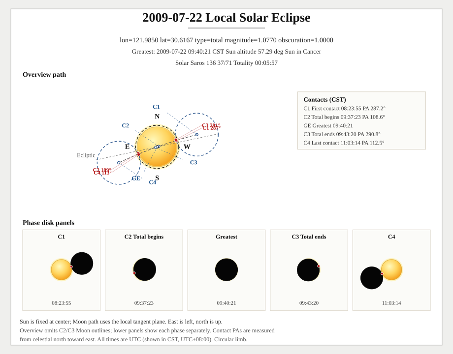

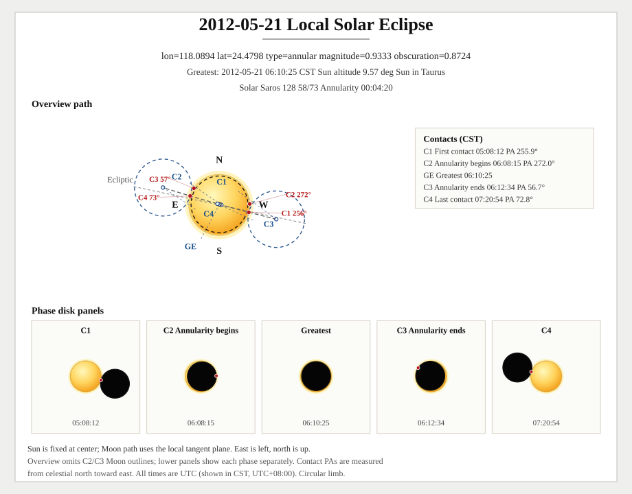

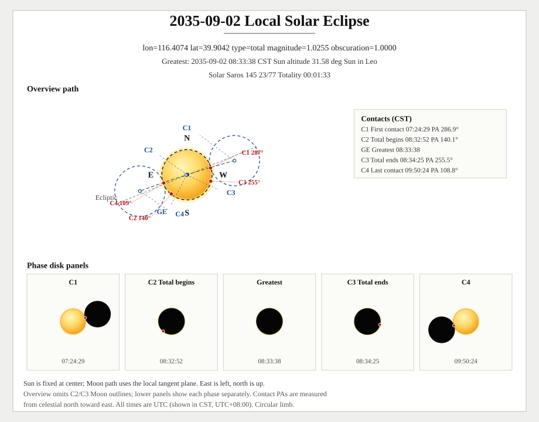

## Lunar eclipse

Lunar-eclipse detection and search live in `eclipse`; returned times preserve the input `time.Time` location.

Common entry points:

- `LunarEclipseOnDate`: detect whether a lunar eclipse occurs on a local date
- `LastLunarEclipse` / `NextLunarEclipse` / `ClosestLunarEclipse`: search global lunar eclipses
- `LocalLunarEclipseOnDate`: detect whether a visible lunar eclipse is visible from a site on a local date
- `LastLocalLunarEclipse` / `NextLocalLunarEclipse` / `ClosestLocalLunarEclipse`: search visible local lunar eclipses
- `LastLocalTotalLunarEclipse` / `NextLocalTotalLunarEclipse` / `ClosestLocalTotalLunarEclipse`: search visible local total lunar eclipses, returning `(info, ok)`
- `GeometricLocalLunarEclipseOnDate`: detect geometric lunar eclipse overlap without filtering by whether the Moon is above the horizon
- `eclipse/svg.LunarEclipseSVG`: render a lunar-eclipse shadow-path SVG

`LocalLunarEclipseInfo.Visibility` classifies local visibility into eight states: `full`, `moonrise`, `moonset`, `rise-and-set`, `interrupted`, `penumbra-moonrise`, `penumbra-moonset`, and `invisible`. The two `penumbra-*` states require the Moon to remain below the horizon throughout the umbral phase; the check uses the altitude extremum over that interval to include grazing windows between contacts. A purely penumbral eclipse has no umbral contacts and never returns these states. `interrupted` means the Moon is visible at both penumbral contacts but drops below the horizon in between, even if the whole umbral phase is below it. Classification uses the site's local culmination, not the global greatest-eclipse instant.

`MarshalLunarEclipse` exports the instantaneous hemispheres `visible-at-p1` and `visible-at-p4`, plus the time envelopes `visible-during-eclipse` and `visible-throughout-eclipse`. Their `aggregation` values are `union` and `intersection`; the latter is an empty `MultiPolygon` when no location remains visible for the whole interval. Envelopes use longitude columns derived from `boundary_points`, clamped to 360..720, and report the count as `longitude_points`.

The same API exports `penumbra-moonset` and `penumbra-moonrise` bands for sites visible at P1 or P4 respectively, but below the horizon throughout the umbral phase. Each carries `phase=penumbral-only` and its own contact times. Purely penumbral eclipses export neither band.

`MarshalLunarEclipseWithOptions` uses `LunarEclipseOptions` to control output and sampling. `SkipRoles` can omit envelopes and penumbra-only bands; skipping both envelopes also skips their sampling. `EnvelopeSweepSamples` defaults to 48 and is clamped to `[2, 192]`; `EnvelopeLongitudePoints` defaults to `max(360, boundaryPoints)` and is clamped to `[12, 720]`.

`MoonHorizon` and `MoonStateAt` take a UTC Julian day. `HMoonHeight(jd, lon, lat, tz)` takes a local civil Julian day and a timezone offset in hours; only `tz=0` makes `jd` a UTC value. Time-scale conversion happens inside the library.

`LunarEclipseInfo` includes:

- eclipse type `Type`
- Saros metadata `HasSaros` / `Saros`
- penumbral magnitude `PenumbralMagnitude`
- umbral magnitude `UmbralMagnitude`
- P1, U1, U2, greatest eclipse, U3, U4, P4 contact times

`Saros` has the same meaning as in the solar-eclipse section:

- `Saros.Series`: NASA lunar Saros series number when `Verified=true`, otherwise a provisional derived series number
- `Saros.Member`: 1-based member number within that series
- `Saros.Count`: total member count of that series
- `Saros.Verified`: whether the result matches an embedded authoritative catalog anchor; extension-table and extrapolated results are `false`

Lunar metadata also uses NASA anchors first, the extension table for astronomical years `-3000` through `+6000`, and live extrapolation outside that interval.

Computed members include the union of events detected by Danjon and Chauvenet, so metadata is independent of the requested lunar model and observing site. Very shallow members may differ from the NASA catalog; `Verified` remains `false`.

For example, the cross-year total lunar eclipse on `2028-12-31 / 2029-01-01` is member `49/72` of Lunar Saros `125`.

Two shadow-radius conventions are retained:

- **Danjon** (default): multiplies only the lunar horizontal-parallax term by `1.01`, then combines it with the solar semidiameter and solar parallax.

  NASA GSFC's current lunar-eclipse catalogs and diagram pages use the same route, as do the library defaults `LunarEclipseOnDate`, `LastLunarEclipse`, `NextLunarEclipse`, and `ClosestLunarEclipse`.
- **Chauvenet**, compatibility convention: starts with `0.99834 x Earth equatorial radius` and then multiplies the full shadow radii by `51/50`. This is closer to older traditional tables and is useful for compatibility checks.

Differences:

- `Chauvenet` gives larger penumbral and umbral shadows. Penumbral magnitude is usually about `0.025` larger, and umbral magnitude about `0.005` larger.
- For edge cases, `Chauvenet` can push an eclipse toward a deeper type.
- Against NASA catalogs, modern ephemeris software, or current mainstream lunar-eclipse material, the matching convention is the default `Danjon`.
- For compatibility with existing historical baselines, the matching convention is the explicitly-called `Chauvenet`.

### Code example

```go
package main

import (
	"github.com/starainrt/astro/eclipse"
	"fmt"
	"time"
)

func main() {
	date := time.Date(2029, 1, 1, 0, 0, 0, 0, time.UTC)

	// Default Danjon model, closer to NASA current material.
	info := eclipse.ClosestLunarEclipse(date)
	fmt.Println(info.Type)                                     // eclipse type
	fmt.Println(info.HasSaros, info.Saros)                     // Saros match flag; series, member number, total count
	fmt.Println(info.Maximum)                                  // greatest-eclipse time
	fmt.Println(info.PenumbralMagnitude, info.UmbralMagnitude) // penumbral and umbral magnitudes
	fmt.Println(info.PenumbralStart)                           // P1, penumbral eclipse begins
	fmt.Println(info.PartialStart)                             // U1, partial eclipse begins
	fmt.Println(info.TotalStart)                               // U2, totality begins
	fmt.Println(info.TotalEnd)                                 // U3, totality ends
	fmt.Println(info.PartialEnd)                               // U4, partial eclipse ends
	fmt.Println(info.PenumbralEnd)                             // P4, penumbral eclipse ends

	// Chauvenet model for compatibility with older conventions.
	legacy := eclipse.ClosestLunarEclipseChauvenet(date)
	fmt.Println(legacy.PenumbralMagnitude, legacy.UmbralMagnitude) // magnitudes under Chauvenet

	// Check a local civil date. Output time zone follows the input date.
	local := time.Date(2029, 1, 1, 12, 0, 0, 0, time.FixedZone("CST", 8*3600))
	today, ok := eclipse.LunarEclipseOnDate(local)
	fmt.Println(ok)            // whether this local date overlaps a lunar eclipse
	fmt.Println(today.Type)    // eclipse type
	fmt.Println(today.Maximum) // greatest-eclipse time in the input time zone
}
```

Output:

```text
total // eclipse type
true {125 49 72 true} // Lunar Saros 125, member 49/72, verified
2028-12-31 16:52:05.797516107 +0000 UTC // greatest eclipse
2.2740102011228953 1.246124858428628 // penumbral and umbral magnitudes
2028-12-31 14:03:54.428796172 +0000 UTC // P1
2028-12-31 15:07:42.35383898 +0000 UTC // U1
2028-12-31 16:16:27.44777888 +0000 UTC // U2
2028-12-31 17:27:46.474579274 +0000 UTC // U3
2028-12-31 18:36:32.476299405 +0000 UTC // U4
2028-12-31 19:40:11.773990094 +0000 UTC // P4
2.29962460346294 1.2511815539147877 // Chauvenet penumbral and umbral magnitudes
true // local date overlaps an eclipse
total // local eclipse type
2029-01-01 00:52:05.797516107 +0800 CST // greatest eclipse in UTC+8
```

### Checks against NASA data

The reference values come from NASA GSFC's lunar-eclipse catalog (greatest eclipse printed in **TD**, magnitudes as catalogued).

**A UT-level comparison must first remove the time-scale convention**: the catalogue and the single-eclipse diagram pages convert TD to UT with the ΔT adopted at publication (`75 s` for 2026, `74 s` for 2024), while the measured ΔT is only about `69.1-69.2 s`.

That is a `4.8-5.9 s` offset, so any UT-level contact comparison carries it wholesale; it is not a lunar-geometry error. The TD level (no ΔT) is the layer that tests the ephemeris and the shadow geometry on its own.

The table below was measured while Legacy was the default. Re-measuring `2026-03-03` with the semianalytic model gives a greatest-eclipse TD of `+0.083 s` against the `+0.114 s` for Legacy in the table, a `0.031 s` model difference; that is far below the `0.1-1.0 s` convention residuals in the table, so the table is not split by model.

| Sample | Model | Penumbral magnitude error | Umbral magnitude error | Greatest-eclipse TD difference (no ΔT) | Greatest-eclipse UT difference (with the ΔT convention) |
| --- | --- | --- | --- | --- | --- |
| 2026-03-03 total lunar eclipse | Danjon | -0.000067208 | -0.000069993 | +0.114 s | +5.99 s |
| 2026-03-03 total lunar eclipse | Chauvenet | +0.025599846 | +0.004935007 | +0.114 s | +5.99 s |
| 2026-08-28 partial lunar eclipse | Danjon | -0.000113694 | -0.000033624 | +0.090 s | +5.93 s |
| 2026-08-28 partial lunar eclipse | Chauvenet | +0.025567662 | +0.004957333 | +0.090 s | +5.93 s |
| 2024-03-25 penumbral lunar eclipse | Danjon | -0.000176555 | see note below | +1.012 s | +5.81 s |
| 2024-03-25 penumbral lunar eclipse | Chauvenet | +0.026044973 | see note below | +1.012 s | +5.81 s |

For the `2026-03-03` total lunar eclipse, current default `Danjon` differences against NASA are:

- type: both `total`
- greatest eclipse: our TD `11:34:52.113` vs NASA `11:34:52`, difference `+0.114 s`; in UT we are `5.99 s` later than the published diagram page, of which `5.88 s` is NASA's `ΔT = 75 s` against our measured `ΔT = 69.12 s`
- phase durations: penumbral `338.67 min` vs NASA `338.6`, umbral `207.17 min` vs `207.2`, total `58.31 min` vs `58.3`, all inside the catalogue's 0.1-minute printing resolution
- penumbral magnitude: `2.183732792` vs NASA `2.1838`, error `-0.000067208`
- umbral magnitude: `1.150630007` vs NASA `1.1507`, error `-0.000069993`

For the same eclipse, `Chauvenet` gives:

- type: both `total`
- penumbral magnitude: `2.209399846` vs NASA `2.1838`, error `+0.025599846`
- umbral magnitude: `1.155635007` vs NASA `1.1507`, error `+0.004935007`

`Chauvenet` is the compatibility model kept for older almanac conventions: both shadows are larger than the default `Danjon`, so magnitudes and contacts shift at the minute / one-percent level against the current NASA catalogue.

That is a model-convention difference and does not describe the timing accuracy of the default lunar-eclipse entry points.

For pure penumbral eclipses, NASA may publish negative `umbral magnitude`, meaning the Moon's disk center remains outside the umbral boundary by that amount.

This library preserves that negative value, so pure penumbral cases are compared in the same convention.

> Note: the NASA catalogue prints TD to whole seconds, so anything within ±0.5 s is printing resolution; the `+1.012 s` for `2024-03-25` is slightly beyond that, a difference between the two chains in the very shallow penumbral geometry.

### Lunar-eclipse SVG

The default model and the suffixed entry-point conventions of `LunarEclipseSVG`, `LunarEclipseDetailedSVG` and `LunarEclipseMapSVG` are described under [Lunar eclipse charts](#lunar-eclipse-charts) below.

The default lunar-eclipse SVG header includes Saros metadata. `LunarEclipseSVGOptions` can override:

- `Title`: main title
- `SummaryText` / `MaximumText` / `CoordinatesText` / `DurationText` / `MetaText`: five information lines under the title
- `ContactsTitle`: contact-time section title
- `DirectionText` / `FooterNote`: footer direction note and extra note

```go
package main

import (
	"fmt"
	"os"
	"time"

	eclipsesvg "github.com/starainrt/astro/eclipse/svg"
)

func main() {
	cst := time.FixedZone("CST", 8*3600)
	// Render the shadow-path diagram for the cross-year total lunar eclipse on 2029-01-01 UTC.
	svg, ok := eclipsesvg.LunarEclipseSVG(
		time.Date(2029, 1, 1, 0, 0, 0, 0, cst),
		eclipsesvg.LunarEclipseSVGOptions{
			Width:    960,
			Height:   620,
			Step:     10 * time.Minute,
			Location: cst,
			Language: "en",
		},
	)
	fmt.Println(ok, len(svg)) // whether SVG generation succeeded; SVG byte length
	if ok {
		_ = os.WriteFile("doc/img/lunar-eclipse-2029-01-01-en.svg", []byte(svg), 0o644)
	}
}
```

Output:

```text
true 19832 // lunar-eclipse SVG generated, 19832 bytes
```

Rendered example:

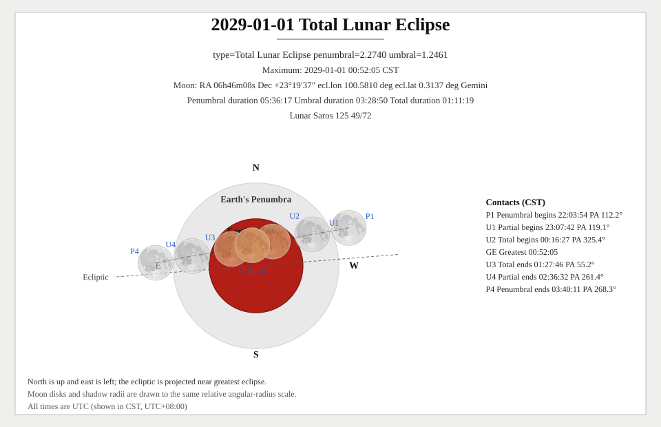

### References

- NASA lunar eclipse decade catalog: <https://eclipse.gsfc.nasa.gov/LEdecade/LEdecade2021.html?pubDate=20250222>
- NASA 2026-03-03 total lunar eclipse diagram: <https://eclipse.gsfc.nasa.gov/LEplot/LEplot2001/LE2026Mar03T.pdf>
- NASA 2026-08-28 partial lunar eclipse diagram: <https://eclipse.gsfc.nasa.gov/LEplot/LEplot2001/LE2026Aug28P.pdf>
- NASA 2024-03-25 penumbral lunar eclipse diagram: <https://eclipse.gsfc.nasa.gov/LEplot/LEplot2001/LE2024Mar25N.pdf>
- NASA lunar eclipse algorithm and history notes: <https://eclipse.gsfc.nasa.gov/LEhistory/LEhistory.html>

## Lunar limb correction

The Moon is a circular disk by default; local solar eclipses, global solar eclipses, lunar eclipses and fixed-site occultations can all use the lunar limb profile from `moon/limb`. The profile gives the actual limb radius toward the target and is used to refine contact times.

| Quantity | Corrected with the limb? |
| --- | --- |
| Local solar eclipse first and last contacts, central begin/end and central duration | Yes |
| Local magnitude and obscuration at greatest eclipse | Yes; the instant of greatest eclipse is unchanged |
| Global solar eclipse partial begin/end (P1/P4) and the central duration at greatest eclipse | Yes |
| Solar central path northern/southern limits, per-point widths, width at greatest eclipse, central band footprint and longest central duration | Yes, via `SolarEclipsePathOptions.LunarLimb` or the module |
| Outer partial visibility boundary (zero-magnitude envelope and the start/end sunrise-sunset curves) | Yes, via `SolarEclipsePartialFootprintOptions.LunarLimb` or the module |
| The six lunar-eclipse contacts | Yes, only through the module or context |
| Occultation disappearance, reappearance and planetary inner/outer contacts | Yes, see the [occultation manual](occultation.md#lunar-limb-correction) |
| Local and global instant of greatest eclipse, global magnitude, type, the center line itself, magnitude isolines, greatest-eclipse isochrones and the greatest-eclipse sunrise-sunset curves | No, still circular |

Correction rules:

- Annular and total-lunar inner contacts use the limb on the far side from the contact center.
- P1/P4 scan observers along the Earth's limb on both sides of the circular tangent point and keep the earliest (latest) contact.
- Central-path limits take the worst point within ±45° of position angle around the central direction: a total limit is where the deepest limb valley still covers the Sun, an annular limit where the highest limb point still lies inside the Sun. Endpoints on the horizon stay circular.
- The outer partial boundary is where the highest limb point just touches the near edge of the Sun. Horizon endpoints and the start/end sunrise-sunset curves move along the terminator at the same instant, so the two still meet at one point. Points with solar altitude between 0.05° and 0.5° stay circular. `PartialBoundaryLimbApplied` reports that at least one point moved. Across four eclipses including 2024-04-08 and high-latitude partial ones, the zero-magnitude envelope shifts by a median of 1–4 km and a maximum of about 7 km; the start/end sunrise-sunset curves slide along the terminator and can move more than 10 km at individual points; with the default step, footprint computation takes about 10%–20% longer.

```go
import "github.com/starainrt/astro/moon/limb"

// Per query
info, ok := eclipse.LocalSolarEclipseOnDateWithOptions(date, lon, lat, 0,
	eclipse.SolarEclipseOptions{LunarLimb: limb.Default()})

// For every local solar eclipse in a context
base, err := astro.NewContext(astro.ModelSemianalytic)
if err != nil {
	panic(err)
}
ctx := base.WithLunarLimb(limb.Default())
info, ok = ctx.Eclipse().LocalSolarEclipseOnDate(date, lon, lat, 0)
```

Charts support it too: every eclipse-chart options struct in `eclipse/svg` carries a `LunarLimb` field. The local solar chart corrects contact times and the magnitude and obscuration at greatest eclipse; both lunar diagrams correct contact times, with the disks still drawn as circles and the instant of greatest eclipse unchanged; the lunar world map moves each phase horizon with the corrected contact; the global solar map corrects the central-band limits, the width at greatest eclipse, the outer partial visibility boundary, the global P1/P4 and the local panel at greatest eclipse (including the central duration), while magnitude isolines, isochrones and the geocentric panel stay circular.

The layers are independent — a profile with values only at some position angles may correct just some of them — and the global solar map footer lists only the layers actually corrected, e.g. "Lunar limb profile applied to visibility boundary (isolines circular)."; `CentralLimitsLimbApplied` on the central path result records whether the limits and width were corrected.

Each chart declares the convention after the time-scale note ("Circular limb." or "Limb profile." on local charts), and a custom `FooterNote` does not replace it.

`LunarLimbApplied` on a result records whether the limb correction actually took effect, and charts use it rather than whether the option is set. Where the profile has no value (`LimbRadiusKM` returns `false`), the radius falls back to the circular limb and that sample does not take part in the correction; when nothing in a result was corrected the field is `false` and the numbers equal the circular result exactly.

`LunarLimb` in the options takes precedence over the module setting. `eclipse.(*Eclipse).WithLunarLimb` returns a new module and leaves the original unchanged. Any type implementing `eclipse.LunarLimb` can supply another profile; the low-level `basic.LunarEclipseWithLunarLimb` offers the same capability.

The built-in profile lives in the separate `moon/limb` package. It is a processed product of the ISAS/JAXA SELENE (Kaguya) LALT global topography data (published by DARTS, 16 pixels/degree) and is about 1.5 MB; the data is linked only when that package is imported. The table is indexed by the observer's selenographic longitude and latitude (±9° / ±8°, 1° steps) and position angle (0.1° steps); trilinear interpolation reproduces profiles taken directly from the DEM with an RMS error of about 90 m.

The corrections are a few seconds: totality at Dallas on 2024-04-08 changes from `227.6 s` to `229.8 s`, Torreón `250.6 s` → `255.0 s`, annularity at Albuquerque on 2023-10-14 `289.4 s` → `290.3 s`, and the contacts of the 2025-09-07 total lunar eclipse move by `-4.4 s` to `+0.2 s`. The total-path limits move by about `2.1 km` / `1.0 km` on average (up to about `3.2 km`), the width at greatest eclipse from `198.6 km` to `196.8 km`, the longest central duration from `268.0 s` to `271.7 s` and the central duration at greatest eclipse from `268.0 s` to `271.2 s`.

For item-by-item checks, compare with the published values of the *Chinese Astronomical Almanac* (Purple Mountain Observatory): about `-0.8 s` / `+0.2 s` at whole-second precision, and with the Chauvenet convention at 0.1-minute precision a mean error of `1.5 s` circular and `2.2 s` with the limb, both within the published rounding.

## Solar and Lunar Eclipse Charts

All five `eclipse/svg` entry points return `(string, bool)`.

A `false` second value means the chart cannot be drawn with the current arguments (no such event on that date, canvas below the floor, or a UT1 scale paired with a non-UTC location) - it is not a rendering error.

| Entry point | Chart | Suggested canvas |
| --- | --- | --- |
| `LocalSolarEclipseSVG` | Fixed-site solar disk chart (see "Solar-eclipse SVG" above) | 920×720 and up |
| `SolarEclipseMapSVG` | Global visibility map, four selectable projections | 1200×800; orthographic globe 1000×1414 |
| `LunarEclipseSVG` | Lunar shadow-path diagram | 960×620 and up |
| `LunarEclipseMapSVG` | Lunar world visibility map | 1200×800 |
| `LunarEclipseDetailedSVG` | Lunar detailed layout (diagram and base map on one page) | 1000×1414 or 1414×1000 |

A solar global map draws the full partial-visibility region, the total/annular central band, the central line, global phase information and central-line time markers, together with the rise/set lines of first/greatest/last contact, the subsolar point, the shadow-axis entry and exit points, the `P1-P4/U1-U4` contacts, and the sampled penumbral and umbral/antumbral outlines that are off by default and requested on demand.

A lunar map draws the `P1/P4` Moon-visible hemispheres, the moonrise/moonset transition zones and the all-visible region. It uses the three-shape approximation over the P1, greatest-eclipse and P4 horizons and does not carry the swept time envelopes exported on the GeoJSON side, so a very narrow unshaded seam can remain between the two horizon lines.

### Global visibility maps

#### Equirectangular

The minimal call passes only the event date and the display time zone; everything else defaults (`TimeLabelStep` is 30 minutes):

```go
solar, ok := eclipsesvg.SolarEclipseMapSVG(
	time.Date(2009, 7, 22, 12, 0, 0, 0, cst),
	eclipsesvg.SolarEclipseMapSVGOptions{
		Width: 1414, Height: 1000, Location: cst,
		TimeLabelStep: 30 * time.Minute, GreatestTimeStep: 30 * time.Minute,
	},
)
fmt.Println(ok, len(solar))
```

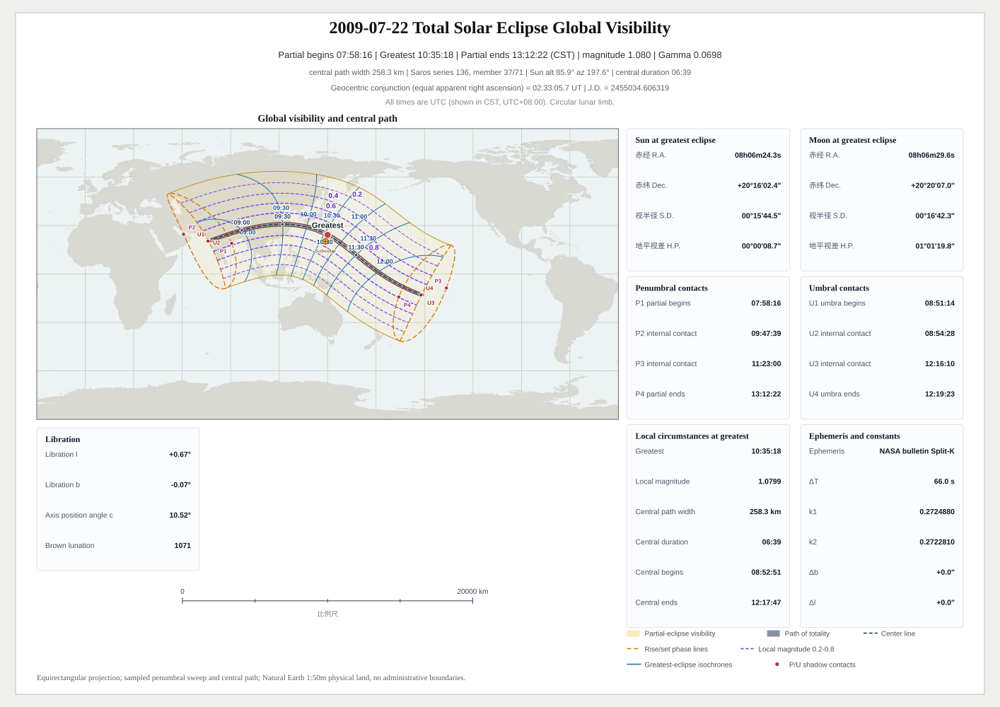

The other two equirectangular examples are the `2012-05-21` Xiamen annular eclipse and the `2035-09-02` Beijing total eclipse.

Both figures use the same recipe as the Yangtze map: no instantaneous penumbral/umbral outlines, 30-minute greatest-eclipse isochrones, and the magnitude contours disabled with an empty slice:

```go
options := eclipsesvg.SolarEclipseMapSVGOptions{
	Width: 1200, Height: 800, Location: cst,
	TimeLabelStep: 30 * time.Minute, GreatestTimeStep: 30 * time.Minute,
	MagnitudeValues: []float64{},
}
annular, ok := eclipsesvg.SolarEclipseMapSVG(time.Date(2012, 5, 21, 12, 0, 0, 0, cst), options)
total, ok := eclipsesvg.SolarEclipseMapSVG(time.Date(2035, 9, 2, 12, 0, 0, 0, cst), options)
fmt.Println(ok, len(annular), len(total))
```

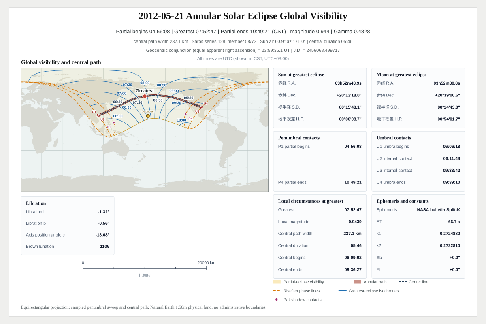

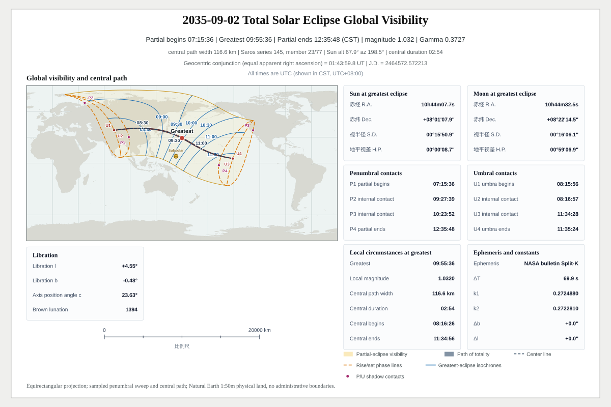

#### Orthographic globe

`EclipseMapProjectionOrthographic` gives the NASA-style **orthographic globe**: the view point is the greatest-eclipse point, only the hemisphere facing it is drawn, and the projection boundary is the great circle of the visible hemisphere.

The orthographic projection uses the NASA-style centered-globe layout; a `1000×1414` canvas is recommended. It does not change the underlying geographic results.

```go
globe, ok := eclipsesvg.SolarEclipseMapSVG(
	time.Date(2009, 7, 22, 12, 0, 0, 0, cst),
	eclipsesvg.SolarEclipseMapSVGOptions{
		Width: 1000, Height: 1414, Location: cst,
		Projection:    eclipsesvg.EclipseMapProjectionOrthographic,
		TimeLabelStep: 30 * time.Minute, GreatestTimeStep: 30 * time.Minute,
	},
)
```

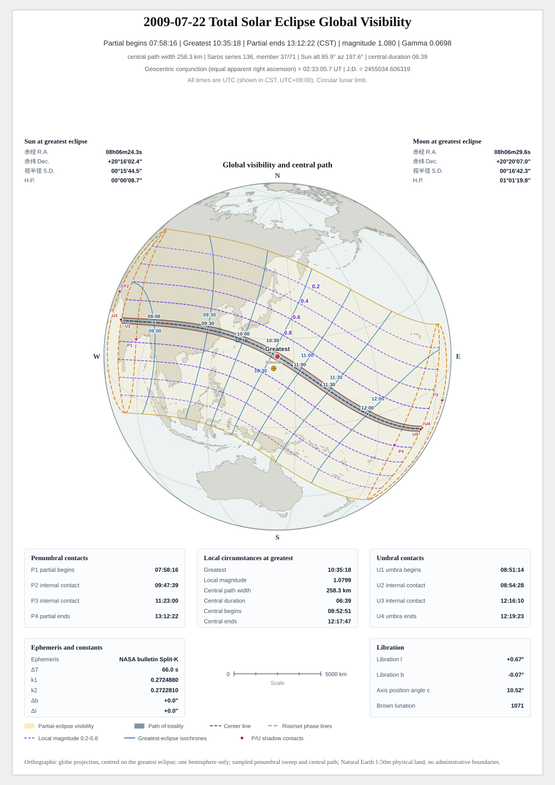

The orthographic globe is most comfortable in portrait (e.g. `1000×1414`); landscape (`1200×800`) also renders, with a visibly smaller globe.

#### Polar azimuthal equidistant

`EclipseMapProjectionNorthPolar` and `EclipseMapProjectionSouthPolar` place the pole at the center of the canvas, which suits events whose band lies entirely at high latitude.

`EclipseMapProjectionAuto` (the zero value) picks a polar map when that fits, so specify a projection explicitly only when the layout must be fixed; the projection only affects SVG presentation and never the underlying WGS84 geography.

The partial-visibility region of the `2012-05-21` annular eclipse covers the north pole; forcing the north-polar projection makes the antimeridian-crossing extent easy to read:

```go
arctic, ok := eclipsesvg.SolarEclipseMapSVG(
	time.Date(2012, 5, 21, 12, 0, 0, 0, cst),
	eclipsesvg.SolarEclipseMapSVGOptions{
		Width: 1200, Height: 800, Location: cst,
		Projection:    eclipsesvg.EclipseMapProjectionNorthPolar,
		TimeLabelStep: 30 * time.Minute, GreatestTimeStep: 30 * time.Minute,
	},
)
```

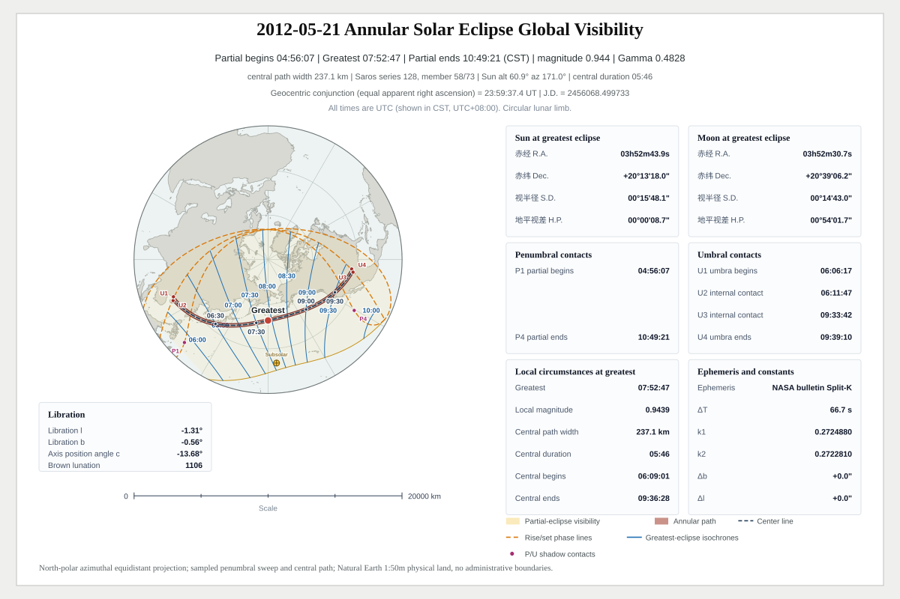

The band of the `2021-12-04` total eclipse lies entirely over Antarctica, where the south-polar projection is the natural layout; the figure below uses the same recipe as the landscape global maps, with 30-minute greatest-eclipse isochrones only:

```go
south, ok := eclipsesvg.SolarEclipseMapSVG(
	time.Date(2021, 12, 4, 12, 0, 0, 0, cst),
	eclipsesvg.SolarEclipseMapSVGOptions{
		Width: 1200, Height: 800, Location: cst,
		Projection:    eclipsesvg.EclipseMapProjectionSouthPolar,
		TimeLabelStep: 30 * time.Minute, GreatestTimeStep: 30 * time.Minute,
		MagnitudeValues: []float64{},
	},
)
```

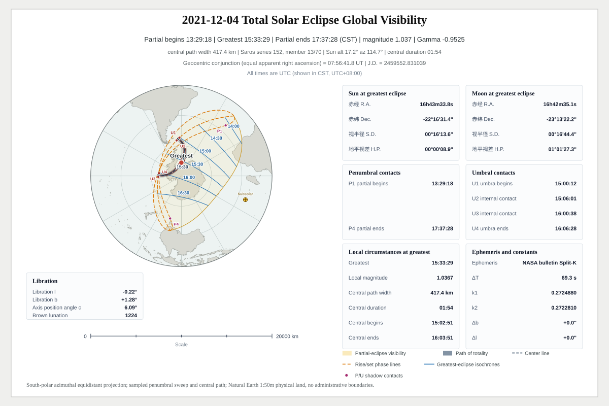

#### Four projections in one pass

All four projections share one option set; only `Projection` differs, which makes it easy to generate a batch and pick a layout:

```go
date := time.Date(2009, 7, 22, 12, 0, 0, 0, cst)
for _, spec := range []struct {
	name string
	p    eclipsesvg.EclipseMapProjection
}{
	{"equirectangular", eclipsesvg.EclipseMapProjectionEquirectangular},
	{"north-polar", eclipsesvg.EclipseMapProjectionNorthPolar},
	{"south-polar", eclipsesvg.EclipseMapProjectionSouthPolar},
	{"orthographic", eclipsesvg.EclipseMapProjectionOrthographic},
} {
	options := eclipsesvg.SolarEclipseMapSVGOptions{
		Width: 1200, Height: 800, Location: cst, Projection: spec.p,
	}
	svg, ok := eclipsesvg.SolarEclipseMapSVG(date, options)
	if !ok {
		continue
	}
	_ = os.WriteFile("solar-eclipse-"+spec.name+".svg", []byte(svg), 0o644)
}
```

#### Layer and sampling switches

| Option | Default | Meaning |
| --- | --- | --- |
| `TimeLabelStep` | 30 minutes | Central-line time-marker interval; a negative value disables them |
| `GreatestTimeStep` | off | Greatest-eclipse isochrones; a positive value must be requested explicitly, aligned to the display time zone, values below one minute become one minute, at most 64 per run |
| `MagnitudeValues` | `0.2/0.4/0.6/0.8` when nil | Magnitude-contour levels; an explicit empty slice disables them, a non-empty slice draws the given levels |
| `PenumbralOutlineStep` | off | Sampling interval of the instantaneous penumbral outline; zero or negative draws nothing, a positive value below one minute becomes one minute |
| `CentralShadowStep` | off | Sampling interval of the instantaneous umbral/antumbral outline; same rules |
| `PartialStep` | 2 minutes | Time step of partial footprints; non-positive values and positive values below two minutes are clamped to two minutes |
| `BoundaryPoints` | 180 | Angular sample count of each instantaneous partial footprint; non-positive uses 180, positive values are clamped to 12..1440 |
| `CentralStep` | 2 minutes | Central-path time step; non-positive uses two minutes, a positive value below one second becomes one second, and long events are widened automatically to keep the base path within 30000 samples |
| `TargetSpacingKM` | 150 km | Maximum center-line ground spacing; non-positive uses 150 km, NaN and +Inf disable refinement |

The penumbral/umbral outlines are off by default. When `MagnitudeValues` is nil, the magnitude contours use the levels in the table; pass an explicit empty slice to disable them.

The Xiamen, Beijing, north-polar and south-polar figures all use that minimum recipe: no instantaneous outlines, 30-minute greatest-eclipse isochrones, and the magnitude contours explicitly disabled:

```go
options := eclipsesvg.SolarEclipseMapSVGOptions{
	Width: 1200, Height: 800, Location: cst,
	TimeLabelStep: 30 * time.Minute, GreatestTimeStep: 30 * time.Minute,
	MagnitudeValues: []float64{},
}
```

Isochrones are not traced by sampling greatest-eclipse times on a grid: each fixed instant solves the zero set of `d(Sun-Moon center separation^2)/dt = 0` and continues it along the curve, so the cost is proportional to curve length.

Every branch ends on the horizon or the partial-visibility boundary, propagation stops beyond latitude +/-88 degrees, and one instant can produce several disconnected branches.

Degradable layers record their actual geometry source in `data-source`; the vocabulary is listed under [Map Projections](map-geojson.md#map-projections).

#### Canvas floors and fallbacks

- The solar-map floor is **800×560**: a width below 800 or a height below 560 falls back to 960×640. On narrower landscape canvases the map frame overlaps the right-hand data grid horizontally and the panel line spacing drops below 1 px.
- The partial-region fill is a union of instantaneous footprints, so `PartialStep` values below two minutes are clamped to two minutes; a denser request does not improve the result.
- The lunar detailed layout derives its arrangement from `Height`: `640×420` and `800×600` cannot hold the diagram and base-map floors and return `false`, while `1000×1414` and `1414×1000` render normally.

### Lunar eclipse charts

#### Three entry points and shadow models

`LunarEclipseSVG` (shadow-path diagram), `LunarEclipseMapSVG` (world visibility) and `LunarEclipseDetailedSVG` (detailed layout) share one default model: Danjon first, falling back to Chauvenet for very shallow penumbral phases, matching `LunarEclipseOnDate`.

Entries with a `Danjon` / `Chauvenet` suffix force the model; the `...Chauvenet` variants are the ones to compare against older tables that use the classical shadow radii.

```go
diagram, ok := eclipsesvg.LunarEclipseSVG(
	time.Date(2029, 1, 1, 0, 0, 0, 0, cst),
	eclipsesvg.LunarEclipseSVGOptions{
		Width: 960, Height: 620, Step: 10 * time.Minute, Location: cst,
	},
)
fmt.Println(ok, len(diagram))
```


#### World visibility map

The base map separates all-visible, moonrise-with-eclipse, moonset-with-eclipse and not-visible regions: all-visible requires the Moon above the horizon at `P1`, greatest eclipse and `P4` alike (visible at both contacts does not imply visible in between - at high latitudes a lower culmination can drop the Moon below the horizon around greatest, and that band is drawn as moonset-with-eclipse); moonset-with-eclipse covers places visible at `P1` but not at `P4`, plus the polar lens that is above the horizon only around greatest while below it at both contacts; moonrise-with-eclipse covers places visible at `P4` but not at `P1`;

and not-visible means below the horizon at all three. `Projection` switches to polar and orthographic layouts; the map below is the default output, with the penumbral phases already folded into the partition:

```go
visible, ok := eclipsesvg.LunarEclipseMapSVG(
	time.Date(2029, 1, 1, 0, 0, 0, 0, cst),
	eclipsesvg.LunarEclipseMapSVGOptions{Width: 1200, Height: 800, Location: cst},
)
```

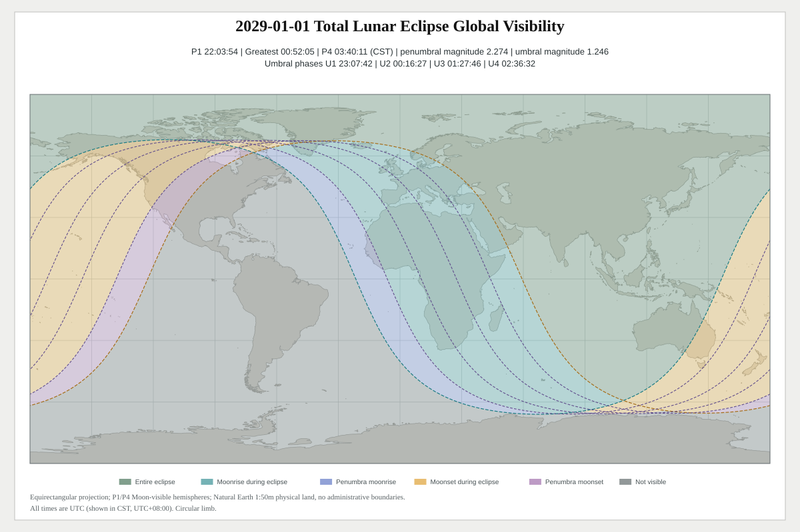

The penumbral phase is folded into the partition by default, the way NASA's lunar eclipse world maps do it: the renderer draws the `U1`, `U2`, `U3` and `U4` horizon boundaries, shades the moonrise and moonset bands where only the penumbra is above the horizon, listed in the legend as "Penumbra moonrise" and "Penumbra moonset" (blue for moonrise, violet for moonset), and adds a row of umbral contact times under the summary line. The two bands exclude the **whole umbral interval**: a site that is above the horizon at any instant between U1 and U4 belongs to the umbral moonrise/moonset bands. The mask samples the full visible hemisphere every 15 minutes (disk resolution about 0.035 degrees), leaving a residual grazing window of about 0.05 degrees (roughly 0.15 pixel); shallower windows lasting only a few minutes are decided exactly by the site API and GeoJSON.

A penumbral-only eclipse has no umbral contacts and renders identically either way. `DisablePenumbralPhase: true` falls back to the four-way partition of the three horizon instants and draws neither the `U1`-`U4` horizons nor the penumbra-only bands:

```go
penumbral, ok := eclipsesvg.LunarEclipseMapSVG(
	time.Date(2026, 3, 3, 0, 0, 0, 0, cst),
	eclipsesvg.LunarEclipseMapSVGOptions{
		Width: 1200, Height: 800, Location: cst, DisablePenumbralPhase: true,
	},
)
```

`LunarEclipseDetailedSVGOptions` carries the same field for the base map of the detailed layout, which also draws the penumbral phase by default.

#### Detailed layout

The detailed layout combines both lunar charts on one page: a centered summary (greatest eclipse, penumbral/umbral magnitude, gamma, penumbral/umbral radii, Moon distance, Saros series), geocentric coordinate blocks for Sun and Moon on either side, the shadow-path diagram, three columns for duration, arc-minute scale and contact times, and the world visibility base map with its legend underneath.

The shadow geometry comes from `basic.LunarEclipseShadowGeometryAt`, where **gamma uses the Earth equatorial radius while the penumbral/umbral radii are in degrees** - to convert them into Earth radii, multiply by the Earth parallax at the Moon.

```go
detailed, ok := eclipsesvg.LunarEclipseDetailedSVG(
	time.Date(2029, 1, 1, 0, 0, 0, 0, cst),
	eclipsesvg.LunarEclipseDetailedSVGOptions{Location: cst},
)
```

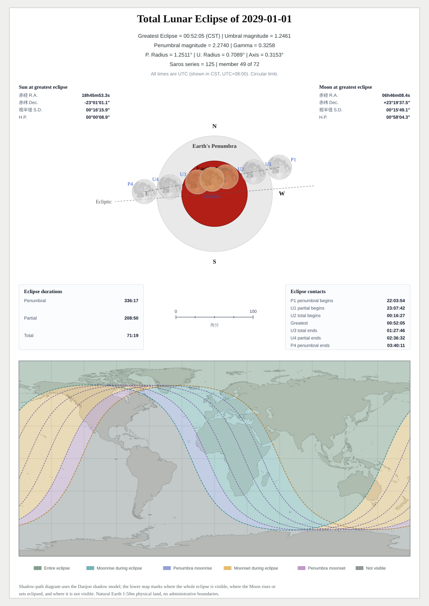

The second event, the `2026-03-03` total lunar eclipse, uses the same entry points for a shadow-path diagram and a detailed layout:

```go
diagram2026, ok := eclipsesvg.LunarEclipseSVG(
	time.Date(2026, 3, 3, 0, 0, 0, 0, cst),
	eclipsesvg.LunarEclipseSVGOptions{Width: 960, Height: 620, Step: 10 * time.Minute, Location: cst},
)
detailed2026, ok := eclipsesvg.LunarEclipseDetailedSVG(
	time.Date(2026, 3, 3, 12, 0, 0, 0, cst),
	eclipsesvg.LunarEclipseDetailedSVGOptions{Location: cst},
)
```

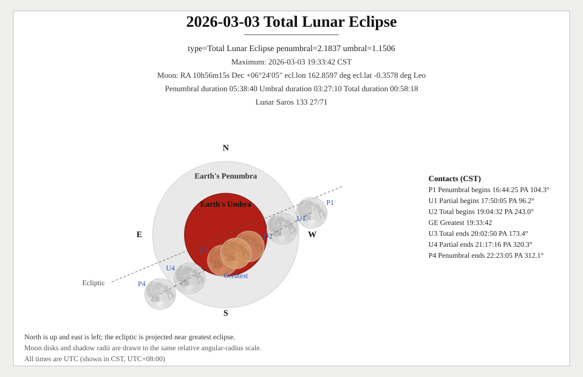

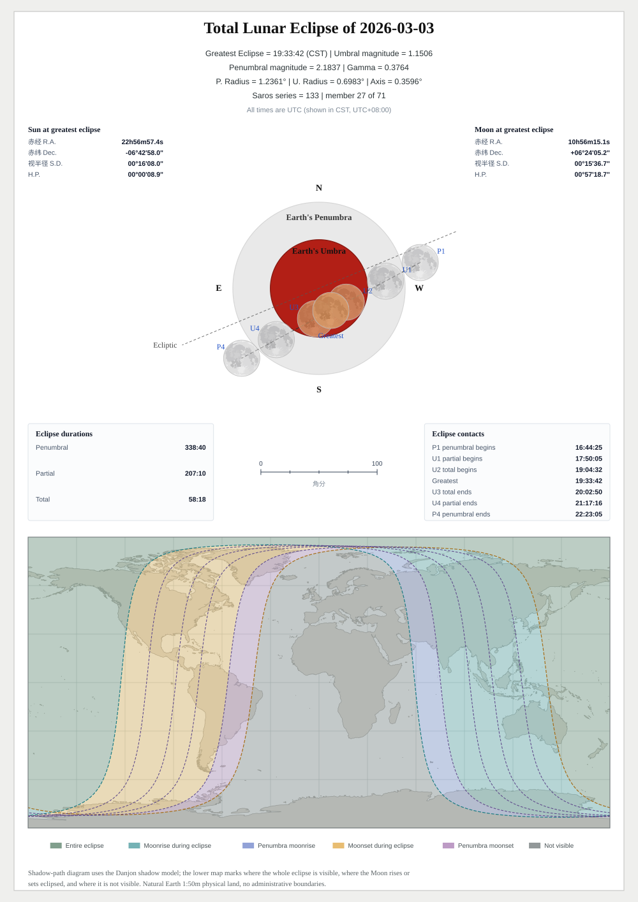

The layout follows `Height`: landscape puts the data blocks in two columns by three rows to the right of the map, portrait puts them in three columns by two rows below the globe.

### Time scale and UT1

All four chart families are drawn in the UTC scale by default and state the scale inside the figure or in the footer. `TimeScale: astro.TimeScaleUT1` switches to UT1 readings and adds the `DUT1 = UT1-UTC` offset; in that mode `Location` must be UTC, otherwise the call returns `false`. Geometry is always computed on the civil instant and converted afterwards, so the conversion never shifts an isochrone.

To read UT1 values in code, use the `...InUT1` converters of `eclipse` (`SolarEclipseInfoInUT1`, `LocalSolarEclipseInfoInUT1`, `LunarEclipseInfoInUT1`, `SolarEclipsePathInUT1`, `SolarEclipsePartialFootprintsInUT1`, `SolarEclipseGeocentricPanelInUT1`, `TimeLabelsInUT1`); they rewrite time fields only and keep zero instants as-is. See [Time Scale Declaration](map-geojson.md#time-scale-declaration) for the full convention.

```go
ut1, ok := eclipsesvg.SolarEclipseMapSVG(
	time.Date(2009, 7, 22, 12, 0, 0, 0, cst),
	eclipsesvg.SolarEclipseMapSVGOptions{
		Width: 1200, Height: 800, Location: time.UTC,
		TimeScale: astro.TimeScaleUT1, TimeLabelStep: 30 * time.Minute,
	},
)
```

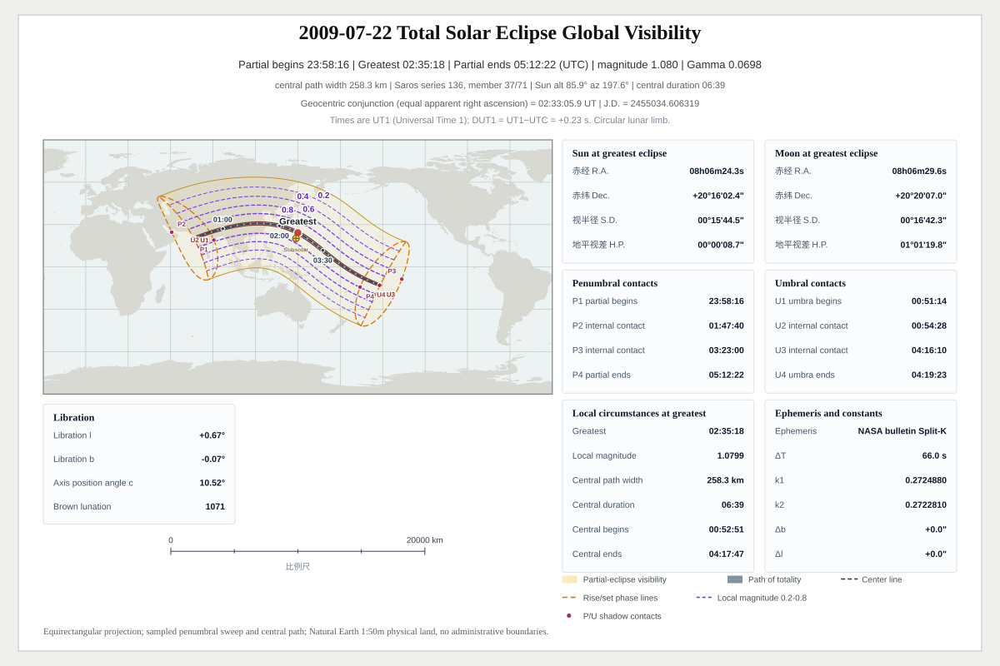

## Transit charts

Transit contact times, topocentric visibility and `LocalTransit` live in [Planets: Mercury and Venus transits](planets.md#mercury-and-venus-transits); this section covers only the two `eclipse/svg` charts. `eclipse/svg` has two transit renderers, both returning `(string, bool)`; `date` selects the closest transit, and a same-day query finds that day's transit.

| Entry | Chart | Suggested canvas |
| --- | --- | --- |
| `TransitMapSVG` | Geocentric global visibility: entire transit, transit at sunrise, transit at sunset, not visible | 960×640 and up |
| `TransitLocalSVG` | Topocentric solar disk: north up, east left, planet-center track, planet disk at each contact and at greatest, contact table | 960×680 and up |

Regions follow whether the Sun's center is above the apparent horizon at C1, greatest and C4, with standard refraction (a horizon circle of 90°34′). Isochrones are off by default; enable them bitwise with `Isochrones`: `TransitIsochroneC1` … `TransitIsochroneC4`, or the combinations `TransitIsochroneExternal` (C1 and C4) and `TransitIsochroneAll`. C2/C3 are dropped for a grazing transit without internal contacts. Isochrones are topocentric contact times drawn only where the Sun is above the apparent horizon; a non-positive `IsochroneStep` uses 20 s for Mercury and 1 min for Venus. A transit is visible from roughly half the globe, so the map always shows the whole world; `Projection` selects one of the four projections.

```go
venus := time.Date(2012, 6, 6, 0, 0, 0, 0, time.UTC)
world, ok := eclipsesvg.TransitMapSVG(eclipsesvg.TransitVenus, venus, eclipsesvg.TransitMapSVGOptions{
	Isochrones:    eclipsesvg.TransitIsochroneExternal,
	IsochroneStep: 10 * time.Minute,
	Language:      "en",
})
local, ok := eclipsesvg.TransitLocalSVG(eclipsesvg.TransitVenus, venus, 116.4, 39.9, 50,
	eclipsesvg.TransitLocalSVGOptions{Language: "en"})
```

On the disk chart, track parts with the Sun's center below the apparent horizon are grey and dashed, and the table adds sunrise or sunset during the transit. `TransitLocalSVG` returns `false` when the site sees no geometric transit. The topocentric contact method is described in [Planets](planets.md#mercury-and-venus-transits).

### Mercury: 2032-11-13 (Beijing)

2032-11-13 is the next Mercury transit visible from Beijing. Beijing sees first contact, second contact and greatest, with the Sun only `+0.2°` high at greatest; third and fourth contact happen after sunset (Sun about `-24°`) and are drawn grey and dashed on the disk chart.

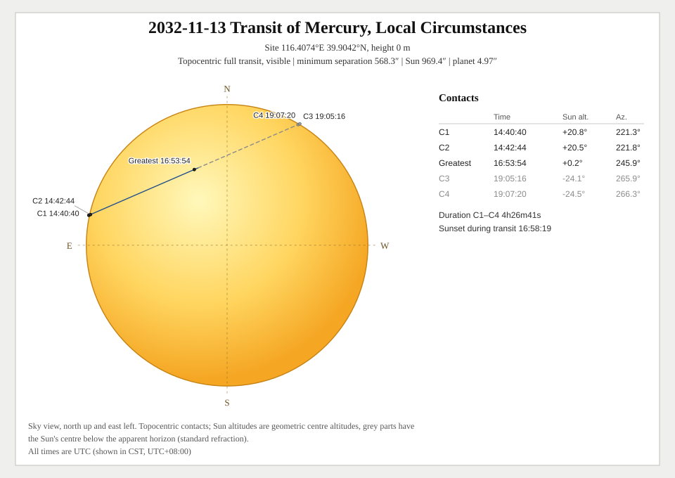

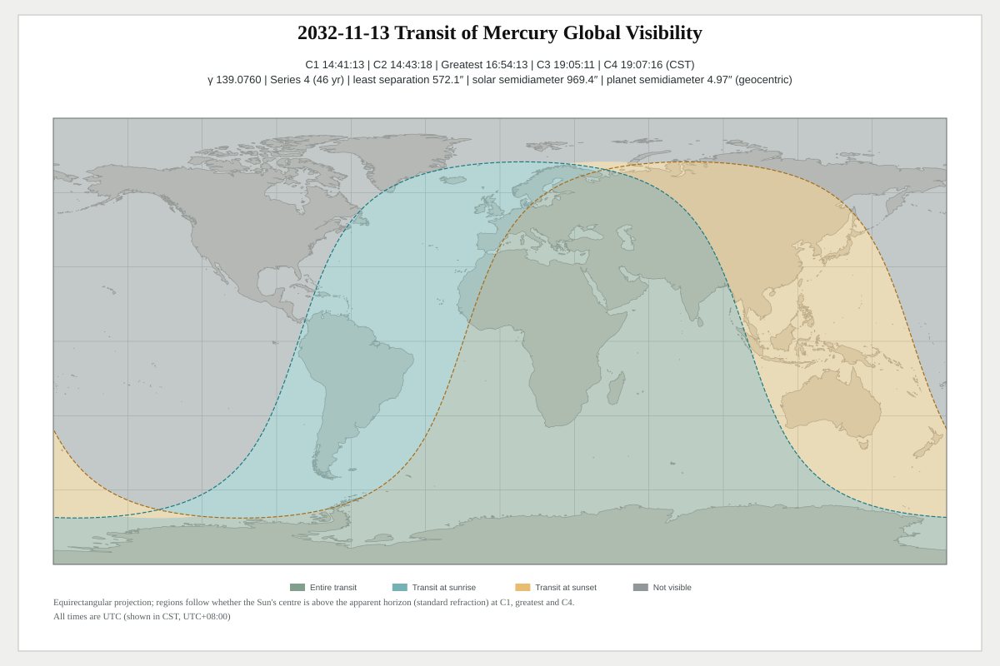

### Venus: 2012-06-06 (Beijing)

The Venus transit of 2012-06-06 was visible in full from Beijing, with `6h39m4s` from first to fourth contact and solar altitudes of `+14°` to `+71°` at the contacts.

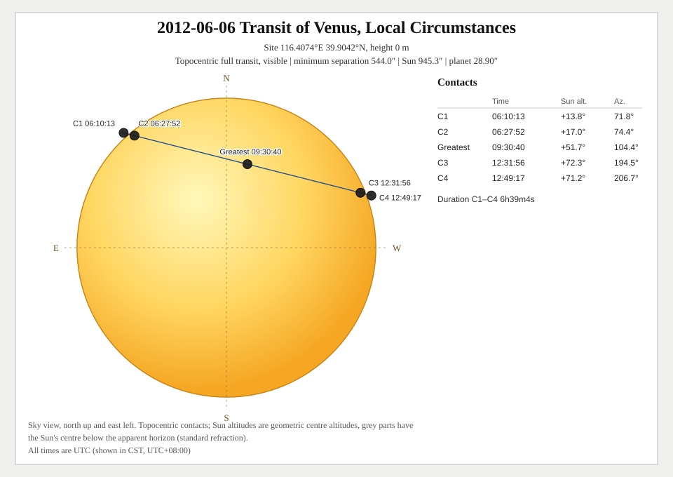

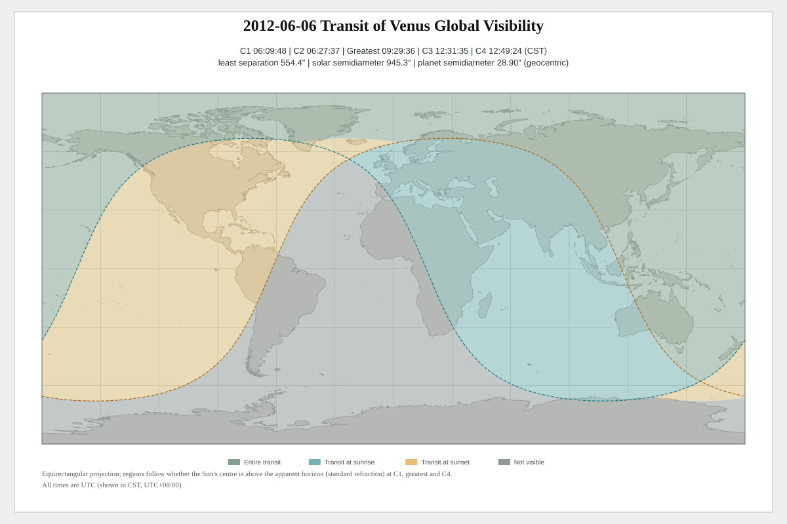
