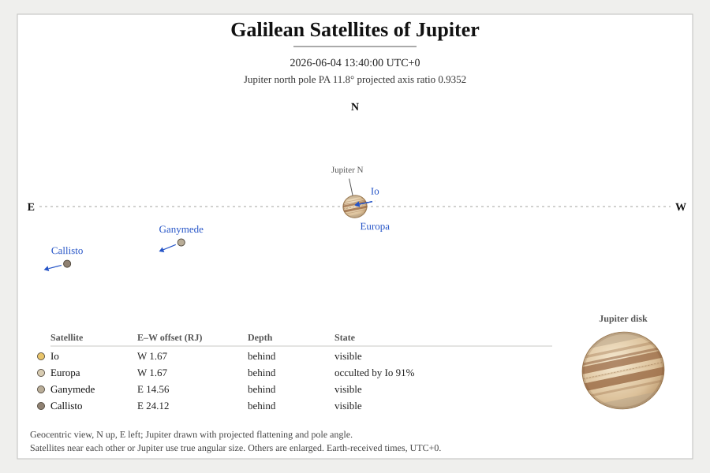
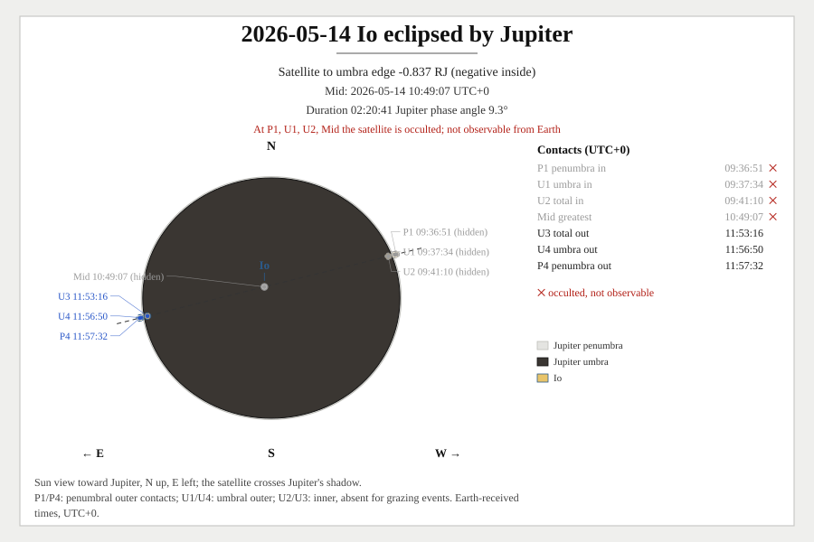
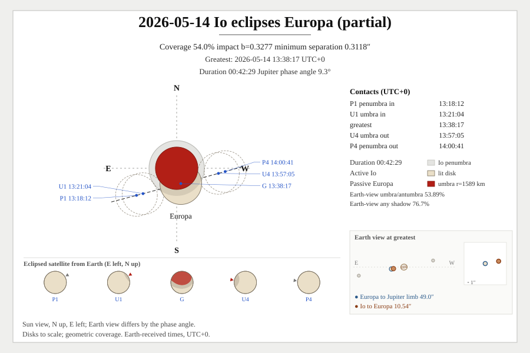

# Jupiter Satellite SVG

[中文](../jupiter-svg.md) | [Planets Manual](planets.md#galilean-satellites-phenomena-contacts--mutual-events) | [Back to README](../../../README.en.md)

The `jupiter/svg` package renders three self-contained vector charts for Jupiter's Galilean moons: an instantaneous four-moon system overview, a single-satellite regular phenomenon diagram (transit, occultation, eclipse, shadow transit), and a mutual occultation/eclipse chart. All functions return `(string, bool)`.

## Contents

- [Entry Points](#entry-points)
- [1. Four-Satellite System Overview (GalileanSystemSVG)](#1-four-satellite-system-overview-galileansystemsvg)
- [2. Regular Phenomenon Chart (GalileanPhenomenonSVG)](#2-regular-phenomenon-chart-galileanphenomenonsvg)
- [3. Mutual Occultation / Eclipse Chart (GalileanMutualEventSVG)](#3-mutual-occultation--eclipse-chart-galileanmutualeventsvg)
- [Options and Limitations](#options-and-limitations)

## Entry Points

| Function | Purpose | Default Size / Behavior |
| --- | --- | --- |
| `GalileanSystemSVG` | Where Io, Europa, Ganymede & Callisto lie around Jupiter at an instant | 900×600, enlarged dots for legibility (`TrueScale: true` for true angular scale) |
| `GalileanPhenomenonSVG` | Track and D/F contact table for a transit, occultation, eclipse, or shadow transit | 900×600, always drawn to relative disc scale |
| `GalileanMutualEventSVG` | Relative disc geometry, penumbra/umbra circles & contact table for a mutual event | 900×600, enlarged shadow cores are labeled |

> Sky orientation is naked-eye view (**north up, east left**). Invalid events return `ok == false`.

## 1. Four-Satellite System Overview (`GalileanSystemSVG`)

```go
package main

import (
	"log"
	"os"
	"time"

	jupitersvg "github.com/starainrt/astro/jupiter/svg"
)

func main() {
	date := time.Date(2026, 6, 4, 13, 40, 0, 0, time.UTC)
	svg, ok := jupitersvg.GalileanSystemSVG(date, jupitersvg.GalileanSystemSVGOptions{
		Language: "en",
		Location: time.UTC,
	})
	if !ok {
		log.Fatal("render failed")
	}
	if err := os.WriteFile("jupiter-system-2026-06-04-en.svg", []byte(svg), 0o644); err != nil {
		log.Fatal(err)
	}
}
```



Reading the chart:
- The dashed horizontal line is the celestial east–west reference (not Jupiter's equator); Jupiter is drawn with its projected flattening and north-pole position angle, and blue arrows show apparent motion.
- Satellites close to each other or to Jupiter's disc automatically switch to true angular scale to avoid false overlaps, while others are enlarged for clarity.
- The bottom table lists E–W offset (in Jupiter radii), depth (in front / behind), and visibility or occultation/eclipse state, alongside a magnified Jupiter disc inset.

## 2. Regular Phenomenon Chart (`GalileanPhenomenonSVG`)

```go
package main

import (
	"log"
	"os"
	"time"

	"github.com/starainrt/astro/jupiter"
	jupitersvg "github.com/starainrt/astro/jupiter/svg"
)

func main() {
	date := time.Date(2026, 1, 15, 0, 0, 0, 0, time.UTC)
	event := jupiter.NextGalileanPhenomenonContactEvent(
		date,
		jupiter.GalileanSatelliteIo,
		jupiter.GalileanPhenomenonEclipse,
	)
	svg, ok := jupitersvg.GalileanPhenomenonSVG(event, jupitersvg.GalileanPhenomenonSVGOptions{
		Language: "en",
		Location: time.UTC,
	})
	if !ok {
		log.Fatal("render failed")
	}
	if err := os.WriteFile("jupiter-io-eclipse-2026-en.svg", []byte(svg), 0o644); err != nil {
		log.Fatal(err)
	}
}
```



- Shaded arcs mark Jupiter's shadow cone; the bottom table shows disappearance (D) and reappearance (F) windows plus model crossing times.
- Works identically for `Transit`, `Occultation`, `Eclipse`, and `ShadowTransit`. When an eclipse falls back to penumbral bounds (`PenumbralFallback: true`), the table and footer label it explicitly.

## 3. Mutual Occultation / Eclipse Chart (`GalileanMutualEventSVG`)

```go
package main

import (
	"log"
	"os"
	"time"

	"github.com/starainrt/astro/jupiter"
	jupitersvg "github.com/starainrt/astro/jupiter/svg"
)

func main() {
	date := time.Date(2026, 6, 1, 0, 0, 0, 0, time.UTC)
	event := jupiter.NextGalileanMutualEvent(
		date,
		jupiter.GalileanSatelliteIo,
		jupiter.GalileanSatelliteEuropa,
		jupiter.GalileanMutualEclipse,
	)
	svg, ok := jupitersvg.GalileanMutualEventSVG(event, jupitersvg.GalileanMutualEventSVGOptions{
		Language: "en",
		Location: time.UTC,
	})
	if !ok {
		log.Fatal("render failed")
	}
	if err := os.WriteFile("jupiter-mutual-io-europa-eclipse-2026-en.svg", []byte(svg), 0o644); err != nil {
		log.Fatal(err)
	}
}
```



- Left panel shows relative disc geometry (penumbra/umbra circles for eclipses, apparent discs for occultations); side/bottom panels list start, maximum, end, minimum separation, coverage, and visibility state from `GreatestState`.

## Options and Limitations

All three option structs (`GalileanSystemSVGOptions`, `GalileanPhenomenonSVGOptions`, `GalileanMutualEventSVGOptions`) share the same fields:

- `Width` / `Height`: canvas dimensions, defaulting to `900×600`.
- `Title`: custom title (auto-generated when empty).
- `Language`: `"zh"` (default) or `"en"`.
- `Location`: display time zone (`nil` defaults to UTC+8).
- `TrueScale`: applies only to `GalileanSystemSVG` (draws moon discs to true angular scale); no effect in phenomenon or mutual-event charts.
