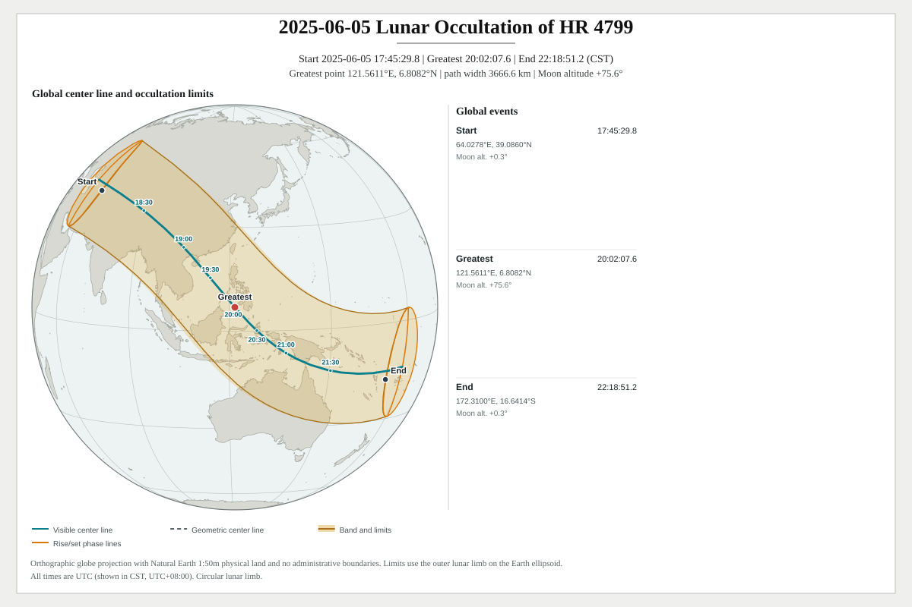
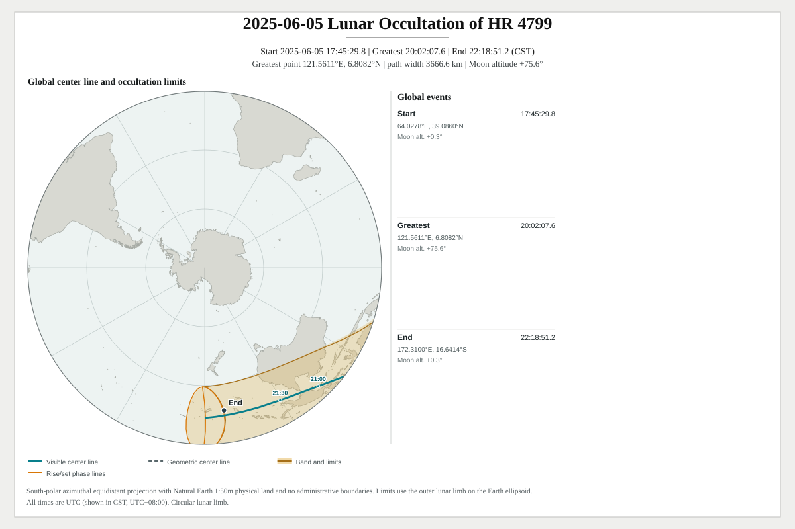
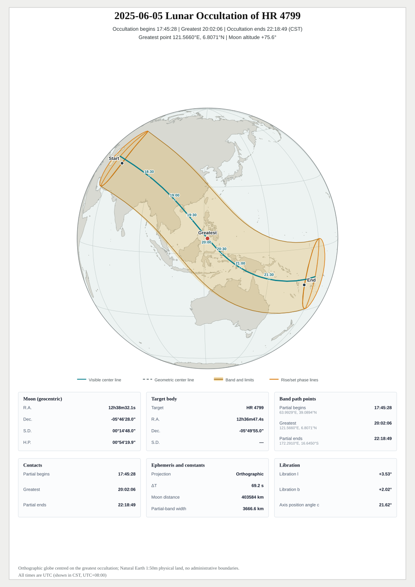
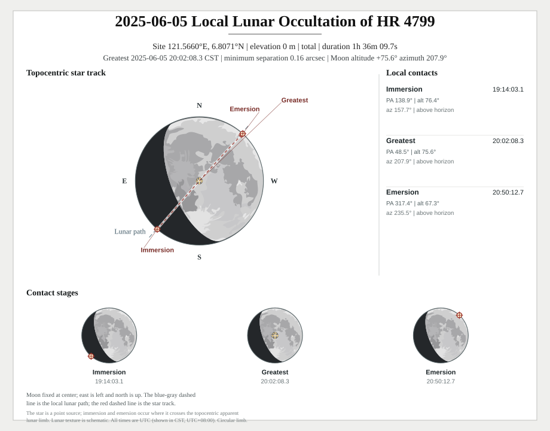
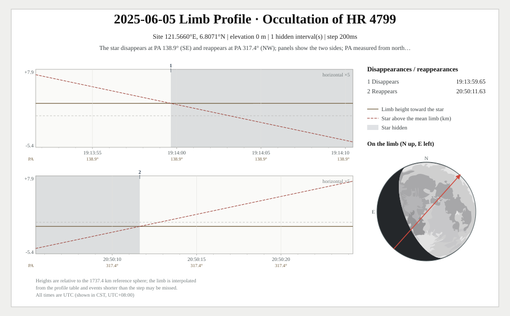

# Lunar Occultations

[中文](../occultation.md) | [Back to README](../../../README.en.md)

Lunar-occultation APIs live in `moon` and search only the target supplied by the caller; they never enumerate the star catalog (maintain your own table of frequently occulted stars if needed). Fixed-site APIs take `start`, `end`, longitude, latitude, and ellipsoidal height directly.

Global-path results contain WGS84 samples suitable for `moon/svg`, `geojson`, or `kml`.

Targets use two distinct contact models:

- **Stars** are point sources. Results contain immersion, greatest occultation, and emersion.
- **Planets** are finite disks (pure circles). C1/C4 are external contacts; a fully covered disk also has C2/C3 internal contacts. Partial and grazing events have no C2/C3.
- The planetary model uses the equatorial body radius and excludes rings, atmospheric extensions, and oblateness.
- `FindBestStarOccultations` and `FindBestPlanetOccultations` return the global sea-level geometric greatest point. They do not score horizon visibility, lunar altitude, duration, or magnitude.
- `VisibleAtGreatest` only reports visibility at the selected point.
- The query window selects events by their greatest instant. Once selected, complete contacts or a complete global path are returned rather than clipped at the query endpoints.
- Contact times solve topocentric geometry between the target and lunar limb without atmospheric refraction.
- `MoonAltitudeAtGreatest` is the true altitude of the lunar center. `VisibleAtGreatest` reports whether it is at or above the geometric horizon.

## Contents

- [Searching for a stellar occultation at a fixed site](#searching-for-a-stellar-occultation-at-a-fixed-site)
- [API Reference](#api-reference)
- [Usage examples](#usage-examples)
  - [Is there a lunar occultation at my site tonight?](#is-there-a-lunar-occultation-at-my-site-tonight)
  - [Planetary occultations and finite disks](#planetary-occultations-and-finite-disks)
  - [Global path maps and the detailed layout](#global-path-maps-and-the-detailed-layout)
  - [Grazing events, isochrones and band widths](#grazing-events-isochrones-and-band-widths)
- [Stellar occultations](#stellar-occultations)
  - [Search and path sampling options](#search-and-path-sampling-options)
  - [Path algorithms and contours](#path-algorithms-and-contours)
  - [Greatest-time contours](#greatest-time-contours)
- [Planetary occultations](#planetary-occultations)
- [Lunar limb correction](#lunar-limb-correction)
- [Lunar Occultation Charts](#lunar-occultation-charts)
  - [Global paths](#global-paths)
  - [Detailed layout](#detailed-layout)
  - [Fixed-site charts](#fixed-site-charts)
  - [Precise limb-profile chart](#precise-limb-profile-chart)
  - [Time scale and UT1](#time-scale-and-ut1)

## Searching for a stellar occultation at a fixed site

```go
package main

import (
	"fmt"
	"log"
	"time"

	"github.com/starainrt/astro/moon"
)

func main() {
	cst := time.FixedZone("CST", 8*3600)
	start := time.Date(2025, 6, 5, 0, 0, 0, 0, cst)
	end := start.AddDate(0, 0, 1)
	target := moon.StarCoordinate{
		ID: "HR 4799", RA: 189.1975, Dec: -5.831944444444,
		Epoch:                          time.Date(2000, 1, 1, 12, 0, 0, 0, time.UTC),
		Frame:                          moon.CoordinateFrameJ2000,
		ProperMotionRACosDecMasPerYear: -28,
		ProperMotionDecMasPerYear:      -18,
		// Optional distance enables 3D space motion; radial velocity is ignored without it.
	}
	events, err := moon.FindStarOccultations(start, end, target,
		121.56601, 6.80706, 0, moon.OccultationSearchOptions{})
	if err != nil {
		log.Fatal(err)
	}
	if len(events) == 0 {
		fmt.Println("no occultation in this window")
		return
	}
	for _, event := range events {
		fmt.Println(event.Type, event.Immersion, event.Greatest, event.Emersion)
	}
}
```

An empty slice is a valid result: no event was found in the window. Events are selected by greatest-occultation time; immersion and emersion may lie outside the window.

## API Reference

The snippets use the target and search window from the first example. SVG calls use the import alias `moonsvg "github.com/starainrt/astro/moon/svg"`.

| Name | Purpose | Notes |
| --- | --- | --- |
| `moon.FindStarOccultations` / `FindStarOccultationPaths` | Stellar occultation events / global paths | Targets are `moon.StarCoordinate` |
| `moon.FindPlanetOccultations` / `FindPlanetOccultationPaths` | Planetary events / global paths | Solved as finite disks |
| `moon.StarCoordinateFromStarData` | Build a target from the embedded catalog | The catalog must be loaded first |
| `moonsvg.FindStarOccultationSVGs` / `FindPlanetOccultationSVGs` | Search and render global charts | Return `([]string, error)` |
| `moonsvg.FindLocalStarOccultationSVGs` / `FindLocalPlanetOccultationSVGs` | Search and render fixed-site charts | Same |
| `moonsvg.StarOccultationPathSVG` / `PlanetOccultationPathSVG` | Render an existing global path | Return `(string, error)` |
| `moonsvg.StarOccultationDetailedSVG` / `PlanetOccultationDetailedSVG` | One-page detailed layout | Fixed orthographic globe |
| `moon.StarOccultationLimbProfile` / `StarOccultationLimbProfileInUT1` | Precise solve along the star track with a limb profile, returning every hidden interval and the in-band samples | Needs a profile; result is a `StarOccultationLimbProfileResult` |
| `moonsvg.StarOccultationLimbProfileSVG` | Precise limb-profile chart | Options are `StarOccultationLimbProfileSVGOptions` |
| `moonsvg.StarOccultationSVGOptions` / `moonsvg.OccultationDetailedSVGOptions` | Chart options (canvas, projection, scale, marker step) | Projections via `MapProjection*`, scales via `astro.TimeScale*` |
| `moon.OccultationMercury` ... `moon.OccultationNeptune` | Planetary target constants | Passed to the planetary entry points |
| `moon.OccultationSearchOptions` / `moon.OccultationPathOptions` | Search and path options | Path options include `Step`, `TargetSpacingKM` and `GreatestTimeStep` |

## Usage examples

| Scenario | Entry point | Returns |
| --- | --- | --- |
| An occultation at a site on a given night | `moon.FindStarOccultations(start, end, star, lon, lat, height, searchOptions)` | `[]moon.StarOccultationInfo` |
| Global geometric greatest point | `moon.FindBestStarOccultations(start, end, star, searchOptions)` | `[]moon.StarOccultationInfo` |
| Global band geometry | `moon.FindStarOccultationPaths(start, end, star, pathOptions)` | `[]moon.StarOccultationPath` |
| Global visible footprint at one instant | `moon.StarOccultationFootprintAt(at, star)` | `moon.StarOccultationInstant` |
| Search and render a global band map in one step | `moonsvg.FindStarOccultationSVGs(start, end, star, pathOptions, svgOptions)` | `([]string, error)` |
| Render an existing path only | `moonsvg.StarOccultationPathSVG(path, svgOptions)` | `(string, error)` |
| One-page detailed layout | `moonsvg.StarOccultationDetailedSVG(path, star, detailedOptions)` | `(string, error)` |
| Search and render fixed-site charts for a given site | `moonsvg.FindLocalStarOccultationSVGs(start, end, star, lon, lat, height, searchOptions, localOptions)` | `([]string, error)` |
| Render an existing fixed-site event | `moonsvg.LocalStarOccultationSVG(info, star, localOptions)` | `(string, error)` |
| Topocentric diagram geometry only (no chart) | `moon.StarOccultationDiagram(info, star, diagramOptions)` | `moon.StarOccultationDiagramResult` |
| Hand off to GIS | `geojson.MarshalStarOccultation(path)` / `MarshalStarOccultationWithTimeMarkers(path, markerOptions)` / `MarshalStarOccultationFootprint(instant)` | `([]byte, error)` |

### Is there a lunar occultation at my site tonight?

```go
events, err := moon.FindStarOccultations(start, end, target, 121.56601, 6.80706, 0, moon.OccultationSearchOptions{})
if err != nil {
	panic(err)
}
for _, e := range events {
	fmt.Println(e.Type, e.Immersion.Format("15:04:05.000"),
		e.Greatest.Format("15:04:05.000"), e.Emersion.Format("15:04:05.000"))
}
```

```text
total 19:14:01.071 20:02:06.314 20:50:10.715
```

- `FindStarOccultations` returns the fixed-site contacts: `Immersion`, `Greatest` and `Emersion`, with `Type` separating total from grazing events.
- A target can be given as raw RA/Dec or built from the embedded catalog with `moon.StarCoordinateFromStarData`; **searching does not load the catalog** - only the catalog entry points do.
- When you need global results rather than site contacts, `FindStarOccultationPaths` returns the path in one call.

### Planetary occultations and finite disks

```go
start := time.Date(2025, 2, 1, 0, 0, 0, 0, cst)
events, err := moon.FindPlanetOccultations(start, start.Add(24*time.Hour), moon.OccultationSaturn,
	104.52219613, 55.25401991, 0, moon.OccultationSearchOptions{})
if err != nil {
	panic(err)
}
for _, e := range events {
	fmt.Println(e.TargetID, e.Type, e.HasInternalContacts)
	fmt.Println(e.ExternalImmersion.Format("2006-01-02 15:04:05.000 MST"), e.InternalImmersion.Format("2006-01-02 15:04:05.000 MST"))
	fmt.Println(e.Greatest.Format("2006-01-02 15:04:05.000 MST"), e.InternalEmersion.Format("2006-01-02 15:04:05.000 MST"), e.ExternalEmersion.Format("2006-01-02 15:04:05.000 MST"))
}
```

```text
Saturn total true
2025-02-01 11:29:09.710 CST 2025-02-01 11:29:40.069 CST
2025-02-01 12:00:48.747 CST 2025-02-01 12:32:46.415 CST 2025-02-01 12:33:18.312 CST
```

Planets are solved as **finite disks**: C2/C3 (internal contacts) exist only when `HasInternalContacts` is true, and `OccultationPlanet` sets the disk radius; Saturn's rings neither take part in the contact solution nor act as the disk boundary.

### Global path maps and the detailed layout

```go
paths, err := moon.FindStarOccultationPaths(start, end, target,
	moon.OccultationPathOptions{Step: 5 * time.Minute, TargetSpacingKM: 200})
if err != nil {
	panic(err)
}
if len(paths) == 0 {
	fmt.Println("no occultation path")
	return
}
svg, err := moonsvg.StarOccultationPathSVG(paths[0], moonsvg.StarOccultationSVGOptions{
	Width: 1200, Height: 800, Location: cst, Projection: moonsvg.MapProjectionSouthPolar,
})
detailed, detailErr := moonsvg.StarOccultationDetailedSVG(paths[0], target,
	moonsvg.OccultationDetailedSVGOptions{Width: 1000, Height: 1414, Location: cst})
fmt.Println(err, len(svg), detailErr, len(detailed))
```

```text
<nil> 120119 <nil> 633489
```

- Path maps return `(string, error)` and accept the same four projections as the solar maps; the detailed layout is fixed to the orthographic globe, accepts no other projection, and derives its arrangement from the canvas aspect.
- Use `StarOccultationPathSVG` when the path already exists, and `FindStarOccultationSVGs` for search-plus-render in one call (see the two chains above).
- Canvas floors: `640×480` for a standalone path map. The detailed layout accepts a width of `480` but in practice needs about `670×595` to hold the map, data blocks and footer; smaller canvases return an error.

### Grazing events, isochrones and band widths

- **Grazing events have no center line**: when `HasTotalBand` is false the global map draws the northern and southern limits only, so never assume a center line exists.
- **Band-width conventions**: the "band width" printed on the map is the ground separation of the limits at greatest occultation, `GreatestLimitSeparationKM` (about `3666.6 km` for the HR 4799 sample), which is not interchangeable with the across-center-line width `Greatest.WidthKM` (about `3582.4 km`).
- **Isochrones**: request `moon.OccultationPathOptions.GreatestTimeStep` at the path layer; `moon/svg` only draws the `GreatestTimeContours` already present in the result, positioned by the core convention (aligned to whole UTC marks).
- **UT1 scale**: `TimeScale: astro.TimeScaleUT1` produces UT1 readings plus the DUT1 offset and requires a UTC `Location`, returning an error instead of drawing a wrong chart.

## Stellar occultations

> Figure and footer time-scale declarations are documented in [Time Scale Declaration](map-geojson.md#time-scale-declaration).

Callers supply a `StarCoordinate`. `RA` and `Dec` are degrees; `Epoch` and `Frame` are required. Proper motions use `mas/year`; `ProperMotionRACosDecMasPerYear` follows the usual catalog convention `dRA*cos(Dec)`.

| Field | Type | Zero value | Valid range and errors | Purpose |
| --- | --- | --- | --- | --- |
| `ID` | `string` | `""` | No restriction | Display label that appears in results and chart titles; never used in computation |
| `RA` | `float64` | — | Required, `[0, 360)`, otherwise `ErrInvalidOccultationInput` | Right ascension in **degrees** (not hours/minutes/seconds) |
| `Dec` | `float64` | — | Required, `[-90, 90]` | Declination in degrees, north positive and south negative |
| `Epoch` | `time.Time` | `time.Time{}` | Zero value is an error | Epoch of the two angles above, such as J2000.0 |
| `Frame` | `moon.CoordinateFrame` | `""` | Only `icrs` / `j2000` / `apparent_of_date`; empty is an error | Reference frame, see below |
| `ProperMotionRACosDecMasPerYear` | `float64` | `0` | Must be finite | Proper motion in right ascension, **mas/year**, in the `dRA·cos(Dec)` convention |
| `ProperMotionDecMasPerYear` | `float64` | `0` | Must be finite | Proper motion in declination, mas/year |
| `ParallaxMas` | `float64` | `0` | Must be finite and ≥ 0 | Annual parallax in mas; `0` means no distance was supplied, so proper motion falls back to two dimensions and the parallax correction is skipped |
| `DistanceLightYear` | `float64` | `0` | Must be finite and ≥ 0 | Distance in light-years; an alternative input to `ParallaxMas`, used only when the parallax is `0` |
| `RadialVelocityKmPerSecond` | `float64` | `0` | Must be finite and \|v\| ≤ 1000 | Radial velocity in km/s; `0` is valid and takes part only when a distance is known |

The two distance inputs have one precedence rule: `ParallaxMas > 0` wins, otherwise the parallax is derived from `DistanceLightYear`. Supplying a distance enables the 3D space motion; without one, proper motion advances only the two angular components and `RadialVelocityKmPerSecond` takes no part.

Additional notes on `Epoch` and `Frame`:

- `j2000`: the coordinates are J2000.0 mean places and `Epoch` is `2000-01-01 12:00 UTC`. The precession origin is hard-coded to J2000.0 inside the library, so `Epoch` only decides from which year proper motion is extrapolated; passing a non-J2000 epoch makes the proper motion count one extra span.
- `icrs`: the coordinates are ICRS catalog positions that first pass through a ~17 mas frame-bias matrix; `Epoch` is the catalog epoch (Hipparcos `1991.25`, Gaia `2016.0`).
- `apparent_of_date`: the coordinates are the **apparent place at that instant** (precession, nutation and aberration already included) and `Epoch` must be that instant; the library solves back to the mean place at that instant and then propagates forward. Use this when taking the "current coordinates" shown by planetarium software such as Stellarium.

A coordinate can be constructed directly:

```go
target := moon.StarCoordinate{
	ID:                             "HR 4799",
	RA:                             189.1975,
	Dec:                            -5.831944444444,
	Epoch:                          time.Date(2000, 1, 1, 12, 0, 0, 0, time.UTC),
	Frame:                          moon.CoordinateFrameJ2000,
	ProperMotionRACosDecMasPerYear: -28,
	ProperMotionDecMasPerYear:      -18,
}
```

Alternatively, explicitly load the embedded 9100-star catalog and convert a `StarData` value with `StarCoordinateFromStarData`.

The occultation search itself does not load the catalog; calls such as `star.InitStarDatabase`, `StarDataByName`, and `StarDataByHR` do.

```go
package main

import (
	"fmt"
	"time"

	"github.com/starainrt/astro/moon"
	"github.com/starainrt/astro/star"
)

func main() {
	cst := time.FixedZone("CST", 8*3600)
	start := time.Date(2025, 6, 5, 0, 0, 0, 0, cst)
	end := start.Add(24 * time.Hour)

	if err := star.InitStarDatabase(); err != nil {
		panic(err)
	}
	data, err := star.StarDataByName("进贤增九")
	if err != nil {
		panic(err)
	}
	target, err := moon.StarCoordinateFromStarData(data)
	if err != nil {
		panic(err)
	}

	events, err := moon.FindStarOccultations(
		start, end, target,
		121.56601, 6.80706, 0,
		moon.OccultationSearchOptions{},
	)

	if err != nil {
		panic(err)
	}
	for _, event := range events {
		fmt.Println(event.TargetID, event.Type)
		fmt.Println(
			event.Immersion.Format("2006-01-02 15:04:05.000 MST"),
			event.Greatest.Format("2006-01-02 15:04:05.000 MST"),
			event.Emersion.Format("2006-01-02 15:04:05.000 MST"),
		)
		fmt.Printf("altitude=%.3f visible=%v\n", event.MoonAltitudeAtGreatest, event.VisibleAtGreatest)
	}

	paths, err := moon.FindStarOccultationPaths(
		start, end, target,
		moon.OccultationPathOptions{Step: 5 * time.Minute, TargetSpacingKM: 200},
	)

	if err != nil {
		panic(err)
	}
	for _, path := range paths {
		fmt.Println(
			path.Start.Time.Format("2006-01-02 15:04:05.000 MST"),
			path.Greatest.Time.Format("2006-01-02 15:04:05.000 MST"),
			path.End.Time.Format("2006-01-02 15:04:05.000 MST"),
		)
		fmt.Printf("greatest=%.6f %.6f width=%.1fkm center=%d\n",
			path.Greatest.Longitude, path.Greatest.Latitude,
			path.Greatest.WidthKM, len(path.CenterLine))
	}
}
```

Output:

```text
进贤增九 total
2025-06-05 19:14:03.127 CST 2025-06-05 20:02:08.397 CST 2025-06-05 20:50:12.789 CST
altitude=75.556 visible=true
2025-06-05 17:45:29.822 CST 2025-06-05 20:02:07.622 CST 2025-06-05 22:18:51.246 CST
greatest=121.561060 6.808173 width=3582.4km center=108
```

### Search and path sampling options

`OccultationSearchOptions` uses default step and safety margins when zero-valued; `MaxEvents > 0` limits the result count. `OccultationPathOptions` controls global-path sampling:

| Field | Purpose |
| --- | --- |
| `Step` | Base time step |
| `TargetSpacingKM` | Refines the center line by ground distance; exceeding the sampling budget returns `ErrOccultationPathSamplingLimit` |
| `RiseSetStep` | Step for six immersion/greatest/emersion moonrise/moonset curves; zero means 5 minutes |
| `DisableRiseSet` | Skips those six phase curves |
| `DisableFootprints` | Omits dense instant footprints and forms a compact band from sparse support samples; keeps the center line, boundaries and rise/set curves |
| `IncludeFootprintTimeline` | Retains instant footprints alongside the compact band |
| `FootprintTimelineStep` | Sampling step for that timeline |

The result's `GreatestLimitSeparationKM` is the ground separation between northern and southern limits at greatest occultation, used for the chart's band-width label. It differs from `Greatest.WidthKM` and is not interchangeable with it.

### Path algorithms and contours

`OccultationPathOptions.Algorithm` selects the stellar/planetary global-path ephemeris branch: its zero value or `moon.OccultationPathAlgorithmOptimized` approximates the ephemeris with vector interpolation at 30-minute nodes, and recomputes with the full ephemeris when the interpolation self-check fails or the instant falls outside the interpolation window. `moon.OccultationPathAlgorithmExact` interpolates only during candidate screening and always solves with the full ephemeris. Both branches keep the same station equations, band boundaries and rise/set curves.

Checks are sampled safeguards, not a rigorous error bound at every instant. The branches share the geometric definition, but sample points and GeoJSON bytes need not be identical.

Event-only searches, fixed-site contacts, independent instant-footprint APIs, and eclipses are unaffected.

Both branches retain full-term evaluation of global start/end/greatest markers and center-line widths. Render the complete returned path, including visibility contours; discarding those contours invokes the sampled-footprint fallback, whose boundary is not interchangeable with the analytic visible set.

In a returned path, `BandContours` are the static contact envelopes, `VisibilityContours` are the time envelope where the Moon is above the horizon, and `Footprints` are instantaneous samples for time-axis detail.

They serve different geometry layers and should not be used as substitutes for one another.

### Greatest-time contours

`OccultationPathOptions.GreatestTimeValues` / `GreatestTimeStep` request **greatest-occultation time isolines**. Unlike the solar case, `GreatestTimeValues []float64` carries TT Julian ephemeris days; at most 64 are kept — deduplicated, sorted, and cut to the earliest 64 — and a level outside the visibility window or without a usable branch produces no entry.

When it is empty, `GreatestTimeStep` takes over, again only for a positive value, aligned to UTC ticks.

Contours land in `StarOccultationPath.GreatestTimeContours` (the planetary path has the same field) as `OccultationGreatestTimeContour` values whose `JDE`, `Time`, and `Segments` mean the same as in the solar case: `Time` keeps the original aligned instant for step-derived levels, while an explicit level is converted from `JDE` and rounded to the millisecond; both carry the UTC zone, whereas branch point times use the path timezone (the solar public layer instead reports `Time` in the input timezone).

The boundary rules match as well: curves exist only where the target disk truly overlaps the lunar disk and the Moon is above the geometric horizon (no refraction or semidiameter correction), each branch ends at the horizon or the occultation-visibility boundary, nothing is continued beyond ±88° latitude, one instant may carry several disconnected branches, and output is unchanged when they are not requested.

```go
options := moon.OccultationPathOptions{
	Algorithm: moon.OccultationPathAlgorithmExact, // Full-term ephemerides for the final solve.
	DisableFootprints: true,
}
```

## Planetary occultations

Planet targets use the constants from `OccultationMercury` through `OccultationNeptune`. This example solves C1-C4 for the `2025-02-01` occultation of Saturn at a site near the global geometric greatest point:

```go
package main

import (
	"fmt"
	"time"

	"github.com/starainrt/astro/moon"
)

func main() {
	cst := time.FixedZone("CST", 8*3600)
	start := time.Date(2025, 2, 1, 0, 0, 0, 0, cst)
	events, err := moon.FindPlanetOccultations(
		start, start.Add(24*time.Hour), moon.OccultationSaturn,
		104.52219613, 55.25401991, 0,
		moon.OccultationSearchOptions{},
	)
	if err != nil {
		panic(err)
	}
	for _, event := range events {
		fmt.Println(event.TargetID, event.Type, event.HasInternalContacts)
		fmt.Println(event.ExternalImmersion.Format("2006-01-02 15:04:05.000 MST")) // C1
		fmt.Println(event.InternalImmersion.Format("2006-01-02 15:04:05.000 MST")) // C2
		fmt.Println(event.Greatest.Format("2006-01-02 15:04:05.000 MST"))
		fmt.Println(event.InternalEmersion.Format("2006-01-02 15:04:05.000 MST")) // C3
		fmt.Println(event.ExternalEmersion.Format("2006-01-02 15:04:05.000 MST")) // C4
	}
}
```

Output:

```text
Saturn total true
2025-02-01 11:29:10.984 CST
2025-02-01 11:29:41.333 CST
2025-02-01 12:00:50.058 CST
2025-02-01 12:32:47.753 CST
2025-02-01 12:33:19.650 CST
```

Global `FindPlanetOccultationPaths` results contain both the region where any part of the planetary disk overlaps the Moon and the region where the whole planet is hidden.

`HasTotalBand` reports whether a total band exists, and `GreatestTotalWidthKM` is its width at greatest occultation; center lines, limits, and enabled instantaneous footprints all carry sample times.

## Lunar limb correction

The Moon is a circular disk by default. Stellar and planetary occultation searches at a fixed site can use the ISAS/JAXA limb profile from the `moon/limb` package (a processed product of SELENE/Kaguya LALT data; see the [eclipse and transit manual](eclipse.md#lunar-limb-correction)): disappearance, reappearance and the planet's inner and outer contacts are refined with the actual limb radius toward the target. Greatest occultation, type and candidate screening still use the circular disk.

```go
import "github.com/starainrt/astro/moon/limb"

events, err := moon.FindStarOccultations(start, end, star, lon, lat, 0,
	moon.OccultationSearchOptions{LunarLimb: limb.Default()})

// Or set it once on a context
base, err := astro.NewContext(astro.ModelSemianalytic)
if err != nil {
	panic(err)
}
ctx := base.WithLunarLimb(limb.Default())
events, err = ctx.Moon().FindStarOccultations(start, end, star, lon, lat, 0, moon.OccultationSearchOptions{})
```

Corrections are usually a few seconds; for the 2024-08-21 occultation of Saturn the contacts move by `-1.8 s` to `-0.6 s`.

Accuracy limits:

- The built-in profile is interpolated on a 1° libration grid; the limb margin at a single contact is good to about `±0.05″` (about 100 m on the Moon), set by the 16 pixel/degree terrain and the interpolation together.
- In a graze the star skims the limb with a margin of a few hundredths of an arcsecond, so the number of hidden intervals and the brief disappearances and reappearances can differ from observations; only the main interval and its magnitude are reliable. Example: the Regulus graze of 2017-09-18 (Greece, 5 intervals observed by IOTA) gives 1 interval here, whose disappearance and reappearance differ from the last observed interval by `+0.6 s` / `-0.4 s`.
- For finer graze profiles, build a table from higher-resolution terrain and load it with `limb.Parse`, or implement the `LunarLimb` interface.

Global occultation paths (`FindStarOccultationPaths`, `FindPlanetOccultationPaths`, via `OccultationPathOptions.LunarLimb` or the module setting) correct only the outer-contact northern and southern limits:

- The limits move onto the limb graze lines: the star track is treated as straight near the tangent point and the effective limb is the highest point within ±8° of position angle.
- Points with the Moon near the horizon stay circular.
- Planetary total-occultation limits, band fills, isochrones and rise/set curves stay circular.
- Multiple disappearances and reappearances inside the graze zone are not computed here.
- For HR 4799 on 2025-06-05 the graze lines move by up to about `4 km`.

Charts need no extra switch: `LunarLimbApplied` on the result records whether the limb correction actually took effect, and `moon/svg` declares the convention after the time-scale note. A local result sets it only when every contact converged on the profile; if any contact fails, the whole result stays circular. A path sets it when at least one limit point was corrected. Converged contacts no longer sit on the circular limb, so local charts skip the circular contact check for them and render events from the built-in or a custom profile directly.

## Lunar Occultation Charts

`moon/svg` offers two groups of entry points: "search and render" and "render an existing result".

| Entry point | Purpose |
| --- | --- |
| `FindStarOccultationSVGs` / `FindPlanetOccultationSVGs` | Search every occultation in the window and render one global path map per event |
| `StarOccultationPathSVG` / `PlanetOccultationPathSVG` | Render an existing global path (the value returned by `Find...Paths`) |
| `StarOccultationDetailedSVG` / `PlanetOccultationDetailedSVG` | One-page detailed layout |
| `FindLocalStarOccultationSVGs` / `FindLocalPlanetOccultationSVGs` | Fixed-site topocentric lunar track, lunar path and contact-phase charts |
| `LocalStarOccultationSVG` / `LocalPlanetOccultationSVG` | Render an existing fixed-site event |
| `StarOccultationLimbProfileSVG` | Precise limb-profile chart: limb relief along the track, every hidden interval and the immersion/reappearance numbering |

`eclipse/svg` entry points return `(string, bool)` while `moon/svg` entry points return `(string, error)` or `([]string, error)`: on the occultation side the second value is a real error (UT1 with a non-UTC location, canvas below the floor, invalid path), not a "cannot draw this chart" flag.

Stars are treated as point sources and planets as finite disks: planetary contact times come from the disk-versus-limb geometry with the radius selected by `OccultationPlanet`, and Saturn's rings neither take part in the contact solution nor act as the disk boundary.

A grazing occultation (`HasTotalBand` false) may have no center line at all, in which case the global map draws the northern and southern limits only.

Greatest instants are measured from the Sun-Moon center separation for point stars and from external contact for finite planetary disks, matching `StarOccultationInfo.Greatest` and `PlanetOccultationInfo.Greatest` respectively.

### Global paths

`MapProjection` offers the same four projections as the solar maps. The projection only affects SVG presentation and never the underlying WGS84 geography:

| Option | Meaning |
| --- | --- |
| `MapProjectionAuto` (zero value) | Chosen per event; high-latitude events may land on a polar map |
| `MapProjectionEquirectangular` | Equirectangular, clearest for long paths crossing the antimeridian |
| `MapProjectionNorthPolar` / `MapProjectionSouthPolar` | Azimuthal equidistant with the pole at the center |
| `MapProjectionOrthographic` | Orthographic globe viewed from the event center, drawing only the hemisphere facing it |

The orthographic globe (`2025-06-05` occultation of HR 4799):

```go
paths, err := moon.FindStarOccultationPaths(start, end, target,
	moon.OccultationPathOptions{Step: 5 * time.Minute, TargetSpacingKM: 200})
if err != nil || len(paths) == 0 {
	return
}
svg, err := moonsvg.StarOccultationPathSVG(paths[0], moonsvg.StarOccultationSVGOptions{
	Width: 1200, Height: 800, Location: cst,
	TimeLabelStep: 30 * time.Minute,
	Projection:    moonsvg.MapProjectionOrthographic,
})
if err != nil {
	return
}
fmt.Println(len(svg))
```



The same path on the south-polar projection, which reads better than equirectangular when the path lies at high latitude:

```go
south, err := moonsvg.StarOccultationPathSVG(paths[0], moonsvg.StarOccultationSVGOptions{
	Width: 1200, Height: 800, Location: cst,
	TimeLabelStep: 30 * time.Minute,
	Projection:    moonsvg.MapProjectionSouthPolar,
})
if err != nil {
	return
}
```



Use `Find...SVGs` to search and render in one step; the returned slice matches the matching events one for one:

```go
svgs, err := moonsvg.FindStarOccultationSVGs(start, end, target,
	moon.OccultationPathOptions{Step: 5 * time.Minute, TargetSpacingKM: 200},
	moonsvg.StarOccultationSVGOptions{Width: 1200, Height: 800, Location: cst})
fmt.Println(err, len(svgs))
```

`TimeLabelStep` defaults to 30 minutes and a negative value disables the time markers along the center line. A standalone global path map needs at least `640×480`; smaller canvases return `ErrInvalidStarOccultationSVGOptions` (`ErrInvalidPlanetOccultationSVGOptions` for the planetary entry points).

The legend, footer and graticule all reserve space by canvas height, so shorter canvases press against the footer more easily; the south-polar example in this manual works fine at `1200×800`.

### Detailed layout

The detailed layout combines a whole occultation on one `1000×1414` page: a centered summary, geocentric/topocentric data blocks for Moon and target, an **orthographic globe** path map (northern and southern limits, visible/geometric center lines, the greatest point, immersion/greatest/emersion phase points and 30-minute time markers), and a footer note.

The globe is viewed from the event center and this layout is fixed to the orthographic projection, accepting no other; use the `StarOccultationPathSVG` / `FindStarOccultationSVGs` above when only a standalone path map is needed.

```go
detailed, err := moonsvg.StarOccultationDetailedSVG(paths[0], target,
	moonsvg.OccultationDetailedSVGOptions{Width: 1000, Height: 1414, Location: cst, Language: "en"})
if err == nil {
	_ = os.WriteFile("doc/img/lunar-occultation-hr4799-2025-06-05-detailed-en.svg", []byte(detailed), 0o644)
}
```



The page data falls into six blocks: geocentric Moon coordinates, target, path points, contact times, ephemeris and constants, and libration.

A landscape canvas puts the data blocks in two columns by three rows to the right of the map, portrait puts them in three columns by two rows below the globe.

The globe path map uses the Natural Earth `1:50m` coastline without administrative boundaries.

The detailed layout derives its arrangement from the canvas and needs about `670×595` in practice (the `480` width floor is only an argument check), returning `ErrInvalidOccultationDetailedSVGOptions` when the map and data blocks do not fit (`800×600`, `1000×1414` and `1414×1000` all render; `660×600`, `800×590`, `640×420` and `900×400` are rejected).

The "band width" printed on the map is the ground separation of the northern and southern limits at greatest occultation, `GreatestLimitSeparationKM`, not the across-center-line width `Greatest.WidthKM`; the two are not interchangeable.

Greatest-time isochrones must be requested explicitly at the path layer through `moon.OccultationPathOptions.GreatestTimeStep`: `moon/svg` offers no switch of its own and only draws the `GreatestTimeContours` already present in the path result, so the request has to be made while computing the path and the line positions follow the core convention (`GreatestTimeStep` aligns to whole UTC marks; to align to the display time zone, convert the instants to dynamical-time Julian days first and pass them as `GreatestTimeValues`).

A lunar occultation is visible worldwide for only a few hours (4 h 33 min for the HR 4799 sample), so the usual interval is denser than for solar eclipses, on the order of 15-30 minutes.

A compact band using `DisableFootprints` is computed only once on the first render, and the same path reuses the cache afterwards.

### Fixed-site charts

```go
localSVGs, err := moonsvg.FindLocalStarOccultationSVGs(
	start, end, target,
	121.56601, 6.80706, 0,
	moon.OccultationSearchOptions{},
	moonsvg.LocalStarOccultationSVGOptions{Width: 920, Height: 720, Location: cst},
)
fmt.Println(err, len(localSVGs))
```

The local chart is drawn from the topocentric geometry of the given observer; the figure below reuses the `2025-06-05` occultation of Xianxianzengjiu (HR 4799).

The chart's observer is at `121.56601°E, 6.80706°N`, close to the global geometric greatest point; the immersion, greatest and emersion instants in the figure are the topocentric contacts actually seen from that site, together with lunar orientation, the lunar path, Moon altitude, azimuth and horizon visibility.



### Precise limb-profile chart

The contact times above are solved on a circular limb. Feeding the limb relief in point by point gives the limb geometry at every instant along the star track and **every** hidden interval: a deep occultation has one disappearance and one reappearance segment, a grazing event usually just one, and a limb valley can split a single occultation into several separate intervals.

```go
profile, err := moon.StarOccultationLimbProfile(events[0], target, limb.Default(),
	moon.StarOccultationLimbProfileOptions{Step: 200 * time.Millisecond})
fmt.Println(len(profile.Hidden), profile.Hidden[0].Start.UTC(), profile.Hidden[len(profile.Hidden)-1].End.UTC())
samples := 0
for _, segment := range profile.Segments {
	samples += len(segment)
}
fmt.Println(profile.Step, len(profile.Segments), samples)

profileSVG, err := moonsvg.StarOccultationLimbProfileSVG(profile,
	moonsvg.StarOccultationLimbProfileSVGOptions{Width: 1000, Height: 620, Location: cst, Language: "en"})
fmt.Println(err, len(profileSVG))
```

```text
1 2025-06-05 11:13:59.65061903 +0000 UTC 2025-06-05 12:50:11.632025241 +0000 UTC
200ms 2 191
<nil> 30702
```



The horizontal axis is time, each tick also labelled with the limb position angle at that instant, and the vertical axis is height above the reference circular limb in kilometres. The brown solid curve is the limb radius toward the star, the red dashed curve is the star's angular distance from the Moon's center, and their crossings are the hidden intervals, shaded and numbered; one panel is drawn per entry in `Segments`, with a sky-plane inset and the immersion/reappearance list on the right. The circular-limb result for the same event (`11:14:03.127` / `12:50:12.789 UTC`) differs by a few seconds — exactly the limb-relief correction.

Conventions:

- `info` contributes only the instant of greatest occultation and the observer; the remaining contacts are re-solved on the profile and returned in `profile.Occultation`. It must be a UTC-based result — never pass a `...InUT1` copy.
- A `nil` limb falls back to the module or context profile (`WithLunarLimb`); when neither is set the call returns `ErrInvalidOccultationInput`.
- `Step` defaults to 200 ms and is raised to a 10 ms minimum; each segment keeps at least 64 samples and the total is capped at 20000, with the step adjusted automatically. **Hidden intervals shorter than the step can be missed**, so shrink the step for grazing detail.
- `Segments` holds the samples inside the limb relief band (two for a deep occultation, usually one for a graze), `Hidden` holds every hidden interval, `ReliefMinKM` / `ReliefMaxKM` bound the limb radii used for gating, and `ReferenceRadiusKM` is the lunar radius behind `MeanRadiusArcsec`.
- The chart defaults to `920×620` and needs at least `640×480`; anything smaller returns `ErrInvalidStarOccultationLimbProfileSVGOptions`, and a track that never enters the relief band returns `ErrEmptyStarOccultationLimbProfile`.
- For UT1 labels take a copy with `moon.StarOccultationLimbProfileInUT1(profile)`, or pass `TimeScale: astro.TimeScaleUT1` to the chart options (then `Location` must be UTC).

### Time scale and UT1

Occultation charts are drawn in the UTC scale by default and state it in the figure.

`TimeScale: astro.TimeScaleUT1` produces UT1 readings plus the `DUT1 = UT1-UTC` offset, and in that mode `Location` must be UTC: a non-UTC zone returns an error rather than drawing a wrong chart.

GeoJSON export obeys the same contract through `TimeMarkerOptions.TimeScale` on `MarshalStarOccultation*` / `MarshalPlanetOccultation*`: the UT1 scale adds the `time_scale` member and rewrites every `time` property, leaving geometry untouched.

See [Time Scale Declaration](map-geojson.md#time-scale-declaration) for the full convention.
