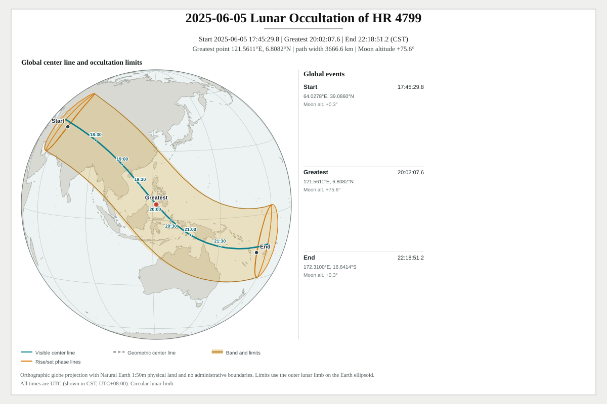
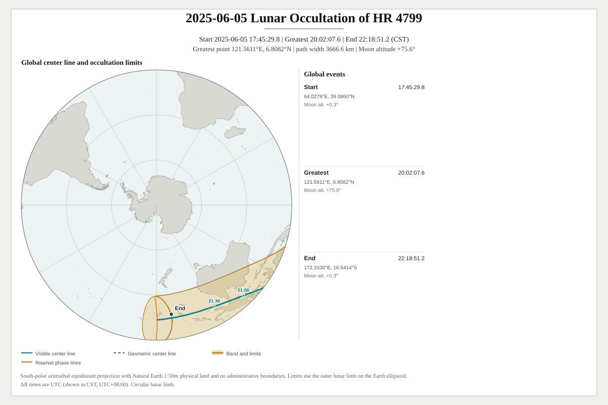
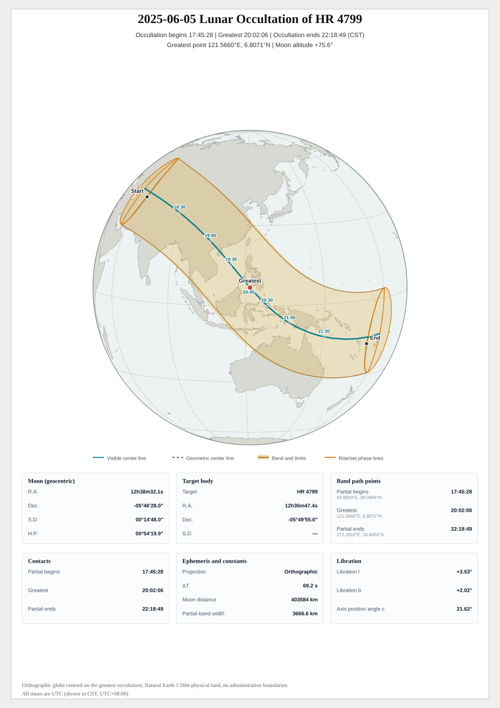
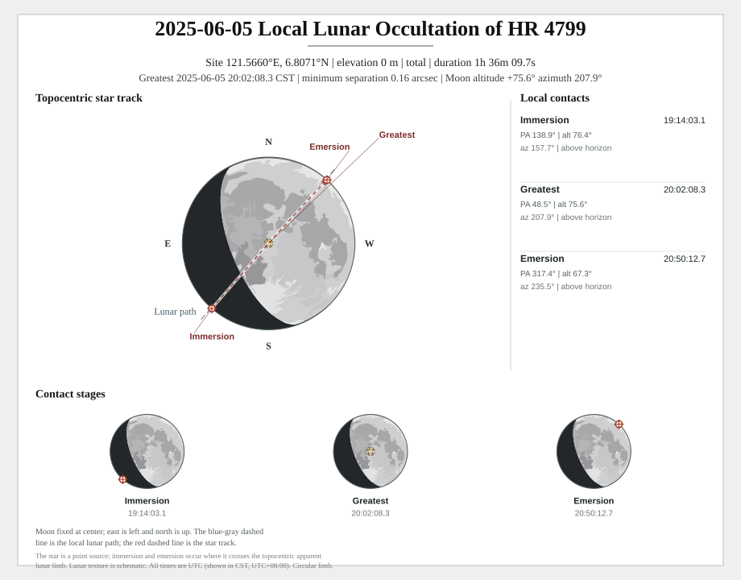
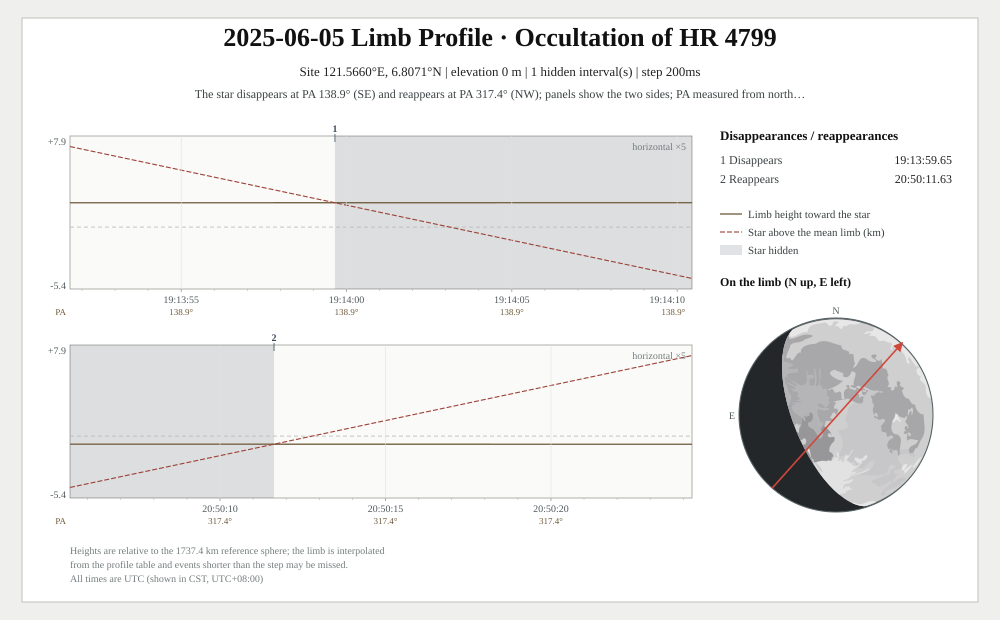

# Lunar Occultations

[中文](../occultation.md) | [Back to README](../../../README.en.md)

The `moon` package computes local predictions, global visibility paths, and instantaneous footprints for stellar and planetary lunar occultations. `moon/svg` renders global maps, one-page detailed sheets, local event diagrams, and Kaguya lunar-limb terrain profiles.

> For GeoJSON / KML export see [Maps, GeoJSON & KML](map-geojson.md); for external star catalogs see [Stars: External Catalogs](star.md#external-catalogs).

## Contents

- [Basic Example](#basic-example)
- [Usage](#usage)
  - [Building a Star Target (Manual or Built-In Catalog)](#building-a-star-target-manual-or-built-in-catalog)
  - [Global Paths & Isochrones](#global-paths--isochrones)
  - [Lunar Limb Correction](#lunar-limb-correction)
  - [Occultation Charts](#occultation-charts)
    - [Global Path Maps & Detailed Sheets](#global-path-maps--detailed-sheets)
    - [Local Event Diagrams](#local-event-diagrams)
    - [Precision Lunar-Limb Profile Charts](#precision-lunar-limb-profile-charts)
- [API Reference](#api-reference)
- [Conventions and Limitations](#conventions-and-limitations)

## Basic Example

Stars are treated as point sources (`Immersion`, `Greatest`, `Emersion`); planets as finite discs (external `C1/C4` plus internal `C2/C3` when fully occulted):

```go
package main

import (
	"fmt"
	"log"
	"time"

	"github.com/starainrt/astro/moon"
)

func main() {
	cst := time.FixedZone("CST", 8*3600)

	// 1. Stellar occultation: HR 4799 on 2025-06-05
	start := time.Date(2025, 6, 5, 0, 0, 0, 0, cst)
	target := moon.StarCoordinate{
		ID:                             "HR 4799",
		RA:                             189.1975,
		Dec:                            -5.831944444444,
		Epoch:                          time.Date(2000, 1, 1, 12, 0, 0, 0, time.UTC),
		Frame:                          moon.CoordinateFrameJ2000,
		ProperMotionRACosDecMasPerYear: -28,
		ProperMotionDecMasPerYear:      -18,
	}
	events, err := moon.FindStarOccultations(start, start.Add(24*time.Hour), target,
		121.56601, 6.80706, 0, moon.OccultationSearchOptions{})
	if err != nil {
		log.Fatal(err)
	}
	for _, e := range events {
		fmt.Printf("Star %s (%s): D %s  Max %s  R %s  Moon alt %.1f°\n",
			e.TargetID, e.Type,
			e.Immersion.Format("15:04:05.0"), e.Greatest.Format("15:04:05.0"), e.Emersion.Format("15:04:05.0"),
			e.MoonAltitudeAtGreatest)
	}

	// 2. Planetary occultation: Saturn on 2025-02-01
	sStart := time.Date(2025, 2, 1, 0, 0, 0, 0, cst)
	pevs, err := moon.FindPlanetOccultations(sStart, sStart.Add(24*time.Hour), moon.OccultationSaturn,
		104.5222, 55.2540, 0, moon.OccultationSearchOptions{})
	if err != nil {
		log.Fatal(err)
	}
	for _, p := range pevs {
		fmt.Printf("Saturn (%s): C1 %s  C2 %s  Max %s  C3 %s  C4 %s\n",
			p.Type, p.ExternalImmersion.Format("15:04:05"), p.InternalImmersion.Format("15:04:05"),
			p.Greatest.Format("15:04:05"), p.InternalEmersion.Format("15:04:05"), p.ExternalEmersion.Format("15:04:05"))
	}
}
```

Output:

```text
Star HR 4799 (total): D 19:14:03.1  Max 20:02:08.3  R 20:50:12.7  Moon alt 75.6°
Saturn (total): C1 11:29:10  C2 11:29:41  Max 12:00:50  C3 12:32:47  C4 12:33:19
```

> An empty slice with `err == nil` means no occultation occurs in the window. Events are selected by `Greatest` inside `[start, end]` and return complete contact times.

## Usage

### Building a Star Target (Manual or Built-In Catalog)

Occultation searches do not auto-load the 9100-star catalog. Provide a `moon.StarCoordinate` directly (`RA` & `Dec` in deg, non-zero `Epoch`, and `Frame`: `CoordinateFrameJ2000`, `CoordinateFrameICRS`, or `CoordinateFrameApparentOfDate` if copying "of-date" coordinates from planetarium software), or convert a built-in star with `moon.StarCoordinateFromStarData(data)` or an external `star/catalog` entry.

### Global Paths & Isochrones

```go
paths, err := moon.FindStarOccultationPaths(start, start.Add(24*time.Hour), target,
	moon.OccultationPathOptions{
		Step:             5 * time.Minute,
		TargetSpacingKM:  200,
		GreatestTimeStep: 30 * time.Minute, // optional isochrones
	})
```

- Use `FindBestStarOccultations` / `FindBestPlanetOccultations` for global geometric greatest points only, or `StarOccultationFootprintAt` / `PlanetOccultationFootprintsAt` for a single instant.
- Set `DisableFootprints: true` to keep compact bands without dense timelines; set `Algorithm: moon.OccultationPathAlgorithmExact` to bypass 30-minute interpolation during path refinement.

### Lunar Limb Correction

Import `github.com/starainrt/astro/moon/limb` and pass `limb.Default()` via search/path options (or `ctx.WithLunarLimb(limb.Default())`) to refine local contacts and global outer limits against Kaguya lunar terrain (typically shifting contacts by seconds and graze limits by kilometres):

```go
import "github.com/starainrt/astro/moon/limb"

events, err := moon.FindStarOccultations(start, end, target, lon, lat, 0,
	moon.OccultationSearchOptions{LunarLimb: limb.Default()})
```

### Occultation Charts

All `moon/svg` functions return `(string, error)` or `([]string, error)`. Set `Language: "en"` for English labels.

#### Global Path Maps & Detailed Sheets

```go
globalSVG, err := moonsvg.StarOccultationPathSVG(paths[0], moonsvg.StarOccultationSVGOptions{
	Width: 1200, Height: 800, Location: cst, Language: "en",
	TimeLabelStep: 30 * time.Minute,
	Projection:    moonsvg.MapProjectionOrthographic,
})
detailedSVG, err := moonsvg.StarOccultationDetailedSVG(paths[0], target,
	moonsvg.OccultationDetailedSVGOptions{Width: 1000, Height: 1414, Location: cst, Language: "en"})
```





#### Local Event Diagrams

```go
localSVGs, err := moonsvg.FindLocalStarOccultationSVGs(
	start, start.Add(24*time.Hour), target,
	121.56601, 6.80706, 0,
	moon.OccultationSearchOptions{},
	moonsvg.LocalStarOccultationSVGOptions{Width: 920, Height: 720, Location: cst, Language: "en"},
)
```



#### Precision Lunar-Limb Profile Charts

Sample lunar limb relief along the star's track to detect every disappearance/reappearance interval (including multiple graze blinks):

```go
profile, err := moon.StarOccultationLimbProfile(events[0], target, limb.Default(),
	moon.StarOccultationLimbProfileOptions{Step: 200 * time.Millisecond})
if err != nil {
	log.Fatal(err)
}
profileSVG, err := moonsvg.StarOccultationLimbProfileSVG(profile,
	moonsvg.StarOccultationLimbProfileSVGOptions{Width: 1000, Height: 620, Location: cst, Language: "en"})
```



## API Reference

| Group | Stars | Planets | Notes |
| --- | --- | --- | --- |
| Local prediction | `FindStarOccultations` | `FindPlanetOccultations` | Planet constants: `OccultationMercury` … `OccultationNeptune` |
| Global greatest / paths | `FindBestStarOccultations`, `FindStarOccultationPaths` | `FindBestPlanetOccultations`, `FindPlanetOccultationPaths` | Paths feed `moon/svg`, `geojson`, `kml` |
| Instant / diagram | `StarOccultationFootprintAt`, `StarOccultationDiagram` | `PlanetOccultationFootprintsAt`, `PlanetOccultationDiagram` | Pure geometry |
| Limb profile | `StarOccultationLimbProfile` / `...InUT1` | — | Requires `limb.Default()` or context limb |
| SVG (`moon/svg`) | `FindStarOccultationSVGs`, `StarOccultationPathSVG`, `StarOccultationDetailedSVG`, `FindLocalStarOccultationSVGs`, `LocalStarOccultationSVG`, `StarOccultationLimbProfileSVG` | `Planet` counterparts (no limb profile) | Return `(string / []string, error)` |

## Conventions and Limitations

- **No refraction**: Contacts are geometric topocentric lunar-limb solutions without atmospheric refraction; `VisibleAtGreatest` tests geometric horizon (`MoonAltitudeAtGreatest >= 0`).
- **Planetary discs**: Modeled as equatorial circles; Saturn's rings and oblateness are excluded from contacts.
- **Grazes & band width**: Grazing events (`HasTotalBand == false`) have no centerline. Displayed band width is `GreatestLimitSeparationKM` (not `Greatest.WidthKM`).
- **Limb profile step**: Default `200 ms` (min `10 ms`); blinks shorter than `Step` can be missed—use smaller steps for grazes.
- **Canvas minimums & UT1**: Path and profile SVGs require `≥ 640×480`; detailed sheets work best at `1000×1414` (layout minimum `~670×595`). `TimeScaleUT1` requires `Location` to be `nil` or `time.UTC` ([Time-Scale Declarations](map-geojson.md#time-scale-declarations)).
