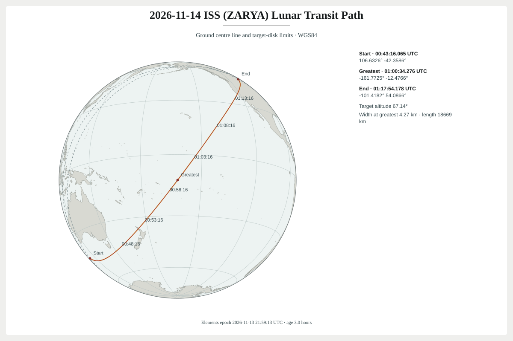
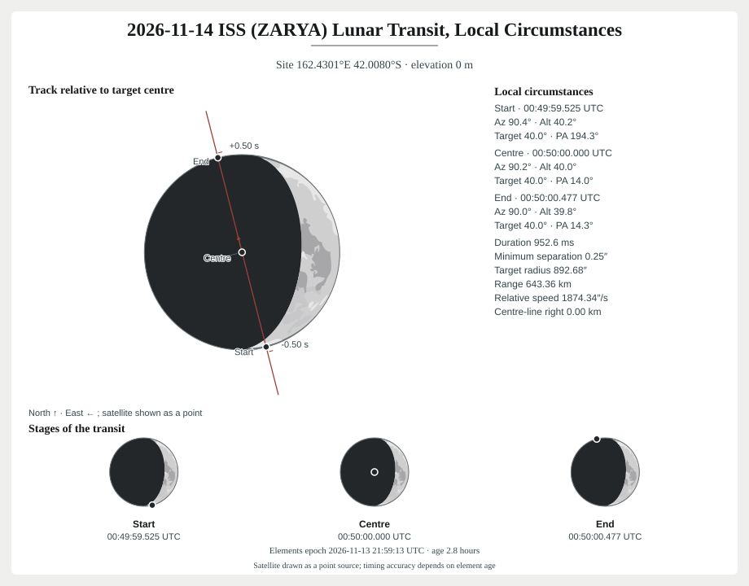
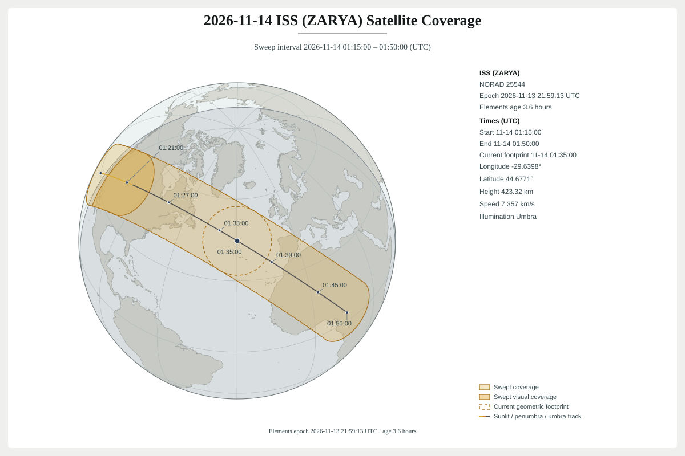
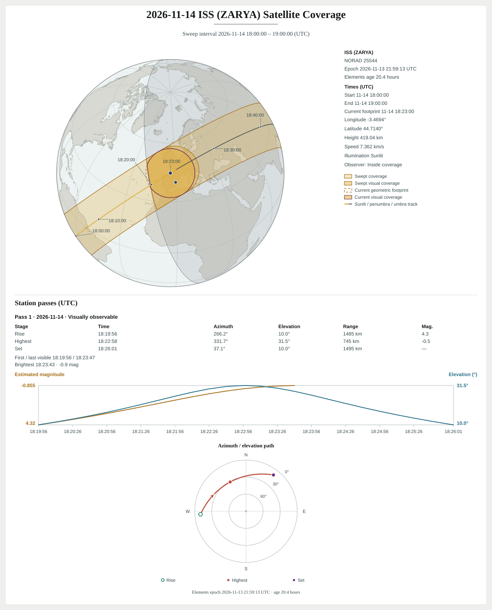

# Satellite SVG

[中文](../satellite-svg.md) | [Satellites](satellite.md) | [GeoJSON / KML](map-geojson.md#satellite-layers) | [Back to README](../../../README.en.md)

The `satellite/svg` package renders three self-contained vector charts for Earth satellites: global solar/lunar transit band maps, local disc transit plots, and ground coverage maps with optional station pass tables. Coastline geometry is built in and requires no external map tiles.

## Contents

- [Entry Points](#entry-points)
- [1. Lunar Transit Band Map (TransitMapSVG)](#1-lunar-transit-band-map-transitmapsvg)
- [2. Local Disc Transit Chart (TransitLocalSVG)](#2-local-disc-transit-chart-transitlocalsvg)
- [3. Ground Coverage & Footprint Map (CoverageSVG)](#3-ground-coverage--footprint-map-coveragesvg)
- [4. Coverage Map with Station Pass Table](#4-coverage-map-with-station-pass-table)
- [Options and Limitations](#options-and-limitations)

## Entry Points

Compute geometry with `satellite` first, then pass it to the renderer:

| Function | Required Input | Default / Min Size |
| --- | --- | --- |
| `TransitMapSVG` | `satellite.TransitEventPath` global transit band | 1200×800 / 640×480 |
| `TransitLocalSVG` | `satellite.TransitFrames` local disc track | 920×720 / 640×520 |
| `CoverageSVG` | `satellite.CoverageBetween` coverage sweep | 1200×800 / 640×480 |

All examples below share this ISS TLE (`iss`, epoch 2026-11-13 21:59 UTC):

```go
elements, err := satellite.ParseTLEText([]byte(`ISS (ZARYA)
1 25544U 98067A   26317.91612726  .00008668  00000+0  16320-3 0  9995
2 25544  51.6324 279.1461 0007381  22.6178 337.5134 15.49359724594966`))
if err != nil {
	log.Fatal(err)
}
iss := elements[0]
```

## 1. Lunar Transit Band Map (`TransitMapSVG`)

```go
start := time.Date(2026, 11, 14, 0, 40, 0, 0, time.UTC)
events, err := satellite.TransitEvents(iss, start, start.Add(40*time.Minute),
	satellite.TransitSearchOptions{Targets: []satellite.TransitTarget{satellite.TransitMoon}})
if err != nil || len(events) == 0 {
	log.Fatal(err)
}
path, err := satellite.TransitEventPath(iss, events[0], time.Second)
if err != nil {
	log.Fatal(err)
}
image, err := satellitesvg.TransitMapSVG(path, satellitesvg.TransitMapSVGOptions{
	Language:   "en",
	Projection: satellitesvg.MapProjectionOrthographic,
	Location:   time.UTC,
})
if err != nil {
	log.Fatal(err)
}
_ = os.WriteFile("satellite-transit-map-iss-moon-2026-11-14-en.svg", []byte(image), 0o644)
```



- The pale yellow band shows where the transit is visible; the red centerline and arrow show travel direction.
- Optionally pass `Observer` and `Nearby` (from `satellite.NearbyTransits`) to mark your site and add a zoomed inset.

## 2. Local Disc Transit Chart (`TransitLocalSVG`)

```go
observer := satellite.Observer{
	Longitude: events[0].GreatestPoint.Longitude,
	Latitude:  events[0].GreatestPoint.Latitude,
}
transits, err := satellite.Transits(iss, observer, events[0].Start.Add(-time.Minute), events[0].End.Add(time.Minute),
	satellite.TransitOptions{Targets: []satellite.TransitTarget{satellite.TransitMoon}})
if err != nil || len(transits) == 0 {
	log.Fatal(err)
}
track, err := satellite.TransitFrames(iss, observer, transits[0], 50*time.Millisecond)
if err != nil {
	log.Fatal(err)
}
image, err := satellitesvg.TransitLocalSVG(track, satellitesvg.TransitLocalSVGOptions{
	Language: "en",
	Location: time.UTC,
})
if err != nil {
	log.Fatal(err)
}
_ = os.WriteFile("satellite-transit-local-iss-moon-2026-11-14-en.svg", []byte(image), 0o644)
```



- Drawn in celestial orientation (**North ↑, East ←**); lunar transits render the current lunar phase with white-outlined satellite markers for contrast on the dark lunar disc. Near misses (`NearMiss: true`) appear dashed.

## 3. Ground Coverage & Footprint Map (`CoverageSVG`)

```go
start := time.Date(2026, 11, 14, 1, 15, 0, 0, time.UTC)
sweep, err := satellite.CoverageBetween(iss, start, start.Add(35*time.Minute), time.Minute,
	satellite.CoverageOptions{MinElevation: 10})
if err != nil {
	log.Fatal(err)
}
image, err := satellitesvg.CoverageSVG(sweep, satellitesvg.CoverageSVGOptions{
	Language:   "en",
	Projection: satellitesvg.MapProjectionOrthographic,
	Location:   time.UTC,
	Highlight:  start.Add(20 * time.Minute), // must match an instant in sweep.Instants
})
if err != nil {
	log.Fatal(err)
}
_ = os.WriteFile("satellite-coverage-iss-2026-11-14-en.svg", []byte(image), 0o644)
```



- Pale yellow shows geometric coverage (≥ 10° elevation); darker yellow ends show visual coverage (ground in darkness while satellite is sunlit).
- Dashed circle and gray shadow show the instantaneous footprint and night region at `Highlight` (01:35 UTC; ISS is in Earth's umbra here).

## 4. Coverage Map with Station Pass Table

Supply `Observer` and `Passes` (built from `satellite.Passes` + `LookAt` samples) to append a station pass summary, magnitude/elevation curves, and an azimuth–elevation polar sky plot below the map:

```go
start := time.Date(2026, 11, 14, 18, 0, 0, 0, time.UTC)
end := start.Add(time.Hour)
station := satellite.Observer{Latitude: 40}

sweep, err := satellite.CoverageBetween(iss, start, end, 10*time.Second, satellite.CoverageOptions{MinElevation: 10})
if err != nil {
	log.Fatal(err)
}
stdMag := 0.0
look := satellite.ObserveOptions{NoRefraction: true, StandardMagnitude: &stdMag}
passes, _, err := satellite.Passes(iss, station, start, end, satellite.PassOptions{
	ObserveOptions: look,
	MinElevation:   10,
})
if err != nil {
	log.Fatal(err)
}

details := make([]satellitesvg.CoveragePass, len(passes))
for i, pass := range passes {
	details[i].Pass = pass
	details[i].Samples = append(details[i].Samples, pass.Rise)
	for at := pass.Rise.Time.Add(15 * time.Second); at.Before(pass.Set.Time); at = at.Add(15 * time.Second) {
		if sample, err := satellite.LookAt(iss, station, at, look); err == nil {
			details[i].Samples = append(details[i].Samples, sample)
		}
	}
	if pass.Set.Time.After(pass.Rise.Time) {
		details[i].Samples = append(details[i].Samples, pass.Set)
	}
}

image, err := satellitesvg.CoverageSVG(sweep, satellitesvg.CoverageSVGOptions{
	Language:   "en",
	Projection: satellitesvg.MapProjectionOrthographic,
	Location:   time.UTC,
	Observer:   &station,
	Passes:     details,
	Highlight:  start.Add(23 * time.Minute),
})
if err != nil {
	log.Fatal(err)
}
_ = os.WriteFile("satellite-coverage-iss-station-2026-11-14-en.svg", []byte(image), 0o644)
```



- Bottom-left: estimated magnitude (gold, brighter upward) and elevation (teal) curves.
- Bottom-right: polar sky plot (N up, E right, 0° horizon ring, 90° zenith center; green=rise, red=max, purple=set).
- `Passes == nil` hides the pass panel; an empty non-nil slice displays "no passes in interval".

## Options and Limitations

- **Projections**: `MapProjectionAuto` (default), `MapProjectionEquirectangular`, `MapProjectionNorthPolar`, `MapProjectionSouthPolar`, `MapProjectionOrthographic`.
- **Colors**: `CoverageSVG` uses pale/dark yellow shades matching occultation charts, whereas GeoJSON/KML defaults use blue for geometric and teal for visual layers.
- **Step size**: When visual boundaries cross the terminator, a 10–30 s `CoverageBetween` step smooths edge stair-stepping.
