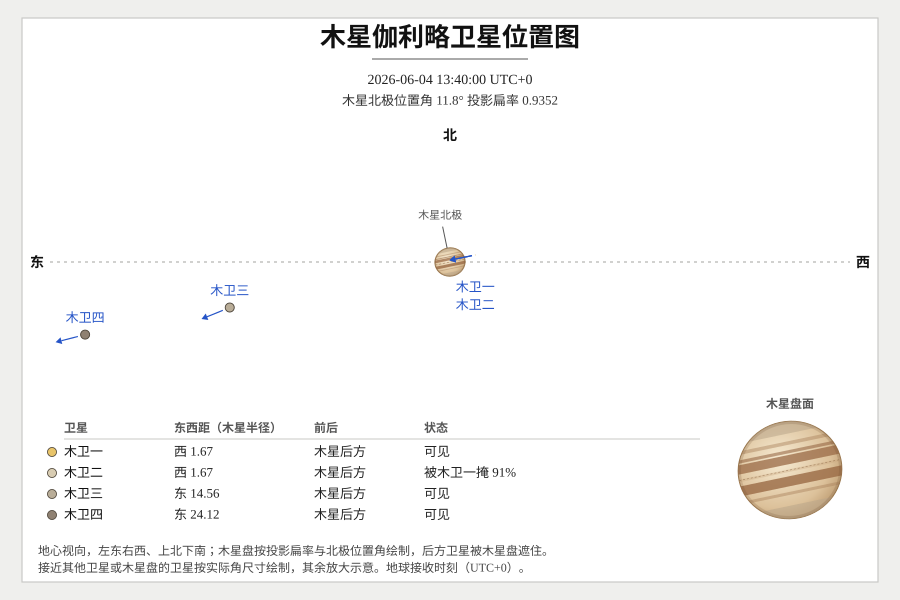
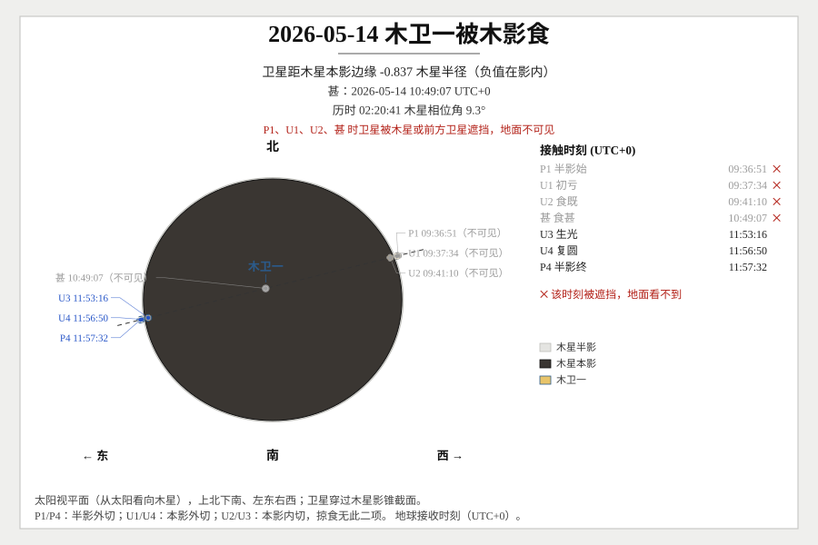
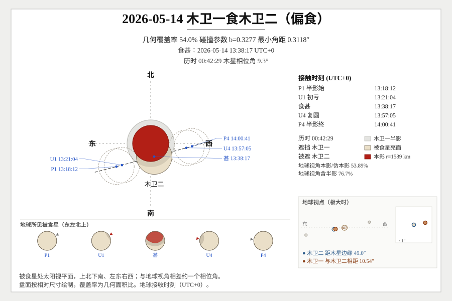

# 木星卫星 SVG

[English](en/jupiter-svg.md) | [行星手册](planets.md#木星伽利略卫星) | [返回 README](../../README.md)

`jupiter/svg` 渲染三类木星伽利略卫星矢量图：四卫星瞬时位置图、单星常规现象图（凌木、木掩、木影食、影凌）以及双星互掩/互食图。全部入口返回 `(string, bool)`，不依赖外部资源。

## 目录

- [入口概览](#入口概览)
- [1. 四卫星位置图（GalileanSystemSVG）](#1-四卫星位置图galileansystemsvg)
- [2. 常规卫星现象图（GalileanPhenomenonSVG）](#2-常规卫星现象图galileanphenomenonsvg)
- [3. 卫星互掩与互食图（GalileanMutualEventSVG）](#3-卫星互掩与互食图galileanmutualeventsvg)
- [选项与限制](#选项与限制)

## 入口概览

| 函数 | 用途 | 默认尺寸与比例 |
| --- | --- | --- |
| `GalileanSystemSVG` | 渲染指定时刻四颗伽利略卫星的相对构型与状态明细 | 900×600，主图放大卫星圆点以便辨识（`TrueScale: true` 切至真实角比例） |
| `GalileanPhenomenonSVG` | 渲染单次凌木、木掩、木影食或影凌的轨迹与接触时刻表 | 900×600，盘面恒按相对尺寸绘制 |
| `GalileanMutualEventSVG` | 渲染双星互掩或互食的盘面接触、影锥几何与时刻表 | 900×600，放大的影核在图中标注 |

画面采用肉眼面向木星时的天空方向：**上北下南、左东右西**；事件无效或参数不合法时返回 `ok == false`。

## 1. 四卫星位置图（`GalileanSystemSVG`）

渲染 2026-06-04 13:40 UTC 木星与四颗伽利略卫星的位置构型（该时刻木卫一正掩木卫二 91%）：

```go
package main

import (
	"log"
	"os"
	"time"

	jupitersvg "github.com/starainrt/astro/jupiter/svg"
)

func main() {
	date := time.Date(2026, 6, 4, 13, 40, 0, 0, time.UTC)
	svg, ok := jupitersvg.GalileanSystemSVG(date, jupitersvg.GalileanSystemSVGOptions{
		Location: time.UTC,
	})
	if !ok {
		log.Fatal("render failed")
	}
	if err := os.WriteFile("jupiter-system-2026-06-04.svg", []byte(svg), 0o644); err != nil {
		log.Fatal(err)
	}
}
```



图面说明：
- 灰色横虚线为天球东西基准（非木星赤道）；木星盘面按投影扁率与北极位置角绘制，蓝色箭头表示各卫星视运动方向。
- 接近其他卫星或木星盘的卫星自动按真实角尺寸绘制以避免假相叠，其余放大示意。
- 底部明细表列出各卫星的东西距（木星半径）、相对木星前后位置及当前可见/掩食状态，右下角附木星盘面放大示意。

## 2. 常规卫星现象图（`GalileanPhenomenonSVG`）

由 `jupiter.NextGalileanPhenomenonContactEvent` 获取接触事件后传入 `GalileanPhenomenonSVG`：

```go
package main

import (
	"log"
	"os"
	"time"

	"github.com/starainrt/astro/jupiter"
	jupitersvg "github.com/starainrt/astro/jupiter/svg"
)

func main() {
	date := time.Date(2026, 1, 15, 0, 0, 0, 0, time.UTC)
	event := jupiter.NextGalileanPhenomenonContactEvent(
		date,
		jupiter.GalileanSatelliteIo,
		jupiter.GalileanPhenomenonEclipse,
	)
	svg, ok := jupitersvg.GalileanPhenomenonSVG(event, jupitersvg.GalileanPhenomenonSVGOptions{
		Location: time.UTC,
	})
	if !ok {
		log.Fatal("render failed")
	}
	if err := os.WriteFile("jupiter-io-eclipse-2026.svg", []byte(svg), 0o644); err != nil {
		log.Fatal(err)
	}
}
```



图面说明：
- 阴影弧线表示木星影锥边界；底部时刻表给出消失（D）与再现（F）的起止及模型穿过时刻。
- `Transit`、`Occultation`、`Eclipse` 与 `ShadowTransit` 共用同一入口，标题、图例与底部说明随事件类型自动切换。木影食触发半影回退（`PenumbralFallback: true`）时，时刻表与页脚显式标注“半影边界”。

## 3. 卫星互掩与互食图（`GalileanMutualEventSVG`）

由 `jupiter.NextGalileanMutualEvent` 获取互现象后传入 `GalileanMutualEventSVG`：

```go
package main

import (
	"log"
	"os"
	"time"

	"github.com/starainrt/astro/jupiter"
	jupitersvg "github.com/starainrt/astro/jupiter/svg"
)

func main() {
	date := time.Date(2026, 6, 1, 0, 0, 0, 0, time.UTC)
	event := jupiter.NextGalileanMutualEvent(
		date,
		jupiter.GalileanSatelliteIo,
		jupiter.GalileanSatelliteEuropa,
		jupiter.GalileanMutualEclipse,
	)
	svg, ok := jupitersvg.GalileanMutualEventSVG(event, jupitersvg.GalileanMutualEventSVGOptions{
		Location: time.UTC,
	})
	if !ok {
		log.Fatal("render failed")
	}
	if err := os.WriteFile("jupiter-mutual-io-europa-eclipse-2026.svg", []byte(svg), 0o644); err != nil {
		log.Fatal(err)
	}
}
```



图面说明：
- 左侧为相对运动盘面图（互食绘出半影外圈与本影内圈，互掩绘出两星视圆盘），右侧与下方列出开始、食甚、结束时刻、最小角距、遮挡比例与基于 `GreatestState` 的可见性提示。

## 选项与限制

三个选项结构（`GalileanSystemSVGOptions`、`GalileanPhenomenonSVGOptions`、`GalileanMutualEventSVGOptions`）字段一致：

- `Width` / `Height`：画布尺寸，零值默认 `900×600`。
- `Title`：自定义主标题，留空时自动生成。
- `Language`：`"zh"`（默认中文）或 `"en"`（英文）。
- `Location`：显示时区，零值（`nil`）默认北京时间（UTC+8）。
- `TrueScale`：仅在 `GalileanSystemSVG` 中生效，设为 `true` 时按真实角尺寸比例绘制卫星盘面；在单星现象图与互现象图中不改变输出。
