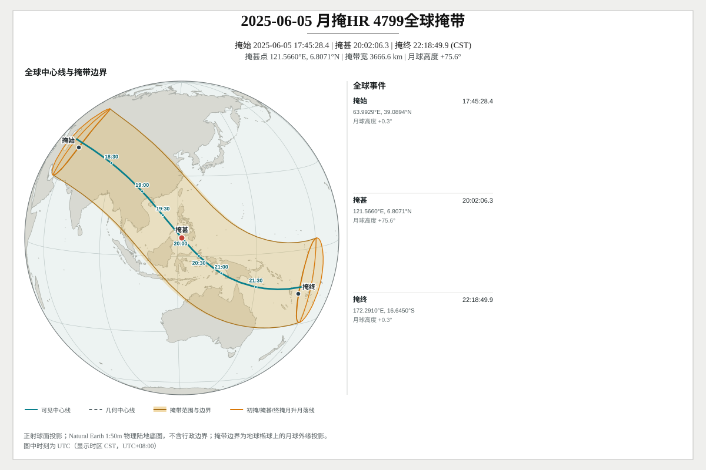
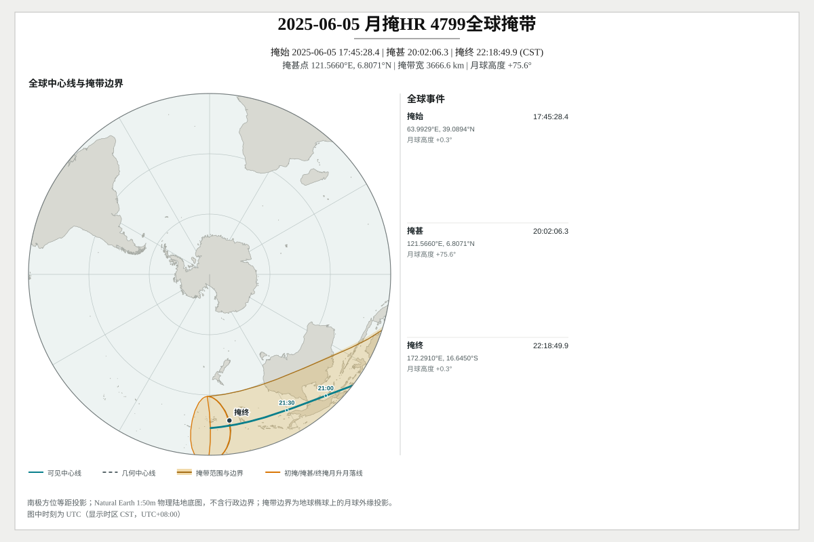
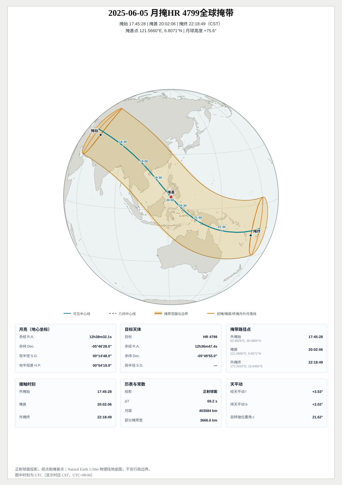
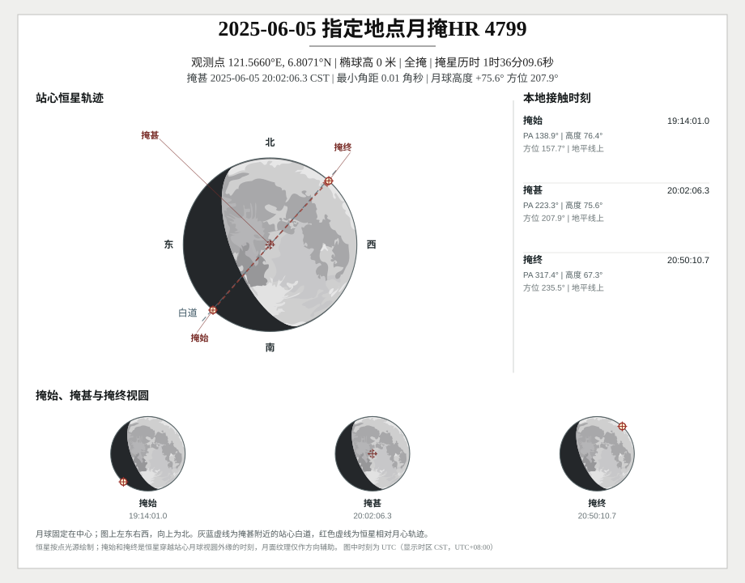
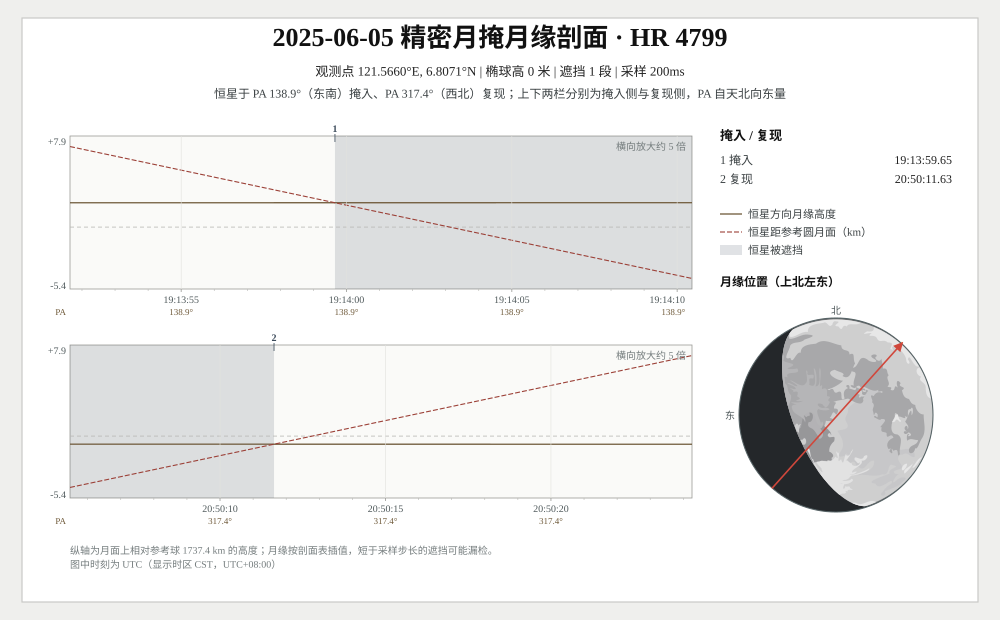

# 月掩

[English](en/occultation.md) | [返回 README](../../README.md)

`moon` 包提供恒星月掩与行星月掩的站心预报、全球掩带路径和单时刻足迹；`moon/svg` 渲染全球掩带图、一页详细版式、站心事件图以及基于 Kaguya 地形的精密月缘剖面图。

GeoJSON / KML 导出见[天象地图、GeoJSON 与 KML](map-geojson.md)；外挂星表见[恒星：外挂星表](star.md#外挂星表)。

## 目录

- [基本示例](#基本示例)
- [主要功能](#主要功能)
  - [构造恒星目标](#构造恒星目标)
  - [全球掩带路径与等时线](#全球掩带路径与等时线)
  - [月缘地形修正](#月缘地形修正)
  - [月掩出图](#月掩出图)
    - [全球掩带图与详细版式](#全球掩带图与详细版式)
    - [站心事件图](#站心事件图)
    - [精密月掩剖面图](#精密月掩剖面图)
- [API 概览](#api-概览)
- [约定与限制](#约定与限制)

## 基本示例

恒星按点光源求解（返回掩始 `Immersion`、掩甚 `Greatest`、掩终 `Emersion`）；行星按有限圆盘求解（返回外切 `C1/C4`，完全遮挡时另返回内切 `C2/C3`）：

```go
package main

import (
	"fmt"
	"log"
	"time"

	"github.com/starainrt/astro/moon"
)

func main() {
	cst := time.FixedZone("CST", 8*3600)

	// 恒星月掩：2025-06-05 月掩进贤增九（HR 4799）
	start := time.Date(2025, 6, 5, 0, 0, 0, 0, cst)
	target := moon.StarCoordinate{
		ID:                             "HR 4799",
		RA:                             189.1975,
		Dec:                            -5.831944444444,
		Epoch:                          time.Date(2000, 1, 1, 12, 0, 0, 0, time.UTC),
		Frame:                          moon.CoordinateFrameJ2000,
		ProperMotionRACosDecMasPerYear: -28,
		ProperMotionDecMasPerYear:      -18,
	}
	events, err := moon.FindStarOccultations(start, start.Add(24*time.Hour), target,
		121.56601, 6.80706, 0, moon.OccultationSearchOptions{})
	if err != nil {
		log.Fatal(err)
	}
	for _, e := range events {
		fmt.Printf("恒星月掩 %s (%s): 掩始 %s  掩甚 %s  掩终 %s  月高 %.1f°\n",
			e.TargetID, e.Type,
			e.Immersion.Format("15:04:05.0"), e.Greatest.Format("15:04:05.0"), e.Emersion.Format("15:04:05.0"),
			e.MoonAltitudeAtGreatest)
	}

	// 行星月掩：2025-02-01 月掩土星
	sStart := time.Date(2025, 2, 1, 0, 0, 0, 0, cst)
	pevs, err := moon.FindPlanetOccultations(sStart, sStart.Add(24*time.Hour), moon.OccultationSaturn,
		104.5222, 55.2540, 0, moon.OccultationSearchOptions{})
	if err != nil {
		log.Fatal(err)
	}
	for _, p := range pevs {
		fmt.Printf("月掩土星 (%s): C1 %s  C2 %s  掩甚 %s  C3 %s  C4 %s\n",
			p.Type, p.ExternalImmersion.Format("15:04:05"), p.InternalImmersion.Format("15:04:05"),
			p.Greatest.Format("15:04:05"), p.InternalEmersion.Format("15:04:05"), p.ExternalEmersion.Format("15:04:05"))
	}
}
```

输出：

```text
恒星月掩 HR 4799 (total): 掩始 19:14:03.1  掩甚 20:02:08.3  掩终 20:50:12.7  月高 75.6°
月掩土星 (total): C1 11:29:10  C2 11:29:41  掩甚 12:00:50  C3 12:32:47  C4 12:33:19
```

搜索窗口内无命中事件时返回空切片（无错误）。窗口按**掩甚时刻**筛选事件，命中后返回完整接触时刻（掩始与掩终可略超出查询端点）。

## 主要功能

### 构造恒星目标

月掩搜索本身不自动加载内置 9100 星表。构造 `moon.StarCoordinate` 有两种途径：
- **手工构造**：必填 `RA`（度）、`Dec`（度）、非零 `Epoch` 与 `Frame`（`CoordinateFrameJ2000`、`CoordinateFrameICRS` 或 `CoordinateFrameApparentOfDate`）。若输入为某时刻的瞬时视坐标，须同时设 `Frame: moon.CoordinateFrameApparentOfDate` 并将 `Epoch` 设为该时刻。
- **星表转换**：经 `star.StarDataByName` 获取记录后调用 `moon.StarCoordinateFromStarData`，或直接使用 `star/catalog` 外挂星表的 `entry.Coordinate`。

### 全球掩带路径与等时线

```go
paths, err := moon.FindStarOccultationPaths(start, start.Add(24*time.Hour), target,
	moon.OccultationPathOptions{
		Step:             5 * time.Minute,
		TargetSpacingKM:  200,
		GreatestTimeStep: 30 * time.Minute, // 可选：生成掩甚时刻等时线
	})
```

- 仅需全球几何掩甚点时使用 `FindBestStarOccultations` / `FindBestPlanetOccultations`；单时刻全球足迹使用 `StarOccultationFootprintAt` / `PlanetOccultationFootprintsAt`。
- 设 `DisableFootprints: true` 可跳过密集瞬时足迹并保留紧凑掩带与南北限；设 `Algorithm: moon.OccultationPathAlgorithmExact` 可在最终求解阶段全程使用全项星历而非 30 分钟节点插值。

### 月缘地形修正

导入 `github.com/starainrt/astro/moon/limb`，通过选项传入 `limb.Default()`（或经 `ctx.WithLunarLimb(limb.Default())` 统一配置），即可按月面地形剖面精修站心接触时刻与全球外接触南北界（通常为秒级与公里级修正）：

```go
import "github.com/starainrt/astro/moon/limb"

events, err := moon.FindStarOccultations(start, end, target, lon, lat, 0,
	moon.OccultationSearchOptions{LunarLimb: limb.Default()})
```

修正生效后结果中 `LunarLimbApplied` 为 `true`，传给 `moon/svg` 时页脚会自动标明口径。掠掩场景下需获取月缘山谷引发的全部遮挡段时，使用下文的 `StarOccultationLimbProfile`。

### 月掩出图

`moon/svg` 提供“搜索并渲染”（`Find*SVGs`）与“渲染已有结果”两类入口，均返回 `(string, error)` 或 `([]string, error)`。

#### 全球掩带图与详细版式

```go
globalSVG, err := moonsvg.StarOccultationPathSVG(paths[0], moonsvg.StarOccultationSVGOptions{
	Width: 1200, Height: 800, Location: cst,
	TimeLabelStep: 30 * time.Minute,
	Projection:    moonsvg.MapProjectionOrthographic,
})

detailedSVG, err := moonsvg.StarOccultationDetailedSVG(paths[0], target,
	moonsvg.OccultationDetailedSVGOptions{Width: 1000, Height: 1414, Location: cst})
```





#### 站心事件图

绘制指定观测点的月面方向、白道、相对星迹、接触时刻以及月球高度与方位：

```go
localSVGs, err := moonsvg.FindLocalStarOccultationSVGs(
	start, start.Add(24*time.Hour), target,
	121.56601, 6.80706, 0,
	moon.OccultationSearchOptions{},
	moonsvg.LocalStarOccultationSVGOptions{Width: 920, Height: 720, Location: cst},
)
```



#### 精密月掩剖面图

沿星迹逐点代入月缘地形剖面，检出全部遮挡区间（深掩为掩入与复现两段，掠掩可检出多段闪烁）并渲染剖面图：

```go
profile, err := moon.StarOccultationLimbProfile(events[0], target, limb.Default(),
	moon.StarOccultationLimbProfileOptions{Step: 200 * time.Millisecond})
if err != nil {
	log.Fatal(err)
}
profileSVG, err := moonsvg.StarOccultationLimbProfileSVG(profile,
	moonsvg.StarOccultationLimbProfileSVGOptions{Width: 1000, Height: 620, Location: cst})
```



横轴为时刻与月缘位置角，纵轴为相对参考圆月面的地形高度（km）；棕色实线为月缘高度，红色虚线为恒星距月心距离，阴影区间标示遮挡段。

## API 概览

| 分类 | 恒星入口 | 行星入口 | 说明 |
| --- | --- | --- | --- |
| 站心预报 | `FindStarOccultations` | `FindPlanetOccultations` | 行星常量：`OccultationMercury` … `OccultationNeptune` |
| 全球掩甚 / 路径 | `FindBestStarOccultations`、`FindStarOccultationPaths` | `FindBestPlanetOccultations`、`FindPlanetOccultationPaths` | 路径可交给 `moon/svg`、`geojson` 与 `kml` |
| 瞬时足迹与轨迹 | `StarOccultationFootprintAt`、`StarOccultationDiagram` | `PlanetOccultationFootprintsAt`、`PlanetOccultationDiagram` | 纯几何数据 |
| 精密月缘剖面 | `StarOccultationLimbProfile` / `...InUT1` | — | 须传入 `limb.Default()` 或上下文剖面 |
| SVG 出图（`moon/svg`） | `FindStarOccultationSVGs`、`StarOccultationPathSVG`、`StarOccultationDetailedSVG`、`FindLocalStarOccultationSVGs`、`LocalStarOccultationSVG`、`StarOccultationLimbProfileSVG` | 对应 `Planet` 版（无剖面图） | 返回 `(string / []string, error)` |

## 约定与限制

- **无折射接触**：接触时刻按站心几何求解，不含大气折射；`MoonAltitudeAtGreatest` 为月心真高度，`VisibleAtGreatest` 表示是否不低于几何地平线。
- **行星圆盘口径**：行星按赤道本体圆盘计算，不含行星环、大气延伸或扁率（土星环不参与接触判定）。
- **掠掩与掩带宽**：掠掩（`HasTotalBand == false`）可能无中心线，全球图仅绘制南北限。图中标注的“掩带宽”对应掩甚处南北限地面间距 `GreatestLimitSeparationKM`，与中心线横向宽度 `Greatest.WidthKM` 定义不同。
- **剖面采样步长**：`StarOccultationLimbProfile` 默认步长 200 ms（最小 10 ms），短于步长的掠掩闪烁可能漏检，掠掩应适当减小 `Step`。
- **画布下限与 UT1**：单独全球掩带图与剖面图最小 `640×480`，详细版式推荐 `1000×1414`（实测下限 `670×595`）。设置 `TimeScale: astro.TimeScaleUT1` 时 `Location` 须为 `nil` 或 `time.UTC`，否则返回错误；详见[时标声明](map-geojson.md#时标声明)。
