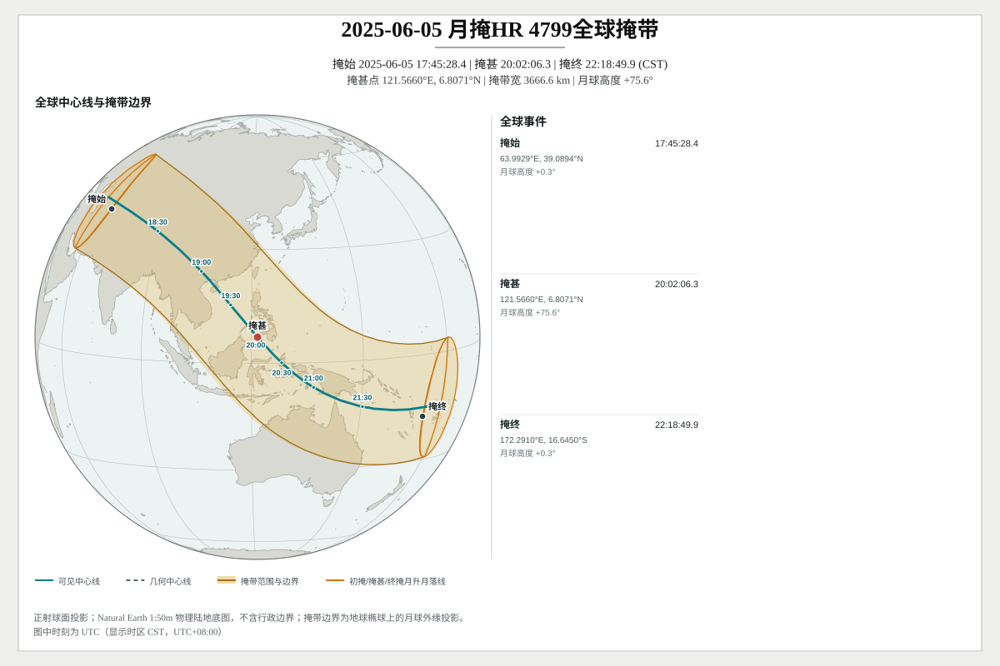
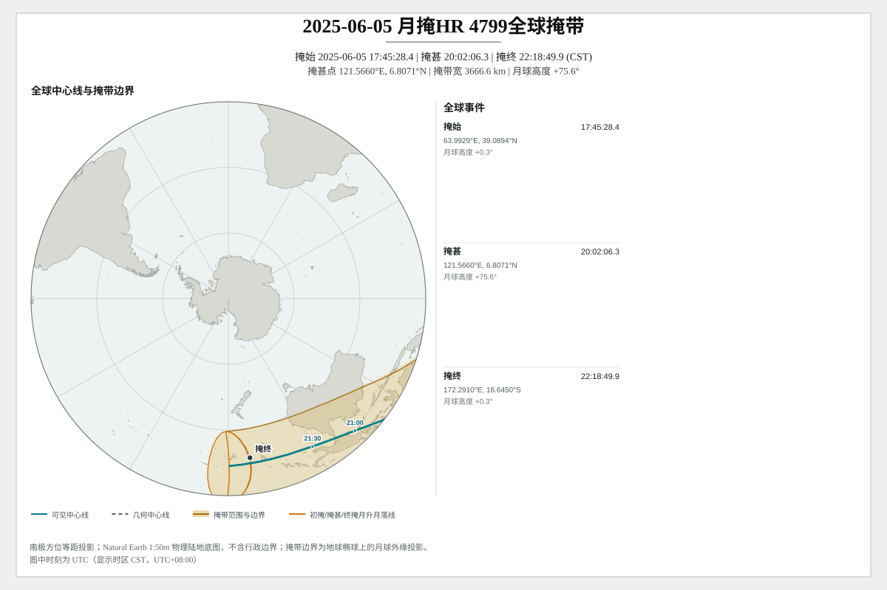
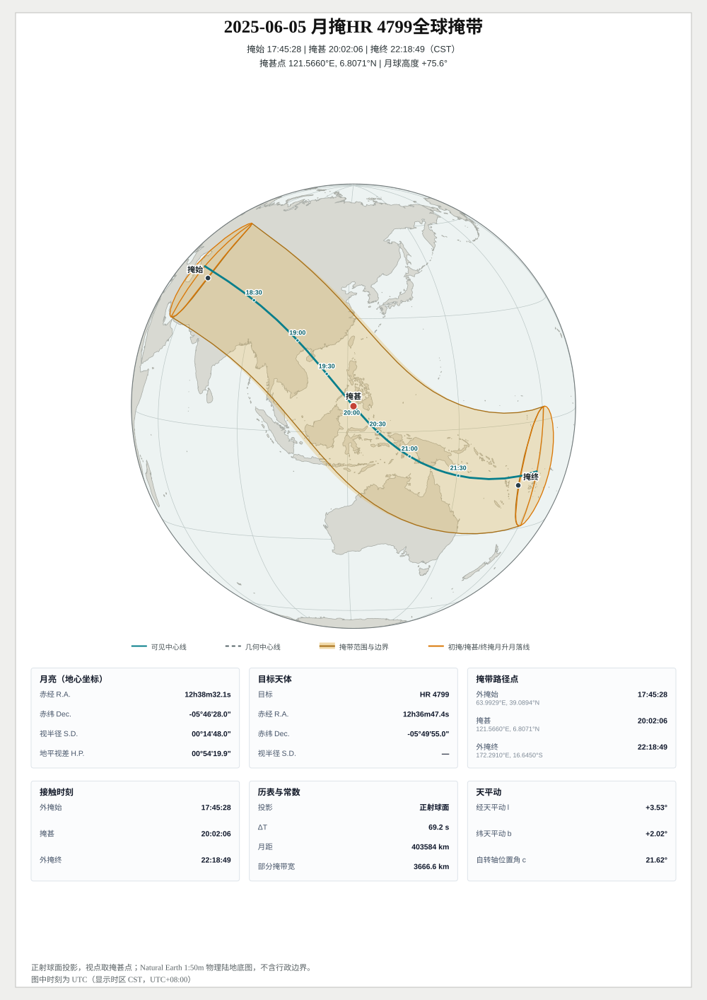
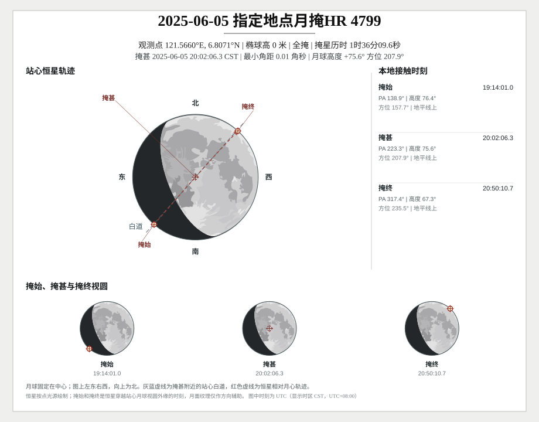

# 月掩

[English](en/occultation.md) | [返回 README](../../README.md)

月掩接口位于 `moon`，按用户给定的目标搜索，不会遍历恒星表（=-=可自行维护常见被掩星表）。固定地点接口直接接收 `start`、`end`、经度、纬度和椭球高；全球路径接口返回 WGS84 经纬度采样，可继续交给 `moon/svg` 或 `geojson`或`kml`处理。

目标和接触语义分为两类：

- **恒星**按点光源处理，返回掩始 `Immersion`、掩甚 `Greatest` 和掩终 `Emersion`。
- **行星**按有限圆盘处理(纯圆)，外切为 C1/C4，完全被月面覆盖时另有内切 C2/C3；偏掩和擦掩没有 C2/C3。行星半径取赤道本体半径，不含行星环、大气延伸和扁率。
- `FindBestStarOccultations` / `FindBestPlanetOccultations` 返回全球海平面几何掩甚点，不按地平线、月高、可见时长或食分评分；`VisibleAtGreatest` 仅报告该点的可见性。
- 搜索时间窗按掩甚时刻选择事件。命中后会返回完整接触时刻或完整全球路径，不会把结果裁剪到查询端点。
- 接触时刻按目标与月面边缘的站心几何求解，不加入大气折射。`MoonAltitudeAtGreatest` 是月心真高度，`VisibleAtGreatest` 表示它是否不低于几何地平线。

## 目录

- [简单示例：搜索指定地点的恒星月掩](#简单示例搜索指定地点的恒星月掩)
- [API 参考](#api-参考)
- [常用场景](#常用场景)
  - [某地今晚有没有月掩](#某地今晚有没有月掩)
  - [行星月掩与有限圆盘](#行星月掩与有限圆盘)
  - [全球掩带图与详细版式](#全球掩带图与详细版式)
  - [掠掩、等时线与掩带宽口径](#掠掩等时线与掩带宽口径)
- [恒星月掩](#恒星月掩)
  - [搜索与路径采样选项](#搜索与路径采样选项)
  - [路径算法与轮廓](#路径算法与轮廓)
  - [掩甚时刻等时线](#掩甚时刻等时线)
- [行星月掩](#行星月掩)
- [月掩出图](#月掩出图)
  - [全球掩带图](#全球掩带图)
  - [详细版式](#详细版式)
  - [站心事件图](#站心事件图)
  - [时标口径与 UT1](#时标口径与-ut1)

## 简单示例：搜索指定地点的恒星月掩

```go
package main

import (
	"fmt"
	"log"
	"time"

	"github.com/starainrt/astro/moon"
)

func main() {
	cst := time.FixedZone("CST", 8*3600)
	start := time.Date(2025, 6, 5, 0, 0, 0, 0, cst)
	end := start.AddDate(0, 0, 1)
	target := moon.StarCoordinate{
		ID: "HR 4799", RA: 189.1975, Dec: -5.831944444444,  // 室女座25，进贤增九 和它滴赤经赤纬
		Epoch:                          time.Date(2000, 1, 1, 12, 0, 0, 0, time.UTC), //赤经赤纬的历元信息，上面是J2000.0的坐标，若坐标是该时刻的视位置，必须同时把 Frame 设为 apparent_of_date
		Frame:                          moon.CoordinateFrameJ2000,//坐标系，可选 icrs / j2000 / apparent_of_date
		ProperMotionRACosDecMasPerYear: -28, //赤经方向自行，毫角秒/年
		ProperMotionDecMasPerYear:      -18, //赤纬方向自行，毫角秒/年
		// 距离可选：不给就退回二维自行；给了DistanceLightYear（或ParallaxMas）就走三维空间运动，
		// 此时RadialVelocityKmPerSecond才参与计算，不填按径向速度为0处理。
	}
	events, err := moon.FindStarOccultations(start, end, target,
		121.56601, 6.80706, 0, moon.OccultationSearchOptions{})
	if err != nil {
		log.Fatal(err)
	}
	if len(events) == 0 {
		fmt.Println("no occultation in this window")
		return
	}
	for _, event := range events {
		fmt.Println(event.Type, event.Immersion, event.Greatest, event.Emersion)
	}
}
```

空切片表示搜索窗内没有命中事件，是正常结果。搜索按掩甚时刻归属窗口，返回的掩始、掩终可能在窗口之外。

## API 参考

后续片段沿用首例的目标与搜索窗口。SVG 调用使用导入别名 `moonsvg "github.com/starainrt/astro/moon/svg"`。

| 名称 | 用途 | 备注 |
| --- | --- | --- |
| `moon.FindStarOccultations` / `FindStarOccultationPaths` | 恒星月掩事件 / 全球路径 | 目标为 `moon.StarCoordinate` |
| `moon.FindPlanetOccultations` / `FindPlanetOccultationPaths` | 行星月掩事件 / 全球路径 | 按有限圆盘求解 |
| `moon.StarCoordinateFromStarData` | 由内置星表构造目标 | 需先加载星表 |
| `moonsvg.FindStarOccultationSVGs` / `FindPlanetOccultationSVGs` | 搜索并渲染全球图 | 返回 `([]string, error)` |
| `moonsvg.FindLocalStarOccultationSVGs` / `FindLocalPlanetOccultationSVGs` | 搜索并渲染站心图 | 同上 |
| `moonsvg.StarOccultationPathSVG` / `PlanetOccultationPathSVG` | 渲染已有全球路径 | 返回 `(string, error)` |
| `moonsvg.StarOccultationDetailedSVG` / `PlanetOccultationDetailedSVG` | 一页详细版式 | 固定正射球面 |
| `moonsvg.StarOccultationSVGOptions` / `moonsvg.OccultationDetailedSVGOptions` | 出图选项（画布、投影、时标、标记步长） | 投影用 `MapProjection*`，时标用 `astro.TimeScale*` |
| `moon.OccultationMercury` … `moon.OccultationNeptune` | 行星目标常量 | 传给行星入口 |
| `moon.OccultationSearchOptions` / `moon.OccultationPathOptions` | 搜索与路径选项 | 路径选项含 `Step`、`TargetSpacingKM`、`GreatestTimeStep` |


## 常用场景

| 场景列表 | 入口 | 返回 |
| --- | --- | --- |
| 某地某晚有没有月掩 | `moon.FindStarOccultations(start, end, star, lon, lat, height, searchOptions)` | `[]moon.StarOccultationInfo` |
| 全球几何掩甚点 | `moon.FindBestStarOccultations(start, end, star, searchOptions)` | `[]moon.StarOccultationInfo` |
| 全球掩带几何 | `moon.FindStarOccultationPaths(start, end, star, pathOptions)` | `[]moon.StarOccultationPath` |
| 某一时刻的全球可见足迹 | `moon.StarOccultationFootprintAt(at, star)` | `moon.StarOccultationInstant` |
| 搜索并一步出全球掩带图 | `moonsvg.FindStarOccultationSVGs(start, end, star, pathOptions, svgOptions)` | `([]string, error)` |
| 已有路径只渲染 | `moonsvg.StarOccultationPathSVG(path, svgOptions)` | `(string, error)` |
| 一页详细版式 | `moonsvg.StarOccultationDetailedSVG(path, star, detailedOptions)` | `(string, error)` |
| 搜索并出指定地点的站心图 | `moonsvg.FindLocalStarOccultationSVGs(start, end, star, lon, lat, height, searchOptions, localOptions)` | `([]string, error)` |
| 渲染已有的固定地点事件 | `moonsvg.LocalStarOccultationSVG(info, star, localOptions)` | `(string, error)` |
| 只要站心轨迹几何数据（不出图） | `moon.StarOccultationDiagram(info, star, diagramOptions)` | `moon.StarOccultationDiagramResult` |
| 交给 GIS | `geojson.MarshalStarOccultation(path)` / `MarshalStarOccultationWithTimeMarkers(path, markerOptions)` / `MarshalStarOccultationFootprint(instant)` | `([]byte, error)` |


### 某地今晚有没有月掩

```go
events, err := moon.FindStarOccultations(start, end, target, 121.56601, 6.80706, 0, moon.OccultationSearchOptions{})
if err != nil {
	panic(err)
}
for _, e := range events {
	fmt.Println(e.Type, e.Immersion.Format("15:04:05.000"),
		e.Greatest.Format("15:04:05.000"), e.Emersion.Format("15:04:05.000"))
}
```

```text
total 19:14:01.071 20:02:06.314 20:50:10.715
```

- `FindStarOccultations` 给站心接触时刻：`Immersion`（掩始）、`Greatest`（掩甚）、`Emersion`（掩终）；`Type` 区分全掩与掠掩。
- 目标既可以直接给赤经赤纬，也可以先加载内置星表再用 `moon.StarCoordinateFromStarData` 转换；**搜索本身不加载星表**，只有调用星表接口时才加载。
- 只要全球结果、不要某地接触时，用 `FindStarOccultationPaths` 一步拿到路径。

### 行星月掩与有限圆盘

```go
start := time.Date(2025, 2, 1, 0, 0, 0, 0, cst)
events, err := moon.FindPlanetOccultations(start, start.Add(24*time.Hour), moon.OccultationSaturn,
	104.52219613, 55.25401991, 0, moon.OccultationSearchOptions{})
if err != nil {
	panic(err)
}
for _, e := range events {
	fmt.Println(e.TargetID, e.Type, e.HasInternalContacts)
	fmt.Println(e.ExternalImmersion.Format("2006-01-02 15:04:05.000 MST"), e.InternalImmersion.Format("2006-01-02 15:04:05.000 MST"))
	fmt.Println(e.Greatest.Format("2006-01-02 15:04:05.000 MST"), e.InternalEmersion.Format("2006-01-02 15:04:05.000 MST"), e.ExternalEmersion.Format("2006-01-02 15:04:05.000 MST"))
}
```

```text
Saturn total true
2025-02-01 11:29:09.710 CST 2025-02-01 11:29:40.069 CST
2025-02-01 12:00:48.747 CST 2025-02-01 12:32:46.415 CST 2025-02-01 12:33:18.312 CST
```

行星按**有限圆盘**求解接触：`HasInternalContacts` 为真时才有 C2/C3（内切），`OccultationPlanet` 决定圆盘半径；土星环既不参与接触计算、也不作为圆盘边界绘制。

### 全球掩带图与详细版式

```go
paths, err := moon.FindStarOccultationPaths(start, end, target,
	moon.OccultationPathOptions{Step: 5 * time.Minute, TargetSpacingKM: 200})
if err != nil {
	panic(err)
}
if len(paths) == 0 {
	fmt.Println("no occultation path")
	return
}
svg, err := moonsvg.StarOccultationPathSVG(paths[0], moonsvg.StarOccultationSVGOptions{
	Width: 1200, Height: 800, Location: cst, Projection: moonsvg.MapProjectionSouthPolar,
})
detailed, detailErr := moonsvg.StarOccultationDetailedSVG(paths[0], target,
	moonsvg.OccultationDetailedSVGOptions{Width: 1000, Height: 1414, Location: cst})
fmt.Println(err, len(svg), detailErr, len(detailed))
```

```text
<nil> 120119 <nil> 633489
```

- 掩带图返回 `(string, error)`，四档投影与日食图一致；详细版式固定正射球面、不接受其它投影，版面随画布长宽自动推导。
- 只渲染已有路径用 `StarOccultationPathSVG`；"搜索 + 渲染"一步到位用 `FindStarOccultationSVGs`（见上方两条链）。
- 画布下限：单独掩带图 `640×480`；详细版宽度下限是 `480`，但整幅版式实测要 `670×595` 以上才放得下地图、数据块与页脚，低于下限直接返回错误。


### 掠掩、等时线与掩带宽口径

- **掠掩没有中心线**：`HasTotalBand` 为假时全球图只画南北限，此情形不要假设存在中心线。
- **掩带宽口径**：图上标注的"掩带宽"是掩甚处南北限的地面间距 `GreatestLimitSeparationKM`（HR 4799 示例约 `3666.6 km`），与中心线横向宽度 `Greatest.WidthKM`（约 `3582.4 km`）口径不同、不可互换。
- **等时线**：要在路径层显式请求 `moon.OccultationPathOptions.GreatestTimeStep`；`moon/svg` 只绘制路径结果里已有的 `GreatestTimeContours`，位置由核心口径决定（对齐 UTC 整刻度）。
- **UT1 口径**：`TimeScale: astro.TimeScaleUT1` 出 UT1 读数与 DUT1 差值，此时 `Location` 必须为 UTC，配非 UTC 时区直接返回错误而不是画错图。

## 恒星月掩

> 图内与图注的时标声明见[时标声明](map-geojson.md#时标声明)。

恒星由调用者传入 `StarCoordinate`。`RA` / `Dec` 单位为度，`Epoch` 和 `Frame` 必填；自行单位为 `mas/year`，其中 `ProperMotionRACosDecMasPerYear` 使用星表常见的 `dRA*cos(Dec)` 口径。


| 字段 | 类型 | 零值 | 合法范围与报错 | 作用 |
| --- | --- | --- | --- | --- |
| `ID` | `string` | `""` | 无限制 | 展示标签，出现在结果和图题里，不参与任何计算 |
| `RA` | `float64` | — | 必填，`[0, 360)`，否则 `ErrInvalidOccultationInput` | 赤经，单位**度**（不是时分秒） |
| `Dec` | `float64` | — | 必填，`[-90, 90]` | 赤纬，单位度，北正南负 |
| `Epoch` | `time.Time` | `time.Time{}` | 零值报错 | 上面两个角度所属的历元时刻，比如J2000.0 |
| `Frame` | `moon.CoordinateFrame` | `""` | 只认 `icrs` / `j2000` / `apparent_of_date`，空值报错 | 参考系，见下 |
| `ProperMotionRACosDecMasPerYear` | `float64` | `0` | 必须是有限值 | 赤经方向自行，**mas/年**，口径是 `dRA·cos(Dec)` |
| `ProperMotionDecMasPerYear` | `float64` | `0` | 必须是有限值 | 赤纬方向自行，mas/年 |
| `ParallaxMas` | `float64` | `0` | 必须有限且 ≥ 0 | 周年视差，mas；`0` 表示未提供距离，此时退回二维自行并跳过视差修正 |
| `DistanceLightYear` | `float64` | `0` | 必须有限且 ≥ 0 | 距离，光年；`ParallaxMas` 的替代输入，仅当视差为 `0` 时生效 |
| `RadialVelocityKmPerSecond` | `float64` | `0` | 必须有限且 \|v\| ≤ 1000 | 径向速度，km/s；`0` 合法，只在距离已知时参与三维空间运动 |

距离的两种给法满足一条优先级：`ParallaxMas > 0` 时以它为准，否则由 `DistanceLightYear` 折算视差。给距离即启用三维空间运动；不给距离时自行只推进赤经赤纬两个角分量，`RadialVelocityKmPerSecond` 不参与。

`Epoch` 与 `Frame` 的额外说明：

- `j2000`：坐标是 J2000.0 平位置，`Epoch` 填 `2000-01-01 12:00 UTC`。库内岁差起点硬编码为 J2000.0，`Epoch` 只决定自行从哪一年开始外推；把非 J2000 历元填进来会让自行重复计一段。
- `icrs`：坐标是 ICRS 星表位置，先过一次 ~17 mas 的框架偏差矩阵；`Epoch` 填星表历元（Hipparcos `1991.25`、Gaia `2016.0`）。
- `apparent_of_date`：坐标是**该时刻的视位置**（已含岁差、章动、光行差），`Epoch` 必须填那一刻；库会在该时刻反解回平位置再向前传播。直接从星图软件（如stellarium）显示的"当前坐标"时使用这个参数。


可以直接构造坐标：

```go
target := moon.StarCoordinate{
	ID:                             "HR 4799",
	RA:                             189.1975,
	Dec:                            -5.831944444444,
	Epoch:                          time.Date(2000, 1, 1, 12, 0, 0, 0, time.UTC),
	Frame:                          moon.CoordinateFrameJ2000,
	ProperMotionRACosDecMasPerYear: -28,
	ProperMotionDecMasPerYear:      -18,
}
```

也可以显式加载内置 9100 星表，再用 `StarCoordinateFromStarData` 转换。月掩搜索本身不会加载星表；只有调用 `star.InitStarDatabase`、`StarDataByName`、`StarDataByHR` 等星表接口时才会加载。

```go
package main

import (
	"fmt"
	"time"

	"github.com/starainrt/astro/moon"
	"github.com/starainrt/astro/star"
)

func main() {
	cst := time.FixedZone("CST", 8*3600)
	start := time.Date(2025, 6, 5, 0, 0, 0, 0, cst)
	end := start.Add(24 * time.Hour)

	if err := star.InitStarDatabase(); err != nil {
		panic(err)
	}
	data, err := star.StarDataByName("进贤增九")
	if err != nil {
		panic(err)
	}
	target, err := moon.StarCoordinateFromStarData(data)
	if err != nil {
		panic(err)
	}

	events, err := moon.FindStarOccultations(
		start, end, target,
		121.56601, 6.80706, 0,
		moon.OccultationSearchOptions{},
	)

	if err != nil {
		panic(err)
	}
	for _, event := range events {
		fmt.Println(event.TargetID, event.Type)
		fmt.Println(
			event.Immersion.Format("2006-01-02 15:04:05.000 MST"),
			event.Greatest.Format("2006-01-02 15:04:05.000 MST"),
			event.Emersion.Format("2006-01-02 15:04:05.000 MST"),
		)
		fmt.Printf("altitude=%.3f visible=%v\n", event.MoonAltitudeAtGreatest, event.VisibleAtGreatest)
	}

	paths, err := moon.FindStarOccultationPaths(
		start, end, target,
		moon.OccultationPathOptions{Step: 5 * time.Minute, TargetSpacingKM: 200},
	)

	if err != nil {
		panic(err)
	}
	for _, path := range paths {
		fmt.Println(
			path.Start.Time.Format("2006-01-02 15:04:05.000 MST"),
			path.Greatest.Time.Format("2006-01-02 15:04:05.000 MST"),
			path.End.Time.Format("2006-01-02 15:04:05.000 MST"),
		)
		fmt.Printf("greatest=%.6f %.6f width=%.1fkm center=%d\n",
			path.Greatest.Longitude, path.Greatest.Latitude,
			path.Greatest.WidthKM, len(path.CenterLine))
	}
}
```

输出结果：

```text
进贤增九 total
2025-06-05 19:14:01.076 CST 2025-06-05 20:02:06.311 CST 2025-06-05 20:50:10.721 CST
altitude=75.561 visible=true
2025-06-05 17:45:28.475 CST 2025-06-05 20:02:06.300 CST 2025-06-05 22:18:49.945 CST
greatest=121.566009 6.807079 width=3582.4km center=108
```

### 搜索与路径采样选项

`OccultationSearchOptions` 的零值采用默认步长和安全余量，`MaxEvents > 0` 限制返回数量。全球路径的采样由 `OccultationPathOptions` 控制：

| 字段 | 作用 |
| --- | --- |
| `Step` | 基础时间步长 |
| `TargetSpacingKM` | 按地面距离加密中心线；请求超出采样预算时返回 `ErrOccultationPathSamplingLimit` |
| `RiseSetStep` | 六类初掩、掩甚、终掩月升/月落阶段线的步长，零值为 5 分钟 |
| `DisableRiseSet` | 跳过六类升落阶段线 |
| `DisableFootprints` | 跳过密集瞬时足迹，以稀疏支撑样本生成紧凑掩带；保留中心线、边界和升落阶段线 |
| `IncludeFootprintTimeline` | 在紧凑掩带之外保留瞬时足迹序列 |
| `FootprintTimelineStep` | 上述瞬时足迹序列的采样步长 |

`GreatestLimitSeparationKM` 是结果中掩甚处南北限的地面间距，图中的“掩带宽”使用该值。它与 `Greatest.WidthKM` 定义不同，不能互换。

### 路径算法与轮廓

`OccultationPathOptions.Algorithm` 控制恒星和行星全球路径的星历分支：零值或 `moon.OccultationPathAlgorithmOptimized` 默认使用经抽检的 30 分钟节点矢量插值，保留现有站心方程、连续包络和升落曲线；`moon.OccultationPathAlgorithmExact` 在候选筛选时可使用插值，最终求解使用全项星历。优化分支在抽检不合格时回退到全项求解，超出插值时间窗时使用精确星历。

抽检不是全时段严格误差证明；两个分支的几何目标相同，但不保证采样点或 GeoJSON 字节完全相同。此选项不影响仅查询事件、指定站点接触或独立单时刻月影接口，也不影响日月食。

两个分支的全球起止、掩甚标记和中心线宽度均保留全项星历计算。绘图时应传入完整返回路径，包括可见性轮廓；丢弃该轮廓会调用瞬时足迹回退逻辑，其边界不能替代完整解析可见集。

路径中的 `BandContours` 是静态掩带的接触包络，`VisibilityContours` 是月亮处于地平线以上时的可见时间包络；两者与 `Footprints` 的瞬时采样分别承担静态边界、可见性边界和时间轴细节，不应互相替代。

### 掩甚时刻等时线

`OccultationPathOptions.GreatestTimeValues` / `GreatestTimeStep` 请求**掩甚时刻等时线**。与日食不同，`GreatestTimeValues []float64` 给的是力学时儒略日，最多保留 64 条（先去掉重复的时刻取值，按时间先后排序，超出时保留最早的 64 条），掩可见窗口之外或没有可用支路的时刻取值不会出现在结果里；它为空时改用 `GreatestTimeStep`，同样只在为正值时生效，且对齐到 UTC 整刻度。

结果写入 `StarOccultationPath.GreatestTimeContours`（行星路径是同名字段），元素类型 `OccultationGreatestTimeContour` 的 `JDE`、`Time`、`Segments` 与日食同义：`Time` 在按步长生成时是原始对齐时刻，显式给出的时刻取值则由 `JDE` 换算并抹到毫秒，两者都落在 UTC 时区，而支路点的时刻仍按路径时区；日食公共层的 `Time` 则直接落在输入时区。

边界口径同样一致：只出现在目标盘面与月面确有重叠且月亮在几何地平以上（不含蒙气差与半径修正）的地方，两端止于地平线或掩可见域边界，纬度 ±88° 以上不再延拓，同一时刻可能有多条互不相连的支路；不请求时既有输出不变。

```go
options := moon.OccultationPathOptions{
	Algorithm: moon.OccultationPathAlgorithmExact, // 最终求解使用全项星历
	DisableFootprints: true,
}
```

## 行星月掩

行星目标使用 `OccultationMercury` 到 `OccultationNeptune` 常量。下面以 `2025-02-01` 月掩土星为例，在靠近全球几何掩甚点的位置求 C1-C4：

```go
package main

import (
	"fmt"
	"time"

	"github.com/starainrt/astro/moon"
)

func main() {
	cst := time.FixedZone("CST", 8*3600)
	start := time.Date(2025, 2, 1, 0, 0, 0, 0, cst)
	events, err := moon.FindPlanetOccultations(
		start, start.Add(24*time.Hour), moon.OccultationSaturn,
		104.52219613, 55.25401991, 0,
		moon.OccultationSearchOptions{},
	)
	if err != nil {
		panic(err)
	}
	for _, event := range events {
		fmt.Println(event.TargetID, event.Type, event.HasInternalContacts)
		fmt.Println(event.ExternalImmersion.Format("2006-01-02 15:04:05.000 MST")) // C1
		fmt.Println(event.InternalImmersion.Format("2006-01-02 15:04:05.000 MST")) // C2
		fmt.Println(event.Greatest.Format("2006-01-02 15:04:05.000 MST"))
		fmt.Println(event.InternalEmersion.Format("2006-01-02 15:04:05.000 MST")) // C3
		fmt.Println(event.ExternalEmersion.Format("2006-01-02 15:04:05.000 MST")) // C4
	}
}
```

输出结果：

```text
Saturn total true
2025-02-01 11:29:09.710 CST
2025-02-01 11:29:40.069 CST
2025-02-01 12:00:48.747 CST
2025-02-01 12:32:46.415 CST
2025-02-01 12:33:18.312 CST
```

`FindPlanetOccultationPaths` 的全球结果同时包含任意圆盘重叠的部分掩区域和整颗行星被遮住的全掩区域。`HasTotalBand` 表示是否存在全掩带，`GreatestTotalWidthKM` 是掩甚处全掩带宽；中心线、边界和启用时的瞬时足迹都带采样时刻。

## 月掩出图

`moon/svg` 分“搜索并渲染”和“渲染已计算结果”两组入口：

| 入口 | 用途 |
| --- | --- |
| `FindStarOccultationSVGs` / `FindPlanetOccultationSVGs` | 搜索窗口内全部月掩，逐事件渲染全球掩带图 |
| `StarOccultationPathSVG` / `PlanetOccultationPathSVG` | 渲染已有的全球路径（`Find...Paths` 的返回值） |
| `StarOccultationDetailedSVG` / `PlanetOccultationDetailedSVG` | 一页详细版式 |
| `FindLocalStarOccultationSVGs` / `FindLocalPlanetOccultationSVGs` | 指定地点的站心月面轨迹、白道与接触阶段图 |
| `LocalStarOccultationSVG` / `LocalPlanetOccultationSVG` | 渲染已有的固定地点事件 |

`eclipse/svg` 的入口返回 `(string, bool)`，`moon/svg` 的入口返回 `(string, error)` 或 `([]string, error)`：月掩侧的第二个返回值是真正的错误（UT1 配非 UTC 时区、画布低于下限、路径非法），不是“画不出来”的标志。恒星按点光源处理，行星按有限圆盘处理：行星月掩的接触时刻由圆盘与月缘的几何求解，`OccultationPlanet` 决定圆盘半径；土星环既不参与接触计算、也不作为圆盘边界绘制。

掠掩（`HasTotalBand` 为假）可以整条没有中心线，此时全球图只画南北限。点源恒星按日月中心角距定食甚，有限盘面行星按外接触度量，分别与 `StarOccultationInfo.Greatest`、`PlanetOccultationInfo.Greatest` 同口径。

### 全球掩带图

`MapProjection` 提供与日食图一致的四档投影。投影只影响 SVG 表达，不改变底层 WGS84 地理结果：

| 选项 | 说明 |
| --- | --- |
| `MapProjectionAuto`（零值） | 按事件自动选择，高纬事件可能落到极图 |
| `MapProjectionEquirectangular` | 等经纬，跨反经线的长掩带最直观 |
| `MapProjectionNorthPolar` / `MapProjectionSouthPolar` | 极点居中的方位等距投影 |
| `MapProjectionOrthographic` | 正射球面，视点取事件中心，只画朝向视点的半球 |

正射球面版（`2025-06-05` 月掩 HR 4799）：

```go
paths, err := moon.FindStarOccultationPaths(start, end, target,
	moon.OccultationPathOptions{Step: 5 * time.Minute, TargetSpacingKM: 200})
if err != nil || len(paths) == 0 {
	return
}
svg, err := moonsvg.StarOccultationPathSVG(paths[0], moonsvg.StarOccultationSVGOptions{
	Width: 1200, Height: 800, Location: cst,
	TimeLabelStep: 30 * time.Minute,
	Projection:    moonsvg.MapProjectionOrthographic,
})
if err != nil {
	return
}
fmt.Println(len(svg))
```



同一路径改为南极投影，掩带落在高纬时比等经纬更清楚：

```go
south, err := moonsvg.StarOccultationPathSVG(paths[0], moonsvg.StarOccultationSVGOptions{
	Width: 1200, Height: 800, Location: cst,
	TimeLabelStep: 30 * time.Minute,
	Projection:    moonsvg.MapProjectionSouthPolar,
})
if err != nil {
	return
}
```



把搜索与渲染合成一步时用 `Find...SVGs`，返回切片与命中事件一一对应：

```go
svgs, err := moonsvg.FindStarOccultationSVGs(start, end, target,
	moon.OccultationPathOptions{Step: 5 * time.Minute, TargetSpacingKM: 200},
	moonsvg.StarOccultationSVGOptions{Width: 1200, Height: 800, Location: cst})
fmt.Println(err, len(svgs))
```

`TimeLabelStep` 的零值为 30 分钟，负值关闭中心线上的时刻标记。单独的全球掩带地图最小 `640×480`，更小的画布返回 `ErrInvalidStarOccultationSVGOptions`（行星入口对应 `ErrInvalidPlanetOccultationSVGOptions`）；图例、页脚与经纬刻度都按画布高度预留，画布越矮越容易压到页脚；本手册的南极示例用 `1200×800` 即可。

### 详细版式

详细版式把整场月掩合成一页 `1000×1414`：居中摘要、日月与目标天体的地心/站心数据块、一张**正射球面**的全球掩带图（南北限、可见/几何中心线、掩甚点、初掩/掩甚/终掩阶段点与 30 分钟时间标记），以及页脚说明。球面视点取事件中心，这一版式固定用正射球面，不接受其它投影；只需要单独的掩带地图时用上面的 `StarOccultationPathSVG` / `FindStarOccultationSVGs`。

```go
detailed, err := moonsvg.StarOccultationDetailedSVG(paths[0], target,
	moonsvg.OccultationDetailedSVGOptions{Width: 1000, Height: 1414, Location: cst})
if err == nil {
	_ = os.WriteFile("doc/img/lunar-occultation-hr4799-2025-06-05-detailed.svg", []byte(detailed), 0o644)
}
```



页内数据分为月亮地心坐标、目标天体、掩带路径点、接触时刻、历表与常数、天平动六块；横版画布把数据块排在地图右侧两栏三行，竖版把数据块排在球面下方三栏两行。球面掩带图使用 Natural Earth `1:50m` 海岸线，不含行政边界。

详细版按画布推导版式，实测最小画布 `670×595`（宽度下限 `480` 只是参数校验）：地图与数据块放不下时返回 `ErrInvalidOccultationDetailedSVGOptions`（`800×600`、`1000×1414`、`1414×1000` 均可出图，`660×600`、`800×590`、`640×420`、`900×400` 会被拒绝）。

图上标注的“掩带宽”是掩甚处南北限的地面间距 `GreatestLimitSeparationKM`（HR 4799 样例约 `3666.6 km`），与中心线横向宽度 `Greatest.WidthKM`（约 `3582.4 km`）口径不同、不可互换。

掩甚时刻等时线要在路径层显式请求 `moon.OccultationPathOptions.GreatestTimeStep`：`moon/svg` 自身不提供开关，只绘制路径结果里已有的 `GreatestTimeContours`，因此请求必须在计算路径时提出，线的位置也由核心口径决定（`GreatestTimeStep` 对齐 UTC 整刻度；要按展示时区对齐，就先换算成力学时儒略日再传给 `GreatestTimeValues`）。

月掩的全球可见窗口通常只有数小时（HR 4799 样例为 4 小时 33 分），常用间隔比日食更密，为 15–30 分钟量级。使用 `DisableFootprints` 的紧凑掩带首次渲染会合并一次，之后同一路径走缓存。

### 站心事件图

```go
localSVGs, err := moonsvg.FindLocalStarOccultationSVGs(
	start, end, target,
	121.56601, 6.80706, 0,
	moon.OccultationSearchOptions{},
	moonsvg.LocalStarOccultationSVGOptions{Width: 920, Height: 720, Location: cst},
)
fmt.Println(err, len(localSVGs))
```

本地图按指定观测者的站心几何绘制，下图沿用前文 `2025-06-05` 月掩进贤增九（HR 4799）的样例。局地图的观测点为 `121.56601°E, 6.80706°N`，靠近全球几何掩甚点；图中的掩始、掩甚和掩终是该地点实际看到的站心接触时刻，并同时给出月面方向、白道、月高、方位和地平可见性。



### 时标口径与 UT1

月掩图默认按 UTC 口径出图并图内声明；`TimeScale: astro.TimeScaleUT1` 出 UT1 读数与 `DUT1 = UT1−UTC` 差值，此时 `Location` 必须是 UTC，配非 UTC 时区会直接返回错误而不是画错图。

GeoJSON 导出（`MarshalStarOccultation*` / `MarshalPlanetOccultation*` 的 `TimeMarkerOptions.TimeScale`）遵守同一契约：UT1 口径写 `time_scale` 成员、把全部 `time` 属性换成 UT1 读数，几何保持不变。完整约定见[时标声明](map-geojson.md#时标声明)。
