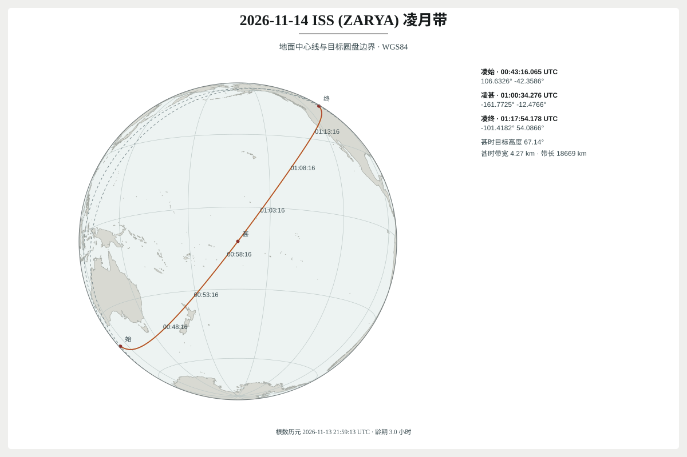
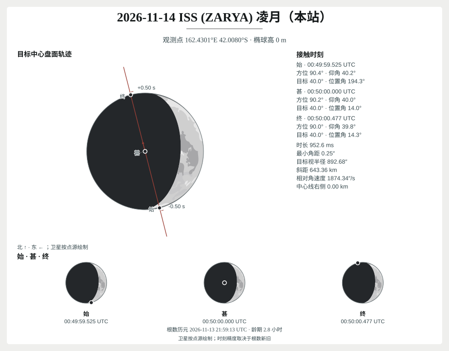
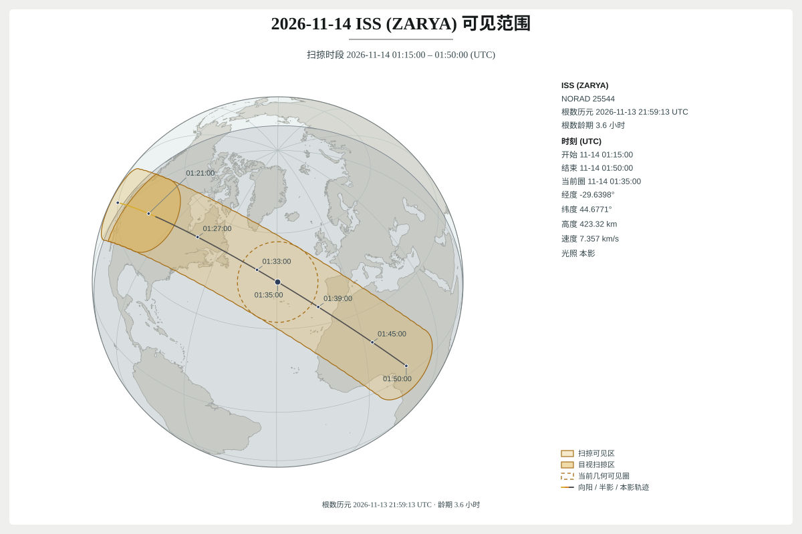
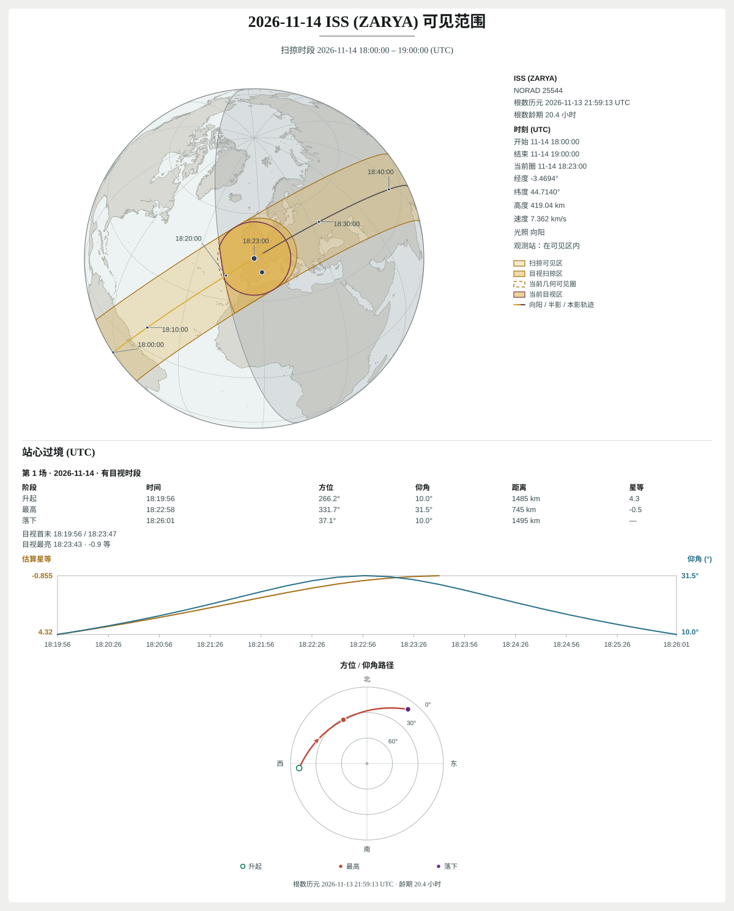

# 卫星凌现象与覆盖 SVG

[English](en/satellite-svg.md) | [人造卫星](satellite.md) | [GeoJSON / KML](map-geojson.md#人造卫星图层) | [返回 README](../../README.md)

`satellite/svg` 渲染三类人造卫星矢量图：全球凌日/凌月带地图、站心盘面凌现象图以及地面可见覆盖范围图（可选附本站过境表）。底图海岸线内置，无需外部瓦片。

## 目录

- [入口概览](#入口概览)
- [1. 凌月带地图（TransitMapSVG）](#1-凌月带地图transitmapsvg)
- [2. 本站凌月盘面图（TransitLocalSVG）](#2-本站凌月盘面图transitlocalsvg)
- [3. 地面可见范围图（CoverageSVG）](#3-地面可见范围图coveragesvg)
- [4. 覆盖范围图附本站过境表](#4-覆盖范围图附本站过境表)
- [选项与限制](#选项与限制)

## 入口概览

几何计算与矢量渲染分离：先由 `satellite` 求得结构化几何，再传入对应绘图函数。

| 函数 | 输入 | 默认 / 最小尺寸 |
| --- | --- | --- |
| `TransitMapSVG` | `satellite.TransitEventPath` 返回的全球凌带路径 | 1200×800 / 640×480 |
| `TransitLocalSVG` | `satellite.TransitFrames` 返回的站心盘面轨迹帧 | 920×720 / 640×520 |
| `CoverageSVG` | `satellite.CoverageBetween` 返回的覆盖扫掠结果 | 1200×800 / 640×480 |

以下示例共用同一份国际空间站（ISS）两行根数 `iss`（历元 2026-11-13 21:59 UTC）：

```go
elements, err := satellite.ParseTLEText([]byte(`ISS (ZARYA)
1 25544U 98067A   26317.91612726  .00008668  00000+0  16320-3 0  9995
2 25544  51.6324 279.1461 0007381  22.6178 337.5134 15.49359724594966`))
if err != nil {
	log.Fatal(err)
}
iss := elements[0]
```

## 1. 凌月带地图（`TransitMapSVG`）

渲染 2026-11-14 00:40–01:20 UTC 期间 ISS 凌月带的全球分布：

```go
start := time.Date(2026, 11, 14, 0, 40, 0, 0, time.UTC)
events, err := satellite.TransitEvents(iss, start, start.Add(40*time.Minute),
	satellite.TransitSearchOptions{Targets: []satellite.TransitTarget{satellite.TransitMoon}})
if err != nil || len(events) == 0 {
	log.Fatal(err)
}
path, err := satellite.TransitEventPath(iss, events[0], time.Second)
if err != nil {
	log.Fatal(err)
}
image, err := satellitesvg.TransitMapSVG(path, satellitesvg.TransitMapSVGOptions{
	Projection: satellitesvg.MapProjectionOrthographic,
	Location:   time.UTC,
})
if err != nil {
	log.Fatal(err)
}
_ = os.WriteFile("satellite-transit-map-iss-moon-2026-11-14.svg", []byte(image), 0o644)
```



图面说明：
- 浅黄狭带为地面凌月可见带，深红线与箭头指示中心线及行进方向。
- 在 `TransitMapSVGOptions` 中补充 `Observer` 与 `Nearby`（由 `satellite.NearbyTransits` 计算），可在图上标注观测站点及局部放大框。
- 查询窗口截断凌带（`event.Complete == false`）时，右侧面板会标明“被查询窗口截断”。

## 2. 本站凌月盘面图（`TransitLocalSVG`）

渲染中心线上观测点看到的 ISS 凌月盘面轨迹与接触信息：

```go
observer := satellite.Observer{
	Longitude: events[0].GreatestPoint.Longitude,
	Latitude:  events[0].GreatestPoint.Latitude,
}
transits, err := satellite.Transits(iss, observer, events[0].Start.Add(-time.Minute), events[0].End.Add(time.Minute),
	satellite.TransitOptions{Targets: []satellite.TransitTarget{satellite.TransitMoon}})
if err != nil || len(transits) == 0 {
	log.Fatal(err)
}
track, err := satellite.TransitFrames(iss, observer, transits[0], 50*time.Millisecond)
if err != nil {
	log.Fatal(err)
}
image, err := satellitesvg.TransitLocalSVG(track, satellitesvg.TransitLocalSVGOptions{
	Location: time.UTC,
})
if err != nil {
	log.Fatal(err)
}
_ = os.WriteFile("satellite-transit-local-iss-moon-2026-11-14.svg", []byte(image), 0o644)
```



图面说明：
- 盘面按天球方向绘制（北 ↑、东 ←）；凌月同步渲染当前月相，卫星标记带白色外描边以在暗月面上保持清晰。
- 实线表示凌过盘面，近掠（`NearMiss: true`）绘制为虚线；右侧列出始/甚/终接触时刻、持续时长与最小角距，下方附三阶段盘面小图。

## 3. 地面可见范围图（`CoverageSVG`）

渲染 2026-11-14 01:15–01:50 UTC 期间 ISS（仰角 ≥ 10°）的几何扫掠区、目视可见扫掠区以及指定 `Highlight` 时刻的瞬时可见圈与夜区：

```go
start := time.Date(2026, 11, 14, 1, 15, 0, 0, time.UTC)
sweep, err := satellite.CoverageBetween(iss, start, start.Add(35*time.Minute), time.Minute,
	satellite.CoverageOptions{MinElevation: 10})
if err != nil {
	log.Fatal(err)
}
image, err := satellitesvg.CoverageSVG(sweep, satellitesvg.CoverageSVGOptions{
	Projection: satellitesvg.MapProjectionOrthographic,
	Location:   time.UTC,
	Highlight:  start.Add(20 * time.Minute), // 须匹配 sweep.Instants 中的采样时刻
})
if err != nil {
	log.Fatal(err)
}
_ = os.WriteFile("satellite-coverage-iss-2026-11-14.svg", []byte(image), 0o644)
```



图面说明：
- 浅黄区域为时段内几何可见扫掠并集，两端深色区域为目视可见扫掠并集（站点处于夜区且卫星向阳）。
- 空心虚线圆与灰色阴影分别为 `Highlight` 时刻（01:35:00）的瞬时可见圈与夜区（默认太阳高度 ≤ `-6°`）；本例该时刻 ISS 处于本影中，因此无当前目视填充。

## 4. 覆盖范围图附本站过境表

在 `CoverageSVGOptions` 中传入 `Observer` 与 `Passes`（由 `satellite.Passes` 及 `LookAt` 采样构造），即可在地图下方追加站心过境表、星等/仰角曲线与方位—仰角极坐标天图：

```go
start := time.Date(2026, 11, 14, 18, 0, 0, 0, time.UTC)
end := start.Add(time.Hour)
station := satellite.Observer{Latitude: 40}

sweep, err := satellite.CoverageBetween(iss, start, end, 10*time.Second, satellite.CoverageOptions{MinElevation: 10})
if err != nil {
	log.Fatal(err)
}
stdMag := 0.0
// 关闭大气折射，与覆盖圈保持同一几何仰角门限
look := satellite.ObserveOptions{NoRefraction: true, StandardMagnitude: &stdMag}
passes, _, err := satellite.Passes(iss, station, start, end, satellite.PassOptions{
	ObserveOptions: look,
	MinElevation:   10,
})
if err != nil {
	log.Fatal(err)
}

details := make([]satellitesvg.CoveragePass, len(passes))
for i, pass := range passes {
	details[i].Pass = pass
	details[i].Samples = append(details[i].Samples, pass.Rise)
	for at := pass.Rise.Time.Add(15 * time.Second); at.Before(pass.Set.Time); at = at.Add(15 * time.Second) {
		if sample, err := satellite.LookAt(iss, station, at, look); err == nil {
			details[i].Samples = append(details[i].Samples, sample)
		}
	}
	if pass.Set.Time.After(pass.Rise.Time) {
		details[i].Samples = append(details[i].Samples, pass.Set)
	}
}

image, err := satellitesvg.CoverageSVG(sweep, satellitesvg.CoverageSVGOptions{
	Projection: satellitesvg.MapProjectionOrthographic,
	Location:   time.UTC,
	Observer:   &station,
	Passes:     details,
	Highlight:  start.Add(23 * time.Minute),
})
if err != nil {
	log.Fatal(err)
}
_ = os.WriteFile("satellite-coverage-iss-station-2026-11-14.svg", []byte(image), 0o644)
```



图面说明：
- 下方左图绘制估算星等（金褐，向上更亮）与仰角（蓝绿）曲线；卫星进入地影后星等中断而仰角继续。
- 下方右图为方位—仰角极坐标图（上北右东、外圈 0° 地平线、圆心 90° 天顶；空心绿圈为升起、实心红点为最高、实心紫点为落下）。
- `Passes == nil` 时省略过境表；传入非 `nil` 空切片时显示“本时段无过境”。

## 选项与限制

- **投影选项**：地面图（`TransitMapSVG`、`CoverageSVG`）支持 `MapProjectionAuto`（默认）、`MapProjectionEquirectangular`、`MapProjectionNorthPolar`、`MapProjectionSouthPolar` 与 `MapProjectionOrthographic`。
- **语言与标签**：均支持 `Language`（`"zh"` / `"en"`）与 `Location`；`CoverageSVGOptions.TimeLabelStep` 为零时自动选取间距，为负时隐藏轨迹时刻标签。
- **配色差异**：SVG 覆盖图使用浅黄/深黄系区分几何与目视层；GeoJSON / KML 默认配色为几何层蓝色、目视层青绿色。
- **采样步长**：目视区跨越晨昏线时，建议将 `CoverageBetween` 步长设为 `10–30 s` 以减弱边界台阶。
